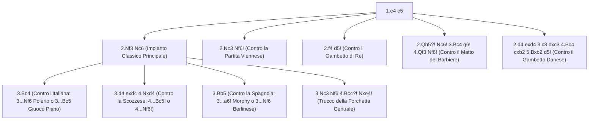

[[Home MOC|Home]] / [[Education & Learning]] / [[Classical 1...e5]]

# Classical 1...e5

## Sintesi Esecutiva

<mark style="background:rgba(255, 193, 69, 0.32)"><b>Classical 1...e5</b></mark> (definita dall'impianto madre `1.e4 e5 2.Nf3 Nc6`) rappresenta la spina dorsale storica e didattica della teoria degli scacchi. Tutti i più grandi istruttori sovietici e moderni (da Botvinnik a Kasparov) concordano sul fatto che nessun giocatore possa padroneggiare le aperture semichiuse o ipermoderne senza aver prima forgiato la propria comprensione nelle **Partite Aperte** (`1.e4 e5`). Giocare `1...e5 2.Nf3 Nc6` insegna tre abilità insostituibili: l'arte della <mark style="background:rgba(255, 193, 69, 0.32)"><b>difesa simmetrica</b></mark> del centro, la <mark style="background:rgba(255, 193, 69, 0.32)"><b>neutralizzazione metodica dei gambetti</b></mark> e la <mark style="background:rgba(181, 113, 255, 0.36)"><b>resilienza tattica</b></mark> sotto il fuoco nemico. Nella fascia `750 – 1600+` ELO, dove gli avversari tentano costantemente attacchi rapidi su `f7`, trappole di Donna e sacrifici di pedone, un repertorio classico solido su `1...e5` trasforma l'aggressività prematura del Bianco in un boomerang.

| Parametro Tecnico | Dettaglio Strategico |
| :--- | :--- |
| **Nome Difesa** | Classical 1...e5 (*Partite Aperte Simmetriche* — Codici ECO `C20–C99`) |
| **Contro** | `1.e4` |
| **Mosse Iniziali** | `1.e4 e5 2.Nf3 Nc6` |
| **Lezione Primaria** | Difesa simmetrica, neutralizzazione dei gambetti, resilienza tattica |
| **Fascia ELO Ideale** | `750 – 1600+` (ed estendibile fino ai massimi livelli mondiali con Berlinese/Marshall) |

---

## 1. Filosofia di `1.e4 e5 2.Nf3 Nc6`: Il Presidio Classico del Centro

Perché rispondere a `1.e4` con **`1...e5`** seguito da **`2...Nc6`** su `2.Nf3`?

1. **Parità immediata di spazio centrale**: Collocando il pedone in `e5`, il Nero impedisce al Bianco di costruire gratuitamente la coppia di pedoni `d4 + e4` e controlla le case critiche `d4` e `f4`.
2. **Sviluppo rapido verso il centro**: `2...Nc6` difende `e5` sviluppando un pezzo minore sulla sua casa più attiva e tenendo sotto controllo sia `d4` sia `e5`.
3. **La Bussola Antipanico del Nero**: In quasi tutte le Partite Aperte, il segreto del Nero per passare dalla difesa al contrattacco risiede nel preparare la spinta centrale liberatoria **`...d5!`**, che liquida il pedone bianco `e4` e apre le linee per i pezzi neri.

![[chess_e5_01_tabiya.svg]]

---

## 2. Come Difendersi Contro le 3 Grandi Aperture Classiche del Bianco

Dopo `1.e4 e5 2.Nf3 Nc6`, il Bianco sceglie quasi sempre una tra [[The Italian Game]] (`3.Bc4`), [[The Scotch Game]] (`3.d4`) e [[The Ruy Lopez]] (`3.Bb5`). Ecco lo scudo teorico completo per il Nero.

### 2.1 Contro la Partita Italiana (`3.Bc4`)

Il Nero dispone di due sistemi complementari, entrambi solidissimi:

#### Sistema A: La Difesa dei Due Cavalli (`3...Nf6`) con la Variante Polerio (`5...Na5!`)
Se vuoi subito contrattaccare il pedone `e4`, gioca **`3...Nf6`**:
- Se il Bianco gioca tranquillo con `4.d3`, rispondi **`4...Bc5 5.c3 d6 6.O-O a6!`** (creando il rifugio `...Ba7` per l'Alfiere camposcuro) seguito da `...O-O`, `...h6` e `...Re8` con parità assoluta.
- Se il Bianco lancia l'attacco critico **`4.Ng5`** su `f7`, la sequenza da conoscere a memoria è:
  **`4...d5! 5.exd5 Na5!`** (*Difesa Polerio*).

![[chess_e5_02_two_knights_polerio.svg]]

> [!CAUTION] Regola Salvavita nei Due Cavalli: MAI Giocare `5...Nxd5?!`
> Giocare `5...Nxd5?!` permette al Bianco il devastante sacrificio **Attacco Fegatello (`6.Nxf7! Kxf7 7.Qf3+ Ke6`)** o l'Attacco Lolli (`6.d4!`).
> Giocando invece **`5...Na5!`**, il Nero attacca subito l'Alfiere italiano in `c4`! Dopo **`6.Bb5+ c6 7.dxc6 bxc6 8.Be2 h6 9.Nf3 e4! 10.Ne5 Bd6!`**, i Cavalli bianchi vengono scacciati all'indietro mentre il Nero domina il centro e tutte le diagonali!

#### Sistema B: Il Giuoco Piano (`3...Bc5`) e la Liberazione `8...d5!`
Se preferisci sviluppare prima l'Alfiere, gioca **`3...Bc5`**:
- Contro l'Attacco Centrale **`4.c3 Nf6 5.d4 exd4 6.cxd4`**, ricorda di dare **SEMPRE scacco con `6...Bb4+!`** (mai ritirarsi passivamente in `b6`!).
- Se il Bianco gioca `7.Bd2`, segui la sequenza liberatoria: **`7...Bxd2+ 8.Nbxd2 d5! 9.exd5 Nxd5 10.Qb3 Nce7 11.O-O O-O`**, dove il Nero ha liquidato il centro bianco e controlla saldamente la casa di blocco `d5`!

![[chess_e5_03_giuoco_piano_d5.svg]]

- Se invece dopo `6...Bb4+` il Bianco gioca il Gambetto Greco/Moeller **`7.Nc3`**, cattura il pedone centrale con **`7...Nxe4! 8.O-O Bxc3!`** (mai `8...Nxc3?! 9.bxc3 Bxc3 10.Qb3!`) e dopo `9.d5` gioca **`9...Bf6! 10.Re1 Ne7 11.Rxe4 d6!`** gevolto da `...O-O`, spegnendo l'attacco bianco.
- **Come neutralizzare il Gambetto Evans (`4.b4!?`)**:
  Accetta il pedone con `4...Bxb4 5.c3` e ritira l'Alfiere in **`5...Ba5!`**; poi su `6.d4` non essere avido (`6...exd4`), ma gioca la solida **`6...d6! 7.O-O Bb6!`** (*Difesa Lasker*): l'Alfiere in `b6` difende `f7` come una roccia e prepara di restituire il pedone con `...Bg4` ottenendo un finale eccellente.

---

### 2.2 Contro la Partita Scozzese (`3.d4`)

Quando il Bianco gioca `3.d4`, il Nero **deve** catturare **`3...exd4!`** (mai giocare `3...d6?`) e dopo `4.Nxd4` non deve mai cambiare i Cavalli con `4...Nxd4?! 5.Qxd4!`. Le due risposte maestre sono:
1. **Variante Classica (`4...Bc5!`)**: Attacca due volte `d4`. Sulla risposta bianca `5.Be3!`, ricorda che l'unica mossa corretta per difendere `c5` e premere su `d4` è **`5...Qf6!`** (mai `5...Nf6?? 6.Nxc6!`). Dopo `6.c3 Nge7 7.Bc4 O-O 8.O-O Ne5 9.Be2 d5!`, il Nero realizza la spinta liberatoria `...d5!` con gioco pari.
2. **Variante Schmidt (`4...Nf6!`)**: Su `5.Nxc6 bxc6 6.e5`, gioca **sempre `6...Qe7!`** (inchiodando `e5`) seguito da **`7.Qe2 Nd5 8.c4 Ba6!`**, inchiodando il pedone `c4` sulla Donna bianca in `e2`!

---

### 2.3 Contro la Partita Spagnola / Ruy Lopez (`3.Bb5`)

Contro `3.Bb5`, il Nero interroga subito l'Alfiere con **`3...a6!`**:
- **Se il Bianco cambia (`4.Bxc6`)**: Riprendi **sempre verso il centro con il pedone `d` (`4...dxc6!`)**, liberando entrambi gli Alfieri (`c8` e `f8`). Ricorda che se il Bianco cattura subito `5.Nxe5?`, vinci il pedone con gli interessi grazie a **`5...Qd4!`** (forchetta su `e5` ed `e4`). Su `5.O-O`, difendi `e5` solidamente con **`5...f6!`** o **`5...Bd6!`**.
- **Se il Bianco ritira (`4.Ba4`)**: Sviluppa **`4...Nf6 5.O-O Be7 6.Re1 b5 7.Bb3 d6 8.c3 O-O`**, mantenendo la fortezza spagnola (oppure gioca l'aggressiva Variante di Arcangelo con `5...b5 6.Bb3 Bc5!`).

---

## 3. L'Arte di Neutralizzare i Gambetti: La Regola Universale `...d5!`

Nella fascia `750 – 1600` ELO, molti giocatori col Bianco evitano `2.Nf3` per lanciare gambetti romantici. Il segreto universale per neutralizzarli tutti consiste nel **contrattaccare al centro con `...d5!`**:

### 3.1 Contro il Gambetto Viennese (`1.e4 e5 2.Nc3 Nf6! 3.f4`)
- Come visto in [[The Vienna Game]], **non accettare mai con `3...exf4?!`** (che permette `4.e5! Ng8`).
- Colpisci subito al centro con **`3...d5! 4.fxe5 Nxe4!`**:
  - Su `5.Qf3`, gioca `5...Nc6! 6.Bb5 Nxc3 7.dxc3 Qh4+! 8.g3 Qe4+!`, forzando il cambio delle Donne e spegnendo ogni velleità d'attacco del Bianco!
  - Su `5.Nf3`, sviluppa `5...Be7 6.d4 O-O 7.Bd3 f5!`, bloccando l'ala di Re.

### 3.2 Contro il Gambetto di Re (`1.e4 e5 2.f4`)
- Il modo più semplice e pratico per togliere l'iniziativa al Bianco è il **Controgambetto Falkbeer (`2...d5!`)**:
  `3.exd5 e4!` (oppure `3...exf4 4.Nf3 Nf6! 5.Bc4 Nxd5`): il pedone nero in `e4` toglie la casa naturale `f3` al Cavallo bianco e permette al Nero uno sviluppo fulmineo con `...Nf6` e `...Bc5`.

### 3.3 Contro il Gambetto Danese (`1.e4 e5 2.d4 exd4 3.c3 dxc3 4.Bc4 cxb2 5.Bxb2`)
Il Bianco sacrifica due pedoni per puntare entrambi gli Alfieri (`b2` e `c4`) contro il lato di Re del Nero. Se il Nero cerca di tenersi i due pedoni di vantaggio passivamente, viene travolto.
- **L'Antidoto Magistrali di Schlechter (`5...d5!`)**:
  Restituisci immediatamente uno dei pedoni per aprire le linee dei tuoi pezzi e forzare il cambio delle Donne:
  **`5...d5! 6.Bxd5 Nf6! 7.Bxf7+ Kxf7 8.Qxd8 Bb4+! 9.Qd2 Bxd2+ 10.Nxd2 Re8!`**
  *(Esattamente il meccanismo tattico della Trappola dell'Elefante: lo scacco `8...Bb4+!` recupera subito la Donna in `d8` lasciando il Nero in un finale comodissimo!)*

---

## 4. Le Mosse Più Ingannevoli, Trappole e Contro-Trappole

### Trappola 1: Il Trucco della Forchetta Centrale (`...Nxe4!` seguito da `...d5!`)

È l'arma tattica più utile in assoluto per chi gioca `1...e5`: ogni volta che il Bianco sviluppa i due Cavalli e l'Alfiere in `c4` senza aver spinto `d3` (ad esempio nella *Partita dei Quattro Cavalli Italiana*: `1.e4 e5 2.Nf3 Nc6 3.Nc3 Nf6 4.Bc4?!`), il Nero può eseguire il falso sacrificio **`4...Nxe4!`**:

![[chess_e5_04_center_fork_trick.svg]]

- **Come funziona**:
  - Se il Bianco riprende `5.Nxe4`, il Nero gioca **`5...d5!`**, attaccando contemporaneamente l'Alfiere in `c4` e il Cavallo in `e4`! Dopo `6.Bd3 dxe4 7.Bxe4 Bd6 8.O-O O-O`, il Nero ha eliminato il pedone centrale `e4` del Bianco, ha la coppia degli Alfieri e un centro superiore già alla sesta mossa!
  - Se il Bianco prova a essere furbo con `5.Bxf7+? Kxf7 6.Nxe4`, il Nero gioca comunque **`6...d5! 7.Neg5+ Kg8`**, ottenendo un centro di pedoni mostruoso (`d5 + e5`) e la coppia degli Alfieri contro il Re bianco senza pezzi sviluppati!

---

### Trappola 2: Come Punire il Matto del Barbiere / Attacco di Donna (`2.Qh5?!`)

Tra `750` e `1200` ELO, moltissimi giocatori tentano il **Matto del Barbiere (`1.e4 e5 2.Qh5?!` seguito da `3.Bc4`)**.
- **Il grave errore da NON commettere mai alla seconda mossa**: Non giocare `2...g6??`, perché `3.Qxe5+!` dà scacco al Re in `e8` e mangia la Torre in `h8`!
- **La Sequenza Chirurgica Perfetta per il Nero**:
  1. **`2...Nc6!`**: Prima difendi il pedone centrale `e5` sviluppando un pezzo!
  2. **`3.Bc4`** (il Bianco minaccia `4.Qxf7#`).
  3. **`3...g6!`**: Ora che `e5` è difeso dal Cavallo in `c6`, `3...g6!` blocca l'attacco su `f7` attaccando la Donna bianca!
  4. **`4.Qf3`** (il Bianco rinnova la minaccia di matto `5.Qxf7#`).
  5. **`4...Nf6!`**: Sviluppa il secondo Cavallo bloccando la colonna `f`!

![[chess_e5_05_scholars_mate_refutation.svg]]

- **Come il Nero passa al contrattacco**:
  Alla mossa successiva il Nero prepara **`...Nd4!`** (attaccando la Donna in `f3` e il punto `c2`, minacciando la forchetta reale `...Nxc2+` su Re e Torre `a1`!) e fianchetta l'Alfiere in `g7` (`...Bg7`), trasformando l'uscita prematura della Donna bianca in un disastro posizionale per il Bianco.

---

### Trappola 3: Il Gambetto Rousseau (`3...f5?!`) e la Trappola del Matto di Légal da Evitare

Un consiglio fondamentale di disciplina difensiva in `Classical 1...e5`:
- Evita di giocare passivamente `3...d6` seguito da `4...Bg4?` prima di aver sviluppato il Cavallo di Re in `f6` e l'Alfiere in `e7`/`c5`. Come analizzato in [[The Italian Game]], la sequenza `1.e4 e5 2.Nf3 Nc6 3.Bc4 d6 4.Nc3 Bg4? 5.h3 Bh5?` permette al Bianco il sacrificio di Donna **`6.Nxe5! Bxd1?? 7.Bxf7+ Ke7 8.Nd5#`** (*Matto di Légal*). Sviluppa sempre prima **`3...Bc5`** o **`3...Nf6`**!

---

## 5. Riepilogo Operativo e Checklist Difensiva per il Nero

| Apertura / Attacco del Bianco | Risposta Solida Consigliata per il Nero | Punto Chiave da Ricordare |
| :--- | :--- | :--- |
| **`3.Bc4`** (*Partita Italiana*) | `3...Nf6` (Due Cavalli) oppure `3...Bc5` (Giuoco Piano) | Su `3...Nf6 4.Ng5 d5 5.exd5`, gioca **`5...Na5!`** (mai `5...Nxd5?!`) |
| **`3.d4`** (*Partita Scozzese*) | `3...exd4! 4.Nxd4 Bc5! 5.Be3 Qf6!` (o `4...Nf6!`) | Su `5.Be3`, gioca **solo `5...Qf6!`** (mai `5...Nf6?? 6.Nxc6!`) |
| **`3.Bb5`** (*Partita Spagnola*) | `3...a6! 4.Ba4 Nf6 5.O-O Be7` | Su `4.Bxc6`, riprendi **`4...dxc6!`** (e su `5.Nxe5?`, gioca `5...Qd4!`) |
| **`2.Nc3 Nf6 3.f4`** (*Viennese*) | `3...d5! 4.fxe5 Nxe4` | Non accettare `3...exf4?! 4.e5!`; su `3.Bc4` usa `3...Nxe4!` |
| **`2.d4 exd4 3.c3`** (*Gambetto Danese*) | `3...dxc3 4.Bc4 cxb2 5.Bxb2 d5!` | Difesa Schlechter: `6.Bxd5 Nf6 7.Bxf7+ Kxf7 8.Qxd8 Bb4+!` |
| **`2.Qh5?!`** (*Matto del Barbiere*) | `2...Nc6! 3.Bc4 g6! 4.Qf3 Nf6!` | Prima difendi `e5` con `2...Nc6!`, poi mura `f7` con `...g6` e `...Nf6` |
