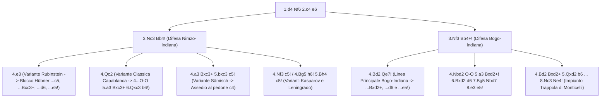

[[Home MOC|Home]] / [[Education & Learning]] / [[Nimzo - Bogo-Indian]]

# Nimzo - Bogo-Indian

## Sintesi Esecutiva

Il complesso <mark style="background:rgba(255, 193, 69, 0.32)"><b>Nimzo / Bogo-Indian</b></mark> (*Difesa Nimzo-Indiana e Difesa Bogo-Indiana*, introdotto da `1.d4 Nf6 2.c4 e6` seguito da `3...Bb4`) costituisce il capolavoro della scuola ipermoderna fondata negli anni '20 da Aron Nimzowitsch (*Il Mio Sistema*) ed Efim Bogoljubow (`1400 – 2000+` ELO). A differenza di [[Queen's Gambit Declined]], dove il Nero occupa subito la casa `d5` con un pedone (`1...d5`), il sistema Nimzo/Bogo-Indiano insegna tre concetti rivoluzionari della strategia superiore: il <mark style="background:rgba(255, 193, 69, 0.32)"><b>controllo ipermoderno del centro a distanza</b></mark> tramite i pezzi, l'<mark style="background:rgba(255, 193, 69, 0.32)"><b>inchiodatura per paralizzare</b></mark> l'espansione avversaria (`3.Nc3 Bb4!`) e l'inflizione deliberata di un <mark style="background:rgba(181, 113, 255, 0.36)"><b>danno strutturale permanente</b></mark> (i pedoni doppiati `c3/c4`) in cambio della coppia degli Alfieri. Insieme, Nimzo-Indiana (`3.Nc3 Bb4!`) e Bogo-Indiana (`3.Nf3 Bb4+!`) formano un repertorio completo e impermeabile contro `1.d4`.

| Parametro Tecnico | Dettaglio Strategico |
| :--- | :--- |
| **Nome Difesa** | Nimzo / Bogo-Indian (*Difesa Nimzo-Indiana & Bogo-Indiana* — ECO `E11, E20–E59`) |
| **Contro** | `1.d4` (`1.d4 Nf6 2.c4 e6`) |
| **Mosse Iniziali** | `1.d4 Nf6 2.c4 e6` (`3.Nc3 Bb4!` Nimzo-Indiana / `3.Nf3 Bb4+!` Bogo-Indiana) |
| **Lezione Primaria** | Controllo ipermoderno, inchiodare per paralizzare, danno strutturale (`c3/c4`) |
| **Fascia ELO Ideale** | `1400 – 2000+` (repertorio d'élite ai massimi livelli mondiali per flessibilità e ricchezza) |

---

## 1. La Rivoluzione Ipermoderna di `1.d4 Nf6 2.c4 e6` e la Sinergia `3...Bb4`

Nella scuola classica, il controllo del centro avveniva occupandolo fisicamente coi pedoni (`1...d5`). Nimzowitsch dimostrò che è possibile — e spesso ancora più efficace — **controllare le case centrali (`e4` e `d5`) con i pezzi minori**, lasciando che il Bianco avanzi i propri pedoni solo per trasformarli in bersagli immobili!

1. **`1.d4 Nf6`**: Il Cavallo nero in `f6` impedisce immediatamente al Bianco di giocare `2.e4` e controlla `e4` e `d5`.
2. **`2.c4 e6`**: Il Nero apre la diagonale `f8-a3` per l'Alfiere camposcuro senza ancora impegnare il pedone `d7`.
3. **La Sinergia Perfetta al Terzo Tratto**:
   - **Se il Bianco gioca `3.Nc3`** (per conquistare la casa `e4` e minacciare `4.e4`): il Nero gioca **`3...Bb4!`** (*Difesa Nimzo-Indiana*). L'Alfiere in `b4` **inchioda il Cavallo in `c3` sul Re in `e1`**: improvvisamente il Cavallo bianco è paralizzato, la casa `e4` torna sotto il pieno dominio del Nero (`Nf6`) e il Nero minaccia di cambiare `...Bxc3+ bxc3` rovinando la struttura pedonale bianca!
   - **Se il Bianco gioca `3.Nf3`** (cercando furbescamente di evitare l'inchiodatura della Nimzo-Indiana!): il Nero gioca comunque **`3...Bb4+!`** (*Difesa Bogo-Indiana*), dando scacco al Re bianco e forzando il Bianco a fare una concessione posizionale per coprire la diagonale `a5-e1`!

![[chess_nimzo_01_tabiya.svg]]

---

## 2. Parte I: La Difesa Nimzo-Indiana (`3.Nc3 Bb4!`)

Nella Nimzo-Indiana, il conflitto strategico fondamentale è il seguente: **la coppia degli Alfieri del Bianco contro la struttura pedonale superiore e lo sviluppo rapido del Nero**. Vediamo come il Nero affronta le quattro risposte principali del Bianco.

### 2.1 Contro la Variante Rubinstein (`4.e3`): Il Blocco su Case Scure di Hübner

Con **`4.e3`**, il Bianco consolida `d4` e apre la diagonale per l'Alfiere `f1`, rinunciando a spingere subito `e4`.
Il sistema più istruttivo e velenoso per il Nero è il **Sistema Hübner (`4...c5 5.Bd3 Nc6 6.Nf3 Bxc3+! 7.bxc3 d6!`)**:

![[chess_nimzo_02_hubner_blockade.svg]]

- **Perché il Nero cambia `6...Bxc3+! 7.bxc3` senza essere stato attaccato da `a3`?**:
  Perché dopo `7...d6! 8.O-O e5!`, il Nero realizza il sogno di Nimzowitsch:
  1. Se il Bianco spinge **`9.d5`**, il Nero ritira il Cavallo in **`9...Ne7!`**: il centro diventa completamente **bloccato su case scure (`c5-d6-e5`)**!
  2. In un centro chiuso, i due Alfieri del Bianco sono ridotti a "grossi pedoni" privi di diagonali, mentre i **Cavalli del Nero dominano la scacchiera**!
  3. Il Nero può sia attaccare sull'ala di Re (`...Ng6`, `...O-O`, `...Nh5-f4` e `...f5!`) sia assediare il pedone debole doppiato `c4` sull'ala di Donna!
- *(Nota: Se alla sesta mossa il Bianco evita `6.Nf3` giocando l'astuta `6.Ne2`, il Nero gioca `6...d5!` o `6...b6` seguito da `...Ba6` e `...Na5` puntando comunque su `c4`).*

---

### 2.2 Contro la Variante Sämisch (`4.a3 Bxc3+ 5.bxc3`): L'Assedio Chirurgico al Pedone `c4`

Con **`4.a3`**, il Bianco costringe subito l'Alfiere nero a dichiararsi. Il Nero accetta la sfida con **`4...Bxc3+! 5.bxc3`** e applica la ricetta classica di Nimzowitsch e Capablanca per **congelare e distruggere i pedoni doppiati `c3/c4`**:

1. **`5...c5!`**: **Mossa cardine!** Fissa immediatamente il pedone bianco `c4` su casa chiara, impedendogli per sempre di avanzare in `c5` per liberarsi!
2. **`6.e3 Nc6 7.Bd3 b6! 8.Ne2 Ba6!`**: L'Alfiere campochiaro del Nero si colloca in `a6` puntando dritto su `c4`!

![[chess_nimzo_03_samisch_siege.svg]]

3. **`9.Ng3 Na5! 10.Qe2 Rc8`**:
   Guarda la coordinazione perfetta dei pezzi neri sull'ala di Donna: l'Alfiere in **`a6`**, il Cavallo in **`a5`** e la Torre in **`c8`** attaccano tre volte il pedone paralizzato **`c4`**! Il Bianco non ha più modo di difenderlo con altri pedoni ed è costretto a legare tutti i propri pezzi alla difesa passiva di `c4` o a cederlo!

---

### 2.3 Contro la Variante Classica Capablanca (`4.Qc2`)

Con **`4.Qc2`**, il Bianco difende il Cavallo in `c3` con la Donna per poter riprendere di Donna (`Qxc3`) qualora il Nero cambi `...Bxc3+`, evitando così i pedoni doppiati.
- **Come il Nero sfrutta la perdita di tempo della Donna bianca**:
  Il Nero gioca **`4...O-O!`**:
  - Se il Bianco insiste con **`5.a3 Bxc3+ 6.Qxc3`**, il Bianco ha evitato i pedoni doppiati ma ha **speso due mosse intere di Donna (`Qc2-Qxc3`) e una mossa di pedone (`a3`) senza sviluppare alcun pezzo del lato di Re**!
  - Il Nero ne approfitta giocando **`6...b6! 7.Bg5 Bb7! 8.f3 h6 9.Bh4 d5!`** (oppure `6...d5! 7.Bg5 dxc4 8.Qxc4 b6! 9.Rd1 Ba6!`), conquistando un enorme vantaggio di sviluppo e il dominio della grande diagonale `a8-h1`.
  - *(Alternativa dinamica già al quarto tratto: **`4...c5! 5.dxc5 Na6! 6.a3 Bxc3+ 7.Qxc3 Nxc5`**, dove il Cavallo nero in `c5` e il successivo `...b6 + ...Bb7` controllano in modo ferreo la casa centrale `e4`!).*

---

## 3. Parte II: La Difesa Bogo-Indiana (`1.d4 Nf6 2.c4 e6 3.Nf3 Bb4+!`)

Cosa succede quando il giocatore col Bianco teme la Nimzo-Indiana e al terzo tratto gioca **`3.Nf3`** invece di `3.Nc3`?
Il Nero gioca **`3...Bb4+!`** (*Difesa Bogo-Indiana*), completando il proprio repertorio con la massima coerenza concettuale!

Per parare lo scacco in `b4`, il Bianco ha tre sole opzioni:
1. Se para con **`4.Nc3`**, rientra per trasposizione diretta nella **Nimzo-Indiana (`4.Nf3`)**, dove il Nero gioca `4...c5!` o `4...b6!`.
2. Se para con l'Alfiere (**`4.Bd2`** — la scelta più comune).
3. Se para con il Cavallo (**`4.Nbd2`**).

### 3.1 Contro `4.Bd2`: La Mossa Sottile `4...Qe7!` e la Spinta `...e5!`

Quando il Bianco gioca `4.Bd2` attaccando l'Alfiere in `b4`, molti principianti cambiano subito `4...Bxd2+`. Ancora più fine ed elastica è **`4...Qe7!`** (o `4...a5`):

![[chess_nimzo_04_bogo_indian.svg]]

- **L'idea strategica profonda della Bogo-Indiana**:
  Con **`4...Qe7!`**, il Nero difende l'Alfiere in `b4` e prepara già la spinta centrale **`...e5!`**:
  - Dopo `5.g3 Nc6 6.Bg2 Bxd2+! 7.Nbxd2` (se il Bianco riprende `7.Qxd2`, allora `7...Ne4! 8.Qc2 Qb4+!` forza il cambio delle Donne in condizioni ottime per il Nero!), il Nero gioca **`7...d6! 8.O-O O-O 9.e4 e5! 10.d5 Nb8! 11.Ne1 a5`**:
  - **Nota la perfezione posizionale del Nero**: Prima di mettere i propri pedoni sulle case scure (`d6` ed `e5`), il Nero ha **già scambiato il proprio Alfiere camposcuro** (`...Bxd2+`)! Di conseguenza, al Nero resta solo l'Alfiere campochiaro (`c8`), che è il pezzo **buono** perché tutti i pedoni neri sono collocati su case scure! Il Cavallo nero manovra `Nb8 -> a6 -> c5` attaccando il pedone `e4`.

### 3.2 Contro `4.Nbd2`: Cambio Immediato e Struttura su Case Scure

Se sullo scacco `3...Bb4+` il Bianco para con il Cavallo (`4.Nbd2`), l'Alfiere bianco in `c1` è rimasto chiuso dentro. Il Nero gioca:
**`4...O-O 5.a3 Bxd2+! 6.Bxd2`** (o `6.Qxd2`) **`6...d6! 7.Bg5 Nbd7 8.e3 e5!`**:
Ancora una volta, il Nero si è liberato dell'Alfiere camposcuro e costruisce il muro centrale su case scure `d6-e5` con gioco facilissimo e privo di debolezze.

---

## 4. Le Mosse Più Ingannevoli, Trappole Letali e Errori da Evitare

### Trappola 1 (Da Tendere col Nero!): La Leggendaria Trappola di Monticelli (`10...Nxe2!!`)

Prende il nome dal campione italiano Mario Monticelli (che la eseguì contro Prokeš a Budapest nel 1926) ed è il gioiello tattico più famoso della Difesa Bogo-Indiana:

- **Sequenza**: `1.d4 Nf6 2.c4 e6 3.Nf3 Bb4+ 4.Bd2 Bxd2+ 5.Qxd2 b6 6.g3 Bb7 7.Bg2 O-O 8.Nc3 Ne4! 9.Qc2 Nxc3`.
- A questo punto, invece di riprendere subito il Cavallo in `c3` con `10.Qxc3`, il Bianco crede di aver trovato un colpo intermedio geniale e gioca **`10.Ng5?!`**:
  - L'idea ingannevole del Bianco: *"Minaccio scacco matto in una mossa in `h7` (`11.Qxh7#`) E contemporaneamente il mio Alfiere in `g2` attacca di scoperta l'Alfiere nero indifeso in `b7` (`11.Bxb7` che infilza anche la Torre in `a8`!). Quando il Nero difenderà `h7`, riprenderò il Cavallo in `c3`!"*

![[chess_nimzo_05_monticelli_trap.svg]]

> [!SUCCESS] Il Contro-Colpo da Maestro del Nero: `10...Nxe2!!`
> Il Nero **non difende né `h7` né `b7`**, ma cattura il pedone `e2` con il Cavallo: **`10...Nxe2!!`**!
> Perché `10...Nxe2!!` demolisce completamente il calcolo del Bianco?
> 1. **La minaccia di matto in `h7` è svanita** perché l'Alfiere nero in `b7` e la Donna nera ora hanno linee aperte, e se `11.Qxh7#` non è possibile (il Cavallo in `g5` è attaccato dalla Donna nera in `d8`!), vediamo le catture:
> 2. **Se il Bianco mangia l'Alfiere in `b7` (`11.Bxb7`)**: Il Nero non tocca la Torre in `a8`, ma salta in **`11...Nxd4!`** attaccando la Donna bianca in `c2`! Dopo `12.Qe4 Qxg5 13.Bxa8`, il Nero gioca **`13...Nc2+!`** (oppure su `12.Qd2 Nbc6! 13.Bxa8 Qxa8`), rimanendo con due o tre pedoni di vantaggio e il Re bianco bloccato al centro sotto scacco!
> 3. **Se il Bianco mangia il Cavallo in `e2` (`11.Qxe2`)**: Segue **`11...Bxg2 12.Rg1 Qxg5`**, e il Nero ha semplicemente guadagnato un **pezzo netto**!

---

### Trappola 2 (Da Tendere col Nero!): Il Regalo Avvelenato `6...Bxg2!` nella Rubinstein

Nella Variante Rubinstein della Nimzo-Indiana (`1.d4 Nf6 2.c4 e6 3.Nc3 Bb4 4.e3 b6 5.Bd3 Bb7`):
- Il Bianco sa che se gioca `6.Nf3`, il Nero salta subito in `6...Ne4!`. Perciò molti giocatori tra `1400` e `1800` ELO cercano di sviluppare il Cavallo in **`e2` (`6.Ne2?!`)** per sostenere `c3` e preparare `O-O` + `f3` + `e4`.
- **La svista fatale del Bianco**: Andando in `e2`, il Cavallo bianco **ostruisce l'Alfiere in `d3` e la Donna in `d1`**, lasciando il pedone **`g2` completamente indifeso**!
- **La punizione immediata del Nero**: **`6...Bxg2! 7.Rg1 Bf3!`** (o `7...Bb7 8.Rxg7 Nh5!`): il Nero vince un pedone fondamentale, distrugge l'arrocco corto del Bianco e inchioda il Cavallo in `e2`! *(Per giocare `Ne2`, il Bianco avrebbe dovuto giocare `5.Ne2` PRIMA di sviluppare l'Alfiere in `d3`!).*

---

### Trappola 3 (Da Tendere col Nero!): Spezzare l'Inchiodatura nella Leningrado (`4.Bg5 h6! 5.Bh4 c5!`)

Quando il Bianco gioca l'aggressiva **Variante Leningrado (`1.d4 Nf6 2.c4 e6 3.Nc3 Bb4 4.Bg5`)**, cercando di inchiodare il Cavallo nero in `f6`:
- Il Nero risponde subito **`4...h6! 5.Bh4 c5!`**:
  - Se il Bianco spinge **`6.d5`**, il Nero contrattacca sul lato di Donna con **`6...b5!`** (oppure rompe l'inchiodatura con **`6...d6 7.e3 Bxc3+ 8.bxc3 e5!`** seguito da `...g5! Bg3 Ne4!`, dove il Cavallo nero salta in `e4` minacciando `...Nxc3` e intrappolando l'Alfiere bianco in `g3`!).
  - Se il Bianco gioca distrattamente **`6.Nf3?`**, il Nero scatena **`6...g5! 7.Bg3 Ne4! 8.Qc2 cxd4 9.Nxd4 Qa5!`**: il Cavallo in `c3` è attaccato tre volte (`Bb4`, `Ne4`, `Qa5`) e il Bianco perde materiale forzatamente alla nona mossa!

---

### Trappola 4 (Da Evitare col Nero!): Cedere la Coppia degli Alfieri Senza Contropartita

Un errore strategico che distingue il principiante dal giocatore avanzato nella Nimzo-Indiana:
- **Regola di Nimzowitsch**: Non cambiare mai `...Bxc3+` gratuitamente se il Bianco può riprendere senza doppiarsi i pedoni e senza aver perso tempi (ad esempio dopo `4.Bd2`, giocare `4...Bxc3?! 5.Bxc3` regala al Bianco la coppia degli Alfieri con struttura pedonale intatta!).
- Cambia `...Bxc3+` **solo in due casi**:
  1. Quando costringe il Bianco a **doppiarsi i pedoni (`bxc3`)**, permettendoti di fissare il bersaglio `c4` con `...c5!` e chiudere il centro con `...d6` + `...e5!`.
  2. Quando il Bianco ha **già speso tempi preziosi** (ad esempio `4.Qc2 O-O 5.a3 Bxc3+ 6.Qxc3`, dove la Donna bianca ha mosso due volte e `a3` è un tempo sprecato).

---

## 5. Riepilogo Operativo e Checklist Difensiva per il Nero

| Risposta del Bianco a `1.d4 Nf6 2.c4 e6` | Sistema Consigliato per il Nero | Obiettivo Strategico / Tattico Chiave |
| :--- | :--- | :--- |
| **`3.Nc3`** -> **`3...Bb4! 4.e3`** (*Rubinstein*) | `4...c5 5.Bd3 Nc6 6.Nf3 Bxc3+! 7.bxc3 d6!` | Chiudi il centro con `8...e5!` (`9.d5 Ne7!`) e blocca su case scure |
| **`3.Nc3 Bb4 4.a3`** (*Variante Sämisch*) | `4...Bxc3+ 5.bxc3 c5! 6.e3 Nc6 7.Bd3 b6!` | Congela `c4` con `5...c5!` e assedialo con **`...Ba6!`**, **`...Na5!`** e **`...Rc8`** |
| **`3.Nc3 Bb4 4.Qc2`** (*Capablanca*) | `4...O-O! 5.a3 Bxc3+ 6.Qxc3 b6! 7.Bg5 Bb7!` | Sfrutta i tempi persi dalla Donna bianca per dominare `e4` e giocare `...d5!` |
| **`3.Nc3 Bb4 4.Bg5`** (*Leningrado*) | `4...h6! 5.Bh4 c5!` | Se `6.Nf3?`, punisci con **`6...g5! 7.Bg3 Ne4!` e `...Qa5!`** |
| **`3.Nf3`** -> **`3...Bb4+!`** (*Bogo-Indiana*) | Su `4.Bd2`: **`4...Qe7!`**; su `4.Nbd2`: **`4...O-O 5.a3 Bxd2+!`** | Cambia l'Alfiere camposcuro e piazza i pedoni su case scure (`...d6` + `...e5!`) |
| **Bogo-Indiana (`8.Nc3 Ne4 9.Qc2 Nxc3`)** | Se il Bianco gioca `10.Ng5?!` -> **`10...Nxe2!!`** | *Trappola di Monticelli*: smonta il doppio attacco su `h7` e `b7` vincendo! |
