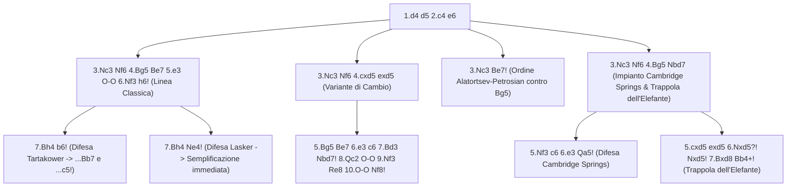

[[Home MOC|Home]] / [[Education & Learning]] / [[Queen's Gambit Declined]]

# Queen's Gambit Declined

## Sintesi Esecutiva

<mark style="background:rgba(255, 193, 69, 0.32)"><b>Queen's Gambit Declined</b></mark> (*Gambetto di Donna Rifiutato* o **QGD**, `1.d4 d5 2.c4 e6`) è il baluardo classico per eccellenza contro `1.d4`, impiegato in quasi tutti i match per il Campionato del Mondo da Steinitz, Lasker, Capablanca e Alekhine fino a Karpov, Kasparov e Carlsen (`750 – 2000+` ELO). Studiato dal punto di vista del **Nero** (in maniera complementare a [[The Queen's Gambit]] visto dal Bianco), il QGD insegna tre principi strategici immortali: la costruzione di <mark style="background:rgba(255, 193, 69, 0.32)"><b>ancore centrali incrollabili</b></mark> (`d5` sostenuto da `e6`), la preparazione metodica delle <mark style="background:rgba(255, 193, 69, 0.32)"><b>rotture pedonali liberatorie (...c5! e ...e5!)</b></mark> e l'arte della <mark style="background:rgba(181, 113, 255, 0.36)"><b>difesa classica profilattica</b></mark>. Chi padroneggia il QGD col Nero impara a neutralizzare la pressione posizionale avversaria, risolvere il problema dell'Alfiere campochiaro di `c8` e prendere il comando del centro nel mediogioco.

| Parametro Tecnico | Dettaglio Strategico |
| :--- | :--- |
| **Nome Difesa** | Queen's Gambit Declined (*Gambetto di Donna Rifiutato* — Codici ECO `D30–D69`) |
| **Contro** | `1.d4` (`1.d4 d5 2.c4`) |
| **Mosse Iniziali** | `1.d4 d5 2.c4 e6` |
| **Lezione Primaria** | Ancore centrali, rotture pedonali liberatorie (`...c5`), difesa classica |
| **Fascia ELO Ideale** | `750 – 2000+` (universale: dalla scuola posizionale di base fino all'élite) |

---

## 1. Filosofia Difensiva di `1.d4 d5 2.c4 e6` e le 3 Regole d'Oro del Nero

Quando il Bianco gioca `1.d4 d5 2.c4`, minaccia di eliminare il pedone centrale nero `d5` (`cxd5`). Rispondendo con **`2...e6`**, il Nero stabilisce una fortezza centrale basata su tre leggi strategiche:

1. **L'Ancora Centrale `d5`**: Se il Bianco cambia `cxd5`, il Nero riprende di pedone (`...exd5`), mantenendo un guardiano fisso in `d5` che impedisce al Bianco di spingere `e4` e controlla le case `c4` ed `e4`.
2. **La Regola del Pedone `c7` (Mai bloccarlo con `...Nc6`!)**:
   Nelle aperture di Donna (`1.d4 d5`), il pedone `c7` è la leva vitale del Nero. A meno che non si giochi un sistema specifico (come la Tarrasch o la Ragozin), il Cavallo di Donna del Nero va sviluppato in **`d7` (`...Nbd7!`)** e non in `c6`, affinché il pedone `c` possa avanzare in **`...c6`** (per blindare `d5`) o direttamente in **`...c5!`** (la grande rottura liberatoria che attacca `d4`!).
3. **La Liberazione dell'Alfiere di `c8`**:
   L'unico inconveniente di `2...e6` è che chiude temporaneamente la diagonale `c8-h3` dell'Alfiere campochiaro. Tutta la strategia del Nero nel QGD consiste nel liberare questo Alfiere tramite:
   - Il fianchetto in **`b7`** (`...b6` + `...Bb7` nel *Sistema Tartakower*).
   - L'apertura della diagonale `c8-h3` dopo il cambio `cxd5 exd5` o dopo la rottura `...e5!`.

![[chess_qgd_01_tabiya.svg]]

---

## 2. Caso Principale A: La Linea Classica (`4.Bg5 Be7`) — Tartakower (`7...b6!`) e Lasker (`7...Ne4!`)

Dopo `1.d4 d5 2.c4 e6 3.Nc3 Nf6 4.Bg5`, la mossa più solida e flessibile del Nero è **`4...Be7!`** (schiodando immediatamente il Cavallo in `f6`).
Dopo **`5.e3 O-O 6.Nf3`**, il Nero inserisce sempre l'importantissima mossa interrogativa **`6...h6!`**:
- Se il Bianco cambia `7.Bxf6 Bxf6`, il Nero ha ottenuto gratuitamente la coppia degli Alfieri e una pressione magnifica sulla diagonale `h8-a1` preparando subito `...c5!`!
- Il Bianco quindi ritira quasi sempre l'Alfiere con **`7.Bh4`**. Qui il Nero ha due sistemi di livello mondiale.

### 2.1 Il Sistema Tartakower (`7...b6!`) — Dinamismo e Rottura `...c5!`

Adottato da Kasparov, Kramnik e Carlsen, **`7...b6!`** risolve alla radice il problema dell'Alfiere di `c8`:

![[chess_qgd_02_tartakower_b6.svg]]

- **Sequenza principale**: `7...b6! 8.cxd5 Nxd5!`:
  - **Perché riprendere di Cavallo (`8...Nxd5!`) e non di pedone?**: Perché catturando con `8...Nxd5!`, il Nero forza il cambio degli Alfieri camposcuri (`9.Bxe7 Qxe7 10.Nxd5 exd5`), dopodiché l'Alfiere campochiaro del Nero è completamente libero di uscire in **`b7` (`...Bb7`)** o **`e6` (`...Be6`)**!
- **La Rottura Liberatoria `...c5!`**:
  Dopo `11.Rc1 Be6 12.Qa4`, il Nero spinge **`12...c5! 13.Qa3 Rc8 14.Bb5 a6 15.dxc5 bxc5 16.O-O Nd7`**:
  I cosiddetti <mark style="background:rgba(181, 113, 255, 0.36)"><b>pedoni sospesi (Hanging Pawns) in c5 e d5</b></mark> conferiscono al Nero un controllo spaziale formidabile al centro e linee aperte per entrambe le Torri (`c8` e `b8`).

---

### 2.2 La Difesa Lasker (`7...Ne4!`) — Semplificazione e Solidità Granitica

Se il Nero desidera un piano semplice, chiarissimo e quasi impossibile da scardinare, dopo `6...h6 7.Bh4` gioca subito **`7...Ne4!`**:
- **Il meccanismo tattico**: Poiché l'Alfiere in `e7` e la Donna in `d8` sono allineati, il salto `7...Ne4!` forza il cambio di **due coppie di pezzi minori**:
  `8.Bxe7 Qxe7 9.cxd5 Nxc3 10.bxc3 exd5`.
- **Come prosegue il Nero**:
  Avendo eliminato quattro pezzi minori, il Nero non soffre più di alcuna ristrettezza di spazio! Il piano successivo è automatico:
  **`11.Qb3 Rd8 12.c4 dxc4 13.Bxc4 Nc6! 14.Be2 b6 15.O-O Bb7`**, seguito da `...Na5` e `...c5!` con parità comodissima.

---

## 3. Caso Principale B: Come Difendersi contro la Variante di Cambio (`4.cxd5 exd5`)

Come visto in [[The Queen's Gambit]], nella Variante di Cambio (`1.d4 d5 2.c4 e6 3.Nc3 Nf6 4.cxd5 exd5 5.Bg5 Be7 6.e3 c6 7.Bd3`) il Bianco fissa la **Struttura Carlsbad** e cerca di lanciare l'*Attacco di Minoranza* (`Rab1` + `b4-b5`).
Il Nero dispone di **due contromisure perfette** per neutralizzare questo piano.

### 3.1 La Manovra Classica `...Nbd7-f8!` e il Blocco sull'Ala di Donna

Dopo `4.cxd5 exd5 5.Bg5 Be7 6.e3 c6 7.Bd3`, il Nero esegue l'ordine di mosse magistrale:
**`7...Nbd7! 8.Qc2 O-O 9.Nf3 Re8 10.O-O Nf8!`**:

![[chess_qgd_03_exchange_defense.svg]]

- **Perché il giro del Cavallo `b8 -> d7 -> f8` è così forte?**:
  1. In `f8`, il Cavallo difende il punto `h7` contro la batteria bianca `Bd3 + Qc2`, rendendo impossibile qualsiasi sacrificio sul Re nero!
  2. Da `f8`, il Cavallo salta in **`g6`** o **`e6`**, preparando **`...g6`**, **`...Ng7`** e **`...Bf5!`**: in questo modo il Nero **cambia il proprio "Alfiere cattivo" di `c8` con il fortissimo Alfiere bianco di `d3`**!
  3. **Come fermare l'Attacco di Minoranza (`b4-b5`)**:
     Quando il Bianco prepara `Rab1` e `b4`, il Nero può giocare **`...a5!`** (fermando `b4`) oppure, se il Bianco ha già giocato `a3` e `b4`, il Nero spinge **`...b5!`** seguito da **`...Nb6-c4!`**: il pedone `c6` rimane arretrato ma è inattaccabile perché il Cavallo nero si installa per sempre nell'avamposto dominante **`c4`**!

### 3.2 Il Trucco d'Ordine di Mosse di Alatortsev-Petrosian (`3.Nc3 Be7!`)

Se il Nero vuole impedire del tutto al Bianco di entrare nella Variante di Cambio con `Bg5`, dopo `1.d4 d5 2.c4 e6 3.Nc3` può giocare **`3...Be7!`** (invece di `3...Nf6`)!
- **Perché funziona**:
  Se ora il Bianco cambia `4.cxd5 exd5`, **non può più giocare `5.Bg5`**, perché in `g5` non c'è alcun Cavallo da inchiodare e il Nero cambierebbe subito gli Alfieri con `5...Bxg5`!
  Se il Bianco sviluppa l'Alfiere in `5.Bf4`, il Nero gioca **`5...c6 6.e3 Bf5!`** (oppure `6.Qc2 g6! 7.e3 Bf5!`), risolvendo il problema dell'Alfiere campochiaro già alla sesta mossa!

---

## 4. Caso Principale C: La Difesa Cambridge Springs (`6...Qa5!`) e la Ragozin (`4...Bb4!`)

Per i giocatori che amano il controgioco tattico attivo col Nero:

### 4.1 La Difesa Cambridge Springs (`6...Qa5!`)
- **Sequenza**: `1.d4 d5 2.c4 e6 3.Nc3 Nf6 4.Bg5 Nbd7 5.Nf3 c6 6.e3 Qa5!`.
- Con **`6...Qa5!`**, il Nero esce dall'inchiodatura sulla diagonale `d8-h4`, inchioda a sua volta il Cavallo `c3` sul Re bianco e prepara **`...Bb4`** e **`...Ne4!`** con pressione fortissima sul punto `c3` e sull'Alfiere bianco in `g5`.

### 4.2 La Difesa Ragozin (`3.Nf3 Nf6 4.Nc3 Bb4!`)
- Ibridando il QGD con [[Nimzo - Bogo-Indian]], il Nero sviluppa l'Alfiere camposcuro in **`b4` (`4...Bb4!`)**, inchiodando il Cavallo `c3` e preparando subito la rottura centrale **`...c5!`** e il salto **`...Ne4`**.

---

## 5. Le Mosse Più Ingannevoli, Trappole da Tendere e Errori da Evitare

### Trappola 1 (Da Tendere col Nero!): La Trappola dell'Elefante (`6...Nxd5! 7.Bxd8 Bb4+!`)

Analizzata qui dal punto di vista del **Nero** che la imposta:
Dopo `1.d4 d5 2.c4 e6 3.Nc3 Nf6 4.Bg5 Nbd7`, se il Bianco gioca **`5.cxd5 exd5`** prima di aver sviluppato il Cavallo di Re in `f3`, molti giocatori tra `750` e `1600` ELO cadono nella tentazione di catturare il pedone `d5` con **`6.Nxd5?!`**, credendo che il Cavallo nero in `f6` sia paralizzato dall'inchiodatura sulla Donna in `d8`.

![[chess_qgd_05_elephant_trap_black.svg]]

- **L'Esecuzione Perfetta del Nero**:
  1. **`6...Nxd5!`**: Cattura il Cavallo bianco lasciando la Donna in `d8` in presa!
  2. **`7.Bxd8 Bb4+!`**: **Scacco intermedio mortale!**
  3. Poiché il Cavallo bianco è ancora in `g1` (e non in `f3`!), il Bianco **non può coprire lo scacco con `Nd2`**; l'unica mossa legale per parare lo scacco è interporre la Donna con **`8.Qd2`**.
  4. **`8...Bxd2+ 9.Kxd2 Kxd8`**: Il Nero recupera la Donna e resta con un **Cavallo netto in più**!

> [!WARNING] Attenzione Critica per il Nero: Quando la Trappola dell'Elefante NON Funziona!
> Verifica sempre dove si trova il Cavallo bianco di Re!
> Se il Bianco ha **già sviluppato il Cavallo in `f3`** (ad esempio dopo `5.Nf3 a6? 6.cxd5 exd5? 7.Nxd5!`), allora `7...Nxd5?? 8.Bxd8 Bb4+` **perde la Donna per il Nero**, perché il Bianco copre lo scacco interponendo il Cavallo da `f3` (**`9.Nd2!`**) e tenendosi la Donna in più! (E se il Nero ha spinto `...c5`, la diagonale `f8-b4` è persino ostruita dal pedone `c5`!). La Trappola dell'Elefante funziona **solo quando il Cavallo bianco è ancora in `g1`** (ecco perché dopo `5.Nf3` il Nero gioca prima **`5...c6!`** per poter riprendere `6.cxd5 exd5` avendo `d5` difeso anche dal pedone `c6`!).

---

### Trappola 2 (Da Tendere col Nero!): La Trappola Cambridge Springs (`7.Bd3? dxc4! 8.Bxc4 Ne4!`)

Dopo `1.d4 d5 2.c4 e6 3.Nc3 Nf6 4.Bg5 Nbd7 5.Nf3 c6 6.e3 Qa5!`:
Se il Bianco sviluppa meccanicamente l'Alfiere con **`7.Bd3?`**, il Nero vince materiale sul colpo:

![[chess_qgd_04_cambridge_springs_trap.svg]]

- **Sequenza vincente del Nero**:
  **`7...dxc4! 8.Bxc4 Ne4!`**:
  - Ora il Cavallo nero in `e4` e la Donna in `a5` attaccano due volte il Cavallo inchiodato in `c3` (minacciando `...Nxc3`), e contemporaneamente la Donna in `a5` **attacca lungo la quinta traversa l'Alfiere bianco indifeso in `g5`**!
  - Se il Bianco ritira l'Alfiere (`9.Bh4` o `9.Bf4`), segue **`9...Nxc3 10.Qd2 Bb4! 11.bxc3 Bxc3`**, vincendo qualità e pedone!

---

### Trappola 3 (Da Evitare col Nero!): La Lotta per il Tempo su `...dxc4`

Un errore posizionale comunissimo sotto i `1500` ELO nel QGD (`1.d4 d5 2.c4 e6 3.Nc3 Nf6 4.Bg5 Be7 5.e3 O-O 6.Nf3 Nbd7`) è catturare **`...dxc4?!` prima che il Bianco abbia mosso l'Alfiere `f1`**.
- **Perché è un errore**: Se il Nero gioca `7...dxc4?!` mentre l'Alfiere bianco è ancora in `f1`, il Bianco lo cattura in **un solo movimento (`8.Bxc4`)**, risparmiando un tempo intero!
- **La Regola del Tempo Ortodossa**: Aspetta che il Bianco giochi **`7.Bd3`** (o `7.Rc1 c6 8.Bd3`), e **solo allora** cattura **`8...dxc4! 9.Bxc4 Nd5!`**: in questo modo l'Alfiere bianco ha impiegato due mosse (`f1-d3-c4`) per arrivare in `c4`, regalando al Nero il tempo necessario per eseguire la manovra liberatoria Capablanca (`9...Nd5 10.Bxe7 Qxe7 11.O-O Nxc3 12.Rxc3 e5!`).

---

## 6. Riepilogo Operativo e Checklist Difensiva per il Nero

| Variante del Bianco nel QGD | Piano Consigliato per il Nero | Punto Strategico / Antitrappola |
| :--- | :--- | :--- |
| **`4.Bg5 Be7 5.e3 O-O 6.Nf3`** | `6...h6! 7.Bh4 b6!` (*Tartakower*) o `7...Ne4!` (*Lasker*) | Nel Tartakower fianchetta `...Bb7` e rompi con `...c5!`; con `7...Ne4!` cambia due pezzi |
| **`4.cxd5 exd5 5.Bg5 Be7 6.e3`** | `6...c6 7.Bd3 Nbd7! 8.Qc2 O-O 9.Nf3 Re8 10.O-O Nf8!` | Il Cavallo in `f8` difende `h7` e prepara `...Ne6-g7 + ...Bf5!`; ferma `b4` con `...a5!` |
| **Ordine Anti-Bg5 (`3.Nc3`)** | `3...Be7!` (*Ordine Alatortsev*) | Impedisce `4.cxd5 exd5 5.Bg5` e permette di sviluppare subito `...Bf5!` |
| **`4.Bg5 Nbd7 5.cxd5 exd5`** | Se il Bianco gioca `6.Nxd5?!` -> **`6...Nxd5! 7.Bxd8 Bb4+!`** | *Trappola dell'Elefante*: verifica che il Cavallo bianco sia ancora in `g1`! |
| **`4.Bg5 Nbd7 5.Nf3 c6 6.e3`** | `6...Qa5!` (*Cambridge Springs*) | Se il Bianco gioca `7.Bd3?`, puniscilo con **`7...dxc4! 8.Bxc4 Ne4!`** |
