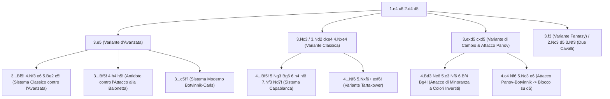

[[Home MOC|Home]] / [[Education & Learning]] / [[The Caro-Kann Defense]]

# The Caro-Kann Defense

## Sintesi Esecutiva

<mark style="background:rgba(255, 193, 69, 0.32)"><b>The Caro-Kann Defense</b></mark> (*Difesa Caro-Kann*, `1.e4 c6 2.d4 d5`), elaborata nel 1886 da Horatio Caro e Marcus Kann e perfezionata dai Campioni del Mondo José Raúl Capablanca, Mikhail Botvinnik e Anatoly Karpov, è la difesa semi-aperta più solida e resiliente contro `1.e4`. L'apertura insegna tre pilastri della maestria difensiva: la tutela dell'<mark style="background:rgba(255, 193, 69, 0.32)"><b>integrità strutturale</b></mark>, la valorizzazione dell'<mark style="background:rgba(181, 113, 255, 0.36)"><b>Alfiere campochiaro attivo</b></mark> (sviluppato fuori dalla catena pedonale prima di giocare `...e6`) e la <mark style="background:rgba(255, 193, 69, 0.32)"><b>tecnica del finale</b></mark>. A differenza di [[The Sicilian Defense]], che accetta sbilanciamenti radicali, e di [[Classical 1...e5]], che espone il punto `f7` a gambetti immediati, la Caro-Kann costruisce una fortezza elastica priva di debolezze croniche.

| Parametro Tecnico | Dettaglio Strategico |
| :--- | :--- |
| **Nome Difesa** | The Caro-Kann Defense (*Difesa Caro-Kann* — Codici ECO `B10–B19`) |
| **Contro** | `1.e4` |
| **Mosse Iniziali** | `1.e4 c6 2.d4 d5` |
| **Lezione Primaria** | Integrità strutturale, Alfiere campochiaro attivo, tecnica superiore nel finale |
| **Fascia ELO Ideale** | `750 – 2000+` (ideale per chi cerca solidità posizionale e finali vantaggiosi) |

---

## 1. Filosofia della Difesa e Confronto con la Difesa Francese

Con `1.e4 c6 2.d4 d5`, il Nero sfida immediatamente il pedone centrale `e4` del Bianco:

1. **Perché `1...c6` invece di `1...e6` (*Difesa Francese*)?**:
   Nella Difesa Francese (`1.e4 e6 2.d4 d5`), il pedone in `e6` mura vivo l'Alfiere campochiaro di `c8` (il cosiddetto "Alfiere Francese"). Nella **Caro-Kann**, invece, la diagonale **`c8-h3` rimane completamente aperta**: il Nero può sviluppare l'Alfiere in `f5` o `g4` *prima* di chiudere la catena di pedoni con `...e6`!
2. **Superiorità strutturale nel finale**:
   Il Nero conserva quasi sempre solo due isole di pedoni compatte e sane. Ogni cambio di pezzi nel mediogioco avvicina il Nero a un finale tecnicamente favorevole.

![[chess_caro_01_tabiya.svg]]

---

## 2. Caso Principale A: La Variante d'Avanzata (`3.e5`)

Tra `750` e `1800` ELO, la risposta più frequente del Bianco a `1.e4 c6 2.d4 d5` è la spinta spaziale **`3.e5`**, che mira a soffocare il Nero togliendo la casa naturale `f6` al Cavallo di Re.

### 2.1 Il Piano Classico del Nero: `3...Bf5!` seguito da `...e6` e `...c5!`

Il Nero risponde secondo i principi primi della Caro-Kann:

1. **`3...Bf5!`**: Prima di spingere `...e6`, l'Alfiere campochiaro esce dalla catena di pedoni collocandosi sulla diagonale attiva `b1-h7`.
2. **`4.Nf3 e6 5.Be2`** (*Variazione Short*, la più solida per il Bianco).
3. **`5...c5!`**: **La rottura tematica fondamentale!** Anche se il Nero ha già mosso il pedone in `c6` alla prima mossa, spingere `5...c5!` è teoricamente ineccepibile perché anche il Bianco ha mosso due volte il pedone `e` (`e2-e4-e5`).

![[chess_caro_02_advance_bf5.svg]]

- **Come sviluppa i pezzi il Nero dopo `5...c5!`**:
  - Il Cavallo di Donna va in **`c6` (`...Nc6`)**, aumentando la pressione su `d4` ed `e5`.
  - La Donna salta in **`b6` (`...Qb6`)**, attaccando simultaneamente la base della catena bianca in `d4` e il pedone `b2` lasciato indifeso dall'Alfiere `c1`!
  - Il Cavallo di Re (privato di `f6` dal pedone bianco `e5`) si sviluppa armoniosamente tramite **`...Ne7`** -> **`...Ng6`** (o `...Nf5` / `...Nc6`), attaccando il punta di lancia bianco in `e5`!

### 2.2 Come Neutralizzare l'Aggressivo `4.h4` (L'Attacco di Tal)

Molti giocatori d'attacco dopo `3.e5 Bf5` lanciano subito **`4.h4!?`** (o `4.g4`), cercando di intrappolare l'Alfiere nero in `f5`.
- **La Regola Salvavita Assoluta**: Contro `4.h4`, il Nero **DEVE rispondere `4...h5!`** (oppure `4...h6!`), bloccando l'avanzata `g4` e creando la casa di fuga permanente in `h7` (`...Bh7`)!
- Dopo `4.h4 h5! 5.c4 e6 6.Nc3 Ne7 7.Bg5 Qb6 8.Qd2 dxc4 9.Bxc4 Nd5!`, il Nero conquista la splendida casa forte centrale **`d5`** per il proprio Cavallo e gode di un gioco eccellente.

### 2.3 L'Alternativa Moderna: Il Sistema Botvinnik-Carls (`3...c5!?`)

Se il Nero vuole evitare tutte le linee taglienti dove il Bianco dà la caccia all'Alfiere in `f5`, può giocare subito **`3...c5!?`** alla terza mossa!
- **Sequenza**: `3.e5 c5!? 4.dxc5 e6 5.Be3 Nd7 6.Bb5 Ne7 7.Nf3 Nf5 8.Bd4 Nxd4 9.Qxd4 Bxc5`: il Nero recupera il pedone `c5` con la coppia degli Alfieri e una posizione aperta comodissima.

---

## 3. Caso Principale B: La Variante Classica (`3.Nc3` o `3.Nd2` -> `3...dxe4 4.Nxe4`)

Quando il Bianco difende il pedone `e4` sviluppando il Cavallo (`3.Nc3` o `3.Nd2`), il Nero elimina subito la tensione centrale con **`3...dxe4 4.Nxe4`** per evitare che il Bianco guadagni spazio con `e5`. Qui il Nero dispone di due grandi sistemi.

### 3.1 Il Sistema Capablanca (`4...Bf5!`)

È il sistema più istruttivo per padroneggiare la profilassi e l'integrità strutturale:
**`4...Bf5! 5.Ng3 Bg6 6.h4 h6! 7.Nf3 Nd7! 8.h5 Bh7 9.Bd3 Bxd3 10.Qxd3 e6`**.

![[chess_caro_03_classical_capablanca.svg]]

> [!IMPORTANT] Le Due Mosse Profilattiche Obbligatorie per il Nero (`6...h6!` e `7...Nd7!`)
> 1. **Perché `6...h6!` è obbligatoria**: Se su `6.h4` il Nero giocasse `6...e6??`, il Bianco spingerebbe `7.h5!` intrappolando e vincendo l'Alfiere in `g6` (che non avrebbe più la casa `h7`!).
> 2. **Perché `7...Nd7!` deve precedere `...Ngf6`**: Se al settimo tratto il Nero sviluppasse pigramente `7...Nf6?!`, il Bianco salterebbe subito in **`8.Ne5!`**, minacciando di cambiare in `g6` (`9.Nxg6 fxg6`) e rovinare la struttura pedonale nera! Giocando prima **`7...Nd7!`**, il Nero controlla la casa `e5` e solo alla mossa successiva sviluppa `...Ngf6` in totale sicurezza!

- **Piano di mediogioco del Nero nel Sistema Capablanca**:
  Dopo il cambio degli Alfieri campochiari in `d3` (`9.Bd3 Bxd3 10.Qxd3`), il Nero gioca `10...e6 11.Bf4 Qa5+! 12.Bd2 Bb4 13.c3 Be7 14.c4 Qc7 15.O-O-O Ngf6`: il Nero arrocca corto o lungo a seconda delle circostanze e prepara la spinta liberatoria **`...c5!`** (o `...b5`), puntando a un finale superiore.

### 3.2 La Variante Tartakower (`4...Nf6 5.Nxf6+ exf6!`)

Adottata ai massimi livelli da Fabiano Caruana e Ding Liren:
- **Idea strategica**: Dopo `4...Nf6 5.Nxf6+ exf6!`, il Nero accetta volontariamente i pedoni doppiati sulla colonna `f` (`f7` e `f6`).
- **I vantaggi dinamici del Nero**: Sviluppo rapidissimo senza dover perdere tempi con l'Alfiere in `f5-g6-h7`; il pedone in `f6` controlla saldamente la casa `e5`; l'Alfiere camposcuro si colloca in `d6` (`...Bd6`), il Re arrocca corto (`...O-O`), la Torre occupa la colonna `e` (`...Re8+`) e l'Alfiere `c8` è libero sulla diagonale `c8-h3`.

---

## 4. Caso Principale C: Variante di Cambio (`3.exd5 cxd5`) e Attacco Panov (`4.c4`)

### 4.1 La Variante di Cambio Classica (`3.exd5 cxd5 4.Bd3`)

Molti giocatori con il Bianco tra `800` e `1600` ELO cambiano subito in `d5` per "annullare" la teoria del Nero. In realtà, `3.exd5 cxd5` regala al Nero una **Struttura Carlsbad a colori invertiti** (esattamente simmetrica a quella analizzata in [[Queen's Gambit Declined]])!
- **L'ordine di mosse perfetto per il Nero**:
  `3.exd5 cxd5 4.Bd3 Nc6 5.c3 Nf6 6.Bf4 Bg4!`:
  - Con **`6...Bg4!`** (oppure `6...g6` seguito da `...Bf5`), il Nero attiva subito l'Alfiere campochiaro attaccando la Donna bianca (`7.Qb3 Qd7! 8.Nd2 e6 9.Ngf3 Bxf3 10.Nxf3 Bd6 11.Bxd6 Qxd6 12.O-O O-O`).
  - **Piano vincente del Nero nel mediogioco**: Lanciare l'<mark style="background:rgba(181, 113, 255, 0.36)"><b>Attacco di Minoranza a colori invertiti</b></mark> sull'ala di Donna! Il Nero porta le Torri in `c8` e `b8` e spinge **`...a6`** e **`...b7-b5-b4!`**, creando un pedone debole cronico al Bianco in `c3` o `d4`.

### 4.2 L'Attacco Panov-Botvinnik (`3.exd5 cxd5 4.c4`)

Con `4.c4` il Bianco attacca subito `d5`. Il Nero risponde con calma olimpica:
- **Sequenza**: `4...Nf6 5.Nc3 e6! 6.Nf3 Bb4!` (oppure `6...Be7`):
- Al momento opportuno (dopo che l'Alfiere bianco in `f1` si è già mosso in `d3` o `e2`), il Nero cattura **`...dxc4 Bxc4`**, infliggendo al Bianco un **Pedone di Donna Isolato (IQP)** in `d4` e bloccando la casa forte `d5` con i propri pezzi!

---

## 5. Le Mosse Più Ingannevoli, Trappole da Evitare e Trappole da Tendere

### Trappola 1 (Da Evitare Assolutamente!): Il Matto Affogato in 6 Mosse (`6.Nd6#`)

È la trappola più famosa dell'intera Difesa Caro-Kann, in cui cadono migliaia di giocatori quando usano l'ordine di mosse con `4...Nd7` senza prestare attenzione alla colonna `e`:

- **Sequenza**: `1.e4 c6 2.d4 d5 3.Nc3 dxe4 4.Nxe4 Nd7 5.Qe2!` (oppure `5.Bc4 Ngf6 6.Ng5 e6 7.Qe2`).
- In questa posizione, la Donna bianca in `e2` è allineata sulla colonna `e` con il Re nero in `e8`. Questo significa che il **pedone nero `e7` è inchiodato sul Re**!

![[chess_caro_04_smothered_mate_trap.svg]]

> [!DANGER] Il Blunder Mortale `5...Ngf6??`
> Se dopo `4...Nd7 5.Qe2` il Nero sviluppa distrattamente il Cavallo di Re con **`5...Ngf6??`**, il Bianco gioca **`6.Nd6#`** — **Scacco matto affogato alla sesta mossa**, poiché il pedone `e7` è inchiodato dalla Donna bianca in `e2`!
> - **Come evitarlo facilmente**: Gioca il Sistema Capablanca **`4...Bf5!`** (dove `e8` non è mai soffocato), oppure se giochi `4...Nd7 5.Qe2`, rispondi **`5...Ndf6!`** (muovendo il Cavallo che è già in `d7`, liberando una casa di fuga in `d7` per il Re!).

---

### Trappola 2 (Da Evitare!): L'Alfiere Intrappolato nell'Avanzata (`3.e5 Bf5 4.h4 e6??`)

Come visto nella Sezione 2.2, se nella Variante d'Avanzata (`1.e4 c6 2.d4 d5 3.e5 Bf5`) il Bianco gioca **`4.h4`** (o `4.Nc3 e6?! 5.g4! Bg6 6.Nge2 c5 7.h4!`), giocare **`4...e6??`** senza aver prima creato la casa di ritirata `h7` perde un pezzo netto:
- **`4...e6?? 5.g4! Bg6 6.h5! Be4 7.f3!`** — L'Alfiere campochiaro del Nero è completamente intrappolato in mezzo alla scacchiera!
- **Regola aurea**: Quando vedi `h4` o `g4`, rispondi **sempre `...h5!`** (o `...h6!`).

---

### Trappola 3 (Da Tendere col Nero!): Il Contrattacco `4...e5!` contro la Variante Fantasy (`3.f3`)

Molti giocatori aggressivi tra `1000` e `1800` ELO giocano la **Variante Fantasy (`1.e4 c6 2.d4 d5 3.f3`)** per mantenere un centro di pedoni in `e4` e `d4`.
- **La confutazione attiva del Nero**: Non giocare la passiva `3...e6`; apri invece subito la diagonale `d8-h4` (indebolita da `3.f3`!) giocando:
  **`3...dxe4! 4.fxe4 e5!`**

![[chess_caro_05_fantasy_counter.svg]]

- **La trappola letale in cui cade il Bianco (`5.dxe5??`)**:
  Se il Bianco cattura avidamente il pedone con **`5.dxe5??`**, il Nero sferra **`5...Qh4+!`**:
  - Se il Bianco copre lo scacco con `6.g3`, segue **`6...Qxe4+!`** (forchetta reale su Re `e1` e Torre `h1`, vincendo la Torre!).
  - Se il Bianco muove il Re con `6.Ke2`, segue **`6...Qxe4+ 7.Kf2 Bc5+ 8.Kg3 Qxe5+`** con attacco di matto devastante!
  - *(Nota: anche se il Bianco gioca la corretta `5.Nf3`, il Nero prosegue con `5...exd4! 6.Bc4 Be6! 7.Bxe6 fxe6 8.O-O Nd7`, neutralizzando completamente la pressione su `f7`!)*

---

### Trappola 4 (Da Tendere col Nero!): Punire il Falso Attacco su `f7` (`Bc4` + `Ng5`)

Nel Sistema `4...Nd7`, molti giocatori abituati a [[The Italian Game]] provano a imitare l'Attacco Fegatello giocando:
`1.e4 c6 2.d4 d5 3.Nc3 dxe4 4.Nxe4 Nd7 5.Bc4 Ngf6 6.Ng5?!`.
Il Bianco crede di aver vinto perché attacca `f7` con `Bc4` e `Ng5`.
- **Come il Nero ribalta la partita**:
  Il Nero gioca semplicemente **`6...e6! 7.Qe2 Nb6!`**:
  - `6...e6!` mura l'Alfiere in `c4`, e **`7...Nb6!`** difende `f7`/`d5` attaccando con guadagno di tempo l'Alfiere in `c4`!
  - Dopo `8.Bb3 h6! 9.N5f3 c5!`, il Bianco ha perso tre tempi con i propri pezzi minori mentre il Nero conquista il centro e l'iniziativa!

---

## 6. Riepilogo Operativo e Checklist Difensiva per il Nero

| Sistema del Bianco contro `1...c6 2.d4 d5` | Risposta Principale del Nero | Regola d'Oro / Antitrappola |
| :--- | :--- | :--- |
| **`3.e5`** (*Variante d'Avanzata*) | `3...Bf5! 4.Nf3 e6 5.Be2 c5!` | Attacca la base `d4` con `...c5`, `...Nc6` e `...Qb6` |
| **`3.e5 Bf5 4.h4`** (*Attacco alla Baionetta*) | `4...h5!` (oppure `4...h6!`) | **MAI** giocare `4...e6??` (altrimenti `5.g4 Bg6 6.h5 Be4 7.f3!` intrappola l'Alfiere) |
| **`3.Nc3 dxe4 4.Nxe4`** (*Variante Classica*) | `4...Bf5! 5.Ng3 Bg6 6.h4 h6! 7.Nf3 Nd7!` | `6...h6!` salva l'Alfiere; `7...Nd7!` precede `...Ngf6` per impedire `8.Ne5!` |
| **`3.exd5 cxd5`** (*Cambio / Panov*) | `4.Bd3 Nc6 5.c3 Nf6 6.Bf4 Bg4!` | Contro `4.Bd3` lancia l'Attacco di Minoranza `...b5-b4`; contro `4.c4` gioca `4...Nf6 5.Nc3 e6` |
| **`3.f3`** (*Variante Fantasy*) | `3...dxe4! 4.fxe4 e5!` | Se `5.dxe5??`, vinci con `5...Qh4+!`; se `5.Nf3`, gioca `5...exd4 6.Bc4 Be6!` |
