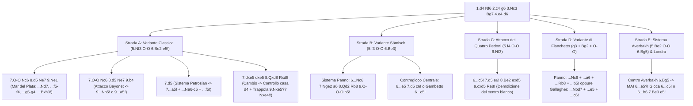

[[Home MOC|Home]] / [[Education & Learning]] / [[The King's Indian Defense]]

# The King's Indian Defense

## Sintesi Esecutiva — La Filosofia del Grande Maestro

<mark style="background:rgba(255, 193, 69, 0.32)"><b>The King's Indian Defense</b></mark> (*Difesa Est-Indiana* o **KID**, `1.d4 Nf6 2.c4 g6 3.Nc3 Bg7 4.e4 d6`) è l'arma più feroce, coraggiosa e ambiziosa che il Nero possieda contro `1.d4` — il corrispettivo speculare di [[The Sicilian Defense]] contro `1.e4` (`1300 – 2800+` ELO). Portata a vette leggendarie da **Bobby Fischer**, **Garry Kasparov**, **Mikhail Tal**, **David Bronstein**, **Svetozar Gligorić**, **Teimour Radjabov** e **Hikaru Nakamura**, la Difesa Est-Indiana rifiuta la mentalità rinunciataria del "pareggiare con il Nero": fin dalla prima mossa dichiara guerra aperta, insegnando l'arte suprema del <mark style="background:rgba(255, 193, 69, 0.32)"><b>contrattacco ipermoderno asimmetrico</b></mark>, della <mark style="background:rgba(255, 193, 69, 0.32)"><b>tempesta pedonale sul Re</b></mark> (`...f5-f4-g5-g4!`) e del <mark style="background:rgba(181, 113, 255, 0.36)"><b>sacrificio posizionale e tattico per l'iniziativa</b></mark>.

A differenza di [[Queen's Gambit Declined]] (che occupa `d5`) e di [[Nimzo - Bogo-Indian]] (che inchioda `c3` per impedire `e4`), nella KID il Nero **INVITA DELIBERATAMENTE** il Bianco a costruire un imponente centro di pedoni (`c4-d4-e4`), perché nella logica ipermoderna un centro sovraesteso è un **bersaglio vulnerabile**! Il Nero completa l'arrocco in tempi record (`...Nf6, ...g6, ...Bg7, ...d6, ...O-O`), colpisce il centro con **`...e5!`** (o **`...c5!`**) e, appena il Bianco lo sigilla con `d4-d5`, trasforma la partita in una corsa mortale su ali opposte. Come dimostrò Garry Kasparov contro i migliori giocatori del pianeta: *"Il Bianco conquista pedoni sull'ala di Donna; il Nero conquista il Re sull'ala di Re!"*

| Parametro Tecnico | Dettaglio Strategico |
| :--- | :--- |
| **Nome Difesa** | The King's Indian Defense (*Difesa Est-Indiana* — Codici ECO `E60–E99`) |
| **Contro** | `1.d4` (e trasposizioni da `1.c4` / `1.Nf3`) |
| **Mosse Iniziali** | `1.d4 Nf6 2.c4 g6 3.Nc3 Bg7 4.e4 d6` |
| **Lezione Primaria** | Dinamismo ipermoderno, corsa su ali opposte, attacco di matto con `...f5-f4-g5-g4` e `...Bxh3!`, gioco su case scure |
| **Fascia ELO Ideale** | `1300 – 2800+` (l'apertura d'elezione per giocare per la vittoria con i pezzi neri contro `1.d4`) |

---

## 1. L'Equazione Strategica di `1.d4 Nf6 2.c4 g6 3.Nc3 Bg7 4.e4 d6`

Prima di addentrarci nelle 6 grandi strade in cui il Bianco può indirizzare la partita, scolpisci nella memoria le **4 Leggi Fondamentali della Difesa Est-Indiana**:

1. **Ordine di Mosse Inviolabile (`4...d6!` PRIMA di `...O-O`)**: Dopo `1.d4 Nf6 2.c4 g6 3.Nc3 Bg7 4.e4`, gioca **SEMPRE `4...d6!`** prima di arroccare! Se giochi l'impulsiva `4...O-O?`, il Bianco spinge **`5.e5! Ne8 6.f4 d6 7.Nf3`** ricacciando il tuo Cavallo in `e8` con vantaggio schiacciante! Con `4...d6!`, la casa `e5` è controllata dal pedone `d6` e puoi arroccare alla quinta mossa in totale sicurezza.
2. **Il Raggio Laser dell'Alfiere Est-Indiano (`Bg7`)**: Il tuo Alfiere camposcuro in `g7` è l'anima della difesa. Quando il centro è aperto, trancia la scacchiera da `g7` fino a `b2`/`a1` (rendendo `d4` vulnerabile a tattiche con `...Nxe4!`). Quando il centro si chiude con `d4-d5` ed `...f4`, *non è affatto un Alfiere cattivo*: diventa il custode supremo dell'arrocco e il pezzo che si ricicla via **`...Bf8`** (difendendo `d6` e puntando a `h6`!) oppure esplode appena il Bianco cede `f4` (`...exf4`!)!
3. **Le Due Rotture Centrali (`...e5!` vs `...c5!`)**: Non aspettare passivamente! Appena arroccato, devi colpire il centro bianco:
   - **`...e5!`**: Rottura principale contro la Variante Classica (`5.Nf3`), la Sämisch (`5.f3`) e il Fianchetto (`g3+Bg2`). Forza il Bianco a chiudere con `d5` (avviando il nostro attacco sul Re) o a cedere la casa `d4`!
   - **`...c5!`**: Rottura esplosiva contro l'**Attacco dei Quattro Pedoni (`5.f4`)**, l'**Averbakh (`6.Bg5`)** e alcune linee Sämisch/Fianchetto, aprendo la diagonale `h8-a1` del nostro Alfiere `g7`!
4. **La Mentalità del Cacciatore (Mai Difendersi Passivamente sull'Ala di Donna)**: Nel 90% delle partite chiuse della KID, il Bianco ha più spazio sull'ala di Donna. Se ti metti a giocare mosse timide come `...a6`, `...b6`, `...Rb8` nella Mar del Plata, muori lentamente per asfissia. **La tua miglior difesa sull'ala di Donna è dare scacco matto al Re bianco sull'ala di Re!**

![[chess_kid_01_tabiya.svg]]

---

## 2. Strada A: La Variante Classica e la Leggendaria Battaglia di Mar del Plata (`5.Nf3 O-O 6.Be2 e5!`)

È il cuore pulsante della Difesa Est-Indiana. Dopo `1.d4 Nf6 2.c4 g6 3.Nc3 Bg7 4.e4 d6 5.Nf3 O-O 6.Be2 e5`, il Bianco si trova davanti a **quattro bivi critici** — e tu devi padroneggiarli tutti come un Grande Maestro!

### 2.1 La Battaglia di Mar del Plata (`7.O-O Nc6! 8.d5 Ne7 9.Ne1 Nd7 10.Nd3 f5!`)

Dopo `7.O-O`, il Nero gioca l'aggressiva **`7...Nc6!`** (attaccando `d4` e costringendo il Bianco a chiudere subito il centro con **`8.d5`**). Il Cavallo si ritira in **`8...Ne7`** — apparentemente bloccando la Donna, ma in realtà pronto a volare sul lato di Re (`Ne7 -> g6 -> h4/f4`!).

Quando il Bianco gioca la linea classica **`9.Ne1`** (preparando `Nd3`, `Be3/Bd2`, `c5`, `Rc1` e `f3`), il Nero esegue la sequenza immortale:
**`9...Nd7! 10.Nd3 f5! 11.Bd2 Nf6 12.f3 f4!`**

![[chess_kid_02_mar_del_plata.svg]]

> [!IMPORTANT] Il Manuale del Grande Maestro nella Mar del Plata (`12...f4!`)
> Memorizza queste 5 leggi d'oro: valgono almeno 300 punti ELO da sole!
> 1. **Perché `12...f4!` (e MAI `12...fxe4?`)**: Se cambi `...fxe4? 13.fxe4`, regali al Bianco la casa `e4` per i suoi pezzi e l'apertura della colonna `f` per le sue Torri! Spingendo **`12...f4!`**, invece, **inchiodi l'intera ala di Re del Bianco** (`f3` diventa un bersaglio, `e4` è bloccata) e guadagni spazio vitale per il tuo attacco di matto!
> 2. **L'Ordine dell'Onda Pedonale (`13.c5 g5! 14.Rc1 Ng6! 15.cxd6 cxd6 16.Nb5 Rf7!`)**:
>    - **`...g5!`**: Prepara la spinta spacca-arrocco **`...g4!`**.
>    - **`...Ng6!`**: Libera la settima traversa e minaccia di piombare su `h4`!
>    - **`...Rf7!!` (La Mossa Miracolosa)**: È una delle mosse multifunzione più geniali degli scacchi! Con un solo tratto: **(a)** difende lateralmente la casa `c7` contro l'invasione `Nb5-c7`; **(b)** libera `f8` per l'Alfiere (`...Bf8!` che difende `d6` e punta `h6`!); **(c)** prepara **`...Rg7`** o **`...Rh7`** per raddoppiare sul Re bianco!
> 3. **I Due Modi di Sfodare l'Arrocco Bianco**:
>    - **Se il Bianco lascia arrivare `...g4!` e cattura `fxg4`**: il Nero gioca `...Nxe4!` (attaccando `Bd2` e liberando `...Ng5` / `...Qh4`) oppure `...h5!` aprendo la colonna `h`!
>    - **Se il Bianco NON cattura `...g4` (giocando `Nf2`)**: il Nero spinge **`...g3!`**: dopo `hxg3 fxg3` la colonna `h` si spalanca per `...Nh5`, `...Qh4`, `...Nf4!` e matto!
> 4. **Il Sacrificio Immortale `...Bxh3!!`**: Ogni volta che il Bianco spinge `h3` per rallentare `...g4` o `...Ng4`, osserva con gli occhi di Tal e Kasparov: il tuo Alfiere `c8` è un **missile nucleare puntato su `h3`**!

#### Il Climax della Mar del Plata: Il Sacrificio `21...Bxh3!!`
Guarda cosa succede quando un giocatore col Bianco si lascia accecare dall'avidità sull'ala di Donna e divora la Torre in `a8` (`...16.Nb5 Rf7 17.Qc2 Bf8 18.Nf2 Rg7 19.h3 Nh4 20.Nc7 Nh5 21.Nxa8??`):

![[chess_kid_03_bxh3_sacrifice.svg]]

> [!SUCCESS] Matto in Due e Demolizione Totale: `21...Bxh3!!`
> Il Nero ha lasciato deliberatamente la Torre in `a8` per portare entrambi i Cavalli (`Nh4`, `Nh5`) e la Torre (`Rg7`) sul Re bianco! Ora esplode **`21...Bxh3!!`**:
> - **Se `22.Nxh3`**: **`22...Rxg2+ 23.Kh1 Ng3#` — SCACCO MATTO PURO IN DUE MOSSE!** (Il pedone `f4` difende `g3`, `Rg2` e `Nh4` sigillano `g1` e `h2`!).
> - **Se `22.gxh3`**: **`22...Qd7!`** minacciando `...Qxh3` -> `...Qg2#` e `...Ng3!` (`23.Kh2 Rg2+ 24.Kh1 Ng3#`!). Il Cavallo bianco in `a8` assiste impotente da un altro continente al funerale del proprio Re!

---

### 2.2 Contro l'Attacco Bayonet (`9.b4!`) — L'Arma di Kramnik

Spaventati dalla potenza del Nero nella Mar del Plata, i Grandi Maestri moderni (a partire da Vladimir Kramnik negli anni '90) hanno adottato **`9.b4!`** subito dopo `7.O-O Nc6 8.d5 Ne7`, accelerando `c4-c5` senza perdere tempo con `Ne1-d3`.
- **Risposta #1 (Aggressiva — `9...Nh5!`)**:
  Il Cavallo salta immediatamente verso **`f4`** liberando il pedone `f`!
  - Se **`10.Re1 f5 11.Ng5 Nf4!`**: l'Alfiere in `e2` è sotto pressione, e se il Bianco cambia **`Bxf4 exf4!`**, l'Alfiere Est-Indiano in `g7` **si risveglia come un mostro** su tutta la grande diagonale `h8-a1`, mentre `...Be5` o `...Ne5` domina le case scure!
  - Se **`10.c5 Nf4 11.Bxf4 exf4 12.Rc1 h6!`**, il Nero ottiene un gioco dinamico travolgente con `...g5` e `...Ng6-e5`!
- **Risposta #2 (Profilattica — `9...a5!`)**:
  Frena subito l'avanzata bianca (`10.Ba3 axb4 11.Bxb4 b6!` seguita da `...Nd7`, `...h6`, `...f5!`), garantendo al Nero il tempo necessario per lanciare comunque la tempesta sul Re!

---

### 2.3 Contro il Sistema Petrosian (`7.d5`) e la Gligorić (`7.Be3`)

1. **Contro il Sistema Petrosian (`5.Nf3 O-O 6.Be2 e5 7.d5`)**:
   - Il Bianco chiude subito il centro per impedire `...Nc6` e preparare `Bg5` + `Nd2` + espansione lenta `b4-c5`.
   - **Antidoto da Grande Maestro (`7...a5!`)**:
     Blocca `b4` e conquista l'avamposto eterno **`c5`** per il Cavallo (`8.Bg5 h6 9.Bh4 Na6! 10.Nd2 Qe8! 11.O-O Nh7!`)! Con `...Na6-c5` il Nero paralizza l'ala di Donna bianca e prepara comunque la rottura **`...f5!`**!
2. **Contro il Sistema Gligorić (`5.Nf3 O-O 6.Be2 e5 7.Be3`)**:
   - Il Bianco sviluppa l'Alfiere prima di arroccare per poter rispondere a `7...Nc6` con `8.d5 Ne7 9.Nd2` (controllando `f4`).
   - **La Punizione Tattica (`7...Ng4!`)**:
     Sfrutta il fatto che `h3` non è stata giocata! **`7...Ng4! 8.Bg5 f6 9.Bh4 Nc6!`** (oppure `7...h6 8.O-O Ng4 9.Bc1 Nc6 10.d5 Ne7`): il Nero guadagna la casa `f6` o costringe l'Alfiere bianco in `h4` fuori dall'ala di Donna, preparando subito `...g5`, `...Nh6-f7` e `...f5!`!

---

### 2.4 Contro la Variante di Cambio (`7.dxe5 dxe5 8.Qxd8 Rxd8`)

Moltissimi giocatori sotto i `1900` ELO giocano `7.dxe5 dxe5 8.Qxd8 Rxd8` pensando di "spegnere la KID e andare in un finale noioso". **Errore colossale: il Nero ADORA questo finale!**
- **Perché il finale favorisce strategicamente il Nero**:
  1. Osserva la casa **`d4`**: il Bianco ha spinto `c4` ed `e4`, quindi **nessun pedone bianco potrà mai più difendere `d4`**!
  2. Il Nero, al contrario, ha ancora il pedone **`c7`** che può avanzare in **`c6`** per togliere al Bianco la casa `d5`!
  3. **Il Piano da Maestro del Nero**: **`...c6!`**, **`...Re8`**, **`...Na6 -> c7 -> e6 -> d4!`** (oppure `...Nbd7 -> c5 -> e6 -> d4!`) e **`...Bf8`**! Un Cavallo nero insediato in **`d4`** domina tutta la scacchiera! *(E se il Bianco si fa tentare da `9.Nxe5??`, vedi la Trappola 1 nella Sezione 7!)*

---

## 3. Strada B: Contro la Variante Sämisch (`5.f3`) — Contrattacco Panno con `...b5!`

Dopo `1.d4 Nf6 2.c4 g6 3.Nc3 Bg7 4.e4 d6`, il Bianco gioca l'intimidatoria **`5.f3!`**. L'intenzione è chiara e brutale: fortificare `e4`, giocare `Be3`, `Qd2`, `O-O-O`, eliminare il nostro amato Alfiere `g7` con `Bh6` e lanciarci in faccia `g4-h4-h5`!

- **Il Tallone d'Achille nascosto di `5.f3`**: Togliendo la casa `f3` al Cavallo `g1`, il Bianco rallenta lo sviluppo dell'ala di Re (`Nge2`), lasciando spesso il proprio Re esposto sull'ala di Donna (`O-O-O`)!

### Il Sistema Panno (`5...O-O 6.Be3 Nc6! 7.Nge2 a6! 8.Qd2 Rb8! 9.O-O-O b5!`)

Questa è l'arma preferita dai più grandi attaccanti della KID (Fischer, Kasparov, Radjabov) contro la Sämisch:

![[chess_kid_04_samisch_panno_b5.svg]]

- **Come funziona la demolizione Panno**:
  1. Invece di chiudere il centro con `...e5`, il Nero tiene aperta la **grande diagonale `h8-a1`** dell'Alfiere in `g7`!
  2. Con **`6...Nc6! 7.Nge2 a6! 8.Qd2 Rb8!`**, il Nero prepara la detonazione **`9...b5!`** esattamente nel momento in cui il Bianco arrocca lungo (`9.O-O-O`)!
  3. **Dopo `9...b5!`**:
     - Se `10.cxb5 axb5`: la colonna `b` e la colonna `a` si aprono direttamente contro il Re bianco in `c1`, mentre **`...Na5-c4`** (o **`...b4`** seguita da **`...Na5`**) distrugge la protezione del Re!
     - Anche se il Bianco evita `O-O-O` giocando `9.h4` o `9.Nc1`, il Nero spinge comunque **`...b5!`** oppure contrattacca al centro con **`...e5! 10.d5 Nd4!`** (sacrificando temporaneamente un pedone per aprire il centro contro il Re bianco bloccato in `e1`!).
- **Alternativa Classica (`6...e5 7.d5 c6!`)**: Se preferisci colpire il centro, dopo `6...e5 7.d5 c6! 8.Qd2 cxd5 9.cxd5 Nh5!` (o `8.Nge2 cxd5 9.cxd5 a6`), il Nero apre la colonna `c` e prepara `...f5!`, combattendo con feroce controgioco su entrambe le ali.

---

## 4. Strada C: Contro l'Attacco dei Quattro Pedoni (`5.f4`) — Punire l'Avidità con `6...c5!`

Quando un avversario aggressivo spinge **`1.d4 Nf6 2.c4 g6 3.Nc3 Bg7 4.e4 d6 5.f4 O-O 6.Nf3`**, sta lanciando una sfida sfrontata: 4 pedoni in quarta traversa (`c4, d4, e4, f4`)!

> [!TIP] Regola d'Oro Contro i Quattro Pedoni
> **NON giocare la timida `6...e5?`** (che permette al Bianco `7.fxe5 dxe5 8.d5` con una valanga centrale intatta!). Contro un centro sovraesteso, devi **colpire immediatamente alla base con `6...c5!`** finché il Re bianco è ancora al centro!

### La Sequenza Demolitrice: `6...c5! 7.d5 e6! 8.Be2 exd5 9.cxd5 Re8!`

![[chess_kid_05_four_pawns_c5.svg]]

- **Guarda la perfezione tattica e posizionale del Nero**:
  1. **`6...c5!`**: Attacca `d4` e apre il raggio del `Bg7`. *(Se il Bianco accetta il pedone con `7.dxc5?`, vedi Trappola 3 nella Sezione 7: `7...Qa5!` demolisce il Bianco!)*
  2. **`7.d5 e6!`**: Mina immediatamente la punta avanzata `d5` prima che il Bianco possa arroccare!
  3. **`8.Be2 exd5 9.cxd5`** *(se invece `9.exd5`, segue `9...Bf5` o `9...Re8` + `...Ne4` con controllo assoluto delle case scure!)* **`9...Re8!`**:
     - La colonna `e` è spalancata contro il pedone **`e4`** e il **Re bianco ancora in `e1`**!
     - Su **`10.Nd2`** (per difendere `e4`), il Nero lancia **`10...c4!`** (impedendo `Nc4` e aprendo la casa `c5`!) oppure **`10...a6 11.a4 Nbd7 12.O-O Rb8!`** preparando **`...b5!`** — la struttura Benoni/Quattro Pedoni crolla sotto il fuoco incrociato di `Bg7`, `Re8`, `...Bg4` e `...b5!`!
     - Su **`10.e5 dxe5 11.fxe5 Ng4!`**, il pedone bianco `e5` cade e il centro bianco evapora nel nulla!

---

## 5. Strada D: Contro la Variante di Fianchetto (`g3 + Bg2 + O-O`) — La Scelta dei Grandi Maestri

I giocatori più solidi e posizionali evitano di offrire bersagli sul lato di Re e giocano la **Variante di Fianchetto**: `1.d4 Nf6 2.c4 g6 3.g3 Bg7 4.Bg2 O-O 5.Nf3 d6 6.O-O`.

- **Errore tipico del giocatore di KID**: Tentare di giocare meccanicamente `...e5`, `...Nh5`, `...f5-f4` come nella Mar del Plata! Contro il bunker `g3 + Bg2` del Bianco, un attacco cieco sul lato di Re rimbalza sul cemento armato!
- **I 2 Antidoti di Livello GM contro il Fianchetto**:
  1. **Il Sistema Panno (`6...Nc6! 7.Nc3 a6! 8.h3 Rb8!`)**:
     - Il Nero prepara **`...b5!`** sull'ala di Donna e controlla la casa `d4`. Dopo `9.e4 b5! 10.cxb5 axb5`, il Nero apre la colonna `b`, attiva l'Alfiere `g7` e la Torre `b8`, e spesso sfrutta `...Na5-c4` o `...Nd7-b6` creando una lotta vivacissima e squilibrata!
  2. **La Linea Dinamica `...Nbd7 + ...e5` (`6...Nbd7 7.Nc3 e5 8.e4 c6! 9.h3 Qb6!` o `8...exd4 9.Nxd4 Re8`)**:
     - Con **`8...c6 9.h3 Qb6!`** (oppure **`9...exd4 10.Nxd4 Re8`**), il Nero esercita una pressione chirurgica sul pedone `d4` e su `e4` (portando il Cavallo in `c5` con `...a5` e raddoppiando sulla colonna `e`), costringendo il Bianco a difendersi su tutto il fronte!

---

## 6. Strada E: Contro il Sistema Averbakh (`6.Bg5`) e il Sistema Londra (`2.Bf4`)

### 6.1 Contro il Sistema Averbakh (`1.d4 Nf6 2.c4 g6 3.Nc3 Bg7 4.e4 d6 5.Be2 O-O 6.Bg5`)
Il Bianco sviluppa `Be2` e `Bg5` (prima di `Nf3`!) con uno scopo velenosissimo: **impedire `6...e5?`** (vedi Errore Fatale 4 nella Sezione 7!).
- **La Risposta Esatta del GM**:
  - **Opzione 1 (`6...c5!`)**: Colpisce subito `d4`! Dopo **`7.d5 h6 8.Be3 e6! 9.Qd2 exd5 10.exd5 Kh7`**, il Nero ottiene un'eccellente struttura Benoni dove l'Alfiere bianco ha perso tempi preziosi!
  - **Opzione 2 (`6...h6! 7.Be3 e5!`)**: Prima cacci l'Alfiere da `g5` (eliminando la tattica `Nd5` con inchiodatura su `f6`!), e SOLO DOPO giochi **`7...e5!`** (`8.d5 a5!` o `8...Na6` seguito da `...Nc5` e `...f5!`)!

### 6.2 Contro il Sistema Londra (`1.d4 Nf6 2.Bf4 g6 3.e3 Bg7 4.Nf3 O-O 5.Be2 d6`)
Quando il Bianco costruisce la piramide passiva del Sistema Londra, la KID la fa a pezzi con due piani fulminanti:
1. **Rottura `...e5!` (`5...d6 6.O-O Nbd7 7.h3 Qe8! 8.Bh2 e5!`)**: Il Nero strappa subito lo spazio centrale e prepara `...Qe7`, `...Nh5` e `...f5!`.
2. **Rottura `...c5!` + `...Qb6!` (`5...d6 6.h3 c5 7.c3 Qb6!`)**: Poiché l'Alfiere bianco `c1` ha abbandonato l'ala di Donna per andare in `f4`, il pedone **`b2`** è nudo! **`...Qb6!`** combinata col laser di **`Bg7`** crea subito problemi tattici insopportabili sul lato di Donna bianco!

---

## 7. Gli Errori Più Comuni del Bianco, Trappole Letali e Errori da Evitare

### Trappola 1 (Da Tendere col Nero!): La Trappola della Variante di Cambio (`9.Nxe5?? Nxe4!!`)

È la trappola tattica più frequente nella fascia `1200 – 1900` ELO! Dopo `1.d4 Nf6 2.c4 g6 3.Nc3 Bg7 4.e4 d6 5.Nf3 O-O 6.Be2 e5 7.dxe5 dxe5 8.Qxd8 Rxd8`, molti giocatori col Bianco pensano: *"Il pedone `e5` è indifeso, lo mangio gratis con `9.Nxe5??`!"*

![[chess_kid_06_exchange_nxe5_trap.svg]]

> [!SUCCESS] Il Contro-Colpo Fulminante: `9...Nxe4!!`
> Non difendere nulla: salta subito con **`9...Nxe4!!`**!
> Guarda la scacchiera: il Cavallo in `e4` attacca **`Nc3`** e **scopre simultaneamente l'Alfiere `Bg7` sul Cavallo bianco indifeso in `e5`**! Entrambi i Cavalli bianchi sono in presa nello stesso istante!
> 1. **Se `10.Nxf7??`** (il Bianco spera di forchettare la Torre `d8`!): **`10...Bxc3+! 11.bxc3 Kxf7`** — il Nero vince un **pezzo intero netto**!
> 2. **Se `10.Nd3?`**: **`10...Nxc3 11.bxc3 Bxc3+! 12.Bd2 Bxa1`** — il Nero vince una **Torre intera netta**!
> 3. **Se `10.Nxe4`**: **`10...Bxe5`** — il Nero ha recuperato il pedone con un'attività devastante (`Bg7->e5`, colonna `d`, `...Bf5`, `...Nc6`, Re bianco ancora fermo in `e1`)!

---

### Trappola 2 (Da Tendere col Nero!): Punire `Bg5?!` Prematuro con `...h6!`, `...g5!` e `...Nh5!`

Moltissimi giocatori col Bianco amano "inchiodare" il Cavallo in `f6` giocando `1.d4 Nf6 2.c4 g6 3.Nc3 Bg7 4.e4 d6 5.Nf3 O-O 6.Bg5?!` (oppure `6.Be2 e5 7.Bg5?!`).
- **Come il Nero ribalta la partita in 3 mosse**: **`...h6! 7.Bh4 g5! 8.Bg3 Nh5!`**:
  - L'Alfiere bianco è incastrato in `g3`: con **`...Nxg3 hxg3`**, il Nero conquista la <mark style="background:rgba(181, 113, 255, 0.36)"><b>coppia degli Alfieri</b></mark> e il dominio assoluto sulle case scure (`...f5!`, `...Nc6`, `...e5` o `...c5`)!
  - Se invece il Bianco aveva giocato `5.Bg5?!` (prima di `Nf3`), ancora meglio: **`5...h6 6.Bh4 c5! 7.d5 Qa5!`** inchioda `Nc3` sul Re in `e1` e minaccia subito **`8...Nxe4!!`**!

---

### Trappola 3 (Da Tendere col Nero!): L'Avidità nei Quattro Pedoni (`7.dxc5? Qa5!`)

Nella Strada C (`1.d4 Nf6 2.c4 g6 3.Nc3 Bg7 4.e4 d6 5.f4 O-O 6.Nf3 c5!`), alcuni avversari provano a incassare il pedone giocando **`7.dxc5?`**:
- **La Punizione Immediata (`7...Qa5!`)**:
  - La Donna nera in `a5` inchioda `Nc3` sul Re in `e1` e minaccia **`8...Nxe4!`** (che vince materiale sfruttando anche il laser di `Bg7`!).
  - Se `8.Bd3 Qxc5`: il Nero ha sviluppato la Donna su una diagonale d'oro, **impedisce al Bianco di arroccare corto** (`Qc5` taglia `g1`!), e domina le case scure (`...Bg4`, `...Nc6`, `...e5`)!
  - Se `8.cxd6?? Nxe4!`: il centro e il lato di Donna del Bianco esplodono sul colpo!

---

### Trappola 4 (DA EVITARE col Nero!): I 3 Errori Mortali del Giocatore di KID

Anche il più talentuoso giocatore di Est-Indiana può rovinare la propria partita in apertura se viola una di queste tre regole:

> [!DANGER] Le 3 Trappole in cui un Maestro di KID NON Cade MAI
> 1. **MAI giocare `4...O-O?` prima di `4...d6!`**: Dopo `1.d4 Nf6 2.c4 g6 3.Nc3 Bg7 4.e4 O-O?`, il Bianco spinge **`5.e5! Ne8 6.f4 d6 7.Nf3`** soffocando tutto l'esercito nero. Gioca **sempre `4...d6!`** prima di arroccare!
> 2. **MAI giocare `6...e5?` contro il Sistema Averbakh (`5.Be2 O-O 6.Bg5`)**: Dopo `6...e5? 7.dxe5 dxe5 8.Qxd8 Rxd8`, il Bianco cala la forchetta micidiale **`9.Nd5!`** attaccando sia il Cavallo inchiodato `f6` sia il punto **`c7`** (forchetta su `Re` e `Ra8`)! Contro `6.Bg5`, gioca sempre **`6...c5!`** oppure **`6...h6! 7.Be3 e5!`**!
> 3. **MAI giocare passivamente in centro o catturare `...fxe4?` troppo presto nella Mar del Plata**: Nella Variante Classica chiusa (`d5` vs `e5`), il tuo attacco **`...f5-f4-g5-g4`** è una questione di vita o di morte. Non sprecare tempi in difese passive sull'ala di Donna (`...a6?`, `...b6?`) e non aprire la casa `e4` al Bianco con `...fxe4?` se non hai un guadagno tattico concreto!

---

## 8. Transizione al Finale — Le Regole d'Oro del Grande Maestro nella KID

Quando l'attacco di matto sul Re viene neutralizzato, il Grande Maestro di KID sa comunque vincere nel finale grazie a tre principi strutturali:

1. **Il Segreto dell'Alfiere `g7` vs Alfiere Cattivo**:
   - Nei finali chiusi (`d5-e4` vs `d6-e5`), l'Alfiere nero `g7` può sembrare murato dai propri pedoni, mentre l'Alfiere **`c8`** (che controlla le case chiare!) è spesso un pezzo preziosissimo per colpire `f3`, `a4` o sacrificarsi sul lato di Re. **Non cambiare MAI il tuo Alfiere campochiaro `c8` gratuitamente** nei finali bloccati senza un compenso chiaro!
2. **La Casa `c5` e la Casa `d4` nei Finali Tecnici**:
   - Quando il centro si apre (`...exd4` o `dxe5`), le case **`c5`** (fissata da `...a5!`) e **`d4`** (dopo `...c6`) sono avamposti permanenti per i tuoi Cavalli. Un Cavallo nero in `c5` o `d4` vale spesso più di un Alfiere bianco passivo!
3. **Il Controgioco sull'Ala di Donna quando il Bianco Sovraestende**:
   - Se il Bianco blocca completamente il lato di Re sacrificando coordinazione sull'ala di Donna (es. pedone isolato `c4` o `a4`), non esitare a cambiare fronte con **`...c6!`** (nella struttura `d5/e4`) o **`...b5!`** per far crollare la catena di pedoni bianca alla base!

---

## 9. Riepilogo Operativo e Checklist Difensiva per il Nero

| Sistema del Bianco contro `1.d4 Nf6 2.c4 g6 3.Nc3 Bg7 4.e4 d6` | Risposta Consigliata per il Nero | Piano Strategico / Regola Antitrappola |
| :--- | :--- | :--- |
| **Classica Mar del Plata (`5.Nf3 O-O 6.Be2 e5 7.O-O Nc6 8.d5 Ne7 9.Ne1`)** | `9...Nd7 10.Nd3 f5! 11.Bd2 Nf6 12.f3 f4!` | Lancia **`...g5-g4`**, **`...Ng6`**, **`...Rf7!`**, **`...Bf8`**; su `h3` cerca **`...Bxh3!!`** |
| **Attacco Bayonet (`9.b4`)** | **`9...Nh5!`** (verso `f4` + `...f5`) oppure **`9...a5!`** | Su `Bxf4 exf4!`, l'Alfiere `Bg7` esplode su tutta la diagonale `h8-a1` |
| **Sistema Petrosian (`7.d5`)** | **`7...a5!`** + `...Na6-c5` + `...Nh7` + `...f5!` | `7...a5!` frena `b4` e regala al Cavallo l'avamposto inespugnabile `c5` |
| **Variante di Cambio (`7.dxe5 dxe5 8.Qxd8 Rxd8`)** | `...c6`, `...Re8`, `...Na6-c7-e6-d4!` | Domina il buco `d4`; se il Bianco gioca **`9.Nxe5??`**, punisci con **`9...Nxe4!!`** |
| **Variante Sämisch (`5.f3 O-O 6.Be3`)** | **Panno**: `6...Nc6 7.Nge2 a6 8.Qd2 Rb8 9.O-O-O b5!` | Apri la colonna `b` contro l'arrocco lungo e scatena `Bg7` + `...Na5-c4` |
| **Quattro Pedoni (`5.f4 O-O 6.Nf3`)** | **`6...c5! 7.d5 e6! 8.Be2 exd5 9.cxd5 Re8!`** | **MAI** `6...e5?`; se `7.dxc5?`, punisci con **`7...Qa5!`**; assedia `e4` e `e1` |
| **Fianchetto (`g3 + Bg2 + O-O`)** | **Panno** (`...Nc6, ...a6, ...Rb8, ...b5!`) o `...Nbd7 + ...e5 + ...c6` | Evita attacchi ciechi su `Bg2`: colpisci `c4`/`d4` sull'ala di Donna o al centro |
| **Sistema Averbakh (`5.Be2 O-O 6.Bg5`)** | **`6...c5!`** oppure **`6...h6! 7.Be3 e5!`** | **MAI** giocare `6...e5?` (`7.dxe5 dxe5 8.Qxd8 Rxd8 9.Nd5!` vince materiale!) |
| **Sistema Londra (`2.Bf4 g6 3.e3 Bg7`)** | `...d6, ...Nbd7, ...Qe8, ...e5!` oppure `...c5 + ...Qb6!` | Attacca il punto debole `b2` o spacca subito il centro con `...e5!` |
