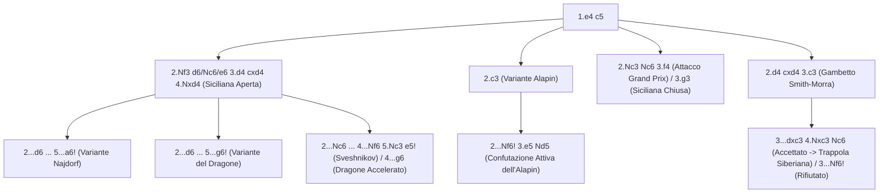

[[Home MOC|Home]] / [[Education & Learning]] / [[The Sicilian Defense]]

# The Sicilian Defense

## Sintesi Esecutiva

<mark style="background:rgba(255, 193, 69, 0.32)"><b>The Sicilian Defense</b></mark> (*Difesa Siciliana*, `1.e4 c5`) è statisticamente e storicamente la difesa più vincente e combattiva degli scacchi moderni, arma prediletta di Bobby Fischer, Garry Kasparov, Viswanathan Anand e Magnus Carlsen quando necessitano di giocare per la vittoria con i pezzi neri (`1300 – 2000+` ELO). A differenza di [[Classical 1...e5]], che imposta una battaglia simmetrica, e di [[The Caro-Kann Defense]], orientata alla solidità e al finale, la Siciliana insegna l'arte del <mark style="background:rgba(255, 193, 69, 0.32)"><b>contrattacco asimmetrico</b></mark> e la mentalità del <mark style="background:rgba(255, 193, 69, 0.32)"><b>combattere per vincere col Nero</b></mark> fin dalla prima mossa. Con `1...c5`, il Nero rifiuta qualsiasi simmetria e prepara lo scambio del proprio pedone laterale `c5` con il pedone centrale `d4` del Bianco, conquistando la maggioranza numerica di pedoni al centro e la micidiale <mark style="background:rgba(181, 113, 255, 0.36)"><b>colonna c semi-aperta</b></mark>.

| Parametro Tecnico | Dettaglio Strategico |
| :--- | :--- |
| **Nome Difesa** | The Sicilian Defense (*Difesa Siciliana* — Codici ECO `B20–B99`) |
| **Contro** | `1.e4` |
| **Mosse Iniziali** | `1.e4 c5` |
| **Lezione Primaria** | Contrattacchi asimmetrici, combattere per la vittoria con il Nero |
| **Fascia ELO Ideale** | `1300 – 2000+` (l'apertura d'elezione del giocatore agonista ambizioso) |

---

## 1. L'Equazione Strategica Fondamentale di `1.e4 c5`

Perché `1...c5` sbilancia immediatamente la partita a favore di una lotta senza quartiere?

Quando il Bianco accetta la sfida entrando nella **Siciliana Aperta (`1.e4 c5 2.Nf3 d6 3.d4 cxd4 4.Nxd4`)**, si verifica uno scambio strutturale asimmetrico di importanza capitale:

1. **Maggioranza centrale 2 contro 1 per il Nero**: Il Nero ha ceduto un pedone d'ala (`c5`) per eliminare un pedone centrale (`d4`). Di conseguenza, il Nero conserva **due pedoni centrali (`d` ed `e`)** contro il **solo pedone `e4`** del Bianco! Nel lungo termine e nel finale, questa maggioranza centrale conferisce al Nero un potenziale strategico superiore.
2. **La Colonna `c` Semi-Aperta**: La scomparsa del pedone `c5` apre la colonna `c` (`c8-c1`) per le Torri e la Donna del Nero (`...Rc8`, `...Qa5`/`...Qc7`), che puntano direttamente al Cavallo bianco in `c3` e al punto `c2`.
3. **La Corsa su Ali Opposte**: Il Bianco gode di un iniziale vantaggio di spazio e sviluppo sul lato di Re (dove cercherà di attaccare con `f4`, `g4` o `Bg5`), mentre il Nero scatena un contrattacco feroce sull'ala di Donna (`...a6`, `...b5`, `...Bb7`, `...Rc8`) e al centro (`...e5` o `...d5`).

![[chess_sicilian_01_tabiya.svg]]

---

## 2. Caso Principale A: La Siciliana Aperta — Najdorf (`5...a6!`) e Dragone (`5...g6!`)

Dopo le mosse standard `1.e4 c5 2.Nf3 d6 3.d4 cxd4 4.Nxd4 Nf6 5.Nc3`, il Nero sceglie la propria architettura di contrattacco.

### 2.1 La Variante Najdorf (`5...a6!`)

Sviluppata da Miguel Najdorf e portata alla perfezione da Fischer e Kasparov, **`5...a6!`** è la linea più giocata al mondo:

![[chess_sicilian_02_najdorf_tabiya.svg]]

- **Perché una mossa di pedone laterale (`5...a6!`) è così profonda?**:
  1. **Controlla la casa `b5`**: Impedisce gli scacchi fastidiosi `Bb5+` e i salti `Ndb5`/`Ncb5` che disturberebbero il pedone `d6`.
  2. **Prepara l'espansione `...b5!`**: Guadagna spazio sull'ala di Donna, preparando lo sviluppo dell'Alfiere in `b7` (`...Bb7` che preme come un laser sul pedone bianco `e4`!) e del Cavallo in `b6-c4`.
  3. **Mantiene flessibilità totale al centro**: A seconda di cosa gioca il Bianco alla sesta mossa, il Nero può spingere **`...e5!`** (prendendo il controllo della casa `d4`) oppure **`...e6`** (struttura Scheveningen compatta).
- **Come giocare contro l'Attacco Inglese (`6.Be3`)**:
  - **Sequenza**: `6.Be3 e5! 7.Nb3 Be6 8.f3 Be7 9.Qd2 O-O 10.O-O-O Nbd7 11.g4 b5!`.
  - **Piano del Nero**: Quando il Bianco arrocca lungo (`10.O-O-O`) e lancia i pedoni `g4-h4` contro il Re nero, il Nero non resta passivo ma spinge **`...b5!`**, porta il Cavallo in **`b6-c4`**, piazza la Torre in **`c8`** e al momento giusto rompe al centro con **`...d5!`**, facendo saltare in aria il centro bianco!

---

### 2.2 La Variante del Dragone (`5...g6!`) e il Sacrificio Tematico `...Rxc3!`

Con **`5...g6!`** seguito da **`6...Bg7`**, il Nero fianchetta l'Alfiere camposcuro sulla grande diagonale `h8-a1`. Questo pezzo, soprannominato l'<mark style="background:rgba(255, 193, 69, 0.32)"><b>Alfiere del Dragone</b></mark>, conferisce al Nero un potenziale tattico esplosivo contro l'arrocco lungo del Bianco.

- **La Battaglia nell'Attacco Jugoslavo (`6.Be3 Bg7 7.f3 O-O 8.Qd2 Nc6 9.Bc4 Bd7 10.O-O-O Rc8 11.Bb3 Ne5`)**:

![[chess_sicilian_03_dragon_rxc3.svg]]

> [!TIP] Il Sacrificio di Qualità Siciliano (`...Rxc3!`)
> Uno dei motivi tattici più potenti e ricorrenti in tutta la Difesa Siciliana (specialmente nel Dragone e nella Najdorf) è il sacrificio della Torre in `c8` per il Cavallo bianco in `c3`: **`...Rxc3! 12.bxc3`**.
> Perché il Nero sacrifica volentieri una Torre per un Cavallo?
> 1. **Demolisce lo scudo pedonale del Re bianco** in `c1`, creando pedoni doppiati e isolati (`a2` e `c3`) davanti al Re!
> 2. **Elimina il difensore chiave delle case `d5` ed `e4`**, permettendo a `...Nxe4`, `...Qa5` e all'Alfiere del Dragone in `g7` di convergere su `c3`, `b2` e `a2` con attacco di matto!

### 2.3 Il Dragone Accelerato (`2...Nc6 3.d4 cxd4 4.Nxd4 g6!`)

Per i giocatori che vogliono il fianchetto in `g7` **senza** dover memorizzare le linee taglienti dell'Attacco Jugoslavo, il **Dragone Accelerato (`1.e4 c5 2.Nf3 Nc6 3.d4 cxd4 4.Nxd4 g6!`)** è una scelta formidabile:
- **Il segreto strategico**: Poiché il Nero **non ha ancora spinto il pedone in `d6`**, se il Bianco imposta l'Attacco Jugoslavo (`5.Nc3 Bg7 6.Be3 Nf6 7.Bc4 O-O 8.Bb3`), il Nero può spingere **`...d5!` in un solo tempo** (invece di due tempi `d7-d6-d5`!), liquidando il centro e prendendo subito il comando della partita (`8...a5 9.f3 d5!`).

---

## 3. Caso Principale B: Come Battere le Anti-Siciliane (`1300 – 2000` ELO)

Nella fascia `1300 – 1800` ELO, oltre la metà dei giocatori con il Bianco teme la teoria della Siciliana Aperta e ripiega sulle cosiddette **Anti-Siciliane** (`2.c3`, `2.Nc3`, `2.d4 cxd4 3.c3`, `3.Bb5`). Ecco come punirle tutte.

### 3.1 Contro la Variante Alapin (`1.e4 c5 2.c3`)

Con `2.c3`, il Bianco vuole spingere `3.d4` e riprendere `cxd4` mantenendo due pedoni centrali uniti (`d4` ed `e4`).
- **Errore da evitare col Nero**: Non giocare mosse passive come `2...d6?! 3.d4`, che concedono al Bianco esattamente il centro che desidera!
- **La Risposta Attiva `2...Nf6!`**:
  Il Nero attacca immediatamente il pedone `e4`!
  - **Sequenza principale**: `3.e5 Nd5 4.d4 cxd4 5.Nf3 Nc6 6.cxd4 d6! 7.Bc4 Nb6 8.Bb5 dxe5! 9.Nxe5 Bd7!`.

![[chess_sicilian_04_alapin_counter.svg]]

  - **Piano del Nero**: Il Cavallo nero si gode il blocco centrale in `d5`/`b6`, la spinta `6...d6!` attacca la punta avanzata `e5`, e l'Alfiere campochiaro esce liberamente in `g4` o `f5` (`...Bg4!`), lasciando il pedone bianco `d4` isolato e sotto assedio!
  - *(Alternativa altrettanto valida: **`2...d5! 3.exd5 Qxd5 4.d4 Nf6 5.Nf3 Bg4!`**, dove la Donna nera in `d5` non può essere scacciata da `Nc3` perché la casa `c3` è occupata dal pedone bianco!)*

### 3.2 Contro il Gambetto Smith-Morra (`1.e4 c5 2.d4 cxd4 3.c3`)

Il Bianco sacrifica il pedone `c3` per ottenere sviluppo rapido (`3...dxc3 4.Nxc3`). Il Nero ha due soluzioni perfette:
1. **La Soluzione Furba (Rifiutare con `3...Nf6!`)**:
   Se hai già studiato la risposta `2...Nf6!` contro l'Alapin, su `2.d4 cxd4 3.c3` gioca semplicemente **`3...Nf6! 4.e5 Nd5`**! Hai trasformato gratuitamente il Gambetto Smith-Morra nella tua Variante Alapin preferita, lasciando a bocca asciutta il giocatore di gambetto!
2. **Accettare e Impostare la Trappola Siberiana (`3...dxc3 4.Nxc3 Nc6`)**:
   Vedi la Sezione 4.1 qui sotto per il piano completo e la trappola mortale `8...Ng4! 9.h3?? Nd4!`.

### 3.3 Contro l'Attacco Grand Prix (`1.e4 c5 2.Nc3 Nc6 3.f4`)

Simile a [[The Vienna Game]], il Bianco vuole spingere `f4-f5` e attaccare con `Bc4` e `Qh4`.
- **Il Piano Antidoto del Nero**:
  **`3...g6! 4.Nf3 Bg7 5.Bc4 e6! 6.O-O Nge7! 7.d3 O-O 8.Qe1 d5!`** (oppure `5.Bb5 Nd4!`):
  - Perché la coppia **`...e6` + `...Nge7`** è geniale contro il Grand Prix? Perché il pedone `e6` mura l'Alfiere bianco in `c4`, e il Cavallo in `e7` sostiene la rottura centrale **`...d5!`** senza bloccare l'Alfiere fianchettato in `g7`!

---

## 4. Le Mosse Più Ingannevoli, Trappole da Evitare e Trappole da Tendere

### Trappola 1 (Da Tendere col Nero!): La Trappola Siberiana nello Smith-Morra (`9...Nd4!`)

È una delle trappole più spettacolari di tutta la Difesa Siciliana, che ha mietuto vittime persino tra i Maestri:
- **Sequenza**: `1.e4 c5 2.d4 cxd4 3.c3 dxc3 4.Nxc3 Nc6 5.Nf3 e6 6.Bc4 Qc7 7.O-O Nf6 8.Qe2 Ng4!`.
- Con **`8...Ng4!`**, il Nero minaccia di saltare in `d4` (`...Nd4`) e punta su `h2`.
- Quasi tutti i giocatori con il Bianco giocano istintivamente **`9.h3??`** per scacciare il Cavallo da `g4` (se il Bianco giocasse `9.Nb5?`, seguirebbe `9...Qb8 10.h3 a6`).

> [!SUCCESS] Il Colpo di Fulmine Siberiano: `9...Nd4!!`
> Su `9.h3??`, il Nero **ignora** l'attacco su `g4` e salta con il secondo Cavallo in **`9...Nd4!!`**:
> 1. **Se il Bianco cattura il Cavallo in `d4` (`10.Nxd4`)**: La casa `f3` non è più controllata e la Donna nera in `c7` + il Cavallo in `g4` danno **scacco matto immediato con `10...Qh2#`**!
> 2. **Se il Bianco cattura il Cavallo in `g4` (`10.hxg4`)**: Il Nero cattura la Donna bianca con scacco: **`10...Nxe2+ 11.Bxe2`**, vincendo la Donna!

---

### Trappola 2 (Da Evitare col Nero!): L'Errore `6...Ng4??` nel Dragone (`7.Bb5+!`)

Nella Variante del Dragone (`1.e4 c5 2.Nf3 d6 3.d4 cxd4 4.Nxd4 Nf6 5.Nc3 g6 6.Be3`), alcuni giocatori col Nero vedono l'Alfiere bianco in `e3` e cercano subito di attaccarlo giocando **`6...Ng4??`** (prima di aver sviluppato `6...Bg7` e `7...Nc6`).

![[chess_sicilian_05_dragon_ng4_trap.svg]]

> [!DANGER] Perché `6...Ng4??` Perde un Pezzo Netto!
> Il Bianco non ritira l'Alfiere da `e3`, ma dà scacco con **`7.Bb5+!`**:
> - Se il Nero copre lo scacco con **`7...Bd7`**, l'Alfiere nero in `d7` è **inchiodato sul Re in `e8`** e non difende più il Cavallo in `g4`! La Donna bianca in `d1` cattura il Cavallo gratis con **`8.Qxg4!`**!
> - Se il Nero copre con **`7...Nc6`**, segue **`8.Nxc6! bxc6 9.Bxc6+ Bd7 10.Bxa8 Nxe3 11.fxe3 Qxa8`**, e il Bianco ha vinto qualità e pedone!
> - **Regola aurea nel Dragone**: Dopo `5...g6 6.Be3`, gioca **sempre `6...Bg7!`** seguito da **`7...O-O`** e **`8...Nc6`**.

---

### Trappola 3 (Da Evitare col Nero!): L'Attacco Levenfish (`6.f4 Bg7?! 7.e5!`)

Un secondo dettaglio d'ordine di mosse fondamentale nel Dragone (`1.e4 c5 2.Nf3 d6 3.d4 cxd4 4.Nxd4 Nf6 5.Nc3 g6`):
- Se alla sesta mossa il Bianco gioca l'aggressiva **`6.f4`** (*Attacco Levenfish*) e il Nero sviluppa automaticamente **`6...Bg7?!`**, il Bianco sfonda al centro con **`7.e5! dxe5 8.fxe5 Nfd7 9.e6!`** demolendo il Re nero!
- **L'antidoto perfetto del Nero contro `6.f4`**: Gioca prima **`6...Nc6!`** (controllando la casa `e5` con due pezzi: `Nf6` e `Nc6`!). Ora `7.e5` è impossibile, e alla mossa successiva (`7.Nf3 Bg7`) il Nero sviluppa l'Alfiere in totale sicurezza!

---

### Trappola 4 (Da Tendere col Nero!): Punire `Bc4` Prematuro con `...e6` e `...d5!`

A livello di club (`1200–1600` ELO), molti giocatori di [[The Italian Game]] sviluppano automaticamente l'Alfiere in `c4` anche contro la Siciliana (`1.e4 c5 2.Nf3 Nc6 3.Bc4?!` o `2.Bc4?!`).
- **Come il Nero trasforma `Bc4` in un bersaglio**:
  Rispondi subito **`...e6!`** (murando la diagonale `a2-g8` dell'Alfiere bianco) e prepara **`...Nf6`** e **`...d5!`**:
  `1.e4 c5 2.Nf3 e6 3.Bc4?! a6 4.O-O b5 5.Be2 Bb7 6.d3 Nf6`: l'Alfiere bianco ha perso due tempi per finire passivo in `e2`, mentre il Nero domina sia l'ala di Donna (`...b5`, `...Bb7`) sia il centro (`...d5!`).

---

## 5. Riepilogo Operativo e Checklist Difensiva per il Nero

| Variante del Bianco su `1.e4 c5` | Sistema Consigliato per il Nero | Punto Strategico / Tattico Chiave |
| :--- | :--- | :--- |
| **Siciliana Aperta (`3.d4 cxd4 4.Nxd4`)** | **Najdorf (`5...a6!`)** o **Dragone (`5...g6!`)** | Sfrutta la colonna `c` (`...Rc8`), l'espansione `...b5` e il sacrificio `...Rxc3!` |
| **Nel Dragone su `6.Be3` / `6.f4`** | `6.Be3 Bg7!`; su `6.f4` gioca **`6...Nc6!`** | **MAI** giocare `6.Be3 Ng4??` (`7.Bb5+! Bd7 8.Qxg4!`); `6...Nc6!` ferma `7.e5!` |
| **Variante Alapin (`2.c3`)** | `2...Nf6! 3.e5 Nd5 4.d4 cxd4 5.Nf3 Nc6 6.cxd4 d6!` | Provoca `3.e5`, blocca `d5` col Cavallo e attacca il centro bianco con `...d6` e `...Bg4` |
| **Gambetto Smith-Morra (`2.d4 cxd4 3.c3`)** | `3...Nf6! 4.e5 Nd5` (oppure `3...dxc3`) | Se accetti, imposta `...Qc7`, `...Nf6`, `...Ng4!` e la **Trappola Siberiana `9...Nd4!`** |
| **Attacco Grand Prix (`2.Nc3 Nc6 3.f4`)** | `3...g6 4.Nf3 Bg7 5.Bc4 e6! 6.O-O Nge7!` | Mura `Bc4` con `...e6` e rompi subito al centro con `...d5!` |
