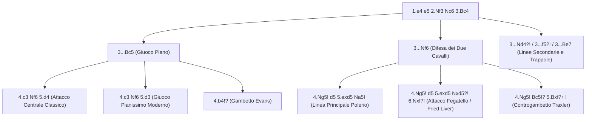

[[Home MOC|Home]] / [[Education & Learning]] / [[The Italian Game]]

# The Italian Game

## Sintesi Esecutiva

<mark style="background:rgba(255, 193, 69, 0.32)"><b>The Italian Game</b></mark> (*Partita Italiana*, definita dalla sequenza madre `1.e4 e5 2.Nf3 Nc6 3.Bc4`) è una delle aperture più antiche, didattiche e longeve della storia degli scacchi, documentata fin dal XVI secolo nei trattati di Damiano, Polerio e Gioachino Greco e oggi impiegata regolarmente fino ai massimi livelli mondiali. La lezione primaria impartita dall'apertura risiede nella <mark style="background:rgba(255, 193, 69, 0.32)"><b>rapidità di sviluppo</b></mark>, nel <mark style="background:rgba(181, 113, 255, 0.36)"><b>puntamento diretto sulla casa debole f7</b></mark> e nella preparazione metodica delle <mark style="background:rgba(255, 193, 69, 0.32)"><b>rotture centrali c3 e d4</b></mark>. A differenza di [[The Scotch Game]], che apre il centro immediatamente alla terza mossa, e di [[The Ruy Lopez]], che esercita una pressione indiretta sul difensore del pedone `e5`, la Partita Italiana colloca l'Alfiere campochiaro sulla diagonale attiva `a2-g8`, creando fin dalle prime battute minacce concrete contro il Re avversario non ancora arroccato.

| Parametro Tecnico | Dettaglio Strategico |
| :--- | :--- |
| **Nome Apertura** | The Italian Game (*Partita Italiana* — Codici ECO `C50–C59`) |
| **Mosse Iniziali** | `1.e4 e5 2.Nf3 Nc6 3.Bc4` |
| **Lezione Primaria** | Sviluppo rapido, pressione sul punto `f7`, rotture centrali (`c3` e `d4`) |
| **Fascia ELO Ideale** | `750 – 2000+` (universale: dal giocatore di club all'élite mondiale) |
| **Indole Posizionale** | Ibrida: tattica ed esplosiva nelle linee aperte (`d4`, Gambetto Evans, Due Cavalli), manovriera nel *Giuoco Pianissimo* (`d3`) |

---

## 1. Filosofia dell'Apertura e Anatomia della Posizione Madre

Analizzando mossa per mossa la sequenza iniziale `1.e4 e5 2.Nf3 Nc6 3.Bc4`:

1. **`1.e4 e5`**: Entrambi i giocatori occupano il centro con il pedone di Re, controllando case critiche (`d5`/`f5` per il Bianco, `d4`/`f4` per il Nero) e liberando le diagonali per l'Alfiere di Re e la Donna.
2. **`2.Nf3 Nc6`**: Il Bianco sviluppa il Cavallo verso il centro attaccando `e5`; il Nero lo difende sviluppando a sua volta un pezzo minore sulla casa naturale `c6`.
3. **`3.Bc4`**: La mossa identitaria dell'Italiana. L'Alfiere si colloca sulla <mark style="background:rgba(181, 113, 255, 0.36)"><b>diagonale italiana a2-g8</b></mark>, liberando la traversa per l'arrocco corto (`O-O`) alla quarta mossa e mirando direttamente al <mark style="background:rgba(255, 193, 69, 0.32)"><b>pedone f7</b></mark>.

![[chess_italian_01_tabiya.svg]]

### Perché la casa f7 è il tallone d'Achille del Nero?

Nella posizione iniziale degli scacchi, ogni pedone della settima traversa è protetto da almeno due pezzi, ad eccezione del pedone `f7` (e simmetricamente `f2` per il Bianco), che è **difeso esclusivamente dal Re in `e8`**. Puntare l'Alfiere in `c4` significa:
- Impedire al Nero mosse distratte: non appena un secondo pezzo bianco (un Cavallo in `g5` o la Donna in `b3`/`f3`) si unisce all'attacco su `f7`, il Nero rischia una doppia minaccia letale o lo scacco matto.
- Controllare la casa centrale `d5`, ostacolando la liberazione del Nero tramite `...d5`.
- Preparare il <mark style="background:rgba(181, 113, 255, 0.36)"><b>piano centrale classico c2-c3 seguito da d2-d4</b></mark>: poiché il Cavallo bianco non occupa `c3` (a differenza di [[The Vienna Game]]), il pedone `c` può avanzare in `c3` per sostenere la spinta `d4`, garantendo che dopo `...exd4` il Bianco possa riprendere di pedone (`cxd4`) mantenendo una coppia ideale di pedoni centrali affiancati in `d4` ed `e4`.

---

## 2. Caso Principale A: Il Giuoco Piano (`3...Bc5`)

Con `3...Bc5` il Nero risponde in modo simmetrico, sviluppando l'Alfiere sulla diagonale `a7-g1`, controllando la casa centrale `d4` e preparando a sua volta l'arrocco. Da qui il Bianco dispone di tre grandi architetture strategiche.

### 2.1 L'Attacco Centrale Classico (`4.c3 Nf6 5.d4`)

Questa è la linea didattica per eccellenza per comprendere la lotta per il centro:

1. **`4.c3`**: Prepara l'avanzata `d2-d4`.
2. **`4...Nf6`**: Il Nero sviluppa il Cavallo attaccando immediatamente il pedone `e4`.
3. **`5.d4! exd4 6.cxd4 Bb4+!`**:
   - **Nota Tattica Fondamentale**: Dopo `6.cxd4`, l'Alfiere nero in `c5` è attaccato. Se il Nero si ritira passivamente con `6...Bb6?`, il Bianco gioca `7.d5! Ne7 8.e5! Ng4 9.d6!`, schiacciando i pezzi neri. Pertanto il Nero **deve** interporre lo scacco `6...Bb4+!`.

![[chess_italian_02_giuoco_piano_center.svg]]

A questo punto il Bianco ha una biforcazione cruciale alla settima mossa:

#### Opzione 1: La Linea Posizionale Solida (`7.Bd2`)
- **Sequenza**: `7.Bd2 Bxd2+ 8.Nbxd2 d5! 9.exd5 Nxd5 10.Qb3 Nce7 11.O-O O-O 12.Rfe1 c6`.
- **Piano del Bianco**: Il Bianco accetta un <mark style="background:rgba(181, 113, 255, 0.36)"><b>Pedone di Donna Isolato (IQP)</b></mark> in `d4` (struttura gemella a quella studiata in [[The Queen's Gambit]]) in cambio di un'attività superiore dei pezzi: la Donna in `b3` preme simultaneamente su `d5` e `b7`, le Torri dominano le colonne centrali `e` e `c`, e il Cavallo mira all'avamposto `e5` (`Ne5` o `Ne4-c5`).
- **Errore comune del Nero da punire**: Se dopo `7.Bd2 Bxd2+ 8.Nbxd2` il Nero cattura avidamente il pedone con `8...Nxe4?` (invece di `8...d5!`), il Bianco risponde `9.Nxe4 d5 10.Bxd5! Qxd5 11.Nc3`, uscendo dall'apertura con un forte vantaggio di sviluppo e il Re nero ancora al centro.

#### Opzione 2: Il Gambetto Greco / Attacco Moeller (`7.Nc3!?`)
- **Sequenza**: `7.Nc3 Nxe4 8.O-O!`.
- Il Bianco sacrifica il pedone `e4` per accelerare lo sviluppo e aprire la colonna `e` contro il Re nero:
  - **L'errore avido del Nero (`8...Nxc3?!`)**: Dopo `9.bxc3 Bxc3?` (ancora peggio se seguito da `10.Ba3!` o `10.Qb3!`), la risposta `10.Qb3!` attacca sia l'Alfiere in `c3` sia il punto `f7`! Se il Nero mangia la Torre con `10...Bxa1?`, segue `11.Bxf7+ Kf8 12.Bg5 Ne7 13.Ne5!` con attacco di matto inarrestabile. Anche dopo `10.Ba3!`, l'Alfiere bianco su `a3` taglia la via d'arrocco al Re nero in `e8`.
  - **La difesa corretta del Nero (`8...Bxc3!`)**: Il Nero deve eliminare il Cavallo prima che diventi attivo, ma il Bianco lancia comunque l'<mark style="background:rgba(181, 113, 255, 0.36)"><b>Attacco Moeller</b></mark> con `9.d5! Bf6 10.Re1 Ne7 11.Rxe4 d6 12.Bg5 Bxg5 13.Nxg5 O-O 14.Nxh7!`, con complicazioni tattiche violentissime.

---

### 2.2 Il Giuoco Pianissimo (`4.c3 Nf6 5.d3` o `4.d3`)

Ai livelli superiori (`1600 – 2800+` ELO), il *Giuoco Pianissimo* è diventato l'arma principale dell'élite perché evita le semplificazioni forzate di `5.d4`, mantenendo tutti i pezzi sulla scacchiera in una lotta strategica simile a [[The Ruy Lopez]]:

- **Sequenza tipica**: `1.e4 e5 2.Nf3 Nc6 3.Bc4 Bc5 4.c3 Nf6 5.d3 d6 6.O-O a5 7.Re1 O-O 8.h3 h6 9.Nbd2`.
- **Piani strategici del Bianco**:
  1. **Ritirata profilattica dell'Alfiere**: `Bc4-b3-c2`, mettendo l'Alfiere al riparo da cambi con `...Na5` o `...Be6`.
  2. **La manovra ispano-italiana del Cavallo (`Nbd2 -> Nf1 -> Ng3`)**: Poiché la casa `c3` è occupata dal pedone, il Cavallo di Donna viaggia via `d2` e `f1` fino a `g3` (o `e3`), mirando alle case `f5` e `h5` sul lato di Re.
  3. **Rottura `d3-d4` al momento perfetto**: Il Bianco spinge `d4` solo quando le Torri sono già in `e1`/`d1` e i Cavalli sono pronti a occupare gli avamposti centrali.

---

### 2.3 Il Gambetto Evans (`4.b4!?`)

Ideato dal Capitano William Davies Evans nel 1827 e reso immortale da Paul Morphy, Anderssen e Kasparov, il <mark style="background:rgba(255, 193, 69, 0.32)"><b>Gambetto Evans</b></mark> (`1.e4 e5 2.Nf3 Nc6 3.Bc4 Bc5 4.b4!?`) è una delle armi d'attacco più spettacolari dell'intero repertorio per il Bianco.

![[chess_italian_04_evans_gambit.svg]]

- **L'idea profonda dietro `4.b4!?`**:
  Sacrificando il pedone laterale `b4` (`4...Bxb4`), il Bianco ottiene tre vantaggi immediati:
  1. Guadagna il tempo `5.c3` attaccando l'Alfiere nero (`5...Ba5` o `5...Be7`).
  2. Costruisce il centro ideale con `6.d4!` a costo zero di tempi.
  3. Svuota la casa `b3` per la Donna (`Qb3`) e apre la micidiale diagonale `a3-f8` per l'Alfiere camposcuro (`Ba3!`), che impedisce al Re nero di arroccare!
- **Linea guida d'attacco**: `4.b4 Bxb4 5.c3 Ba5 6.d4 exd4 7.O-O!`:
  - Se il Nero è avido e cattura il secondo e il terzo pedone con `7...dxc3 8.Qb3! Qf6 9.e5 Qg6 10.Nxc3 Nge7 11.Ba3` (*Compromised Defense*), il Bianco domina l'intera scacchiera e i pezzi neri rimangono paralizzati.
  - La difesa più solida per il Nero è restituire il pedone al momento giusto con `7...d6 8.cxd4 Bb6 9.Nc3 Bg4`, ma il Bianco conserva comunque un centro imponente e un'iniziativa duratura.

---

## 3. Caso Principale B: La Difesa dei Due Cavalli (`3...Nf6`)

Con `3...Nf6` il Nero rifiuta la simmetria di `3...Bc5` e contrattacca immediatamente il pedone `e4`. Qui il Bianco può giocare posizionalmente con `4.d3` (rientrando nel Giuoco Pianissimo), oppure lanciare la mossa più critica e tagliente della teoria: **`4.Ng5!`**.

> [!TIP] Perché 4.Ng5! non viola i principi sebbene muova due volte lo stesso pezzo?
> Di norma muovere due volte lo stesso pezzo in apertura è un errore, ma `4.Ng5!` rappresenta un'eccezione concreta e teoricamente ineccepibile: attacca `f7` con due pezzi (`Bc4` e `Ng5`) e **non esiste alcun pezzo nero che possa difendere `f7` in modo naturale** senza fare concessioni strutturali.

### 3.1 L'Errore `5...Nxd5?!` e l'Attacco Fegatello (*Fried Liver Attack*)

Dopo `4.Ng5`, l'unica mossa logica del Nero per intercettare la diagonale dell'Alfiere `c4` è `4...d5! 5.exd5`.
A questo punto, tra `750` e `1600` ELO, la stragrande maggioranza dei giocatori con il Nero gioca istintivamente **`5...Nxd5?!`**. Questa mossa naturale è un grave errore posizionale e tattico che permette due continuazioni devastanti:

![[chess_italian_03_fried_liver.svg]]

1. **L'Attacco Fegatello (`6.Nxf7!`)**:
   - **Sequenza**: `6.Nxf7! Kxf7 7.Qf3+!`:
   - Il Bianco sacrifica il Cavallo in `f7` per attirare il Re nero allo scoperto e inchiodare/attaccare due volte il Cavallo in `d5` con `Bc4` e `Qf3+`.
   - **Attenzione ai falsi ripari del Nero**:
     - Se `7...Kg8??`, segue `8.Bxd5+ Qxd5 9.Qxd5+ Be6 10.Qxe6#` (Matto in 10 mosse!).
     - Se `7...Ke8??`, segue `8.Bxd5` minacciando `9.Qf7#` e `9.Bxc6+`.
     - Il Nero è **forzato** a portare il Re in mezzo alla scacchiera con `7...Ke6! 8.Nc3 Ncb4! 9.Qe4 c6 10.a3 Na6 11.d4!`, dove il Bianco apre tutte le linee centrali contro il Re nero esposto in `e6`.
2. **L'Attacco Lolli (`6.d4!`)**:
   - Ancora più spietato secondo i motori moderni: prima di sacrificare in `f7`, il Bianco gioca `6.d4! exd4 7.O-O!`, mettendo subito la Torre in `e1` e minacciando `Nxf7` con effetti ancora più distruttivi.

### 3.2 La Linea Principale Corretta del Nero: Difesa Polerio (`5...Na5!`)

Per evitare il Fegatello dopo `4.Ng5 d5 5.exd5`, il Nero istruito gioca **`5...Na5!`**, attaccando l'Alfiere in `c4`:
- **Sequenza principale**: `6.Bb5+ c6 7.dxc6 bxc6 8.Be2! (o 8.Bd3) h6 9.Nf3 e4 10.Ne5 Bd6`.
- **Come gioca il Bianco**: Non bisogna farsi chiudere il Cavallo! Dopo `9.Nf3 e4 10.Ne5`, il Bianco attacca il punto `c6` e prepara `11.d4!` (oppure `10...Bd6 11.f4!`), consolidando il pedone di vantaggio e respingendo l'iniziativa dei pezzi neri.

---

## 4. Le Mosse Più Ingannevoli, Trappole Letali e Contro-Trappole

Questa sezione raccoglie le trappole più insidiose (sia quelle che il Bianco può tendere sia i trabocchetti in cui il Nero cerca di far cadere il Bianco).

### Trappola 1: Il Gambetto Blackburne Shilling (`3...Nd4?!`) — Non Mangiare `e5`!

Una delle trappole più frequenti nel gioco online sotto i `1500` ELO: dopo `1.e4 e5 2.Nf3 Nc6 3.Bc4`, il Nero gioca la mossa apparentemente assurda **`3...Nd4?!`**, lasciando il pedone `e5` completamente indifeso.

![[chess_italian_05_blackburne_trap.svg]]

> [!DANGER] L'Esca Mortale da Evitare (`4.Nxe5??`)
> Se il Bianco cattura avidamente il pedone con `4.Nxe5??`, cade in una trappola micidiale:
> `4.Nxe5?? Qg5!` (attacca contemporaneamente il Cavallo in `e5` e il pedone `g2`!).
> Il Bianco pensa di essere furbo e gioca `5.Nxf7??` (forchetta su Donna e Torre), ma il Nero risponde:
> `5...Qxg2! 6.Rf1 Qxe4+! 7.Be2 Nf3#` — **Scacco matto affogato alla settima mossa**, poiché l'Alfiere in `e2` è inchiodato dalla Donna nera in `e4`!

- **La Confutazione Semplice e Chirurgica del Bianco**:
  Basta giocare **`4.Nxd4! exd4 5.O-O`** (oppure `4.c3! Nxf3+ 5.Qxf3 Nf6 6.d4`): il Nero ha perso tempi preziosi, si ritrova con i pedoni doppiati e bloccati sulla colonna `d` e un grave ritardo di sviluppo.

---

### Trappola 2: Il Controgambetto Traxler / Wilkes-Barre (`3...Nf6 4.Ng5 Bc5!?`)

Dopo `1.e4 e5 2.Nf3 Nc6 3.Bc4 Nf6 4.Ng5`, invece di `4...d5`, alcuni giocatori tattici giocano la mossa scioccante **`4...Bc5!?`**, ignorando totalmente l'attacco su `f7`!

- **Perché è ingannevole**: Se il Bianco gioca automaticamente `5.Nxf7?!`, pensando di guadagnare la Torre con la forchetta su `d8` e `h8`, il Nero esplode con **`5...Bxf2+! 6.Kxf2 Nxe4+ 7.Kg1 Qh4!`**, trascinando il Re bianco in una tempesta di scacchi su `f2` ed `e1` dove un solo passo falso porta al matto.
- **Come smontare il Traxler senza rischi**:
  Contro `4...Bc5!?`, il Bianco deve catturare in `f7` **con l'Alfiere e non con il Cavallo**:
  **`5.Bxf7+! Ke7 6.Bb3!`** (oppure `6.Bd5`).
  - Risultato: Il Bianco ha vinto un pedone netto (`f7`), ha tolto il diritto d'arrocco al Re nero (che ora intralcia i propri pezzi in `e7`), e ha **già ritirato l'Alfiere in `b3`**, rendendo impossibile il sacrificio `...Bxf2+` e mantenendo il proprio Re completamente al sicuro!

---

### Trappola 3: Il Matto di Légal nell'Italiana (`3...d6`)

Contro giocatori passivi che rispondono a `3.Bc4` con la timida `3...d6` (*Difesa Semi-Italiana*):
- **Sequenza della trappola**: `1.e4 e5 2.Nf3 Nc6 3.Bc4 d6 4.Nc3 Bg4? 5.h3 Bh5?`.
- Il Nero crede che il Cavallo in `f3` sia inchiodato sulla Donna in `d1`. In realtà, poiché il punto `f7` e la casa `d5` sono sguarniti, il Bianco scatena il celebre sacrificio di Donna:
  **`6.Nxe5! Bxd1?? 7.Bxf7+ Ke7 8.Nd5#`** — Scacco matto con soli tre pezzi minori nel mezzo della scacchiera! (Anche se il Nero si accorge del matto e gioca `6...Nxe5 7.Qxh5 Nxc4 8.Qb5+`, la forchetta in `b5` recupera il pezzo lasciando il Bianco con un pedone pulito di vantaggio).

---

### Trappola 4: L'Errore dell'Inchiodatura Prematura `Bg5`

Un errore tipico dei giocatori tra `800` e `1400` ELO (sia col Bianco sia col Nero) nel Giuoco Pianissimo è giocare `Bg5` (o `...Bg4`) **prima che l'avversario abbia arroccato corto**:
- Esempio: `1.e4 e5 2.Nf3 Nc6 3.Bc4 Bc5 4.d3 Nf6 5.Bg5?! h6 6.Bh4? g5! 7.Bg3 d6`.
- Poiché il Re nero è ancora in `e8` (e può eventualmente arroccare lungo o restare protetto al centro con la colonna `g` aperta), la spinta `...h6` e `...g5!` non indebolisce il Re nero, ma inchioda l'Alfiere bianco in una prigione passiva in `g3` e lancia una valanga di pedoni sul lato di Re!
- **Regola d'Oro**: Gioca `Bg5` nel Giuoco Pianissimo solo *dopo* che il Nero ha già giocato `...O-O` (cosicché `...g5` indebolirebbe fatalmente il suo Re arroccato), oppure mantieni l'Alfiere in `e3`.

---

## 5. Riepilogo Operativo e Checklist Decisionale per il Bianco

| Risposta del Nero a `3.Bc4` | Piano Consigliato per il Bianco | Obiettivo Strategico Chiave |
| :--- | :--- | :--- |
| **`3...Bc5`** (*Giuoco Piano*) | `4.c3 Nf6 5.d4` (tattico) oppure `5.d3` (posizionale) | Conquistare il centro o manovrare `Nbd2-f1-g3` |
| **`3...Bc5`** (Alternativa d'attacco) | `4.b4!?` (*Gambetto Evans*) | Deviare l'Alfiere da `c5`, spingere `c3-d4` e giocare `Ba3!` |
| **`3...Nf6`** (*Due Cavalli*) | `4.Ng5! d5 5.exd5` | Punire `5...Nxd5?!` con `6.Nxf7!`; contro `5...Na5!` giocare `6.Bb5+` |
| **`3...Nf6 4.Ng5 Bc5!?`** (*Traxler*) | `5.Bxf7+! Ke7 6.Bb3!` | Vincere il pedone `f7` in totale sicurezza evitando `5.Nxf7?! Bxf2+!` |
| **`3...Nd4?!`** (*Blackburne Trap*) | `4.Nxd4! exd4 5.O-O` | Rifiutare l'esca avvelenata `4.Nxe5?? Qg5!` e punire la perdita di tempo |
| **`3...f5?!`** (*Gambetto Rousseau*) | `4.d3!` (solida) oppure `4.d4! exd4 5.e5!` | Non prendere `4.exf5? e4!`; sfruttare l'indebolimento della diagonale `a2-g8` |
