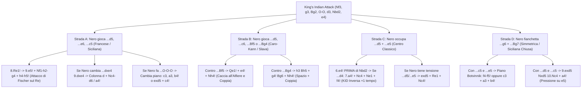

[[Home MOC|Home]] / [[Education & Learning]] / [[The King's Indian Attack]]

# The King's Indian Attack

## Sintesi Esecutiva — La Filosofia del Grande Maestro

<mark style="background:rgba(255, 193, 69, 0.32)"><b>The King's Indian Attack</b></mark> (*Attacco Est-Indiano* o **KIA**, definito dallo schieramento `Nf3`, `g3`, `Bg2`, `O-O`, `d3`, `Nbd2`, `e4`) è molto più di una semplice apertura: è un **sistema universale ipermoderno** che trasforma il Bianco in un serpente arrotolato, capace di colpire qualunque difesa avversaria — Francese, Siciliana, Caro-Kann, Slava, `1...d5` o `1...Nf6` — con una conoscenza strategica profonda invece di centinaia di varianti memorizzate a vuoto (`1000 – 2600+` ELO). Portato alla leggenda da **Bobby Fischer** (il cui capolavoro contro Myagmarsuren a Sousse 1967 resta la Bibbia dell'attacco sul lato di Re) e raffinato da campioni come Petrosian, Botvinnik, Larsen, Nakamura e Carlsen, il KIA è la controparte speculare di [[The King's Indian Defense]], ma giocata con un <mark style="background:rgba(255, 193, 69, 0.32)"><b>tempo intero di vantaggio</b></mark>.

Tuttavia, ecco la prima verità che separa il giocatore di club dal Grande Maestro: **il KIA NON è un sistema da giocare con il pilota automatico!** Un dilettante spinge le stesse 7 mosse meccaniche senza guardare cosa fa il Nero e finisce soffocato al centro; un Maestro usa lo scheletro elastico del KIA come una <mark style="background:rgba(181, 113, 255, 0.36)"><b>piattaforma camaleontica</b></mark>, adattando l'ordine di mosse, la rottura centrale (`e4-e5!` vs `f4!` vs `c4!` vs `exd5`) e il percorso dei pezzi al preciso difetto strutturale commesso dal Nero.

| Parametro Tecnico | Dettaglio Strategico |
| :--- | :--- |
| **Nome Apertura** | The King's Indian Attack (*Attacco Est-Indiano* — Codici ECO `A07–A08`, trasposizioni `C00 / B00 / B20`) |
| **Scheletro Base** | `Nf3`, `g3`, `Bg2`, `O-O`, `d3`, `Nbd2`, `e4` (raggiunto via `1.Nf3`, `1.e4` o `1.g3`) |
| **Lezione Primaria** | Flessibilità ipermoderna, manovre di Cavallo (`Nd2-f1-h2-g4`), attacco su case scure e profilassi contro il centro nero |
| **Fascia ELO Ideale** | `1000 – 2600+` (arma letale contro giocatori dogmatici di Francese, Siciliana `...e6` e Caro-Kann) |
| **Indole Posizionale** | Elastica, insidiosa, esplosiva sul lato di Re e ricca di trasposizioni velenose |

---

## 1. Anatomia della "Molla Carica" e Maestria dell'Ordine di Mosse

Prima di studiare le singole strade, devi interiorizzare **il ruolo di ogni pezzo** nello schieramento base del KIA (`1.Nf3 d5 2.g3 c5 3.Bg2 Nc6 4.O-O Nf6 5.d3 e6 6.Nbd2 Be7 7.e4 O-O 8.Re1`):

1. **Il Bunker `g3 + Bg2 + O-O`**: Garantisce al Re bianco una fortezza quasi impenetrabile, mentre l'Alfiere in `g2` irradia una pressione costante sulla grande diagonale `h1-a8` e, quando il centro si chiude con `e5`, difende `e4` o si ricicla via `Bf1-h3`!
2. **La Coppia `d3 + e4`**: Costituisce la rampa di lancio. In base alla risposta del Nero, il pedone `e4` può diventare il <mark style="background:rgba(255, 193, 69, 0.32)"><b>cuneo assassino `e4-e5!`</b></mark> (contro Francese/Siciliana), il fulcro di una **Est-Indiana Inversa** (`e4!` contro `...d5+...e5` seguita da `f4!`), oppure il detonatore che punisce un Alfiere esposto in `f5`.
3. **La Torre in `e1` (`Re1`)**: Non serve solo a sostenere `e4-e5`. La sua missione segreta è **liberare la casa `f1`** per il leggendario **Giro del Cavallo di Fischer**: `Nb1 -> d2 -> f1 -> h2 (o e3) -> g4 -> f6/h6`!
4. **L'Alfiere `c1` (`Bf4` / `Bg5`)**: Rimane dietro fino all'ultimo istante per osservare dove il Nero espone il fianco, per poi scattare in **`f4`** (puntando su `h6` e controllando `e5`) oppure in **`b2`** dopo `b3` nelle linee aperte.

![[chess_kia_01_tabiya.svg]]

### Quale Prima Mossa Scegliere? (`1.Nf3` vs `1.e4` vs `1.g3`)

Un Grande Maestro sceglie l'ordine di mosse in base al proprio repertorio globale:

| Prima Mossa | Vantaggio Principale | Controindicazione / Dettaglio Critico |
| :--- | :--- | :--- |
| **`1.Nf3`** *(Scelta Universale)* | Massima flessibilità: impedisce `1...e5`, permette il KIA puro contro qualsiasi replica del Nero e lascia aperte trasposizioni nella Réti o nell'Inglese (`c4`). | Se il Nero gioca subito `...d5`, `...c5`, `...Nc6` e **`...e5!`**, devi conoscere la reazione esatta **`6.e4!`** (Sezione 4) per non subire `...e4!`. |
| **`1.e4`** *(Scelta di Fischer)* | Usi il KIA come arma chirurgica contro **Francese (`1...e6 2.d3 d5 3.Nd2!`)**, **[[The Sicilian Defense]] (`1...c5 2.Nf3 e6 3.d3`)** e **[[The Caro-Kann Defense]] (`1...c6 2.d3 d5 3.Nd2!`)**, mantenendo [[The Ruy Lopez]] o [[The Italian Game]] contro `1...e5`. | Contro la Siciliana `1.e4 c5 2.Nf3 Nc6 3.d3 g6 4.g3 Bg7`, entri in una Siciliana Chiusa/KIA dove `e5` non è più possibile (Sezione 5). |
| **`1.g3`** *(Scelta Camaleontica)* | Evita alcune linee anti-`1.Nf3` (come `1.Nf3 d5 2.g3 Bg4`), ma dopo `1.g3 e5 2.Bg2 d5` devi saper gestire il centro aperto o trasporre in `d3 + Nf3`. | Consente al Nero di occupare subito tutto il centro con `1...e5` e `2...d5`. |

---

## 2. Strada A: Il Capolavoro di Bobby Fischer — KIA contro Francese e Siciliana (`...e6`, `...d5`, `...c5`)

Questa è la **strada regina del KIA**, quella in cui l'apertura esprime la massima brutalità artistica. Sorge tramite:
- **Contro la Francese**: `1.e4 e6 2.d3 d5 3.Nd2 Nf6 4.Ngf3 c5 5.g3 Nc6 6.Bg2 Be7 7.O-O O-O 8.Re1!` *(Nota: `3.Nd2!` è più precisa di `3.Nf3?` perché dopo `3.Nf3? dxe4 4.dxe4 Qxd1+` il Bianco perde il diritto d'arrocco! Con `3.Nd2!`, su `3...dxe4 4.dxe4` le Donne restano in gioco o il Bianco controlla la colonna `d` con sviluppo impeccabile).*
- **Contro la Siciliana (`...e6`)**: `1.e4 c5 2.Nf3 e6 3.d3 Nc6 4.g3 d5 5.Nbd2 Nf6 6.Bg2 Be7 7.O-O O-O 8.Re1!`
- **Via `1.Nf3`**: `1.Nf3 d5 2.g3 c5 3.Bg2 Nc6 4.O-O e6 5.d3 Nf6 6.Nbd2 Be7 7.e4 O-O 8.Re1!`

### 2.1 L'Anatomia dell'Assalto Perfetto: `9.e5!`, `10.Nf1!`, `11.h4!`, `13.N1h2!`

Quando il Nero avvia il proprio controgioco sull'ala di Donna (`8...b5`), il Bianco scatena il meccanismo che ha reso immortale Bobby Fischer:
**`8...b5 9.e5! Nd7 10.Nf1! b4 11.h4! a5 12.Bf4 Ba6 13.N1h2!`**

![[chess_kia_02_fischer_attack.svg]]

> [!IMPORTANT] I 5 Pilastri dell'Attacco KIA sulle Case Scure
> 1. **Il Cuneo `e5!` Spacca la Scacchiera in Due**: Spingendo `e4-e5!`, il Bianco scaccia il miglior difensore del Re nero (`Nf6 -> d7`) e crea un muro invalicabile. Tutti i pezzi neri restano intrappolati sull'ala di Donna (`Ba6`, `Nc6`, `Nd7`, `Ra8`), mentre il Re nero resta **solo sul lato di Re**!
> 2. **Il Giro del Cavallo (`Nd2 -> f1 -> h2 -> g4`)**: È l'arteria vitale dell'attacco. In `g4` il Cavallo controlla le case scure mortali **`f6`** e **`h6`**, supportato dal pedone `e5`! *(Variante d'élite: quando il Nero spinge `...a4`, il Cavallo può passare anche via `Ne3 -> g4` o `Nf1-e3-g4`!).*
> 3. **L'Ariete `h4-h5-h6!`**: Spingere `h4-h5` (e poi `h6!`) pone il Nero davanti a un dilemma mortale:
>    - Se lascia arrivare `h6`, dopo `...g6`, le case scure **`f6`**, **`g7`** e **`h6`** diventano crateri permanenti dove piombano `Nf6+!`, `Bg5`/`Bf4-h6` e `Qd2-h6`!
>    - Se tenta di fermare l'ariete con **`...h6?`**, apre la porta al sacrificio immediato **`Bxh6!!`** (vedi Trappola 1!).
> 4. **La Batteria `Qd2 + Bf4` -> `Bh6`**: L'Alfiere in `f4` è spesso destinato a sacrificarsi in `h6` oppure a scambiarsi con l'unico difensore delle case scure nere (`...Be7` o `...Bf8`).
> 5. **Il Risveglio Segreto dell'Alfiere `g2`**: Non farti ingannare dal fatto che `Bg2` sembri bloccato da `e5`! In primis, difende come un leone la base `e4`/`d5` e il Re; in secondo luogo, nelle fasi decisive si ricicla con **`Bf1 -> Bh3`** (puntando su `e6`!) oppure esplode sulla grande diagonale se il Bianco sacrifica **`d4`** / **`e5-e6`** o il Nero spinge `...f6`!

### 2.2 Come Reagire alle 3 Deviazioni Principali del Nero in Strada A

1. **Il Nero liquida il centro con `...dxe4 9.dxe4` (invece di lasciar giocare `e5`)**:
   - **Errore da evitare**: Non essere deluso! Hai ottenuto un vantaggio posizionale pulitissimo!
   - **Piano del GM**: La colonna `d` è aperta e la grande diagonale del `Bg2` è libera. Gioca **`c3!`**, **`Qc2`**, **`Nc4!`**, **`a4!`** (per inchiodare `c4` e impedire `...b5`) e porta il Cavallo in **`d6`**, oppure gioca **`e5!`** seguita da **`Ne4 -> d6`** paralizzando tutto l'esercito nero!
2. **Il Nero rompe la punta `e5` con `...f6` (o `...f5`)**:
   - **Contro `...f6`**: Cattura **`exf6!`** (`Bxf6` o `Nxf6`) -> il pedone nero **`e6`** diventa un bersaglio arretrato cronico sulla colonna `e` semiaperta! Gioca **`Bh3!`**, **`Ng5!`**, **`Rxe6!`**, **`Qe2`** e demolisci `e6`!
   - **Contro `...f5`**: Cattura **`exf6!`** (*en passant*, `Nxf6` o `Bxf6`) -> ancora una volta `e6` resta debole a vita e la casa **`e5`** diventa un avamposto eterno per il Cavallo bianco (`Ne5!`)!
3. **Il Nero NON arrocca corto (`...Qc7`, `...b6`, `...Bb7` e `...O-O-O!`)**:
   - **Legge di Adattamento del GM**: Se il Nero tiene il Re al centro o arrocca lungo (`...O-O-O`), **NON lanciare `h4-h5` nel vuoto!**
   - **Nuovo Piano**: Apri subito il centro e l'ala di Donna contro il Re nero! Gioca **`c3!`**, **`a3!`**, **`b4!`** (oppure **`exd5 exd5`** seguito da **`c4!`** e **`Qa4`**) per scardinare il suo arrocco lungo prima che il Nero completi lo sviluppo!

---

## 3. Strada B: KIA contro Caro-Kann e Slava (`...d5`, `...c6` + `...Bf5` / `...Bg4`)

Quando il Nero affronta il KIA con la piramide `...d5 + ...c6` e sviluppa l'Alfiere campochiaro **fuori dalla catena pedonale** (`...Bf5` o `...Bg4`), la partita assume un carattere molto più posizionale e sottile. Molti giocatori col Bianco qui vanno in confusione perché `e4-e5` non guadagna tempo sul Cavallo se `...e6` chiude la diagonale. Ecco il segreto dei Grandi Maestri!

### 3.1 Contro `...Bf5`: La Manovra Chirurgica `Qe1! + e4!` e la Caccia all'Alfiere (`Nh4!`)

Sequenza tipica: `1.Nf3 d5 2.g3 c6 3.Bg2 Bf5 4.O-O Nf6 5.d3 e6 6.Nbd2 Be7 7.Qe1! O-O 8.e4!`

![[chess_kia_03_vs_bf5_qe1.svg]]

- **Perché `7.Qe1!` è una mossa da Grande Maestro (meglio di `7.Re1`)?**:
  1. Sostiene la spinta **`8.e4!`** con guadagno di tempo sull'Alfiere nero in `f5`, lasciando la casa `f1` o la colonna `e` pronta per `Qe2` e `f4`!
  2. Se il Nero cattura `8...dxe4 9.dxe4 Bg6`, la Donna in `e1` si sposta subito in **`e2`** (controllando `c4` e `e4`) e il Bianco ha aperto la colonna `d` senza bloccare l'Alfiere `c1`!
- **Come punire l'omissione di `...h6` da parte del Nero**:
  - Un giocatore esperto col Nero gioca `...h6` per creare la casa di ritirata `h7` per l'Alfiere `f5`.
  - Se il Nero dimentica `...h6` e ritira `8...Bg6`, il Bianco salta istantaneamente con **`9.Nh4!`**!
  - Risultato: il Bianco cattura **`Nxg6 hxg6`**, guadagna la <mark style="background:rgba(181, 113, 255, 0.36)"><b>coppia degli Alfieri permanente</b></mark>, distrugge la struttura dell'arrocco nero e prepara la spinta devastante **`f2-f4-f5!`** (oppure `e5` seguito da `f4` e `Nf3-g5`)!
- **E se il Nero GIOCA `...h6` (`8.e4 Bh7`)?**
  - Ottimo! Gioca **`9.Qe2!`**, **`b3!`** (o `Re1`), **`Bb2`**, **`Ne5!`** e poi **`f4!`**: l'Alfiere nero in `h7` è tagliato fuori dal gioco, mentre il Bianco gode di spazio schiacciante sul lato di Re e al centro (`e5` / `f5`)!

### 3.2 Contro `...Bg4` (L'Inchiodatura Fastidiosa): La Ricetta `h3 + g4! + Nh4!`

Se il Nero inchioda il Cavallo in `f3` (`1.Nf3 d5 2.g3 Nf6 3.Bg2 c6 4.O-O Bg4 5.d3 Nbd7 6.h3! Bh5`):
- **Non restare passivo!** Dopo **`6.h3! Bh5`**, quando il Nero non ha ancora rotto il centro, esegui il piano d'élite: **`7.Qe1! e6 8.e4`** seguito, al momento giusto, da **`g4! Bg6 Nh4!`**!
- **Perché `g4!` davanti al proprio Re arroccato NON è pericoloso qui?**: Perché il centro è chiuso/controllato dal Bianco e il Nero non ha alcun pezzo pronto a sfruttare `h4`/`f4`! Eliminando l'Alfiere in `g6` (`Nxg6 hxg6`), il Bianco ottiene **coppia degli Alfieri + spazio immenso + controllo assoluto della casa `f5`** (`f4-f5`!).
- *(Alternativa più tranquilla se il Nero ha già spinto `...e5`: gioca `Nbd2`, `e4`, `Qe1`, `h3 Bh5`, `exd5 cxd5` e poi `c4!` o `Nh4-f5!` sfruttando la debolezza di `b7` lasciata sguarnita dall'Alfiere `c8`!)*

---

## 4. Strada C: KIA contro il Centro Classico (`...d5` + `...e5`) — Est-Indiana Inversa con Tempo in Più!

Uno dei test più severi (e istruttivi!) contro `1.Nf3` si verifica quando il Nero occupa **tutto il centro** con `...d5`, `...c5` ed **`...e5!`**:
`1.Nf3 d5 2.g3 c5 3.Bg2 Nc6 4.O-O e5 5.d3 Nf6`

> [!WARNING] Regola di Sopravvivenza #1 del KIA contro `...e5`
> Alla sesta mossa, **DEVI giocare `6.e4!` PRIMA di `Nbd2`!**
> Se giochi `6.Nbd2?` con il pilota automatico, il Nero sfonda subito con **`6...e4! 7.dxe4 dxe4 8.Ng5 e3!`** distruggendo la tua posizione (vedi Errore Fatale 5 nella Sezione 6!).

Dopo la mossa corretta **`6.e4!`**, il Nero ha tre risposte — e il Bianco ha un piano da manuale contro ciascuna:

![[chess_kia_04_reversed_kid_center.svg]]

1. **Il Nero chiude il centro con `6...d4` *(La Linea Principale — Est-Indiana Inversa!)***:
   - Guarda la scacchiera: è esattamente una [[The King's Indian Defense]] (*Variante Classica / Petrosian*) ma **a colori invertiti e con un tempo in più per il Bianco**!
   - **La Sequenza d'Oro del Bianco**: **`7.a4!`** (impedisce per sempre al Nero `...b5` e cementa la casa d'oro **`c4`**!) **`7...Be7 8.Nbd2 O-O 9.Nc4!`**:
     - Il Cavallo in `c4` è un mostro inamovibile che attacca il pedone `e5`!
     - Dopo `9...Qc7` (o `9...Nd7`), il Bianco ritira il Cavallo `f3` (`Ne1!` o `Nh4!`) e scatena la rottura tematica **`f2-f4!`**!
     - Avendo un tempo in più rispetto alla KID col Nero, l'attacco `f4-f5`, `g4`, `Rf3-h3` del Bianco arriva **PRIMA** che il Nero riesca a organizzare qualsiasi controgioco sull'ala di Donna!
2. **Il Nero cambia `6...dxe4 7.dxe4 Qxd1 8.Rxd1`**:
   - Qui il Bianco ha un finale strategico da sogno! La casa **`d5`** è un avamposto eterno per il Cavallo bianco (`Nc3-d5` o `Nbd2-c4-e3-d5`), mentre la casa `d4` del Nero può essere controllata con **`c3!`**!
   - *(Occhio alla trappola tattica se il Nero prende `8...Nxe4??`: vedi Sezione 6, Trappola 2!)*
3. **Il Nero mantiene la tensione con `6...Be7`**:
   - Il Bianco gioca **`7.Nc3!`** (attaccando subito `d5` e costringendo `7...d4 8.Ne2!` seguito da `Ne1/Nd2` + `f4!`, oppure `7...O-O 8.exd5 Nxd5 9.Re1!` attaccando `e5` con `Nxd5`, `Nxe5` e `Bg2`!) — una vera lezione di dinamismo!

---

## 5. Strada D: KIA contro il Fianchetto Simmetrico del Nero (`...g6`, `...Bg7`) e Siciliana Chiusa

Cosa fare se il Nero copia la nostra filosofia ipermoderna giocando `...g6` e `...Bg7`? Qui esistono due scenari ben distinti:

### 5.1 Struttura "Siciliana Chiusa Inversa" (`1.Nf3 c5 2.g3 Nc6 3.Bg2 g6 4.O-O Bg7 5.d3 d6 6.e4 e5`)
Poiché `e5` è già bloccata dal Nero, il Bianco dispone del celebre **Piano a Doppia Tenaglia di Botvinnik**:
- **Tenaglia 1 — Rottura sul Lato di Re (`Nh4`/`Ne1` + `f4!`)**:
  Dopo `7.Nc3 Nge7 8.Be3 O-O 9.Qd2` (preparando `Bh6` per eliminare il prezioso Alfiere nero `g7`!), il Bianco spinge **`f4!`**: se `...exf4 gxf4` il Bianco conquista un centro mobile e la colonna `g`; se `...f5` il Bianco mantiene la tensione centrale e attacca sul lato di Re.
- **Tenaglia 2 — Espansione sull'Ala di Donna (`c3 + a3 + b4!`)**:
  Se il Nero blocca il lato di Re con `...h6` e `...f5`, il Bianco cambia fronte con **`c3!`**, **`a3!`**, **`Rb1`** e **`b4!`**, scardinando `c5` e aprendo la grande diagonale per il proprio Alfiere `g2`!

### 5.2 Doppio Fianchetto con `...d5` (`1.Nf3 Nf6 2.g3 d5 3.Bg2 g6 4.O-O Bg7 5.d3 O-O 6.Nbd2 c5 7.e4 Nc6 8.Re1`)
- Se il Nero gioca `8...e5`, il Bianco **NON chiude** ma gioca **`9.exd5! Nxd5 10.Nc4! Re8 11.a4!`**:
  - L'Alfiere in `g2`, la Torre in `e1` e il Cavallo in `c4` mettono sotto assedio costante `e5` e `c5`! È una variante di Fianchetto della KID giocata col **tempo in più del Bianco**, dove il Nero soffre una pressione posizionale logorante senza mai riuscire a liberarsi con `...d5`!
- Se il Nero gioca `8...d4`, rientriamo immediatamente nella **Strada C** (`9.a4! + Nc4 + f4!`)!

---

## 6. Gli Errori Più Comuni degli Avversari, Trappole Letali e Errori da Evitare

### Trappola 1 (Da Tendere col Bianco!): Il Sacrificio Letale `Bxh6!!` contro il Panico `...h6?`

Nelle partite di club e torneo (`1200 – 2100` ELO), il 70% degli avversari col Nero nella Strada A (Francese / Siciliana) vede arrivare `Bf4`, `Qd2`, `Ng4` e `h4-h5` e commette l'errore psicologico più classico: **spingere `...h6?`** (sperando di fermare `Qh6` o `Ng5`), spesso dopo aver spostato il Cavallo difensivo da `d7` verso l'ala di Donna (`...Nb6` o `...Nc5`).

- **Sequenza modello**: `1.e4 e6 2.d3 d5 3.Nd2 Nf6 4.Ngf3 c5 5.g3 Nc6 6.Bg2 Be7 7.O-O O-O 8.Re1 b5 9.e5 Nd7 10.Nf1 b4 11.h4 a5 12.Bf4 Ba6 13.N1h2 Rc8 14.Ng4 c4 15.d4! Nb6 16.Qd2 h6?`

![[chess_kia_05_h6_sacrifice_trap.svg]]

> [!SUCCESS] La Demolizione Immediata: `17.Bxh6!!`
> Quando il Nero spinge `16...h6?` (specialmente senza un Cavallo in `d7`/`f6` a presidiare la casa `f6`!), **sacrifica immediatamente l'Alfiere con `17.Bxh6!!`**!
> 1. **Se `17...gxh6 18.Qxh6`**: Il Nero è indifeso contro **`19.Nf6+!`**!
>    - Su `19...Bxf6 20.exf6`, lo scacco matto in `g7` è inevitabile se non cedendo la Donna (`20...Qxf6 21.Qxf6`).
>    - Anche `18...f5` non salva nulla: `19.exf6 Bxf6 20.Rxe6!` (e `Qg6+` / `Ng5`) rade al suolo il Re nero!
> 2. **Se il Nero rifiuta il sacrificio** (`17...c3 18.Qf4`): il Bianco ha guadagnato un pedone chiave davanti al Re e sfonda con `Bxg7` + `Qh6` + `Nf6+`!
> - **Nota del GM sull'errore gemello (`...g6?`)**: Se invece di `...h6?` il Nero panica con **`...g6?`** (senza l'Alfiere camposcuro in `g7`!), le case scure **`f6`** e **`h6`** muoiono istantaneamente: gioca **`Bh6 Re8 Qf4`** + **`Ng5`/`Nf6+`** e la partita è finita in poche mosse!

---

### Trappola 2 (Da Tendere col Bianco!): Il Raggio Laser `Bg2` — Punire l'Ingordigia `8...Nxe4??`

Nella Strada C (quando il Nero cambia le Donne sulla colonna `d`):
`1.Nf3 d5 2.g3 c5 3.Bg2 Nc6 4.O-O e5 5.d3 Nf6 6.e4 dxe4 7.dxe4 Qxd1 8.Rxd1`

- Molti avversari guardano il pedone bianco in `e4`, vedono che non è difeso da nessun pedone e catturano avidamente **`8...Nxe4??`**!
- **La Confutazione Chirurgica del Bianco**: **`9.Nxe5!`**!
  - Il Cavallo bianco cattura `e5` scoprendo contemporaneamente il **raggio laser dell'Alfiere in `g2` sul Cavallo nero in `e4`** e attaccando `Nc6`!
  - **Se `9...Nxe5 10.Bxe4`**: Il Bianco ha recuperato il pedone con posizione schiacciante (dominio assoluto della colonna `d` con `Rd1`, `Bf4`, `Nc3-d5` e `Bg2` dominante).
  - **Se `9...Nxf2??`** (credendo di fare una forchetta geniale su `Rd1` e `g2`!): segue l'intermedia devastante **`10.Bxc6+! bxc6 11.Kxf2`** — e il Bianco ha vinto un **pezzo intero netto**!

---

### Trappola 3 (Da Tendere col Bianco!): Il "Falso Regalo" `...d4?` Prematuro del Nero

Contro il KIA (Strada A, dopo `1.e4 e6 2.d3 d5 3.Nd2 Nf6 4.Ngf3 c5 5.g3 Nc6 6.Bg2 Be7 7.O-O O-O 8.Re1`), molti avversari temono `9.e5` e decidono di anticipare spingendo **`8...d4?!`** (o `7...d4?!`) con l'idea di "guadagnare spazio".
- **Perché `...d4?!` è un suicidio posizionale del Nero**:
  1. **Regala la casa `c4` al Bianco**: Dopo `9.a4!` e `Nc4!`, il Cavallo bianco domina la scacchiera e impedisce qualsiasi espansione `...b5`!
  2. **Toglie al Nero il controgioco su `d3`/`e4`** e lascia il Bianco libero di preparare **`f2-f4-f5!`** (con `Rf1`, `Nh4`/`Ne1`, `g4`) oppure **`e5! Nd5 Ne4!`**, insediando un Cavallo mostruoso nella casa **`d6`**!

---

### Trappola 4 (Da Tendere col Bianco!): Il Colpo `Bb5+` / `e5!` su Sviluppo Pigro del Nero (`...b6?!`)

Se nella linea Francese/Siciliana il Nero omette `...Be7` e tenta uno sviluppo lento sull'ala di Donna (`1.e4 e6 2.d3 d5 3.Nd2 c5 4.Ngf3 Nc6 5.g3 b6?! 6.Bg2 Bb7 7.O-O Nf6 8.Re1 Qc7?` lasciando il Re al centro):
- Il Bianco colpisce subito con **`9.exd5! Nxd5`** (se `9...exd5` il Re nero è inchiodato sulla colonna `e` aperta!) **`10.Nc4! Be7 11.Nfe5!`**:
  - La grande diagonale `h1-a8` e la colonna `e` si aprono simultaneamente contro il Re nero non ancora arroccato! Se `11...Nxe5 12.Nxe5 O-O 13.c4! Nb4 14.Bxb7 Qxb7 15.a3 Nc6 16.Qf3!`, il Bianco inchioda e conquista il dominio assoluto!

---

### Trappola 5 (DA EVITARE col Bianco!): L'Errore Mortale del "Pilota Automatico" (`6.Nbd2? e4!`)

Questo è l'errore numero 1 di chi impara il KIA in modo meccanico. Dopo `1.Nf3 d5 2.g3 c5 3.Bg2 Nc6 4.O-O e5 5.d3 Nf6`, il giocatore distratto gioca meccanicamente **`6.Nbd2?`** (pensando: *"Prima `Nbd2`, poi `e4`"*).

![[chess_kia_06_autopilot_e4_blunder.svg]]

> [!DANGER] Perché `6.Nbd2?` è un Errore Grave contro `4...e5`!
> Il Nero punisce subito la passività con **`6...e4!`**:
> - Dopo **`7.dxe4 dxe4 8.Ng5`** (l'alternativa `8.Ne1` lascia il Bianco paralizzato in prima traversa), il Nero colpisce con **`8...e3!!`**!
> - Il pedone nero in `e3` attacca contemporaneamente **`f2`** e **`Nd2`**!
>   - Se **`9.fxe3`**, l'arrocco bianco è a brandelli, i pedoni `e` sono doppiati/isolati e **`9...Ng4!`** attacca `e3` e minaccia `...Nxe3` e `...Qxg5`!
>   - Se **`9.Nde4 exf2+ 10.Kxf2 Qxd1 11.Rxd1 Nxe4+ 12.Nxe4`**, il Bianco ha perso l'arrocco, la struttura e l'iniziativa!
> - **Antidoto assoluto del GM**: Non appena vedi `...e5` sulla scacchiera, gioca **`e4!` IMMEDIATAMENTE** (alla mossa 6!) prima di `Nbd2`, entrando felicemente nella Strada C!

---

## 7. Transizione al Finale — Le Regole d'Oro del Grande Maestro nel KIA

Un vero Maestro non vince solo di attacco: sa **quando trasformare l'attacco KIA in un finale tecnicamente vinto**.

1. **Valuta gli Alfieri nel Finale con `e5`**:
   - Nella struttura chiusa con `d3-e4-e5` contro `d5-e6`, l'**Alfiere campochiaro del Nero (`c8`)** è spesso cattivo (o intrappolato in `a6` senza bersagli), mentre i **Cavalli del Bianco** sono superiori in centro chiuso. Se l'attacco diretto sul Re viene parato dal Nero a costo di cedere `a5`/`c5` o la coppia degli Alfieri, **cambia le Donne solo se puoi invadere le case scure (`d6`, `f6`) con i Cavalli o creare un pedone passato lontano (`h5-h6`!)**.
2. **Il Valore del Pedone `e5` nel Finale**:
   - Finché `e5` è solido, il Re nero è tagliato fuori dal centro (`f6` e `d6` sono interdette) e i tuoi pedoni sul lato di Re possono creare un pedone passato con `f4-g4-f5!` o `h5-h6!`. **Non lasciare mai cadere `e5` gratuitamente!**
3. **La Coppia degli Alfieri nella Strada B (`...Bf5` / `...Bg4`)**:
   - Quando catturi l'Alfiere nero con `Nh4xg6`, **apri la posizione nel mediogioco/finale** con `c4!` o `f4-f5!`: i tuoi due Alfieri (`Bg2` + `Bc1`) domineranno incontrastati su scacchiera aperta!

---

## 8. Riepilogo Operativo e Checklist Decisionale per il Bianco

| Risposta / Struttura del Nero | Ordine di Mosse & Sistema Consigliato | Piano Strategico / Regola Antitrappola |
| :--- | :--- | :--- |
| **Francese (`1.e4 e6`)** | `2.d3 d5 3.Nd2! Nf6 4.Ngf3 c5 5.g3 Nc6 6.Bg2 Be7 7.O-O O-O 8.Re1` | **`3.Nd2!`** evita `...dxe4 Qxd1+`; poi **`9.e5!`, `Nf1-h2-g4`, `h4-h5`, `Bf4-h6`** |
| **Siciliana `...e6` (`1.e4 c5`)** | `2.Nf3 e6 3.d3 Nc6 4.g3 d5 5.Nbd2 Nf6 6.Bg2 Be7 7.O-O O-O 8.Re1` | Identico schema Fischer; punisci **`...h6?`** con **`Bxh6!!`** e **`...g6?`** su `f6/h6` |
| **Caro-Kann / Slava (`...d5, ...c6, ...Bf5`)** | `1.Nf3 d5 2.g3 c6 3.Bg2 Bf5 4.O-O Nf6 5.d3 e6 6.Nbd2 Be7 7.Qe1! 8.e4!` | Se il Nero omette `...h6`, punisci con **`9.Nh4!`** (Coppia degli Alfieri + `f4-f5`) |
| **Inchiodatura `...Bg4`** | `h3! Bh5 -> Qe1! + e4 -> g4! Bg6 Nh4!` | Elimina l'Alfiere attivo del Nero e domina la casa **`f5`** |
| **Centro Classico (`...d5, ...c5, ...e5`)** | **`6.e4!` PRIMA di `Nbd2`!** Se `6...d4` -> **`7.a4! + Nbd2-c4 + Ne1 + f4!`** | **MAI** `6.Nbd2?` (`6...e4! 7.dxe4 dxe4 8.Ng5 e3!`); se `...dxe4 Qxd1 Nxe4??` -> **`Nxe5!`** |
| **Fianchetto Simmetrico (`...g6, ...Bg7`)** | Con `...e5` + `...c5`: `Nc3 + Be3 + Qd2 + f4!` (o `c3 + b4!`); con `...d5`: `exd5 + Nc4 + a4!` | Evita la simmetria sterile: scegli una rottura asimmetrica (`f4!`, `b4!` o pressione `e5`) |
| **Il Nero arrocca lungo (`...O-O-O`)** | Ferma `h4-h5` -> gioca **`c3, a3, b4!`** oppure **`exd5 + c4!`** | Adatta l'attacco al Re avversario: mai spingere pedoni dove il Re non c'è! |
