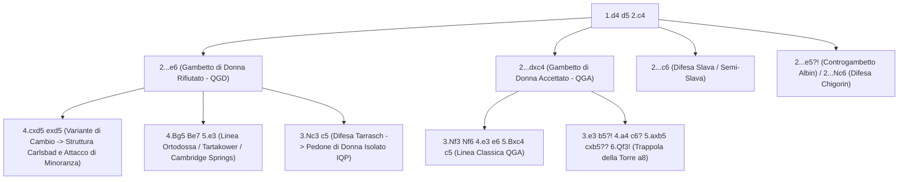

[[Home MOC|Home]] / [[Education & Learning]] / [[The Queen's Gambit]]

# The Queen's Gambit

## Sintesi Esecutiva

<mark style="background:rgba(255, 193, 69, 0.32)"><b>The Queen's Gambit</b></mark> (*Gambetto di Donna*, `1.d4 d5 2.c4`) è il pilastro fondamentale del gioco chiuso e semichiuso e costituisce il passaggio obbligato per ogni scacchista che voglia evolvere dal puro calcolo tattico alla comprensione profonda della strategia posizionale (`1200 – 2000+` ELO). A differenza delle aperture di Re come [[The Italian Game]] o [[The Scotch Game]], dove il conflitto esplode rapidamente attorno al Re, il Gambetto di Donna insegna tre concetti magistrali della scuola classica e moderna: l'esercizio della <mark style="background:rgba(255, 193, 69, 0.32)"><b>pressione posizionale a lungo termine</b></mark>, l'esecuzione dell'<mark style="background:rgba(255, 193, 69, 0.32)"><b>Attacco di Minoranza</b></mark> sull'ala di Donna e la padroneggiatura delle strutture con <mark style="background:rgba(181, 113, 255, 0.36)"><b>Pedone di Donna Isolato (IQP)</b></mark>. Tecnicamente si tratta di uno *pseudo-gambetto*, poiché se il Nero cattura il pedone con `2...dxc4`, non può conservarlo senza incorrere in gravi perdite materiali o posizionali.

| Parametro Tecnico | Dettaglio Strategico |
| :--- | :--- |
| **Nome Apertura** | The Queen's Gambit (*Gambetto di Donna* — Codici ECO `D06–D69`) |
| **Mosse Iniziali** | `1.d4 d5 2.c4` |
| **Lezione Primaria** | Pressione posizionale, Attacco di Minoranza, strutture con Pedone Isolato (IQP) |
| **Fascia ELO Ideale** | `1200 – 2000+` (fondamentale dai tornei agonistici fino ai Campionati del Mondo) |
| **Indole Posizionale** | Strategica, strutturale, basata sul controllo delle colonne `c`/`d` e sugli avamposti |

---

## 1. Perché `1.d4 d5 2.c4` è un "Falso Gambetto" e Qual è il Suo Scopo

Nelle aperture di pedone di Donna (`1.d4`), il pedone `d4` è già difeso fin dalla prima mossa dalla Donna in `d1`. Quando il Nero risponde simmetricamente `1...d5`, la spinta `2.e4` sarebbe un sacrificio reale di pedone (Gambetto Blackmar-Diemer). Il Bianco utilizza invece il pedone laterale `c` giocando **`2.c4!`**:

1. **Attacco di fianco contro il centro**: Il Bianco offre di scambiare un pedone d'ala (`c4`) con un pedone centrale (`d5`). Se il Nero accetta (`2...dxc4`), il Bianco conquista il monopolio del centro con `e3` (o `e4`) e recupera comodamente il pedone `c4` con `Bxc4`.
2. **Apertura della colonna `c`**: Lo scambio `cxd5` apre la colonna semichiusa `c` per la Torre (`Rc1`) e la Donna (`Qc2`/`Qb3`), creando pressione cronica sul lato di Donna del Nero.
3. **Impedimento della liberazione nera**: Finché `c4` preme su `d5`, il Nero deve prendere una decisione strutturale difficile su come difendere il proprio centro.

![[chess_qg_01_tabiya.svg]]

---

## 2. Caso Principale A: Il Gambetto di Donna Rifiutato (`2...e6` — QGD)

Con **`2...e6`**, il Nero puntella il pedone `d5` in modo da poter riprendere di pedone (`...exd5`) qualora il Bianco cambi in `d5`.
- **Il prezzo strategico pagato dal Nero**: La spinta `2...e6` rinchiude l'<mark style="background:rgba(181, 113, 255, 0.36)"><b>Alfiere campochiaro di c8</b></mark> dietro la propria catena di pedoni (`d5-e6`). Tutta la strategia del Bianco nel QGD ruota attorno allo sfruttamento della passività di questo "Alfiere cattivo" e alla pressione lungo la colonna `c`.

### 2.1 La Variante di Cambio, la Struttura Carlsbad e l'Attacco di Minoranza

Il sistema più limpido, istruttivo e universale per il Bianco contro `2...e6` è la **Variante di Cambio**:
`1.d4 d5 2.c4 e6 3.Nc3 Nf6 4.cxd5! exd5 5.Bg5 Be7 6.e3 c6 7.Bd3 Nbd7 8.Qc2 O-O`.

Questa sequenza fissa la celebre <mark style="background:rgba(255, 193, 69, 0.32)"><b>Struttura Carlsbad</b></mark> (dal torneo di Carlsbad 1923): il Bianco ha sviluppato l'Alfiere campochiaro *fuori* dalla catena pedonale in `g5` prima di giocare `6.e3`, mentre il Nero ha la catena rigida `c6-d5`.

![[chess_qg_02_carlsbad_minority.svg]]

In questa struttura, il Bianco dispone di **due piani strategici da manuale** (che non si escludono e dipendono dallo schieramento dei pezzi):

#### Piano 1: L'Attacco di Minoranza sull'Ala di Donna (*The Minority Attack*)
- **Configurazione dei pezzi**: Il Bianco sviluppa il Cavallo in `f3`, arrocca corto (`O-O`) e porta la Torre in `b1` (`Rab1`).
- **Come funziona**: Sull'ala di Donna il Bianco possiede una *minoranza* di 2 pedoni (`a2`, `b2`) contro i 3 pedoni del Nero (`a7`, `b7`, `c6`). Il Bianco avanza **`b2-b4`** (eventualmente preceduta da `a2-a4`) e poi **`b4-b5!`**, forzando il contatto con il pedone `c6`:
  - Se il Nero cambia `...cxb5`, il Bianco riprende `Rxb5` (o `axb5`) isolando il pedone nero `d5` e il pedone `a7`.
  - Se il Nero attende, il Bianco cambia **`bxc6 bxc6`**: ora al Nero resta un <mark style="background:rgba(181, 113, 255, 0.36)"><b>pedone arretrato e debole in c6</b></mark> sulla colonna `c` aperta, bersaglio fisso delle Torri bianche (`Rfc1`, `Rb3-c3`) e del Cavallo bianco che si insedia nell'avamposto `c5` o `e5`!

#### Piano 2: L'Espansione Centrale di Botvinnik-Kasparov (`Nge2` + `f3` + `e4!`)
- **Configurazione dei pezzi**: Invece di sviluppare il Cavallo di Re in `f3`, il Bianco lo sviluppa in **`e2` (`Nge2`)**, lasciando libero il pedone `f2`.
- **Come funziona**: Dopo `O-O`, `Ng3` (o `Rae1`), il Bianco spinge **`f2-f3!`** seguito da **`e3-e4!`**, creando una falange mobile di pedoni centrali (`d4-e4`) e aprendo la colonna `f` per un attacco devastante contro l'arrocco nero.

---

## 3. La Struttura con Pedone di Donna Isolato (IQP) e la Difesa Tarrasch (`3...c5`)

Uno dei temi più importanti indicati nella tabella didattica del Gambetto di Donna è la comprensione dell'<mark style="background:rgba(255, 193, 69, 0.32)"><b>Isolated Queen's Pawn (IQP)</b></mark> — il *Pedone di Donna Isolato* (un pedone in `d4` per il Bianco o in `d5` per il Nero quando entrambi i pedoni `c` ed `e` dello stesso colore sono stati cambiati).

Questa struttura sorge tipicamente nella **Difesa Tarrasch** (`1.d4 d5 2.c4 e6 3.Nc3 c5 4.cxd5 exd5 5.Nf3 Nc6 6.g3 Nf6 7.Bg2 Be7 8.O-O O-O 9.dxc5 Bxc5`, dove il **Nero** ha l'IQP in `d5`) oppure nel Gambetto di Donna Accettato / Semi-Tarrasch (dove il **Bianco** può accettare l'IQP in `d4`).

![[chess_qg_03_iqp_structure.svg]]

### Le Due Facce dell'IQP: Forza nel Mediogioco vs Debolezza nel Finale

> [!IMPORTANT] La Legge Fondamentale del Pedone di Donna Isolato
> **Più pezzi restano sulla scacchiera, più l'IQP è una forza dinamica d'attacco; più pezzi vengono cambiati, più l'IQP diventa una debolezza statica fatale nel finale.**

| Chi Possiede l'IQP (Es. Bianco con pedone `d4`) | Chi Gioca Contro l'IQP (Es. Bianco contro `d5` nella Tarrasch) |
| :--- | :--- |
| **1. Sfrutta gli avamposti `e5` e `c5`**: Installa un Cavallo in `e5` sostenuto dal pedone isolato. | **1. Blocca la casa davanti al pedone (`d4` o `d5`)**: La casa immediatamente davanti all'IQP non può essere controllata da pedoni avversari; piazzaci un Cavallo inamovibile! |
| **2. Evita i cambi di pezzi minori**: Mantieni gli Alfieri e le Donne per attaccare il Re (es. batteria `Bc2` + `Qd3` su `h7` e `Torre lift` `Rf3-h3`). | **2. Cambia i pezzi minori (specialmente i Cavalli e gli Alfieri buoni)**: Ogni cambio riduce il potenziale d'attacco dell'avversario e avvicina il finale vinto. |
| **3. Cerca la rottura liberatoria `d4-d5!`**: Spingere il pedone isolato al momento tattico giusto liquida la debolezza e scatena i pezzi. | **3. Assedia il pedone con le Torri e l'Alfiere di fianchetto (`Bg2`)**: Nella Tarrasch, `Bg2`, `Nf3`, `Nc3` e `Bg5` convergono tutti sul punto `d5`. |

---

## 4. Caso Principale B: Il Gambetto di Donna Accettato (`2...dxc4` — QGA) e la Difesa Slava (`2...c6`)

### 4.1 Il Gambetto di Donna Accettato (`2...dxc4`)

Quando il Nero gioca `2...dxc4`, cede temporaneamente il centro per sviluppare rapidamente i pezzi e contrattaccare `d4` con `...c5`. Il Bianco ha due approcci eccellenti:

1. **L'Approccio Classico Sicuro (`3.Nf3`)**:
   - **Perché `3.Nf3` è precisa**: Impedisce al Nero il contrattacco immediato `3...e5!`.
   - **Sequenza**: `3.Nf3 Nf6 4.e3 e6 5.Bxc4 c5 6.O-O a6 7.Qe2!` (oppure `7.Bb3` / `7.dxc5`): con `7.Qe2 b5 8.Bb3 Bb7 9.Rd1 Nbd7 10.Nc3`, il Bianco prepara la spinta centrale `e3-e4!` con sviluppo armonioso e superiore.
2. **L'Approccio Diretto Centrale (`3.e4!`)**:
   - Il Bianco occupa immediatamente tutto il centro con `d4` ed `e4`. Il Nero deve reagire subito con `3...e5!` (o `3...Nc6 4.Nf3 Bg4 5.Be3 e6 6.Bxc4`), portando a posizioni aperte e tattiche dove il Bianco mantiene il vantaggio della coppia degli Alfieri.

### 4.2 La Difesa Slava (`2...c6`)

Con **`2...c6`**, il Nero difende `d5` con un pedone senza bloccare l'Alfiere campochiaro di `c8`!
- **La sequenza critica da conoscere**: `1.d4 d5 2.c4 c6 3.Nf3 Nf6 4.Nc3 dxc4`.
- Ora che il Bianco ha sviluppato entrambi i Cavalli, il Nero cattura in `c4` minacciando di difendere il pedone per sempre con `...b5!`.
- **La mossa chiave del Bianco (`5.a4!`)**: Il Bianco **deve** giocare **`5.a4!`** per impedire `5...b5!`. Dopo `5.a4 Bf5 6.e3 e6 7.Bxc4 Bb4 8.O-O O-O 9.Qe2`, il Bianco recupera il pedone `c4` e prepara la spinta centrale `e3-e4!`.

---

## 5. Le Mosse Più Ingannevoli, Trappole Letali e Contro-Trappole

Nel Gambetto di Donna esistono quattro trappole celebri che decidono migliaia di partite: due puniscono l'avidità del Nero nel QGA, e due sono trappole tese dal Nero che il Bianco deve assolutamente conoscere per non cadere in disgrazia.

### Trappola 1: La Trappola della Torre nel QGA (`2...dxc4 3.e3 b5?!`)

Moltissimi giocatori sotto i `1600` ELO accettano il Gambetto di Donna (`1.d4 d5 2.c4 dxc4`) e, quando il Bianco gioca `3.e3` (o `3.Nf3`), cercano ostinatamente di tenersi il pedone di vantaggio giocando **`3...b5?!`**.

![[chess_qg_04_qga_rook_trap.svg]]

> [!SUCCESS] Come Demolire la Difesa Avida di `c4` in 6 Mosse
> 1. **`4.a4!`**: Il Bianco attacca subito la base della catena di pedoni in `b5`.
> 2. Se il Nero gioca `4...a6?`, segue semplicemente `5.axb5!`: il Nero non può riprendere `5...axb5??` perché la Torre in `a8` è inchiodata e indifesa (`6.Rxa8` vince una Torre intera!).
> 3. Il Nero allora difende `b5` giocando **`4...c6?`**.
> 4. Il Bianco cambia **`5.axb5 cxb5??`** (il Nero pensa di aver salvato la catena!).
> 5. **`6.Qf3!`**: **Colpo da KO!** La Donna bianca in `f3` infilza l'intera diagonale `h1-a8` mirando alla Torre indifesa in `a8`! Non esiste alcun modo di salvare la Torre senza perdere almeno un Cavallo o un Alfiere (`6...Nc6 7.Qxc6+ Bd7 8.Qxa8`!).

---

### Trappola 2: La Trappola dell'Elefante (*Elephant Trap*) — L'Esca del Nero da Evitare!

Nel Gambetto di Donna Rifiutato (`1.d4 d5 2.c4 e6 3.Nc3 Nf6 4.Bg5 Nbd7`), il Nero tende spesso una trappola psicologica micidiale.

Dopo **`5.cxd5 exd5`**, il Bianco osserva che il Cavallo nero in `f6` è inchiodato sulla Donna in `d8` dall'Alfiere bianco in `g5`. Il Bianco pensa: *"Il Cavallo in `f6` non può muoversi, quindi il pedone `d5` è difeso solo dal Cavallo in `d7`, mentre io lo attacco con `Nc3` e `Qd1`: vinco un pedone centrale gratis con `6.Nxd5?!"*

![[chess_qg_05_elephant_trap.svg]]

> [!DANGER] Perché `6.Nxd5?!` è un Errore Fatale per il Bianco!
> Se il Bianco gioca **`6.Nxd5?!`**, il Nero cattura il Cavallo ignorando l'inchiodatura sulla Donna:
> **`6...Nxd5! 7.Bxd8 Bb4+!`**
> Lo scacco intermedio dell'Alfiere nero in `b4` è devastante: il Re bianco non ha case di fuga e l'unica mossa legale per coprire lo scacco è interporre la Donna con **`8.Qd2`**.
> Dopo **`8...Bxd2+ 9.Kxd2 Kxd8`**, il Nero ha recuperato la Donna e rimane con un **Cavallo netto di vantaggio**!
> - **Come gioca correttamente il Bianco alla mossa 6**: Invece di `6.Nxd5?!`, gioca semplicemente **`6.e3!`** (o `6.Nf3`), entrando nella perfetta Struttura Carlsbad!

---

### Trappola 3: La Trappola di Cambridge Springs (`6...Qa5!`)

Dopo `1.d4 d5 2.c4 e6 3.Nc3 Nf6 4.Bg5 Nbd7 5.Nf3 c6 6.e3`, il Nero gioca spesso **`6...Qa5!`** (*Difesa Cambridge Springs*), schiodandosi dalla diagonale `d8-h4` e inchiodando a sua volta il Cavallo `c3` sul Re bianco in `e1`!
- **La trappola da evitare**: Se il Bianco sviluppa meccanicamente `7.Bd3?`, il Nero gioca **`7...dxc4! 8.Bxc4 Ne4!`**: ora il Nero attacca tre volte il Cavallo in `c3` (`Ne4`, `Qa5`) e contemporaneamente la Donna in `a5` **attacca di scoperta l'Alfiere bianco indifeso in `g5`**! Il Bianco perde materiale forzatamente.
- **L'antidoto profilattico del Bianco**: Contro `6...Qa5`, gioca **`7.Nd2!`** (che difende `c3`, toglie il Cavallo dalla portata di `...Ne4` e sorveglia l'Alfiere in `g5` dopo `7...Bb4 8.Qc2!`) oppure **`7.cxd5! Nxd5 8.Qd2!`**.

---

### Trappola 4: La Trappola di Lasker nel Controgambetto Albin (`2...e5?!`)

A livello di club (`1200–1700` ELO), alcuni giocatori aggressivi rispondono a `1.d4 d5 2.c4` con il **Controgambetto Albin (`2...e5?!`)**.
Dopo **`3.dxe5 d4`**, il pedone nero in `d4` è fastidioso.
- **L'errore fatale `4.e3?`**: Se il Bianco cerca di eliminare subito `d4` con `4.e3?`, cade nella celebre **Trappola di Lasker**:
  `4...Bb4+ 5.Bd2 dxe3! 6.Bxb4?? exf2+!`:
  - Il Bianco non può catturare `7.Kxf2` perché lascerebbe la Donna in `d1` indifesa (`7...Qxd1`)!
  - E se il Bianco muove il Re con `7.Ke2`, il Nero promuove a Cavallo con scacco: **`7...fxg1=N+! 8.Rxg1 Bg4+!`** (infilata reale su Re `e2` e Donna `d1`), vincendo la partita alla mossa 8!
- **La risposta corretta e forte contro l'Albin (`4.Nf3!`)**:
  Dopo `2...e5 3.dxe5 d4`, il Bianco gioca **`4.Nf3! Nc6 5.g3`** (o `5.Nbd2`), fianchettando l'Alfiere in `g2` e assediando il pedone `d4` avanzato del Nero con netto vantaggio posizionale.

---

## 6. Riepilogo Operativo e Checklist Decisionale per il Bianco

| Risposta del Nero a `1.d4 d5 2.c4` | Sistema Consigliato per il Bianco | Piano Strategico / Regola Antitrappola |
| :--- | :--- | :--- |
| **`2...e6`** (*QGD Rifiutato*) | `3.Nc3 Nf6 4.cxd5 exd5 5.Bg5 Be7 6.e3` | Struttura Carlsbad: lancia l'**Attacco di Minoranza** (`Rab1`, `b4-b5`) |
| **`2...e6 3.Nc3 Nf6 4.Bg5 Nbd7`** | `5.cxd5 exd5 6.e3!` | **MAI** giocare `6.Nxd5?!` (*Trappola dell'Elefante* `6...Nxd5 7.Bxd8 Bb4+!`) |
| **`2...e6 3.Nc3 c5`** (*Tarrasch*) | `4.cxd5 exd5 5.Nf3 Nc6 6.g3` | Blocca la casa `d4` davanti all'IQP nero in `d5` e premi con `Bg2` |
| **`2...dxc4`** (*QGA Accettato*) | `3.Nf3 Nf6 4.e3 e6 5.Bxc4 c5` | Se il Nero difende `c4` con `3.e3 b5?!`, punisci con `4.a4 c6 5.axb5 cxb5 6.Qf3!` |
| **`2...c6`** (*Difesa Slava*) | `3.Nf3 Nf6 4.Nc3 dxc4 5.a4!` | `5.a4!` è fondamentale per impedire al Nero di tenere `c4` con `...b5` |
| **`2...e5?!`** (*Controgambetto Albin*) | `3.dxe5 d4 4.Nf3! Nc6 5.g3` | **MAI** giocare `4.e3? Bb4+ 5.Bd2 dxe3!` (*Trappola di Lasker*) |
