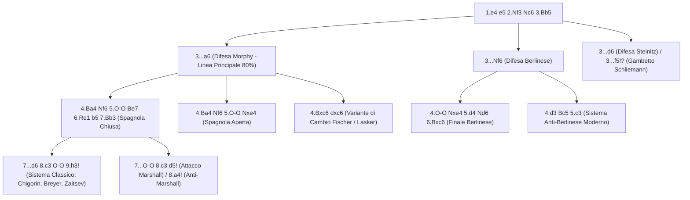

[[Home MOC|Home]] / [[Education & Learning]] / [[The Ruy Lopez]]

# The Ruy Lopez

## Sintesi Esecutiva

<mark style="background:rgba(255, 193, 69, 0.32)"><b>The Ruy Lopez</b></mark> (*Partita Spagnola*, `1.e4 e5 2.Nf3 Nc6 3.Bb5`), codificata nel 1561 dal sacerdote spagnolo Ruy López de Segura, è universalmente riconosciuta come la "Regina delle Aperture" e l'università della strategia scacchistica classica (`1500 – 2000+` ELO). A differenza di [[The Italian Game]] (che punta direttamente alla casa `f7`) e di [[The Scotch Game]] (che liquida subito la tensione centrale con `3.d4`), la Spagnola adotta un approccio concettuale più sottile e duraturo: attacca il **difensore** del pedone centrale `e5` (il Cavallo in `c6`), mantenendo una tensione costante che costringe il Nero sulla difensiva per decine di mosse. Studiare la Ruy Lopez insegna le tre competenze più elevate del gioco posizionale: la <mark style="background:rgba(255, 193, 69, 0.32)"><b>manovra dei pezzi a lungo termine</b></mark>, il pensiero di <mark style="background:rgba(255, 193, 69, 0.32)"><b>profilassi</b></mark> e la <mark style="background:rgba(181, 113, 255, 0.36)"><b>grande strategia multifase</b></mark>.

| Parametro Tecnico | Dettaglio Strategico |
| :--- | :--- |
| **Nome Apertura** | The Ruy Lopez (*Partita Spagnola* — Codici ECO `C60–C99`) |
| **Mosse Iniziali** | `1.e4 e5 2.Nf3 Nc6 3.Bb5` |
| **Lezione Primaria** | Manovre a lungo termine, profilassi, grande strategia multifase |
| **Fascia ELO Ideale** | `1500 – 2000+` (pilastro del repertorio di tutti i Campioni del Mondo da Capablanca a Carlsen) |
| **Indole Posizionale** | Profonda, strategica, ricca di tensione centrale e capace di improvvise esplosioni tattiche |

---

## 1. Il Meccanismo Psicologico e Tattico di `3.Bb5`

Quando il Bianco gioca **`3.Bb5`**, pone immediatamente una pressione indiretta sul pedone `e5` minacciando di eliminare il suo unico difensore (`Nc6`). Tuttavia, per padroneggiare la Ruy Lopez senza commettere errori grossolani, occorre rispondere subito a una domanda fondamentale:

### Il Bianco minaccia davvero di vincere il pedone `e5` alla quarta mossa?

**No!** Dopo `1.e4 e5 2.Nf3 Nc6 3.Bb5 a6`, se il Bianco pensa di guadagnare un pedone giocando `4.Bxc6 dxc6 5.Nxe5?`, cade nella prima trappola classica dell'apertura:

![[chess_ruy_05_premature_nxe5_qd4.svg]]

- **Perché `5.Nxe5?` è un errore tattico**:
  Il Nero risponde **`5...Qd4!`**, attaccando simultaneamente il Cavallo in `e5` e il pedone indifeso in `e4`! Dopo `6.Nf3 Qxe4+ 7.Qe2 Qxe2+ 8.Kxe2`, il Nero ha recuperato il pedone con scacco, possiede la <mark style="background:rgba(181, 113, 255, 0.36)"><b>coppia degli Alfieri</b></mark> su scacchiera aperta e non ha alcun problema.
- **Quando la minaccia su `e5` diventa REALE?**:
  Non appena il Bianco **difende il proprio pedone `e4`** (ad esempio con `6.Re1!` dopo l'arrocco, oppure con `d3` o `Nc3`)! In quel preciso istante `...Qd4` non può più catturare `e4`, e la minaccia `Bxc6 dxc6` seguita da `Nxe5` diventa una minaccia concreta che obbliga il Nero a reagire (spingendo `...b5` o difendendo `e5` con `...d6`).

![[chess_ruy_01_tabiya.svg]]

---

## 2. Caso Principale A: La Spagnola Chiusa e la Grande Strategia Multifase (`3...a6 4.Ba4`)

La linea principale della Ruy Lopez (`1.e4 e5 2.Nf3 Nc6 3.Bb5 a6 4.Ba4 Nf6 5.O-O Be7 6.Re1 b5 7.Bb3 d6 8.c3 O-O 9.h3!`) è una vera sinfonia strategica in cui ogni singola mossa assolve un compito preciso.

![[chess_ruy_02_closed_mainline.svg]]

### Anatomia delle 4 Fasi Strategiche del Bianco

#### Fase 1: Consolidamento e Guadagno di Tempo (`5.O-O Be7 6.Re1!`)
- Con **`5.O-O`**, il Bianco mette al sicuro il Re e lascia apparentemente `e4` in presa (se il Nero prende `5...Nxe4`, si entra nella *Spagnola Aperta*, dove `6.d4!` apre la colonna `e` contro il Re nero ancora al centro).
- Quando il Nero sviluppa prudentemente **`5...Be7`**, la casa `e4` diventa davvero minacciata (`...Nxe4`). Il Bianco la difende con **`6.Re1!`**: ora che `e4` è protetto dalla Torre, il Bianco **minaccia realmente `7.Bxc6 dxc6 8.Nxe5!`**, costringendo il Nero a giocare `6...b5 7.Bb3 d6`.

#### Fase 2: La Doppia Funzione di `8.c3!`
Dopo `7...d6`, il Bianco gioca **`8.c3!`**, mossa che adempie a due funzioni vitali:
1. Prepara la grande rottura centrale **`d2-d4!`**.
2. Crea la "cuccia di salvataggio" in **`c2` (`Bc2`)** per il prezioso <mark style="background:rgba(255, 193, 69, 0.32)"><b>Alfiere Spagnolo</b></mark> di `b3`, cosicché se il Nero cerca di cambiarlo giocando `...Na5`, l'Alfiere bianco si ritira indenne in `c2` continuando a dominare la diagonale `b1-h7`!

#### Fase 3: La Lezione di Profilassi Pura (`9.h3!`)
Dopo `8...O-O`, un giocatore impulsivo spingerebbe subito `9.d4?!`. Ma su `9.d4?!`, il Nero giocherebbe **`9...Bg4!`**, inchiodando il Cavallo in `f3` sulla Donna in `d1` e minacciando di far crollare il centro bianco in `d4`!
- Perciò il Bianco esegue una mossa di <mark style="background:rgba(255, 193, 69, 0.32)"><b>profilassi</b></mark> (*prevenire il piano dell'avversario prima di eseguire il proprio*): **`9.h3!`**.
- Con `9.h3!` la casa `g4` è interdetta agli Alfieri e ai Cavalli neri, e alla decima mossa il Bianco è finalmente pronto a conquistare il centro con **`10.d4!`**.

#### Fase 4: Il Celebre Giro del Cavallo Spagnolo (`Nbd2 -> Nf1 -> Ng3`)
Poiché la casa `c3` è occupata dal pedone bianco, come si sviluppa il Cavallo di Donna in `b1`?
- Dopo `10.d4`, il Cavallo bianco compie il celebre <mark style="background:rgba(181, 113, 255, 0.36)"><b>tour di manovra b1 -> d2 -> f1 -> g3 (o e3)</b></mark>:
  - In `d2` (`Nbd2`) sostiene `e4` e lascia libera la diagonale all'Alfiere `c1`.
  - In `f1` (`Nf1`, resa libera dalla Torre che si è mossa in `e1` alla mossa 6!) difende il Re e si prepara a saltare sul lato di Re.
  - In `g3` (`Ng3`) o `e3` (`Ne3`) punta direttamente agli avamposti d'attacco **`f5`**, **`h5`** e **`d5`**, preparando un assalto micidiale contro l'arrocco nero!

### I Grandi Sistemi Difensivi del Nero dopo `9.h3` e l'Attacco Marshall

1. **Variante Chigorin (`9...Na5 10.Bc2 c5 11.d4 Qc7 12.Nbd2`)**: Il Nero contrattacca `d4` con `...c5`. Il Bianco mantiene la tensione o chiude il centro con `d5!` (preparando l'attacco est-indiano a colori invertiti sul lato di Re).
2. **Variante Breyer (`9...Nb8! 10.d4 Nbd7 11.Nbd2 Bb7`)**: Il Nero riposiziona il Cavallo da `c6` a `d7` per sostenere `e5` senza ostruire il pedone `c7`.
3. **Attacco Marshall (`7...O-O! 8.c3 d5!`)**:
   - **Segnale d'allarme nell'ordine di mosse**: Se alla settima mossa (dopo `6.Re1 b5 7.Bb3`) il Nero gioca subito **`7...O-O!`** invece di `7...d6`, sta preparando il famoso sacrificio di pedone di Frank Marshall: `8.c3 d5! 9.exd5 Nxd5 10.Nxe5 Nxe5 11.Rxe5 c6 12.d4 Bd6 13.Re1 Qh4`.
   - **Come evitarlo con l'Anti-Marshall**: Se non vuoi entrare nelle linee teoriche forzate del Marshall, dopo `7...O-O` gioca **`8.a4!`** (attaccando subito `b5`) oppure **`8.h3! Bb7 9.d3`**.

---

## 3. Caso Principale B: La Variante di Cambio (`3...a6 4.Bxc6 dxc6`)

Resa leggendaria da Emanuel Lasker e da Bobby Fischer (che nel 1966 introdusse il moderno `5.O-O!`), la <mark style="background:rgba(181, 113, 255, 0.36)"><b>Variante di Cambio</b></mark> è una lezione cristallina di strategia strutturale.

![[chess_ruy_03_exchange_structure.svg]]

- **Sequenza**: `1.e4 e5 2.Nf3 Nc6 3.Bb5 a6 4.Bxc6 dxc6 5.O-O!`:
  - Ora che il Re bianco è arroccato e `5...Qd4` non è più efficace come prima, `6.Nxe5!` è una **minaccia reale**!
  - Il Nero deve difendere `e5` (con `5...f6`, `5...Bd6`, `5...Bg4` o `5...Qe7`), e il Bianco apre il centro con **`6.d4! exd4 7.Qxd4 Qxd4 8.Nxd4`**.
- **Il Bilancio Strategico nel Finale**:
  - **Cosa ha ottenuto il Nero**: La coppia degli Alfieri.
  - **Cosa ha ottenuto il Bianco**: Una struttura pedonale permanente superiore! Osserva le due ali:
    - Sull'ala di Re, il Bianco ha una <mark style="background:rgba(255, 193, 69, 0.32)"><b>maggioranza sana di 4 pedoni contro 3</b></mark> (`e4, f2, g2, h2` contro `f7, g7, h7`), capace di generare forzatamente un **pedone passato** con `f4` ed `e5`.
    - Sull'ala di Donna, il Nero ha formalmente 4 pedoni contro 3 (`a6, b7, c6, c7` contro `a2, b2, c2`), ma poiché i pedoni `c6` e `c7` sono **doppiati**, la maggioranza del Nero è **paralizzata** e non può creare alcun pedone passato senza l'aiuto del Bianco! Pertanto, ogni cambio di pezzi avvicina il Bianco a un finale di Re e pedoni matematicamente vinto.

---

## 4. Caso Principale C: La Difesa Berlinese (`3...Nf6`)

Impiegata da Vladimir Kramnik nel 2000 per detronizzare Garry Kasparov, la **Difesa Berlinese (`3...Nf6`)** è soprannominata il "Muro di Berlino". Il Bianco ha due scelte principali:

1. **La Linea Principale del Finale Berlinese (`4.O-O Nxe4 5.d4 Nd6 6.Bxc6 dxc6 7.dxe5 Nf5 8.Qxd8+ Kxd8`)**:
   Portando a una lotta strategica ultra-tecnica dove il Bianco sfrutta la maggioranza `4 contro 3` sul lato di Re e il Re nero rimasto in `d8`/`e8`.
2. **Il Sistema Anti-Berlinese Moderno (`4.d3!`)**:
   Scelta pragmatica favorita da moltissimi Grandi Maestri e giocatori tra `1500` e `2200` ELO:
   - **Sequenza**: `4.d3 Bc5 5.c3! O-O 6.O-O d6 7.Re1 a6 8.Ba4 Ba7 9.Nbd2`:
   - Il Bianco mantiene le Donne sulla scacchiera, evita qualsiasi semplificazione precoce e ottiene una versione migliorata del Giuoco Pianissimo in cui l'Alfiere bianco è già attivo sulla diagonale `a4-e8` -> `b3-c2`.

---

## 5. Le Mosse Più Ingannevoli e le Trappole Storiche della Ruy Lopez

### Trappola 1: La Trappola dell'Arca di Noè (*Noah's Ark Trap*) — Mai Giocare `d4` Senza Prima `c3`!

Una delle trappole più famose e antiche della storia degli scacchi (citata anche da Capablanca), in cui cadono innumerevoli giocatori con il Bianco quando dimenticano il ruolo profilattico di `c2-c3`!

- **Come nasce l'errore**: Dopo `1.e4 e5 2.Nf3 Nc6 3.Bb5 a6 4.Ba4 d6`, il Bianco gioca prematuramente **`5.d4?!`** (senza aver preparato la ritirata dell'Alfiere con `c3`).
- **La sequenza della trappola**:
  `5...b5 6.Bb3 Nxd4 7.Nxd4 exd4`:
  Qui il Bianco dovrebbe limitare i danni giocando `8.Bd5!` o un sacrificio di pedone con `8.c3`. Invece il Bianco riprende istintivamente il pedone con la Donna: **`8.Qxd4??`**.

![[chess_ruy_04_noahs_ark_trap.svg]]

> [!DANGER] L'Arca di Noè si Chiude sull'Alfiere in `b3`!
> Dopo **`8.Qxd4??`**, il Nero esegue una sequenza forzata che guadagna un pezzo netto:
> 1. **`8...c5!`**: Attacca la Donna bianca in `d4` e toglie all'Alfiere `b3` la casa `d5`!
> 2. **`9.Qd5`** (il Bianco spera di salvarsi minacciando sia `Qxf7#` sia la Torre in `a8`!).
> 3. **`9...Be6!`**: Difende `f7` sviluppando l'Alfiere e attaccando di nuovo la Donna!
> 4. **`10.Qc6+ Bd7 11.Qd5 c4!`**: **Sipario!** Il pedone nero avanza in `c4` e l'Alfiere Spagnolo del Bianco in `b3` è completamente **murato vivo** dai pedoni `a6`, `b5`, `c4` e `a2`, `c2`!

---

### Trappola 2: La Trappola di Tarrasch nella Spagnola Aperta (`11.Nd4!`)

Nella Spagnola Aperta (`1.e4 e5 2.Nf3 Nc6 3.Bb5 a6 4.Ba4 Nf6 5.O-O Nxe4 6.d4 b5 7.Bb3 d5 8.dxe5 Be6 9.c3 Be7 10.Re1`):
- Se il Nero arrocca con **`10...O-O?`** e sulla risposta bianca **`11.Nd4!`** (che attacca due volte `c6` ed `e6`) difende incautamente il Cavallo con **`11...Qd7?`** (invece di `11...Nxe5`), il Bianco vince un pezzo sul colpo:
  **`12.Nxe6! fxe6`** (il Nero non può riprendere `12...Qxe6??` perché perderebbe il pedone `d5` con attacco sulla Donna, ma dopo `12...fxe6` il pedone `d5` è **inchiodato sulla Donna in `d7`** lungo la colonna `d`!):
  **`13.Rxe4!`** — Il Bianco cattura gratis il Cavallo in `e4` poiché `13...dxe4?? 14.Qxd7` perde la Donna!

---

### Trappola 3: La Trappola di Mortimer (`3...Nf6 4.d3 Ne7?!`)

Nella Difesa Berlinese (`1.e4 e5 2.Nf3 Nc6 3.Bb5 Nf6 4.d3`), il maestro inglese James Mortimer ideò la mossa bizzarra e ingannevole **`4...Ne7?!`**, ritirando il Cavallo in `e7` e lasciando il pedone `e5` apparentemente indifeso!
- **L'esca avvelenata (`5.Nxe5??`)**: Se il Bianco abbocca e mangia il pedone con `5.Nxe5??`, il Nero gioca **`5...c6!`** (attaccando l'Alfiere in `b5`) e, dopo `6.Bc4` (o `6.Ba4`), sferra la forchetta micidiale **`6...Qa5+!`**, dando scacco al Re in `e1` e catturando il Cavallo bianco indifeso in `e5`!
- **La confutazione posizionale**: Ignora il regalo avvelenato `e5` e gioca semplicemente **`5.O-O c6 6.Ba4 Ng6 7.d4!`** (oppure `5.Nc3`), lasciando i pezzi neri grottescamente ammassati sul lato di Re.

---

### Trappola 4: La Trappola della Canna da Pesca (*Fishing Pole Trap* nella Berlinese)

Dopo `1.e4 e5 2.Nf3 Nc6 3.Bb5 Nf6 4.O-O`, alcuni giocatori tattici giocano **`4...Ng4?!`** seguito da **`5.h3 h5!?`**, offrendo il Cavallo in `g4` come "esca sulla canna da pesca"!
- **Perché non bisogna mangiare subito `6.hxg4??`**: Dopo `6.hxg4?? hxg4`, la colonna `h` si spalanca per la Torre nera in `h8`, il Cavallo bianco in `f3` viene scacciato e il Nero porta la Donna in `h4` (`...Qh4`) dando scacco matto in `h2` o `h1`!
- **Come confutarla con sangue freddo**: Invece di mangiare il Cavallo in `g4`, il Bianco colpisce subito al centro con **`6.d4! exd4 7.Nxd4`** (oppure `6.c3!` seguito da `d4`): senza l'apertura della colonna `h`, i pezzi neri in `g4` e `h5` restano completamente fuori gioco!

---

## 6. Riepilogo Operativo e Checklist Decisionale per il Bianco

| Variante del Nero contro `3.Bb5` | Piano Principale per il Bianco | Regola Strategica / Antitrappola |
| :--- | :--- | :--- |
| **`3...a6 4.Ba4 Nf6 5.O-O Be7`** | `6.Re1! b5 7.Bb3 d6 8.c3 O-O 9.h3! 10.d4` | `8.c3` prepara `Bc2` e `d4`; `9.h3!` impedisce `...Bg4`; manovra `Nbd2-f1-g3` |
| **`3...a6 4.Bxc6 dxc6`** (*Cambio*) | `5.O-O! f6 6.d4! exd4 7.Qxd4 Qxd4 8.Nxd4` | **MAI** giocare `5.Nxe5? Qd4!`; sfrutta la maggioranza `4 vs 3` nel finale |
| **`3...a6 4.Ba4 d6`** (*Steinitz Diff.*) | `5.c3!` (prima di spingere `d4`!) | Evita `5.d4?! b5 6.Bb3 Nxd4 7.Nxd4 exd4 8.Qxd4?? c5!` (*Arca di Noè*) |
| **`3...Nf6`** (*Difesa Berlinese*) | `4.d3 Bc5 5.c3 O-O 6.O-O` (oppure `4.O-O`) | Se `4.d3 Ne7?!`, **NON** giocare `5.Nxe5?? c6 6.Bc4 Qa5+!` (*Mortimer*) |
| **`7...O-O!`** (*Pre-Marshall*) | `8.a4!` (Anti-Marshall) oppure `8.c3 d5!` | `7...O-O` invece di `7...d6` preannuncia il sacrificio di pedone `8...d5!` |
