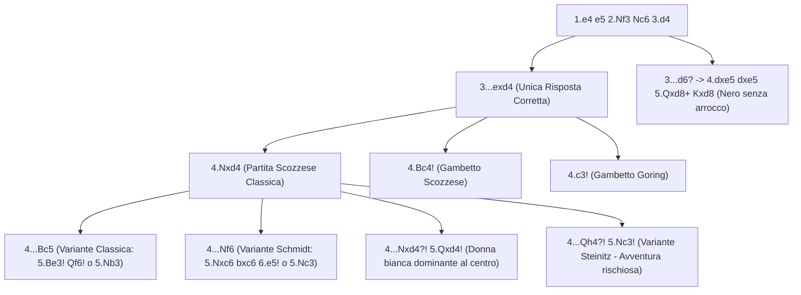

[[Home MOC|Home]] / [[Education & Learning]] / [[The Scotch Game]]

# The Scotch Game

## Sintesi Esecutiva

<mark style="background:rgba(255, 193, 69, 0.32)"><b>The Scotch Game</b></mark> (*Partita Scozzese*, `1.e4 e5 2.Nf3 Nc6 3.d4`) è l'apertura aperta per eccellenza per chi desidera prendere immediatamente l'iniziativa al centro senza attendere lunghe fasi preparatorie. Chiamata così dopo il celebre match per corrispondenza tra i club di Edimburgo e Londra (1824–1828) e riportata ai vertici dei Campionati del Mondo negli anni '90 da Garry Kasparov (contro Anatoly Karpov e Nigel Short), la Scozzese insegna tre lezioni fondamentali: la gestione della <mark style="background:rgba(255, 193, 69, 0.32)"><b>tattica a scacchiera aperta</b></mark>, la massimizzazione dell'<mark style="background:rgba(255, 193, 69, 0.32)"><b>attività dei pezzi</b></mark> e la <mark style="background:rgba(181, 113, 255, 0.36)"><b>conquista immediata di spazio centrale</b></mark>. Mentre [[The Italian Game]] e [[The Ruy Lopez]] preparano gradualmente la spinta `d4` tramite `c3`, la Partita Scozzese forza il Nero a liquidare il proprio pedone `e5` già alla terza mossa, garantendo al Bianco linee aperte per entrambi gli Alfieri e per la Donna.

| Parametro Tecnico | Dettaglio Strategico |
| :--- | :--- |
| **Nome Apertura** | The Scotch Game (*Partita Scozzese* — Codici ECO `C44–C45`) |
| **Mosse Iniziali** | `1.e4 e5 2.Nf3 Nc6 3.d4` |
| **Lezione Primaria** | Tattica su scacchiera aperta, attività dei pezzi, conquista immediata di spazio |
| **Fascia ELO Ideale** | `750 – 1800+` (eccellente fino al livello di Grande Maestro) |
| **Indole Posizionale** | Dinamica, asimmetrica, aperta e fortemente orientata al calcolo concreto |

---

## 1. Perché `3.d4` Funziona Subito e Perché `3...exd4` è Forzata

Dopo `1.e4 e5 2.Nf3 Nc6 3.d4`, il Bianco sfida all'istante il pedone `e5` del Nero:

1. **Liquidazione asimmetrica del centro**: Una volta che il Nero cattura `3...exd4 4.Nxd4`, il Bianco conserva il pedone centrale `e4` (che controlla `d5` e `f5`), mentre il Nero non ha più alcun pedone nella quarta o quinta traversa centrale.
2. **Sviluppo senza ostacoli**: Entrambi gli Alfieri bianchi (`f1` e `c1`) hanno diagonali spalancate fin dalla mossa 3, senza dover spendere un tempo per `c2-c3`.
3. **Centralizzazione del Cavallo**: In `d4`, il Cavallo bianco domina il cuore della scacchiera e minaccia in ogni momento di cambiare in `c6` (`Nxc6`), rovinando la struttura pedonale nera.

![[chess_scotch_01_tabiya.svg]]

### Cosa succede se il Nero NON gioca `3...exd4`?

A livello amatoriale (`750–1300` ELO), molti giocatori col Nero temono di cedere il centro e provano a difendere `e5` con mosse secondarie che sono tutte inferiori:

- **Errore A — `3...d6?` (Difesa Passiva)**:
  Il Bianco punisce immediatamente con `4.dxe5! dxe5 5.Qxd8+ Kxd8` (se il Nero riprende di Cavallo `5...Nxd8`, perde semplicemente il pedone centrale dopo `6.Nxe5!`): il Re nero in `d8` perde il diritto di arroccare alla quinta mossa ed è condannato a difendere un finale penoso dopo `6.Bc4 f6 7.Nc3`.
- **Errore B — `3...exd4 4.Nxd4 Nxd4?!` (Il Cambio Prematuro di Lolli)**:
  Molti principianti vedono il Cavallo bianco in `d4` e lo cambiano subito con `4...Nxd4?!`. Questo è un <mark style="background:rgba(181, 113, 255, 0.36)"><b>grave errore strategico</b></mark>: dopo **`5.Qxd4!`**, la Donna bianca si installa trionfalmente al centro della scacchiera in `d4` e **non può più essere scacciata con guadagno di tempo**, perché il Nero si è appena privato del proprio Cavallo in `c6`! Il Bianco prosegue con `Nc3`, `Bc4`/`Be3` e `O-O-O` con dominio totale.

---

## 2. Caso Principale A: La Variante Classica (`4...Bc5`)

Dopo `1.e4 e5 2.Nf3 Nc6 3.d4 exd4 4.Nxd4`, la risposta classica del Nero è **`4...Bc5`**, sviluppando l'Alfiere sulla diagonale attiva `a7-g1` e attaccando due volte il Cavallo bianco in `d4` (con `Nc6` e `Bc5`). Il Bianco ha due eccellenti sistemi per rispondere.

### 2.1 Il Sistema Principale `5.Be3!` e la Tensione Tattica su `c5`

Giocando **`5.Be3!`**, il Bianco non solo difende il Cavallo in `d4`, ma tende una <mark style="background:rgba(255, 193, 69, 0.32)"><b>minaccia di attacco di scoperta</b></mark> sull'Alfiere nero in `c5`: poiché `Be3` e `Bc5` si fronteggiano sulla diagonale `a7-g1`, non appena il Cavallo bianco in `d4` si muove (catturando in `c6`), l'Alfiere bianco in `e3` colpirà l'Alfiere nero in `c5`!

![[chess_scotch_02_classical_be3.svg]]

- **L'unica mossa corretta del Nero (`5...Qf6!`)**:
  Per non perdere un pezzo e mantenere la pressione su `d4`, il Nero è **obbligato** a giocare `5...Qf6!`, difendendo `c5` con la Donna e aggiungendo il terzo attaccante sulla casa `d4`.
- **La continuazione teorica (`6.c3!`)**:
  Il Bianco blinda il Cavallo in `d4` con un terzo difensore (`c3`, `Be3`, `Qd1`). La linea madre prosegue con:
  `6...Nge7 7.Bc4 Ne5 8.Be2 Qg6 9.O-O O-O 10.Nd2 d5` (oppure `9...d6 10.f4!`), dove il Bianco gode di un solido centro di pedoni e può espandersi con `f4`.

### 2.2 Il Sistema `5.Nb3 Bb6` con Arrocchi Eterogenei

Se il Bianco preferisce evitare la linea forzata `5.Be3 Qf6`, può ritirare subito il Cavallo con **`5.Nb3 Bb6`**:
- **Sequenza d'attacco**: `6.Nc3 Nf6 7.Qe2 O-O 8.Bg5 h6 9.Bh4 d6 10.O-O-O!`.
- **Piano del Bianco**: Posizionando la Donna in `e2` e l'Alfiere in `g5`/`e3`, il Bianco arrocca lungo (`O-O-O`) e lancia un assalto alla baionetta sul lato di Re con `f3` e `g4-g5!`.

---

## 3. Caso Principale B: La Variante Schmidt (`4...Nf6`)

Invece di attaccare `d4` con `4...Bc5`, molti giocatori moderni contrattaccano subito il pedone `e4` giocando **`4...Nf6`**. Qui la risposta più incisiva (resa celebre da Kasparov) è **`5.Nxc6! bxc6 6.e5!`**:

![[chess_scotch_03_schmidt_nf6.svg]]

### L'Analisi della Sequenza `5.Nxc6 bxc6 6.e5!`

1. **`5.Nxc6 bxc6`**: Il Bianco cambia in `c6` forzando il Nero a riprendere con il pedone `b7` (se il Nero riprendesse con `5...dxc6?!`, allora `6.Qxd8+ Kxd8` priverebbe il Re nero dell'arrocco lasciando il Bianco in netto vantaggio nel finale).
2. **`6.e5!`**: Il pedone bianco avanza in quinta traversa scacciando il Cavallo nero da `f6`!
3. **`6...Qe7!`**: Il Nero inchioda temporaneamente il pedone `e5` sulla colonna `e`.
4. **`7.Qe2! Nd5 8.c4! Ba6!`**:
   - **Dettaglio tattico critico**: Perché dopo `8.c4` il Nero non è costretto a ritirare subito il Cavallo da `d5`, ma può giocare `8...Ba6!`? Perché l'Alfiere in `a6` **inchioda il pedone `c4` sulla Donna bianca in `e2`**!
   - **Piano del Bianco**: Il Bianco risponde con `9.b3!` (o `9.Nd2`), preparando `Bb2`, `g3`, `Bg2` e `O-O`, mantenendo un forte vantaggio di spazio centrale (`e5` e `c4`) contro i pedoni doppiati neri sulla colonna `c`.

### La Variante Mieses (`5.Nc3 Bb4`)

In alternativa a `5.Nxc6`, dopo `4...Nf6` il Bianco può difendere `e4` sviluppando il secondo Cavallo con **`5.Nc3`**:
- **Sequenza**: `5...Bb4 6.Nxc6 bxc6 7.Bd3 d5 8.exd5 cxd5 9.O-O O-O 10.Bg5 c6 11.Qf3 Be7 12.Rfe1`.
- **Piano del Bianco**: Sfruttare la maggioranza di pedoni `3 contro 2` sul lato di Donna (`a2, b2, c2` contro `a7, c6`) nel finale e la pressione dei pezzi attivi (`Bg5`, `Qf3`, `Bd3`) sul lato di Re.

---

## 4. I Gambetti Esplosivi: Gambetto Scozzese (`4.Bc4`) e Göring (`4.c3`)

Contro avversari tra `750` e `1800` ELO che si aspettano la ripresa automatica `4.Nxd4`, il Bianco dispone di due armi psicologiche straordinarie.

### 4.1 Il Gambetto Scozzese (`4.Bc4!`)

Invece di riprendere subito in `d4`, il Bianco sviluppa l'Alfiere in `c4` mirando a `f7`:

![[chess_scotch_04_scotch_gambit.svg]]

- **Se il Nero gioca `4...Bc5`**: Il Bianco gioca `5.c3!`, rientrando per trasposizione nell'Attacco Centrale di [[The Italian Game]] (`5...Nf6 6.cxd4 Bb4+`), oppure se il Nero è avido e spinge `5...dxc3?!`, il Bianco lancia il **Gambetto Göring** con `6.Bxf7+! Kxf7 7.Qd5+!` recuperando l'Alfiere in `c5` con il Re nero completamente nudo al centro!
- **Se il Nero gioca `4...Nf6`**: Segue `5.e5! d5 6.Bb5 Ne4 7.Nxd4 Bd7 8.Bxc6 bxc6 9.O-O`, con posizione solida e attiva per il Bianco.
- **Se il Nero difende passivamente il pedone con `4...Bb4+?!`**: Segue `5.c3 dxc3 6.O-O!` (oppure `6.bxc3 Bc5 7.Bxf7+! Kxf7 8.Qd5+`).

### 4.2 Il Gambetto Göring (`4.c3!`)

Con `1.e4 e5 2.Nf3 Nc6 3.d4 exd4 4.c3!`, il Bianco offre uno o due pedoni per uno sviluppo fulmineo:
- Se il Nero accetta entrambi i pedoni (`4...dxc3 5.Bc4! cxb2 6.Bxb2`), i due Alfieri bianchi su `b2` e `c4` ("gli Alfieri di Horwitz") creano un fuoco di sbarramento letale contro `f7` e `g7`, mentre il Nero non ha sviluppato quasi nessun pezzo.

---

## 5. Le Mosse Più Ingannevoli e le Trappole Mortali

### Trappola 1: Il Classico Blunder `5...Nf6??` contro `5.Be3` (Guadagno di Pezzo alla Mossa 6)

Nella Variante Classica `1.e4 e5 2.Nf3 Nc6 3.d4 exd4 4.Nxd4 Bc5 5.Be3!`, moltissimi giocatori sotto i `1600` ELO sviluppano automaticamente il Cavallo con **`5...Nf6??`** (o giocano `5...d6??`).

![[chess_scotch_05_blunder_nf6_trap.svg]]

> [!SUCCESS] Come Punire `5...Nf6??` all'Istante
> Il Bianco gioca **`6.Nxc6!`**:
> - Ora il Cavallo bianco in `c6` attacca la Donna nera in `d8`, e contemporaneamente l'Alfiere bianco in `e3` attacca di scoperta l'Alfiere nero in `c5`!
> - Se il Nero prende di pedone `b` (`6...bxc6`), il Bianco mangia l'Alfiere gratis con **`7.Bxc5`**.
> - Se il Nero prende di pedone `d` (`6...dxc6`), pensando di difendere `c5` con la Donna o di cambiare le Donne, il Bianco prima cambia le Donne con scacco **`7.Qxd8+! Kxd8`** (forzata!) e poi cattura l'Alfiere con **`8.Bxc5`**, restando con un **pezzo netto di vantaggio** già all'ottava mossa!

---

### Trappola 2: La Sortita di Donna di Steinitz (`4...Qh4?!`)

Dopo `1.e4 e5 2.Nf3 Nc6 3.d4 exd4 4.Nxd4`, il Nero talvolta gioca la mossa provocatoria **`4...Qh4?!`**, attaccando il pedone `e4` e minacciando `...Qxe4+`.

- **L'errore del Bianco da evitare**: Non difendere `e4` con `5.Bd3?` (che lascia il Cavallo `d4` indifeso: `5...Nxd4!`) né con `5.Qd3?` (che blocca l'Alfiere `f1` dopo `5...Nf6`).
- **La confutazione magistrale (`5.Nc3!`)**:
  Il Bianco difende `e4` sviluppando il Cavallo e ignorando le minacce:
  `5.Nc3! Bb4 6.Be2! Qxe4 7.Nb5!`:
  Catturando il pedone "avvelenato" `e4`, la Donna nera si è esposta al contrattacco: `7.Nb5!` attacca il punto `c7` (minacciando la forchetta reale `Nxc7+` su Re e Torre `a8`) e costringe il Re nero a muoversi in `7...Kd8! 8.O-O!`, dove il Bianco ha un vantaggio di sviluppo schiacciante contro il Re nero bloccato al centro.

---

### Trappola 3: Il Doppio Attacco di Donna `Qd5!` dopo `4...Nxd4?!`

Quando un avversario inesperto cambia i Cavalli con `4...Nxd4?! 5.Qxd4`:
- Se il Nero prosegue in modo distratto con `5...Ne7 6.Bc4 Nc6?`, cercando di scacciare la Donna con un secondo Cavallo, il Bianco gioca **`7.Qd5!`**:
  - La Donna bianca in `d5` e l'Alfiere in `c4` minacciano **scacco matto in una mossa in `f7` (`8.Qxf7#`)**!
  - L'unica difesa del Nero è `7...Qf6`, a cui segue `8.O-O Bb4 9.c3 Ba5 10.Bg5 Qg6 11.f4` con dominio assoluto del Bianco.

---

### Trappola 4: L'Errore `6...Nd5?` (senza `6...Qe7!`) nella Variante Schmidt

Nella Variante Schmidt (`4...Nf6 5.Nxc6 bxc6 6.e5!`):
- Se il Nero dimentica di interporre lo scacco/inchiodatura `6...Qe7!` e salta direttamente in `d5` con **`6...Nd5?`**, il Bianco non ha più la colonna `e` inchiodata e può giocare subito **`7.Bd3!`** (o `7.c4 Nb6 8.Bd3`), seguito da `O-O`, `Re1` e `Qh5` con un attacco travolgente sul lato di Re senza che il Nero abbia alcun controgioco sul pedone `e5`.

---

## 6. Riepilogo Operativo e Checklist Decisionale per il Bianco

| Risposta del Nero a `3.d4 exd4 4.Nxd4` | Piano Consigliato per il Bianco | Punto Tattico / Strategico da Ricordare |
| :--- | :--- | :--- |
| **`4...Bc5`** (*Variante Classica*) | `5.Be3! Qf6 6.c3 Nge7 7.Bc4` | Se il Nero gioca `5...Nf6??` o `5...d6??`, vinci un pezzo con `6.Nxc6!` |
| **`4...Nf6`** (*Variante Schmidt*) | `5.Nxc6! bxc6 6.e5! Qe7 7.Qe2 Nd5 8.c4` | Dopo `8...Ba6!`, gioca `9.b3!` (il pedone `c4` è inchiodato su `Qe2`) |
| **`4...Nxd4?!`** (*Cambio di Lolli*) | `5.Qxd4! Ne7 6.Nc3 Nc6 7.Qe3` | La Donna in `d4` domina il centro; prepara `Bd2` e `O-O-O` |
| **`4...Qh4?!`** (*Variante Steinitz*) | `5.Nc3! Bb4 6.Be2! Qxe4 7.Nb5!` | Sacrifica il pedone `e4` per colpire `c7` con `Nb5!` |
| **Alternativa Gambetto (`4.Bc4!`)** | `4...Bc5 5.c3!` | Se `5...dxc3?!`, punisci subito con `6.Bxf7+! Kxf7 7.Qd5+!` |
