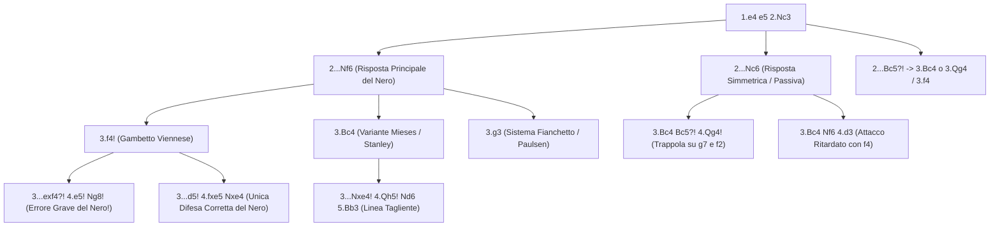

[[Home MOC|Home]] / [[Education & Learning]] / [[The Vienna Game]]

# The Vienna Game

## Sintesi Esecutiva

<mark style="background:rgba(255, 193, 69, 0.32)"><b>The Vienna Game</b></mark> (*Partita Viennese*, definita dalle mosse iniziali `1.e4 e5 2.Nc3`) è una delle armi più letali, pratiche e istruttive per il giocatore compreso nella fascia `750 – 1800` ELO. Sviluppata a Vienna a metà dell'Ottocento da Carl Hamppe e Wilhelm Steinitz come versione raffinata e corretta del romantico *Gambetto di Re* (`1.e4 e5 2.f4`), la Partita Viennese insegna tre principi d'attacco fondamentali: <mark style="background:rgba(255, 193, 69, 0.32)"><b>punire il gioco passivo o automatico</b></mark>, <mark style="background:rgba(255, 193, 69, 0.32)"><b>aprire la colonna f</b></mark> per le Torri e orchestrare <mark style="background:rgba(181, 113, 255, 0.36)"><b>attacchi diretti sull'ala di Re</b></mark>. A differenza di [[The Italian Game]] e [[The Scotch Game]], che sviluppano subito il Cavallo in `f3` bloccando il pedone `f2`, la Viennese sviluppa per primo il Cavallo di Donna in `c3`, blindando il pedone `e4` e mantenendo libera la spinta d'urto `f2-f4!`.

| Parametro Tecnico | Dettaglio Strategico |
| :--- | :--- |
| **Nome Apertura** | The Vienna Game (*Partita Viennese* — Codici ECO `C25–C29`) |
| **Mosse Iniziali** | `1.e4 e5 2.Nc3` |
| **Lezione Primaria** | Punire il gioco passivo, aprire la colonna `f`, attacchi diretti sul lato di Re |
| **Fascia ELO Ideale** | `750 – 1800` (percentuale di vittoria altissima nel gioco rapido e di club) |
| **Indole Posizionale** | Aggressiva, asimmetrica, ricca di trappole tattiche contro mosse "naturali" del Nero |

---

## 1. La Logica Strategica di `2.Nc3`: Un Gambetto di Re Migliorato

Perché sviluppare il Cavallo in `c3` alla seconda mossa invece del classico `2.Nf3`?

1. **Protezione preventiva di `e4` e controllo di `d5`**: Nel Gambetto di Re classico (`1.e4 e5 2.f4`), il pedone `e4` è indifeso e il Nero può creare subito fastidi con `2...exf4` seguito da `...Qh4+` o `...d5`. Giocando prima `2.Nc3`, il Bianco protegge `e4` e controlla la casa critica `d5` con due pezzi (`e4` e `Nc3`).
2. **Il pedone `f2` resta libero di avanzare**: Non avendo collocato il Cavallo in `f3`, il Bianco conserva l'opzione di lanciare **`f2-f4!`** al momento più opportuno, attaccando il centro nero dal fianco e aprendo la colonna `f` per la Torre bianca dopo l'arrocco corto (`O-O`).
3. **Effetto sorpresa contro il "pilota automatico"**: Tra `750` e `1800` ELO, i giocatori con il Nero sono abituati a rispondere a `2.Nf3 Nc6 3.Bc4`. Di fronte a `2.Nc3`, chi ripete meccanicamente le stesse mosse simmetriche (`2...Nc6 3.Bc4 Bc5?!`) va incontro al disastro immediato con `4.Qg4!`.

![[chess_vienna_01_tabiya.svg]]

---

## 2. Caso Principale A: Il Gambetto Viennese (`2...Nf6 3.f4!`)

La risposta più frequente e sensata del Nero a `2.Nc3` è **`2...Nf6`**, sviluppando un pezzo e attaccando `e4`. A questo punto il Bianco scatena il <mark style="background:rgba(255, 193, 69, 0.32)"><b>Gambetto Viennese</b></mark> con **`3.f4!`**.

### 2.1 L'Errore Più Comune del Nero (`3...exf4?!`) e la Punizione `4.e5!`

Nella fascia `750 – 1600` ELO, oltre la metà dei giocatori con il Nero vede un pedone offerto in `f4` e lo cattura istintivamente con **`3...exf4?!`**. Questa mossa, che sarebbe corretta nel Gambetto di Re, nella Viennese è un **errore strategico gravissimo**!

![[chess_vienna_02_vienna_gambit_accepted.svg]]

- **Perché `3...exf4?!` perde subito l'iniziativa**:
  Il Bianco risponde **`4.e5!`** attaccando il Cavallo nero in `f6`.
  Guardiamo le case disponibili per quel Cavallo:
  - `d5` è controllata dal Cavallo bianco in `c3`!
  - `e4` è controllata dal Cavallo bianco in `c3`!
  - `g4` è controllata dalla Donna bianca in `d1`!
  - `h5` è controllata dalla Donna bianca in `d1`!
  - **Risultato scioccante**: Il Cavallo nero non ha alcuna casa attiva ed è **costretto a tornare mestamente nella casa iniziale con `4...Ng8!`** (e se il Nero prova `4...Qe7?!`, il Bianco gioca semplicemente `5.Qe2! Ng8 6.Nf3`, lasciando la Donna nera in `e7` a bloccare il proprio Alfiere `f8`!).
- **Come prosegue il Bianco dopo `4...Ng8`**:
  `5.Nf3 d6 6.d4 dxe5 7.Qe2! Nc6 8.Bxf4`: il Bianco recupera il pedone con gli interessi, ha quattro pezzi sviluppati e può arroccare lungo (`O-O-O`), mentre tutti i pezzi neri sono ancora sull'ottava traversa!

### 2.2 Altre Mosse Passivo-Difensive del Nero al Terzo Tratto (`3...d6?` o `3...Nc6?`)

Cosa succede se dopo `3.f4` il Nero non prende in `f4`, ma difende passivamente il pedone `e5` con `3...d6?` o `3...Nc6?`?
- **Contro `3...Nc6?`**: Il Bianco gioca `4.fxe5 Nxe5 5.d4! Ng6 6.e5! Ng8`: di nuovo il Cavallo nero in `f6` viene ricacciato in `g8` mentre il Bianco costruisce il rullo compressore centrale `d4-e5`!
- **Contro `3...d6?`**: Il Bianco sviluppa con `4.Nf3 Nc6 5.Bb5 Bd7 6.d3 exf4 7.Bxf4 Be7 8.O-O O-O`, ottenendo la colonna `f` semi-aperta gratuitamente senza che il Nero abbia alcun controgioco.

### 2.3 L'Unica Difesa Corretta del Nero: Il Contrattacco Centrale `3...d5!`

Il giocatore preparato col Nero sa che contro un attacco di fianco bisogna reagire al centro con **`3...d5!`**. Dopo **`4.fxe5 Nxe4`**, si raggiunge la posizione teorica chiave del Gambetto Viennese:

![[chess_vienna_03_vienna_gambit_main.svg]]

Qui il Bianco dispone di tre ottime continuazioni:

1. **La Linea Aggressiva di Paulsen (`5.Qf3!`)**:
   - Attacca due volte il Cavallo in `e4` e punta su `f7`.
   - Se il Nero gioca `5...Nxc3 6.bxc3 Be7 7.d4 O-O 8.Bd3`, il Bianco ha un centro granitico (`c3-d4-e5`), l'Alfiere in `d3` puntato su `h7`, la Donna già in `f3` e la colonna `f` spalancata per `Rf1`!
   - Se il Nero gioca `5...Nc6`, il Bianco inchioda subito con `6.Bb5! Nxc3 7.dxc3 Qh4+ 8.g3 Qe4+ 9.Qxe4 dxe4 10.Bf4 Bd7 11.O-O-O`.
2. **La Linea Posizionale Classica (`5.Nf3`)**:
   - Impedisce qualsiasi scacco in `h4` (`...Qh4+`). Dopo `5...Be7 6.d4 O-O 7.Bd3 f5 8.exf6 Bxf6 9.O-O`, il Bianco gode di pressione naturale lungo le colonne `e` ed `f`.
3. **Il Sistema Solido `5.d3`**:
   - Forza `5...Nxc3 6.bxc3 d4 7.Nf3 Nc6 8.Be2`, consolidando il centro con `c3-d4`.

---

## 3. Caso Principale B: La Variante `3.Bc4` e il Trucco della Forchetta Centrale (`3...Nxe4!`)

Se dopo `1.e4 e5 2.Nc3 Nf6` il Bianco sceglie **`3.Bc4`** (Variante Mieses/Stanley), bisogna conoscere a memoria una tattica fondamentale del Nero: il <mark style="background:rgba(181, 113, 255, 0.36)"><b>Center Fork Trick (3...Nxe4!)</b></mark>.

- **Perché `3...Nxe4!` non perde un pezzo**:
  A prima vista sembra che il Nero abbia regalato il Cavallo in `e4`. Ma se il Bianco cattura `4.Nxe4`, il Nero gioca **`4...d5!`**, dando una forchetta simultanea all'Alfiere in `c4` e al Cavallo in `e4` (`5.Bd3 dxe4 6.Bxe4 Bd6`)!
- **L'arma segreta del Bianco dopo `3...Nxe4!`: `4.Qh5!`**:
  Invece di catturare il Cavallo con `4.Nxe4`, il Bianco gioca la mossa intermedia esplosiva **`4.Qh5!`**, minacciando **scacco matto in `f7` (`5.Qxf7#`)** e attaccando contemporaneamente il Cavallo in `e4`!

![[chess_vienna_05_center_fork_qh5.svg]]

- **Come prosegue la linea dopo `4.Qh5!`**:
  - Il Nero non può dare matto né giocare `4...d5?` (perché `5.Qxe5+` o `5.Bxd5` vince). L'unica difesa sensata del Nero è ritirare il Cavallo a difesa di `f7` con **`4...Nd6`**, attaccando l'Alfiere in `c4`.
  - Il Bianco ritira l'Alfiere sulla diagonale mantenendo la minaccia su `f7`: **`5.Bb3!`**.
  - Ora il pedone `e5` è sotto attacco (`Qxe5+`) e il Cavallo nero in `d6` blocca il proprio pedone `d7` e l'Alfiere `c8`! (La difesa migliore del Nero è la prudente `5...Be7 6.Qxe5 O-O 7.Nf3`, con gioco pari e complesso; ma se il Nero gioca la "naturale" `5...Nc6?`, cade in una trappola mortale illustrata nella Sezione 5!).

---

## 4. Caso Principale C: Punire il Gioco Simmetrico (`2...Nc6`)

Tra `750` e `1600` ELO è frequentissimo incontrare giocatori che rispondono a `1.e4 e5 2.Nc3` con **`2...Nc6`**. Il Bianco risponde **`3.Bc4`**, e qui si aprono due scenari:

### 4.1 Il Nero Copia la Mossa con `3...Bc5?!` -> La Bomba `4.Qg4!`

Se il Nero gioca pigramente **`3...Bc5?!`** (pensando di essere in una tranquilla Partita Italiana), il Bianco sferra il colpo da KO **`4.Qg4!`**:

![[chess_vienna_04_copycat_qg4_trap.svg]]

- **Perché `4.Qg4!` funziona nella Viennese (e non nell'Italiana)**:
  In [[The Italian Game]] (`2.Nf3`), il Cavallo in `f3` ostruisce la diagonale `d1-h5` della Donna. Nella Viennese, poiché il Bianco ha sviluppato `2.Nc3`, la diagonale della Donna è completamente aperta e `4.Qg4!` piomba come un fulmine sul pedone indifeso **`g7`**!
- **Le trappole in cui cade il Nero dopo `4.Qg4!`**:
  - **Risposta disperata 1 — `4...Qf6?!` (La Trappola della Donna Intrappolata)**:
    Il Nero difende `g7` con la Donna e minaccia `...Qxf2+`. Il Bianco ignora `f2` e salta in **`5.Nd5!`** (attaccando la Donna e minacciando la forchetta `Nxc7+` su Re e Torre `a8`)!
    Il Nero gioca trionfante `5...Qxf2+ 6.Kd1`, e improvvisamente si accorge di essere **completamente perso**:
    1. Il Bianco minaccia `7.Qxg7` vincendo la Torre in `h8`.
    2. Il Bianco minaccia `7.Nxc7+` vincendo la Torre in `a8`.
    3. Il Bianco minaccia `7.Nh3!` che **intrappola la Donna nera in `f2` in mezzo alla scacchiera**!
  - **Risposta disperata 2 — `4...g6?!`**:
    Indebolisce catastroficamente le case scure: dopo `5.Qf3! Nf6 6.Nge2 d6 7.d3 Bg4 8.Qg3`, il Bianco domina le case `f6`, `g5` e `d5`.
  - **L'unica mossa per non perdere materiale — `4...Kf8!`**:
    Il Nero è costretto a muovere il Re in `f8` alla quarta mossa per difendere `g7`, perdendo l'arrocco e chiudendo in gabbia la Torre `h8`! Il Bianco prosegue comodamente con `5.d3 d6 6.Qg3 Nf6 7.Nge2`.

### 4.2 Il Nero Gioca `3...Nf6` -> L'Attacco Viennese con `4.d3` e `5.f4!`

Se su `2...Nc6 3.Bc4` il Nero gioca la corretta `3...Nf6`, il Bianco imposta la micidiale struttura d'attacco **`4.d3`**:
- **Se `4...Bc5` (o `4...Be7`)**: Il Bianco lancia **`5.f4! d6 6.Nf3`**:
  - Nota importante: se il Nero inchioda il Cavallo con `6...Bg4`, il Bianco gioca subito **`7.Na4!`** (eliminando il prezioso Alfiere camposcuro del Nero in `c5`) seguito da `h3`, `O-O` e pressione devastante lungo la colonna `f` e la diagonale `a2-g8`.
- **Se `4...Bb4` (Difesa con inchiodatura)**: Il Bianco sviluppa `5.Ne2! d5 6.exd5 Nxd5 7.O-O Be6 8.Nxd5 Bxd5 9.Bxd5 Qxd5 10.f4!`, aprendo la colonna `f` a proprio favore.

---

## 5. Le Trappole Più Ingannevoli della Partita Viennese

### Trappola 1: La Trappola di Kaufmann / Frankenstein-Dracula (`3.Bc4 Nxe4 4.Qh5 Nd6 5.Bb3 Nc6?`)

Torniamo alla posizione dopo `1.e4 e5 2.Nc3 Nf6 3.Bc4 Nxe4 4.Qh5! Nd6 5.Bb3`:
Se il Nero difende `e5` con la mossa apparentemente naturalissima **`5...Nc6?`** (invece di `5...Be7!`), il Bianco scatena una sequenza forzata spettacolare:

1. **`6.Nb5!`**: Il Cavallo bianco si unisce all'attacco sul punto `c7` e minaccia `7.Nxd6+` seguito da `8.Qxf7#`!
2. **`6...g6 7.Qf3! f5`** (unica per evitare il matto in `f7` dopo `Nxd6+`):
3. **`8.Qd5!`**: Minaccia ancora `9.Nxd6+` e `10.Qf7#`, oltre a `9.Nxc7+`.
4. **`8...Qe7 9.Nxc7+ Kd8 10.Nxa8`**: Il Bianco guadagna una **Torre intera** in `a8`!
   *(Nota avanzata: nella cosiddetta **Variante Frankenstein-Dracula**, il Nero gioca `10...b6!` cercando di intrappolare il Cavallo in `a8` e attaccare con `...Bb7`; il Bianco si difende con precisione giocando `11.d3! Bb7 12.h4!`, preparando `Bg5` per inchiodare la Donna nera in `e7` e liberare la propria posizione con materiale decisivo di vantaggio!)*

---

### Trappola 2: La Trappola di Würzburger nel Gambetto Viennese (`5...Qh4+?!`)

Nella linea principale del Gambetto Viennese (`1.e4 e5 2.Nc3 Nf6 3.f4 d5 4.fxe5 Nxe4`):
Se dopo `5.d3` il Nero tenta di sfruttare l'indebolimento della diagonale `e1-h4` con lo scacco **`5...Qh4+?!`**, il Bianco lo attira in una trappola velenosissima:
- **Sequenza**: `6.g3 Nxg3 7.Nf3! Qh5 8.Nxd5!`.
- Se il Nero cattura avidamente la Torre in `h1` con `8...Nxh1?`, segue `9.Nxc7+ Kd8 10.Nxa8 Bg4 11.Bg2! Bxf3 12.Qxf3 Qxe5+ 13.Kf1`: il Cavallo nero in `h1` viene catturato (`Bxh1`) e il Bianco rimane con un pezzo di vantaggio e il Re nero esposto in `d8`!

---

## 6. Riepilogo Operativo e Checklist Decisionale per il Bianco

| Risposta del Nero a `1.e4 e5 2.Nc3` | Piano Consigliato per il Bianco | Punto Tattico / Trappola da Ricordare |
| :--- | :--- | :--- |
| **`2...Nf6 3.f4 exf4?!`** | `4.e5! Ng8 5.Nf3 d6 6.d4!` | Il Cavallo nero è forzato a tornare nella casa iniziale `g8`! |
| **`2...Nf6 3.f4 d5!`** | `4.fxe5 Nxe4 5.Qf3!` (o `5.Nf3`) | Attacca `e4` e `f7`; prepara `Bb5` o `d3-d4` e `O-O` |
| **`2...Nf6 3.Bc4 Nxe4!`** | `4.Qh5! Nd6 5.Bb3!` | Se `5...Nc6?`, gioca `6.Nb5! g6 7.Qf3 f5 8.Qd5!` vincendo la Torre `a8` |
| **`2...Nc6 3.Bc4 Bc5?!`** | `4.Qg4!` | Attacca `g7`; se `4...Qf6?!`, gioca `5.Nd5! Qxf2+ 6.Kd1` (tripla minaccia) |
| **`2...Nc6 3.Bc4 Nf6`** | `4.d3 Bc5 5.f4! d6 6.Nf3` | Se `6...Bg4`, gioca `7.Na4!` per eliminare l'Alfiere nero in `c5` |
