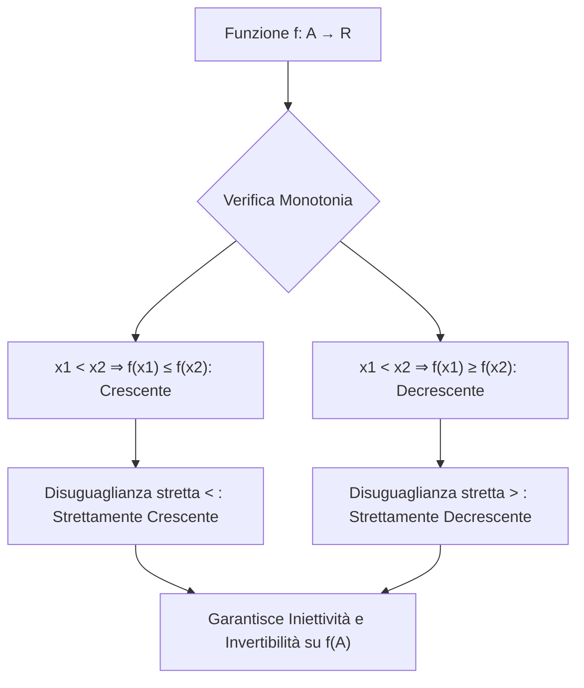

[[Home MOC|Home]] / [[Education & Learning]] / [[Lezione 10 - Funzioni Reali II e Funzioni Elementari I]]

# Lezione 10 - Funzioni Reali II e Funzioni Elementari I

## Sintesi Esecutiva
Il completamento dello studio delle funzioni reali di variabile reale formalizza il concetto di <mark style="background:rgba(255, 193, 69, 0.32)"><b>monotonia funzionale</b></mark> e ne indaga il legame strutturale con l'iniettività e l'invertibilità. La lezione (Sapienza Università di Roma — a cura dei proff. G. Franzina e S. Salzo) analizza la conservazione della monotonia sotto composizione, introduce le trasformazioni geometriche fondamentali (traslazioni, riflessioni assiali e centrali) collegandole alla parità, disparità e periodicità, e avvia la rassegna delle <mark style="background:rgba(181, 113, 255, 0.36)"><b>funzioni elementari</b></mark>: funzioni affini, potenze ad esponente intero positivo, funzioni radice $n$-esima e potenze ad esponente intero negativo.

## Funzioni Reali Monotone

In continuità con l'analisi funzionale sviluppata in [[Lezione 9 - Funzioni Reali ed Estremi]], si considerano le funzioni reali definite su un sottoinsieme reale, $f: A \subseteq \mathbb{R} \to \mathbb{R}$.

### Definizioni Fondamentali
Sia $f: A \subseteq \mathbb{R} \to \mathbb{R}$ una funzione reale di variabile reale:
- **Crescente:** se per ogni coppia di punti $x_1, x_2 \in A$:
  $$x_1 < x_2 \implies f(x_1) \le f(x_2)$$
- **Decrescente:** se per ogni coppia di punti $x_1, x_2 \in A$:
  $$x_1 < x_2 \implies f(x_1) \ge f(x_2)$$
- **Strettamente crescente:** se per ogni coppia di punti $x_1, x_2 \in A$:
  $$x_1 < x_2 \implies f(x_1) < f(x_2)$$
- **Strettamente decrescente:** se per ogni coppia di punti $x_1, x_2 \in A$:
  $$x_1 < x_2 \implies f(x_1) > f(x_2)$$

Una funzione che soddisfa una delle prime due proprietà si dice **monotona**; se soddisfa una delle ultime due, si dice <mark style="background:rgba(255, 193, 69, 0.32)"><b>strettamente monotona</b></mark>. Se la proprietà vale restringendo il dominio a un sottoinsieme $B \subseteq A$, si afferma che $f$ è monotona (o strettamente monotona) in $B$ tramite la restrizione $f|_B$.

### Esempi e Dimostrazione per Induzione
Consideriamo la funzione potenza $f: \mathbb{R}_+ \to \mathbb{R}_+$, $f(x) = x^n$ con $n \in \mathbb{N}^*$. Si dimostra che $f$ è strettamente crescente su $\mathbb{R}_+$ mediante il principio di induzione su $n$:
1. **Base induttiva ($n = 1$):** $P(1)$ asserisce $0 \le x_1 < x_2 \implies x_1 < x_2$, banalmente vera.
2. **Passo induttivo ($P(n) \implies P(n+1)$):** Assumendo vera $0 \le x_1^n < x_2^n$, moltiplicando per $x_1 \ge 0$ e $x_2^n > 0$:
   $$x_1^{n+1} \le x_1 x_2^n \quad \land \quad x_1 x_2^n < x_2^{n+1} \implies 0 \le x_1^{n+1} < x_2^{n+1}$$
   Dunque $P(n+1)$ è verificata per ogni $n \in \mathbb{N}^*$.

### Esercizi Notevoli di Monotonia
1. **Verifica per $f: \mathbb{R}_+^* \to \mathbb{R}$, $f(x) = \frac{x}{1+x}$:**
   Riscrivendo l'espressione dividendo numeratore e denominatore per $x$:
   $$f(x) = \frac{1}{1 + 1/x}$$
   Se $0 < x_1 < x_2$, allora $\frac{1}{x_1} > \frac{1}{x_2}$, da cui $1 + \frac{1}{x_1} > 1 + \frac{1}{x_2}$, e invertendo:
   $$\frac{1}{1 + 1/x_1} < \frac{1}{1 + 1/x_2} \implies f(x_1) < f(x_2)$$
   Pertanto $f$ è strettamente crescente su $\mathbb{R}_+^*$.
2. **Verifica per $f: ]1, +\infty[ \to \mathbb{R}$, $f(x) = \frac{x}{1+x^2}$:**
   Siano $1 < x_1 < x_2$. La condizione di stretta decrescenza $f(x_1) > f(x_2)$ equivale a:
   $$\frac{x_1}{1+x_1^2} > \frac{x_2}{1+x_2^2} \iff x_1(1+x_2^2) > x_2(1+x_1^2) \iff x_1 x_2(x_2 - x_1) > x_2 - x_1$$
   Poiché $x_2 - x_1 > 0$, dividendo per $x_2 - x_1$ si ottiene $x_1 x_2 > 1$, identità sempre vera essendo $x_1, x_2 > 1$. La funzione è quindi strettamente decrescente su $]1, +\infty[$.

> [!NOTE] Funzioni prive di intervalli di monotonia
> Esistono funzioni non monotone che ammettono intervalli di monotonia (come $f(x) = x(1-x^2)$), ma esistono anche funzioni prive di qualsiasi intervallo di monotonia. L'esempio cardine è la **funzione indicatrice dei razionali (funzione di Dirichlet)**:
> $$\chi_{\mathbb{Q}}(x) = \begin{cases} 1 & \text{se } x \in \mathbb{Q} \\ 0 & \text{se } x \in \mathbb{R} \setminus \mathbb{Q} \end{cases}$$
> A causa della densità di $\mathbb{Q}$ e di $\mathbb{R} \setminus \mathbb{Q}$ in $\mathbb{R}$, in ogni intervallo reale arbitrariamente piccolo la funzione oscilla infinitamente tra 0 e 1.

---

## Composizione e Invertibilità di Funzioni Monotone

### Composizione di Funzioni Monotone
Siano $f: A \subseteq \mathbb{R} \to \mathbb{R}$ e $g: B \subseteq \mathbb{R} \to \mathbb{R}$ con $f(A) \subseteq B$. La composizione $g \circ f: A \to \mathbb{R}$ preserva o inverte l'ordinamento secondo precise regole algebriche:
- Se $f$ e $g$ sono entrambe crescenti oppure entrambe decrescenti, allora $g \circ f$ è **crescente**.
- Se una funzione è crescente e l'altra è decrescente, allora $g \circ f$ è **decrescente**.
- Se $f$ e $g$ sono entrambe strettamente monotone, allora $g \circ f$ è **strettamente monotona**.

*Dimostrazione (caso decrescente $\circ$ decrescente):*
Siano $x_1, x_2 \in A$ con $x_1 < x_2$. Poiché $f$ è decrescente, $f(x_1) \ge f(x_2)$. Applicando la decrescenza di $g$ a $y_1 = f(x_1)$ e $y_2 = f(x_2)$, da $f(x_2) \le f(x_1)$ segue $g(f(x_1)) \le g(f(x_2))$, ossia la crescenza della funzione composta.

### Stretta Monotonia e Teorema di Invertibilità
Una funzione strettamente monotona è intrinsecamente iniettiva:
$$\forall x_1 \ne x_2 \in A \implies x_1 < x_2 \lor x_2 < x_1 \implies f(x_1) \ne f(x_2)$$
Restringendo il codominio all'immagine $f(A)$, la funzione $f: A \to f(A)$ risulta biiettiva e ammette inversa $f^{-1}: f(A) \to A$.

> [!IMPORTANT] Monotonia dell'Inversa
> L'inversa $f^{-1}$ di una funzione strettamente monotona eredita la medesima monotonia di $f$:
> - Se $f$ è strettamente crescente, allora $f^{-1}$ è **strettamente crescente**.
> - Se $f$ è strettamente decrescente, allora $f^{-1}$ è **strettamente decrescente**.
> 
> *Dimostrazione:* Siano $y_1, y_2 \in f(A)$ con $y_1 < y_2$. Siano $x_1 = f^{-1}(y_1)$ e $x_2 = f^{-1}(y_2)$. Se per assurdo fosse $x_1 \ge x_2$, per la stretta crescenza di $f$ risulterebbe $f(x_1) \ge f(x_2)$, cioè $y_1 \ge y_2$, contraddicendo l'ipotesi. Ne consegue necessariamente $x_1 < x_2$, ovvero $f^{-1}(y_1) < f^{-1}(y_2)$.

---

## Trasformazioni Geometriche e Simmetrie

Data una funzione reale $f: \mathbb{R} \to \mathbb{R}$, le operazioni algebriche sulla variabile indipendente o sui valori funzionali inducono trasformazioni geometriche sul grafico:

| Trasformazione | Legge Funzionale | Effetto Geometrico |
|---|---|---|
| **Traslazione** | $g(x) = f(x - u) + v$ | Spostamento rigido del vettore $(u, v)$ |
| **Riflessione asse $y$** | $g(x) = f(-x)$ | Ribaltamento orizzontale rispetto all'asse delle ordinate |
| **Riflessione asse $x$** | $g(x) = -f(x)$ | Ribaltamento verticale rispetto all'asse delle ascisse |
| **Riflessione rispetto all'origine** | $g(x) = -f(-x)$ | Simmetria centrale rispetto a $(0, 0)$ |

### Applicazione: Deduzione del Vertice della Parabola
Consideriamo il polinomio di secondo grado $g(x) = ax^2 + bx + c$ con $a \ne 0$. Completando il quadrato:
$$g(x) = a\left(x^2 + \frac{b}{a}x + \frac{c}{a}\right) = a\left[\left(x + \frac{b}{2a}\right)^2 - \frac{b^2 - 4ac}{4a^2}\right] = a\left(x + \frac{b}{2a}\right)^2 - \frac{\Delta}{4a}$$
Posto $f(x) = ax^2$, la funzione $g(x)$ si esprime come la traslata di $f$:
$$g(x) = f\left(x + \frac{b}{2a}\right) - \frac{\Delta}{4a}$$
Poiché $f(x)$ è una parabola con vertice nell'origine $(0, 0)$, il grafico di $g(x)$ è traslato di ampiezza:
$$u = -\frac{b}{2a}, \qquad v = -\frac{\Delta}{4a}$$
da cui si deducono analiticamente le coordinate del vertice $V\left(-\frac{b}{2a}, -\frac{\Delta}{4a}\right)$.

### Parità, Disparità e Periodicità
- **Funzione Pari:** $f(x) = f(-x)$ per ogni $x \in \mathbb{R}$. Il grafico è simmetrico rispetto all'asse $y$.
- **Funzione Dispari:** $f(-x) = -f(x)$ per ogni $x \in \mathbb{R}$. Il grafico è simmetrico rispetto all'origine.
- **Funzione Periodica:** $f(x + p) = f(x)$ per ogni $x \in \mathbb{R}$, con periodo minimo $p > 0$. Il grafico è invariante per traslazioni orizzontali di ampiezza $k \cdot p$ con $k \in \mathbb{Z}$.

---

## Funzioni Elementari (Parte I)

### 1. Funzioni Affini e Lineari
Dati $a, b \in \mathbb{R}$, la funzione $f: \mathbb{R} \to \mathbb{R}$ definita da:
$$f(x) = ax + b$$
si chiama <mark style="background:rgba(181, 113, 255, 0.36)"><b>funzione affine</b></mark>.
- Il grafico rappresenta una retta con pendenza (*coefficiente angolare*) $a$ e intercetta verticale $b$.
- Se $b = 0$, la funzione $f(x) = ax$ è detta **lineare**.
- Se $a = 0$, la funzione $f(x) = b$ è costante (quindi pari).
- Se $a \ne 0$, la funzione è biiettiva su tutto $\mathbb{R}$ e la sua inversa è anch'essa affine:
  $$f^{-1}(y) = \frac{1}{a}y - \frac{b}{a}$$
- La composizione di due funzioni affini è ancora una funzione affine.

### 2. Funzione Potenza ad Esponente Intero Naturale
Sia $n \in \mathbb{N}$. La funzione $p_n: \mathbb{R} \to \mathbb{R}$, $p_n(x) = x^n$ gode delle seguenti proprietà:
- **Simmetria:** $p_n$ è pari se $n$ è pari; è dispari se $n$ è dispari.
- **Monotonia su $\mathbb{R}_+$:** $p_n$ è strettamente crescente su $\mathbb{R}_+$.
- **Comportamento globale:**
  - Per $n$ pari: strettamente decrescente su $\mathbb{R}_-$, strettamente crescente su $\mathbb{R}_+$, immagine $p_n(\mathbb{R}) = \mathbb{R}_+$.
  - Per $n$ dispari: strettamente crescente su tutto $\mathbb{R}$, immagine $p_n(\mathbb{R}) = \mathbb{R}$.
- **Suriettività su $\mathbb{R}_+$:** per ogni $y > 0$, l'insieme $\{t \ge 0 \mid t^n \le y\}$ è superiormente limitato e il suo estremo superiore $x = \sup\{t \ge 0 \mid t^n \le y\}$ soddisfa rigorosamente $x^n = y$.

### 3. Funzione Radice $n$-esima
Data l'invertibilità di $p_n$ su opportuni domini, si definisce la funzione radice $n$-esima $\sqrt[n]{\cdot}$:
- Se $n$ è pari: è l'inversa della restrizione $(p_n)|_{\mathbb{R}_+}: \mathbb{R}_+ \to \mathbb{R}_+$. Dominio e immagine sono $\mathbb{R}_+$.
- Se $n$ è dispari: è l'inversa di $p_n: \mathbb{R} \to \mathbb{R}$. Dominio e immagine sono $\mathbb{R}$.

In entrambi i casi, la funzione $\sqrt[n]{x}$ è **strettamente crescente**. Valgono le proprietà algebriche fondamentali:
$$\sqrt[n]{ab} = \sqrt[n]{a}\sqrt[n]{b}, \qquad (\sqrt[n]{a})^m = \sqrt[n]{a^m}, \qquad \sqrt[m]{\sqrt[n]{a}} = \sqrt[mn]{a}$$

### 4. Funzione Potenza ad Esponente Intero Negativo
Per $n \in \mathbb{N}^*$, la funzione $f: \mathbb{R}^* \to \mathbb{R}$ definita da:
$$f(x) = x^{-n} = \frac{1}{x^n}$$
rappresenta la reciproca della potenza positiva.
- È definita su $\mathbb{R} \setminus \{0\}$.
- È una funzione pari se $n$ è pari, dispari se $n$ è dispari.
- È sempre **strettamente decrescente** sull'intervallo $]0, +\infty[$.
- Sull'intervallo $]-\infty, 0[$ è strettamente crescente per $n$ pari, mentre è strettamente decrescente per $n$ dispari.
