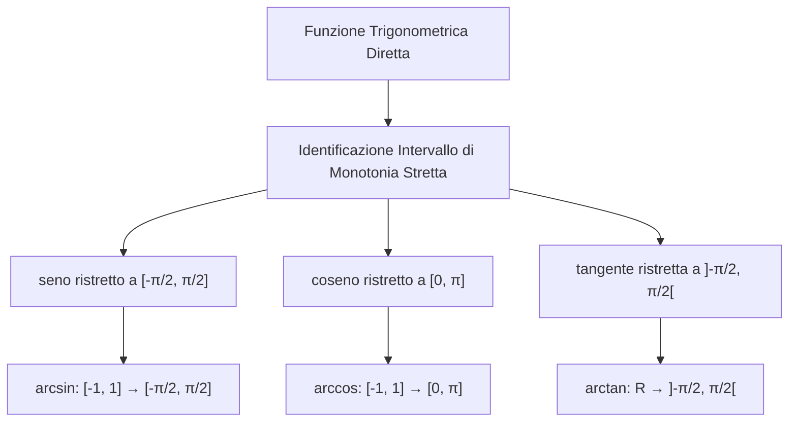

[[Home MOC|Home]] / [[Education & Learning]] / [[Lezione 11 - Funzioni Reali Elementari II]]

# Lezione 11 - Funzioni Reali Elementari II

## Sintesi Esecutiva
Il completamento delle funzioni elementari sancisce il passaggio dalle forme algebriche alle funzioni trascendenti fondamentali dell'analisi matematica. Questa undicesima lezione (Sapienza Università di Roma — a cura dei proff. G. Franzina e S. Salzo) formalizza la costruzione rigorosa della <mark style="background:rgba(255, 193, 69, 0.32)"><b>funzione esponenziale</b></mark> su tutto il campo reale mediante classi contigue di razionali, da cui discende la funzione logaritmo e la potenza ad esponente reale arbitrario. La trattazione sviluppa la teoria delle <mark style="background:rgba(181, 113, 255, 0.36)"><b>funzioni iperboliche</b></mark>, dimostrando l'identità dell'iperbole equilatera e ricavando analiticamente le espressioni esplicite dei settori iperbolici inversi, per poi formalizzare la cinematica angolare delle funzioni trigonometriche e dei relativi rami invertibili arcoseno, arcocoseno e arcotangente.

## Costruzione della Funzione Esponenziale e del Logaritmo

### Dalle Potenze Razionali all'Esponente Reale
Per una base fissata $a > 0$, l'elevamento a potenza ad esponente naturale e intero soddisfa le ordinarie regole algebriche studiate in [[Lezione 7 - Insiemi Numerici N Z e Q]]. Per ogni esponente razionale $q = \frac{m}{n} \in \mathbb{Q}$ (con $m \in \mathbb{Z}$ e $n \in \mathbb{N}^*$), la potenza è definita tramite la radice $n$-esima:
$$a^q := \sqrt[n]{a^m}$$
Valgono per $p, q \in \mathbb{Q}$ e $a, b > 0$ le proprietà:
$$(ab)^q = a^q b^q, \qquad a^{p+q} = a^p a^q, \qquad a^{pq} = (a^p)^q$$

Per estendere l'esponenziale a un qualsiasi esponente reale irrazionale $x \in \mathbb{R} \setminus \mathbb{Q}$, si sfrutta l'assioma di completezza di $\mathbb{R}$ introdotto in [[Lezione 5 - i Numeri Reali e Assioma di Completezza]].

> [!IMPORTANT] Teorema di Esistenza dell'Esponenziale Reale
> Sia $a > 0$ e $x \in \mathbb{R}$. Si considerino i sottoinsiemi di $\mathbb{R}$:
> $$A := \{a^q \mid q \in \mathbb{Q}, q < x\}, \qquad B := \{a^q \mid q \in \mathbb{Q}, q > x\}$$
> Gli insiemi $A$ e $B$ sono non vuoti, separati e contigui. Se $a > 1$, ogni elemento di $A$ è minore di ogni elemento di $B$, ed esiste un unico elemento separatore che definisce $a^x$:
> $$a^x := \sup \{a^q \mid q \in \mathbb{Q}, q < x\} = \inf \{a^q \mid q \in \mathbb{Q}, q > x\}$$
> Se invece $0 < a < 1$, l'ordinamento si inverte e si pone $a^x := \inf \{a^q \mid q < x\} = \sup \{a^q \mid q > x\}$.

### Proprietà Fondamentali dell'Esponenziale
Per $a \ne 1$, la funzione $\exp_a: \mathbb{R} \to ]0, +\infty[$, definita da $\exp_a(x) = a^x$, soddisfa:
1. **Omomorfismo additivo-moltiplicativo:**
   $$a^{x+y} = a^x a^y, \qquad a^{xy} = (a^x)^y, \qquad a^{-x} = \frac{1}{a^x}$$
2. **Monotonia stretta:**
   - Se $a > 1$: $\exp_a$ è strettamente crescente su tutto $\mathbb{R}$.
   - Se $0 < a < 1$: $\exp_a$ è strettamente decrescente su tutto $\mathbb{R}$.
3. **Biiettività e Immagine:** L'immagine è l'intero asse reale positivo $\exp_a(\mathbb{R}) = ]0, +\infty[$.
4. **Base Neperiana:** Scegliendo come base il numero trascendente di Nepero $e \approx 2.71828\dots$, si ottiene l'esponenziale naturale $\exp(x) = e^x$.

### Funzione Logaritmo
Essendo $\exp_a: \mathbb{R} \to ]0, +\infty[$ strettamente monotona e suriettiva, essa è biiettiva e ammette funzione inversa:
$$\log_a: ]0, +\infty[ \to \mathbb{R}$$
Per definizione, $\log_a(y)$ è l'unica soluzione reale dell'equazione $a^x = y$:
$$\forall x \in \mathbb{R}, \, y > 0: \quad a^x = y \iff x = \log_a(y)$$

**Proprietà algebriche fondamentali del logaritmo:**
- $\log_a(xy) = \log_a(x) + \log_a(y)$
- $\log_a\left(\frac{x}{y}\right) = \log_a(x) - \log_a(y)$
- $\log_a(x^\alpha) = \alpha \log_a(x)$ per ogni $\alpha \in \mathbb{R}$
- **Formula del cambio di base:** dati $a, b \in ]0, +\infty[ \setminus \{1\}$:
  $$\log_b(x) = \frac{\log_a(x)}{\log_a(b)}$$
- Se la base è $e$, il logaritmo naturale si denota comunemente con $\ln(x)$ o semplicemente $\log(x)$.

---

## Funzione Potenza ad Esponente Reale

Per qualunque esponente reale fissato $\alpha \in \mathbb{R} \setminus \mathbb{Z}$, la <mark style="background:rgba(181, 113, 255, 0.36)"><b>funzione potenza generalizzata</b></mark> è definita per basi strettamente positive mediante la composizione esponenziale-logaritmica:
$$p_\alpha(x) := x^\alpha = \exp(\alpha \log x) = e^{\alpha \ln x}, \qquad x \in ]0, +\infty[$$

Se $\alpha > 0$, la funzione si estende per continuità nell'origine ponendo $0^\alpha := 0$.

### Proprietà al Variare di $\alpha$
1. **Caso $\alpha > 0$:**
   - $p_\alpha$ è definita su $\mathbb{R}_+$, è strettamente crescente, con $p_\alpha(0) = 0$ e $p_\alpha(\mathbb{R}_+) = \mathbb{R}_+$.
   - Se $\alpha > 1$, la curva ha concavità rivolta verso l'alto (crescita superlineare).
   - Se $0 < \alpha < 1$, la curva ha concavità verso il basso (crescita sublineare, andamento simile alle radici).
2. **Caso $\alpha < 0$:**
   - $p_\alpha$ è definita unicamente su $\mathbb{R}_+^*$, è strettamente decrescente, con immagine $p_\alpha(\mathbb{R}_+^*) = \mathbb{R}_+^*$.
3. **Invertibilità:** Per ogni $\alpha \in \mathbb{R}^*$, l'inversa della funzione potenza $p_\alpha$ è la funzione potenza avente esponente reciproco:
   $$(p_\alpha)^{-1} = p_{1/\alpha}, \qquad (x^\alpha = y \iff x = y^{1/\alpha})$$

---

## Funzioni Iperboliche e Settori Iperbolici Inversi

Le funzioni iperboliche combinano simmetricamente esponenziali ad esponente opposto, formalizzando moti e curve fisiche (es. la catenaria dei cavi sospesi):

| Funzione | Notazione | Definizione Analitica | Simmetria | Dominio / Immagine |
|---|---|---|---|---|
| **Coseno Iperbolico** | $\cosh(x)$ | $\frac{e^x + e^{-x}}{2}$ | Pari | $\mathbb{R} \to [1, +\infty[$ |
| **Seno Iperbolico** | $\sinh(x)$ | $\frac{e^x - e^{-x}}{2}$ | Dispari | $\mathbb{R} \to \mathbb{R}$ |
| **Tangente Iperbolica** | $\tanh(x)$ | $\frac{\sinh x}{\cosh x} = \frac{e^x - e^{-x}}{e^x + e^{-x}}$ | Dispari | $\mathbb{R} \to ]-1, 1[$ |

### Identità Iperbolica Fondamentale
Al variare di $x \in \mathbb{R}$, il punto del piano cartesiano $P(\cosh x, \sinh x)$ descrive il ramo destro dell'iperbole equilatera di equazione $X^2 - Y^2 = 1$:
$$\cosh^2(x) - \sinh^2(x) = \left(\frac{e^x + e^{-x}}{2}\right)^2 - \left(\frac{e^x - e^{-x}}{2}\right)^2 = \frac{e^{2x} + e^{-2x} + 2}{4} - \frac{e^{2x} + e^{-2x} - 2}{4} = 1$$

Da tale identità scaturiscono le proprietà d'ordine:
$$\cosh(x) = \sqrt{1 + \sinh^2(x)} \ge 1, \qquad \cosh(0) = 1, \quad \sinh(0) = 0$$

### Risoluzione Analitica e Deduzione delle Funzioni Inverse
Per determinare le funzioni inverse, si risolvono algebricamente le equazioni nelle incognite $x$ ponendo la sostituzione $t = e^x > 0$:

1. **Settore Seno Iperbolico ($\mathrm{settsinh}$):**
   $$\sinh x = y \iff e^x - e^{-x} = 2y \iff t - \frac{1}{t} = 2y \iff t^2 - 2yt - 1 = 0$$
   Le soluzioni sono $t = y \pm \sqrt{y^2 + 1}$. Poiché $\sqrt{y^2 + 1} > |y|$, la radice col segno negativo è strettamente minore di zero e va scartata. L'unica soluzione positiva è $t = y + \sqrt{y^2 + 1}$. Applicando il logaritmo:
   $$\mathrm{settsinh}(y) = \ln\left(y + \sqrt{y^2 + 1}\right), \qquad y \in \mathbb{R}$$

2. **Settore Coseno Iperbolico ($\mathrm{settcosh}$):**
   Poiché $\cosh$ è pari, per renderla invertibile si considera la restrizione a $\mathbb{R}_+$, dove è strettamente crescente. Per $y \ge 1$:
   $$\cosh x = y \iff t^2 - 2yt + 1 = 0 \implies t = y \pm \sqrt{y^2 - 1}$$
   Imponendo $x \ge 0 \iff t \ge 1$, si sceglie la determinazione con il segno positivo:
   $$\mathrm{settcosh}(y) = \ln\left(y + \sqrt{y^2 - 1}\right), \qquad y \in [1, +\infty[$$

3. **Settore Tangente Iperbolica ($\mathrm{setttgh}$):**
   Per $y \in ]-1, 1[$:
   $$\tanh x = y \iff \frac{e^{2x} - 1}{e^{2x} + 1} = y \iff e^{2x}(1 - y) = 1 + y \iff e^{2x} = \frac{1+y}{1-y}$$
   $$\mathrm{setttgh}(y) = \frac{1}{2} \ln\left(\frac{1+y}{1-y}\right), \qquad y \in ]-1, 1[$$

---

## Funzioni Trigonometriche e Funzioni Inverse

Le funzioni trigonometriche sono definite geometricamente a partire dalla **circonferenza goniometrica** unitaria centrata nell'origine ($X^2 + Y^2 = 1$). Dato un arco orientato di lunghezza $x \in \mathbb{R}$, il punto terminale $P$ ha coordinate $(\cos x, \sin x)$.

### Proprietà di Periodicità e Simmetria
- $\sin(x)$ e $\cos(x)$ sono periodiche di periodo fondamentale $2\pi$, con immagine $[-1, 1]$.
- $\tan(x) = \frac{\sin x}{\cos x}$ è periodica di periodo $\pi$, definita per $x \ne \frac{\pi}{2} + k\pi$ ($k \in \mathbb{Z}$), con immagine $\mathbb{R}$.
- Il coseno è pari ($\cos(-x) = \cos x$), mentre seno e tangente sono dispari ($\sin(-x) = -\sin x$, $\tan(-x) = -\tan x$).

### Rami Invertibili e Definizioni delle Funzioni Circolari Inverse
Essendo funzioni periodiche, esse non sono iniettive sull'intero dominio naturale. L'invertibilità si ottiene isolando intervalli canonici di stretta monotonia:

1. **Arcoseno ($\arcsin$):**
   - Inversa della restrizione $\sin|_{[-\pi/2, \, \pi/2]}: [-\pi/2, \pi/2] \to [-1, 1]$ (strettamente crescente).
   - $$\arcsin: [-1, 1] \to \left[-\frac{\pi}{2}, \frac{\pi}{2}\right]$$
   - È una funzione dispari e strettamente crescente.

2. **Arcocoseno ($\arccos$):**
   - Inversa della restrizione $\cos|_{[0, \, \pi]}: [0, \pi] \to [-1, 1]$ (strettamente decrescente).
   - $$\arccos: [-1, 1] \to [0, \pi]$$
   - È una funzione strettamente decrescente; vale la relazione notevole $\arcsin(x) + \arccos(x) = \frac{\pi}{2}$.

3. **Arcotangente ($\arctan$):**
   - Inversa della restrizione $\tan|_{]-\pi/2, \, \pi/2[}: ]-\pi/2, \pi/2[ \to \mathbb{R}$ (strettamente crescente).
   - $$\arctan: \mathbb{R} \to \left]-\frac{\pi}{2}, \frac{\pi}{2}\right[$$
   - È una funzione definita su tutto $\mathbb{R}$, limitata, dispari e strettamente crescente.
