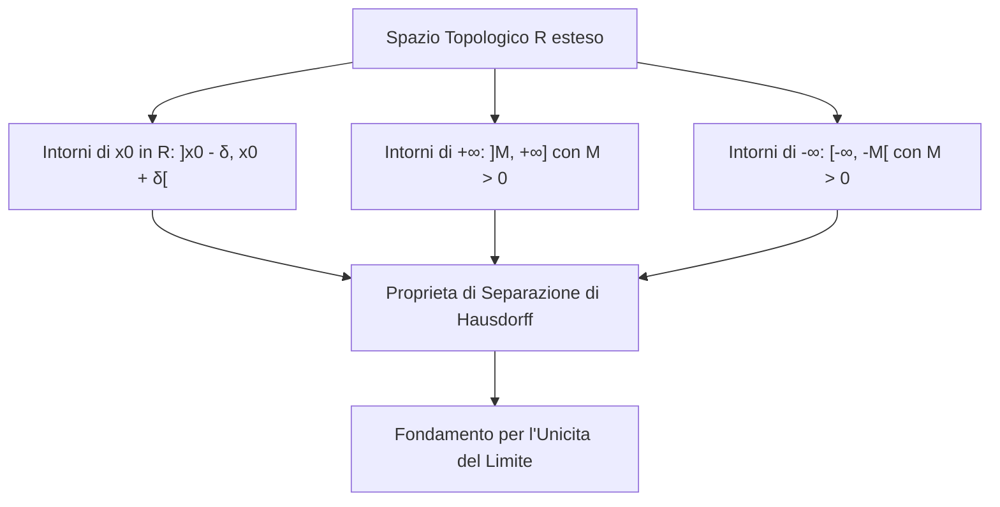

[[Home MOC|Home]] / [[Education & Learning]] / [[Lezione 12 - Limiti I Retta Reale Ampliata e Definizione]]

# Lezione 12 - Limiti I Retta Reale Ampliata e Definizione

## Sintesi Esecutiva
L'avvio dello studio del calcolo infinitesimale poggia sulla formalizzazione topologica del comportamento asintotico e locale delle funzioni reali. Questa dodicesima lezione (Sapienza Università di Roma — a cura dei proff. G. Franzina e S. Salzo) introduce la <mark style="background:rgba(255, 193, 69, 0.32)"><b>retta reale ampliata</b></mark> $\overline{\mathbb{R}} = \mathbb{R} \cup \{-\infty, +\infty\}$, definisce la topologia degli intorni e i punti di accumulazione, per poi erigere la <mark style="background:rgba(181, 113, 255, 0.36)"><b>definizione unificata di limite</b></mark>. Vengono sviscerati i sei casi metrici basati su disequazioni parametriche ($\varepsilon-\delta$, $\alpha-\beta$), illustrate le verifiche analitiche dei primi limiti notevoli e dimostrato con rigore geometrico il teorema di unicità del limite mediante la proprietà di separazione di Hausdorff.

## La Retta Reale Ampliata ed Elementi di Topologia

### Struttura di $\overline{\mathbb{R}}$
Per trattare in modo coerente e unificato i comportamenti divergenti e i punti all'infinito, si estende il campo dei numeri reali aggiungendo due elementi ideali formalmente ordinati:
$$\overline{\mathbb{R}} := \mathbb{R} \cup \{-\infty, +\infty\}$$
La relazione d'ordine totale su $\mathbb{R}$ si estende ponendo per ogni $x \in \mathbb{R}$:
$$-\infty < x < +\infty$$

### Topologia degli Intorni
La nozione di vicinanza metrica si formalizza attraverso i sistemi di intorni:

1. **Intorno di un punto al finito $x_0 \in \mathbb{R}$:**
   Dato un raggio $r > 0$, l'intervallo aperto simmetrico centrato in $x_0$:
   $$I_r(x_0) := ]x_0 - r, x_0 + r[ = \{x \in \mathbb{R} \mid |x - x_0| < r\}$$
   costituisce un intorno circolare elementare. Più in generale, un insieme $U \subseteq \overline{\mathbb{R}}$ è un intorno di $x_0$ se contiene un intervallo aperto $]x_0 - r, x_0 + r[$ con $r > 0$.
2. **Intorno di $+\infty$:**
   Un insieme $U \subseteq \overline{\mathbb{R}}$ è un intorno di $+\infty$ se contiene una semiretta aperta del tipo:
   $$]M, +\infty] = \{x \in \overline{\mathbb{R}} \mid x > M\}, \qquad \text{con } M \in \mathbb{R}$$
3. **Intorno di $-\infty$:**
   Un insieme $U \subseteq \overline{\mathbb{R}}$ è un intorno di $-\infty$ se contiene una semiretta aperta del tipo:
   $$[-\infty, -M[ = \{x \in \overline{\mathbb{R}} \mid x < -M\}, \qquad \text{con } M \in \mathbb{R}$$

> [!IMPORTANT] Proprietà di Separazione di Hausdorff
> Dati due elementi distinti $x_1, x_2 \in \overline{\mathbb{R}}$ con $x_1 \ne x_2$, esistono sempre due rispettivi intorni $U \in \mathcal{U}(x_1)$ e $V \in \mathcal{U}(x_2)$ **disgiunti**:
> $$U \cap V = \emptyset$$
> Questa proprietà topologica è la condizione necessaria e sufficiente che impedisce a una funzione di tendere contemporaneamente a due valori distinti.

### Punti di Accumulazione e Punti Isolati
Sia $A \subseteq \mathbb{R}$ e sia $x_0 \in \overline{\mathbb{R}}$:
- **Punto di accumulazione:** $x_0$ si dice <mark style="background:rgba(255, 193, 69, 0.32)"><b>punto di accumulazione</b></mark> per $A$ se ogni intorno $U$ di $x_0$ contiene almeno un punto di $A$ distinto da $x_0$:
  $$\forall U \in \mathcal{U}(x_0): \quad (U \setminus \{x_0\}) \cap A \ne \emptyset$$
  L'insieme di tutti i punti di accumulazione di $A$ si chiama **insieme derivato** e si denota con $D(A)$ o $\mathrm{Acc}(A)$.
- **Punto isolato:** Un punto $x_0 \in A$ è detto isolato se esiste almeno un intorno $U \in \mathcal{U}(x_0)$ che non contiene altri elementi di $A$ all'infuori di $x_0$:
  $$\exists U \in \mathcal{U}(x_0): \quad U \cap A = \{x_0\}$$

*Esempi notevoli:*
- Per l'intervallo $A = ]a, b[$, i punti di accumulazione coincidono con l'intervallo chiuso $[a, b]$.
- Per l'insieme dei numeri razionali $\mathbb{Q}$, ogni punto reale (e anche $\pm\infty$) è di accumulazione: $\mathrm{Acc}(\mathbb{Q}) = \overline{\mathbb{R}}$.
- Per i numeri naturali $\mathbb{N}$, ogni punto $n \in \mathbb{N}$ è un punto isolato; l'unico punto di accumulazione è $+\infty$.

---

## Definizione Generale e Topologica di Limite

Sia $A \subseteq \mathbb{R}$, $f: A \to \mathbb{R}$, e sia $x_0 \in \overline{\mathbb{R}}$ un punto di accumulazione per $A$. Sia inoltre $\ell \in \overline{\mathbb{R}}$.
Si pone per brevità $A_{x_0} := A \setminus \{x_0\}$.

> [!IMPORTANT] Definizione Generale Topologica di Limite
> Si dice che $\ell$ è il **limite** di $f(x)$ per $x$ che tende a $x_0$, e si scrive:
> $$\lim_{x \to x_0} f(x) = \ell \qquad \text{oppure} \qquad f(x) \to \ell \quad \text{per } x \to x_0$$
> se per ogni intorno $V$ di $\ell$, esiste un intorno $U$ di $x_0$ tale che per ogni $x \in U \cap A_{x_0}$ risulta $f(x) \in V$:
> $$\forall V \in \mathcal{U}(\ell), \, \exists U \in \mathcal{U}(x_0) : \quad f(U \cap A_{x_0}) \subseteq V$$

**Terminologia e Classificazione:**
- Se $\ell \in \mathbb{R}$, la funzione si dice **convergente** a $\ell$.
- Se $\ell = +\infty$, la funzione si dice **positivamente divergente**.
- Se $\ell = -\infty$, la funzione si dice **negativamente divergente**.
- Se esiste un limite $\ell \in \overline{\mathbb{R}}$, la funzione si dice **regolare** per $x \to x_0$.

---

## Esplicitazione Metrica: I 6 Casi Operativi

A seconda che il punto di accumulazione $x_0$ e il limite $\ell$ siano finiti o infiniti, la definizione generale si traduce in disequazioni parametriche:

| Caso | Natura di $x_0$ e $\ell$ | Formulazione Metrica tramite Disequazioni |
|---|---|---|
| **1** | $x_0 \in \mathbb{R}, \, \ell \in \mathbb{R}$ | $\forall \varepsilon > 0, \, \exists \delta > 0 : \forall x \in A, \, 0 < \|x - x_0\| < \delta \implies \|f(x) - \ell\| < \varepsilon$ |
| **2** | $x_0 \in \mathbb{R}, \, \ell = +\infty$ | $\forall \beta > 0, \, \exists \delta > 0 : \forall x \in A, \, 0 < \|x - x_0\| < \delta \implies f(x) > \beta$ |
| **3** | $x_0 \in \mathbb{R}, \, \ell = -\infty$ | $\forall \beta > 0, \, \exists \delta > 0 : \forall x \in A, \, 0 < \|x - x_0\| < \delta \implies f(x) < -\beta$ |
| **4** | $x_0 = +\infty, \, \ell \in \mathbb{R}$ | $\forall \varepsilon > 0, \, \exists \alpha > 0 : \forall x \in A, \, x > \alpha \implies \|f(x) - \ell\| < \varepsilon$ |
| **5** | $x_0 = +\infty, \, \ell = +\infty$ | $\forall \beta > 0, \, \exists \alpha > 0 : \forall x \in A, \, x > \alpha \implies f(x) > \beta$ |
| **6** | $x_0 = +\infty, \, \ell = -\infty$ | $\forall \beta > 0, \, \exists \alpha > 0 : \forall x \in A, \, x > \alpha \implies f(x) < -\beta$ |

*(Per $x_0 = -\infty$ la condizione $x > \alpha$ si sostituisce con $x < -\alpha$.)*

---

## Verifiche di Limiti Tramite Disequazioni ed Esempi Notevoli

Verificare un limite consiste nel risolvere analiticamente la disequazione che descrive l'appartenenza a $V$ e dimostrare che l'insieme delle soluzioni contiene un intorno forato di $x_0$.

### 1. Limite Quadratico al Finito: $\lim_{x \to 0} x^2 = 0$
Fissato $\varepsilon > 0$, si impone $|x^2 - 0| < \varepsilon \iff x^2 < \varepsilon$.
La disequazione ammette come soluzione l'intervallo $]-\sqrt{\varepsilon}, \sqrt{\varepsilon}[$.
Ponendo $\delta_\varepsilon := \sqrt{\varepsilon} > 0$, l'intorno forato $]0 - \delta, 0 + \delta[ \setminus \{0\}$ è interamente contenuto nell'insieme delle soluzioni.

### 2. Forma Indeterminata Razionale: $\lim_{x \to 1} \frac{3x^2 - x - 2}{x - 1} = 5$
Il numeratore si scompone tramite le sue radici: $3x^2 - x - 2 = (3x + 2)(x - 1)$.
Per ogni $x \ne 1$, il termine si semplifica:
$$\left|\frac{(3x+2)(x-1)}{x-1} - 5\right| = |3x + 2 - 5| = 3|x - 1|$$
Imponendo $3|x - 1| < \varepsilon \iff |x - 1| < \frac{\varepsilon}{3}$, basta scegliere $\delta_\varepsilon := \frac{\varepsilon}{3} > 0$ per verificare il limite.

### 3. Limite Notevole Goniometrico: $\lim_{x \to 0} \frac{\sin x}{x} = 1$
Dalla costruzione geometrica sulla circonferenza trigonometrica, per $x \in ]0, \pi/2[$ sussistono le disuguaglianze:
$$\sin x < x < \tan x \implies \cos x < \frac{\sin x}{x} < 1$$
Sottraendo 1 e invertendo:
$$0 < 1 - \frac{\sin x}{x} < 1 - \cos x$$
Fissato $\varepsilon > 0$, la disequazione $\left|\frac{\sin x}{x} - 1\right| < \varepsilon$ è soddisfatta se $1 - \cos x < \varepsilon$, ovvero $\cos x > 1 - \varepsilon$.
Per $x \in ]0, \arccos(1 - \varepsilon)[$, basta porre $\delta_\varepsilon := \arccos(1 - \varepsilon) > 0$. Essendo la funzione pari, la proprietà si estende simmetricamente all'intorno forato sinistro.

### 4. Divergenza Esponenziale ad Infinito: $\lim_{x \to +\infty} a^x = +\infty$ con $a > 1$
Poiché $a > 1$, poniamo $z = a - 1 > 0$. Scrivendo ogni $x > 1$ come $x = n + s$ con $n \in \mathbb{N}$ e $s \in [0, 1[$, applicando la disuguaglianza di Bernoulli studiata in [[Lezione 8 - Densita Sommatorie e Teorema del Binomio]]:
$$a^x \ge a^n = (1 + z)^n \ge 1 + nz \ge 1 + (x - 1)z = 1 + (a - 1)(x - 1)$$
Dato $\beta > 0$, la disequazione $a^x > \beta$ è garantita se $1 + (a-1)(x-1) > \beta \iff x > 1 + \frac{\beta - 1}{a - 1}$.
Posto $\alpha_\beta := 1 + \frac{\beta}{a - 1}$, l'intervallo $]\alpha_\beta, +\infty[$ assicura la divergenza positiva.

---

## Teorema di Unicità del Limite

> [!IMPORTANT] Teorema di Unicità del Limite
> Se una funzione reale $f: A \to \mathbb{R}$ ammette limite per $x \to x_0$, tale limite è **unico**:
> $$\lim_{x \to x_0} f(x) = \ell_1 \quad \land \quad \lim_{x \to x_0} f(x) = \ell_2 \implies \ell_1 = \ell_2$$

*Dimostrazione:*
Supponiamo per assurdo che esistano due limiti distinti $\ell_1, \ell_2 \in \overline{\mathbb{R}}$ con $\ell_1 \ne \ell_2$.
Per la proprietà di separazione di Hausdorff su $\overline{\mathbb{R}}$, esistono due intorni disgiunti $V_1 \in \mathcal{U}(\ell_1)$ e $V_2 \in \mathcal{U}(\ell_2)$ tali che:
$$V_1 \cap V_2 = \emptyset$$
Applicando la definizione di limite:
- In corrispondenza di $V_1$, esiste un intorno $U_1 \in \mathcal{U}(x_0)$ tale che per ogni $x \in U_1 \cap A_{x_0}$ si ha $f(x) \in V_1$.
- In corrispondenza di $V_2$, esiste un intorno $U_2 \in \mathcal{U}(x_0)$ tale che per ogni $x \in U_2 \cap A_{x_0}$ si ha $f(x) \in V_2$.

L'intersezione $U := U_1 \cap U_2$ è ancora un intorno di $x_0$. Poiché $x_0$ è punto di accumulazione per $A$, l'insieme $U \cap A_{x_0}$ non è vuoto; esiste dunque almeno un punto $\bar{x} \in U \cap A_{x_0}$.
Per tale punto si verificherebbe:
$$f(\bar{x}) \in V_1 \quad \land \quad f(\bar{x}) \in V_2 \implies f(\bar{x}) \in V_1 \cap V_2$$
contraddicendo il fatto che $V_1 \cap V_2 = \emptyset$. L'assurdo dimostra che deve necessariamente essere $\ell_1 = \ell_2$.
