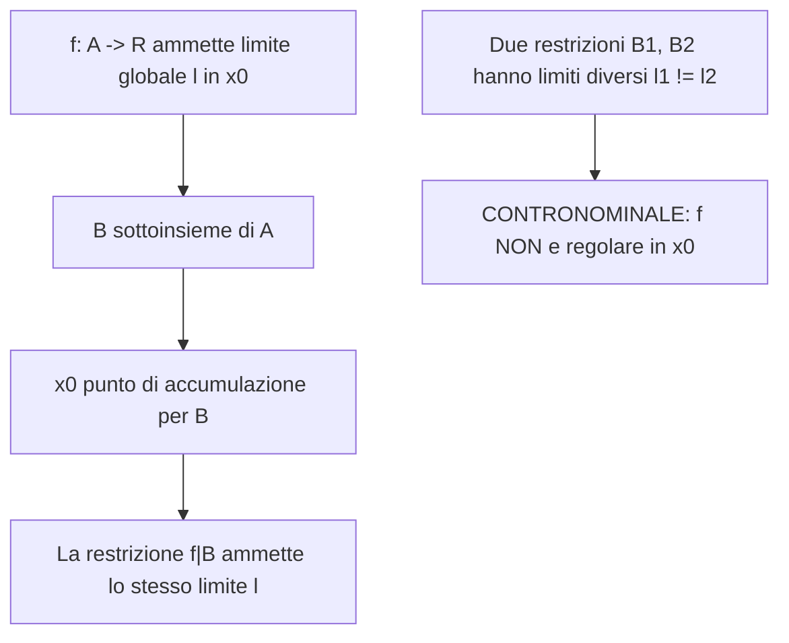

[[Home MOC|Home]] / [[Education & Learning]] / [[Lezione 13 - Limiti II Restrizioni Limiti Laterali e Successioni]]

# Lezione 13 - Limiti II Restrizioni Limiti Laterali e Successioni

## Sintesi Esecutiva
Il consolidamento della teoria dei limiti richiede l'indagine delle proprietà strutturali della definizione topologica e degli strumenti analitici per determinare o escludere la regolarità delle funzioni reali. Questa tredicesima lezione (Sapienza Università di Roma — a cura dei proff. G. Franzina e S. Salzo) dimostra con rigore il <mark style="background:rgba(255, 193, 69, 0.32)"><b>teorema di unicità del limite</b></mark> mediante la separazione topologica di Hausdorff, introduce il comportamento del <mark style="background:rgba(181, 113, 255, 0.36)"><b>limite di una restrizione</b></mark> e ne formalizza l'uso contronominale come potente criterio di non regolarità (funzioni discontinue, funzione di Dirichlet e oscillazioni asintotiche tipo $\sin(1/x)$). La trattazione approfondisce poi i <mark style="background:rgba(181, 113, 255, 0.36)"><b>limiti destro e sinistro</b></mark>, dimostrando l'equivalenza con il limite globale, illustra le tecniche metriche di verifica $\varepsilon-\delta$ per funzioni affini e quadratiche, e infine estende il formalismo alle <mark style="background:rgba(255, 193, 69, 0.32)"><b>successioni numeriche</b></mark>, formalizzando la convergenza discreta e dimostrando il limite notevole $\lim_{n \to +\infty} \sqrt[n]{a} = 1$ tramite la disuguaglianza di Bernoulli.

---

## Teorema di Unicità del Limite

La definizione topologica unificata formulata in [[Lezione 12 - Limiti I Retta Reale Ampliata e Definizione]] assicura che il comportamento asintotico di una funzione non sia ambiguo.

> [!IMPORTANT] Teorema di Unicità del Limite (Teorema 1.1)
> Sia $A \subseteq \mathbb{R}$, $f: A \to \mathbb{R}$ e sia $x_0 \in \overline{\mathbb{R}}$ un punto di accumulazione per $A$. Allora esiste al più un solo punto $\ell \in \overline{\mathbb{R}}$ tale che:
> $$\lim_{x \to x_0} f(x) = \ell$$

### Dimostrazione Rigorosa per Assurdo
Supponiamo per assurdo che esistano due limiti distinti $\ell_1, \ell_2 \in \overline{\mathbb{R}}$ con $\ell_1 \ne \ell_2$.
1. **Separazione degli intorni:** Per la proprietà di separazione di Hausdorff della retta reale estesa $\overline{\mathbb{R}}$, esistono due intorni $V_1 \in \mathcal{U}(\ell_1)$ e $V_2 \in \mathcal{U}(\ell_2)$ tra loro disgiunti:
   $$V_1 \cap V_2 = \emptyset$$
2. **Applicazione della definizione di limite:** Poiché $\lim_{x \to x_0} f(x) = \ell_1$ e $\lim_{x \to x_0} f(x) = \ell_2$, in corrispondenza di $V_1$ e $V_2$ esistono rispettivamente due intorni $U_1, U_2 \in \mathcal{U}(x_0)$ tali che:
   $$x \in U_1 \cap A_{x_0} \implies f(x) \in V_1$$
   $$x \in U_2 \cap A_{x_0} \implies f(x) \in V_2$$
   dove si rammenta la notazione $A_{x_0} := A \setminus \{x_0\}$.
3. **Intersezione degli intorni:** Poniamo $U := U_1 \cap U_2$. Essendo intersezione finita di intorni di $x_0$, $U$ è ancora un intorno di $x_0$. Poiché per ipotesi $x_0$ è un punto di accumulazione per $A$, l'insieme forato non può essere vuoto:
   $$U \cap A_{x_0} \ne \emptyset$$
4. **Deduzione della contraddizione:** Scegliamo un elemento arbitrario $\bar{x} \in U \cap A_{x_0}$. Poiché $\bar{x} \in U_1 \cap A_{x_0}$ e contemporaneamente $\bar{x} \in U_2 \cap A_{x_0}$, ne consegue che:
   $$f(\bar{x}) \in V_1 \quad \land \quad f(\bar{x}) \in V_2 \implies f(\bar{x}) \in V_1 \cap V_2$$
   Ciò implica che $V_1 \cap V_2 \ne \emptyset$, contraddicendo l'ipotesi iniziale di disgiunzione $V_1 \cap V_2 = \emptyset$. L'assurdo dimostra che deve necessariamente sussistere $\ell_1 = \ell_2$.

> [!NOTE] Unicità vs Esistenza
> Il teorema garantisce che *se* il limite esiste, esso è necessariamente unico, legittimando l'uso dell'articolo determinativo («$\ell$ è **il** limite»). Tuttavia, esso non assicura affatto l'esistenza del limite: esistono ampie classi di funzioni prive di limite regolare in determinati punti di accumulazione.

---

## Limite di una Restrizione e Criterio di Non Regolarità

Un potente metodo per studiare i limiti consiste nell'osservare il comportamento della funzione quando la variabile indipendente $x$ è vincolata a un opportuno sottoinsieme del dominio originario.

### Teorema del Limite della Restrizione
Sia $A \subseteq \mathbb{R}$ e $f: A \to \mathbb{R}$. Sia $B \subseteq A$ un sottoinsieme e consideriamo la <mark style="background:rgba(181, 113, 255, 0.36)"><b>restrizione</b></mark> $f|_B : B \to \mathbb{R}$, definita da $f|_B(x) = f(x)$ per ogni $x \in B$.

> [!IMPORTANT] Teorema del Limite di una Restrizione (Teorema 2.1)
> Sia $x_0 \in \overline{\mathbb{R}}$ un punto di accumulazione per $B$ (e quindi a maggior ragione anche per $A$). Se $\ell \in \overline{\mathbb{R}}$, allora:
> $$\lim_{x \to x_0} f(x) = \ell \implies \lim_{x \to x_0} f|_B(x) = \ell$$
> *In parole:* se una funzione ammette limite globale $\ell$, ogni sua restrizione a un insieme per cui $x_0$ sia ancora punto di accumulazione ammette lo stesso medesimo limite $\ell$.

*Dimostrazione:*
Fissato un intorno $V \in \mathcal{U}(\ell)$, per l'esistenza del limite globale esiste un intorno $U \in \mathcal{U}(x_0)$ tale che $f(U \cap A_{x_0}) \subseteq V$. Essendo $B \subseteq A$, vale l'inclusione insiemistica elementare:
$$U \cap B_{x_0} \subseteq U \cap A_{x_0} \implies f(U \cap B_{x_0}) \subseteq f(U \cap A_{x_0}) \subseteq V$$
il che dimostra direttamente la tesi.

### Il Corollario Contronominale (Test di Non Esistenza)
Il teorema del limite della restrizione viene applicato nella pratica quasi sempre per contronominale, per dimostrare che una funzione **non è regolare** (cioè non ammette limite alcuno):

> [!IMPORTANT] Criterio di Non Regolarità (Corollario 2.3)
> Sia $A \subseteq \mathbb{R}$, $f: A \to \mathbb{R}$ e $x_0 \in \overline{\mathbb{R}}$ punto di accumulazione per $A$. Supponiamo che esistano due sottoinsiemi $B_1, B_2 \subseteq A$ tali che:
> 1. $x_0$ è punto di accumulazione sia per $B_1$ sia per $B_2$;
> 2. $\lim_{x \to x_0} f|_{B_1}(x) = \ell_1$ e $\lim_{x \to x_0} f|_{B_2}(x) = \ell_2$, con $\ell_1 \ne \ell_2$.
> 
> Allora la funzione $f$ **non è regolare** per $x \to x_0$.

### Esempi Classici di Non Regolarità

#### 1. Funzione Segno del Rapporto: $f(x) = \frac{x}{|x|}$ per $x \to 0$
Consideriamo la funzione definita su $A = \mathbb{R} \setminus \{0\}$. Il punto $0$ è di accumulazione per i due sottoinsiemi:
- $B_1 = ]-\infty, 0[$: per ogni $x \in B_1$, $|x| = -x \implies f|_{B_1}(x) = \frac{x}{-x} = -1 \implies \lim_{x \to 0} f|_{B_1}(x) = -1$.
- $B_2 = ]0, +\infty[$: per ogni $x \in B_2$, $|x| = x \implies f|_{B_2}(x) = \frac{x}{x} = 1 \implies \lim_{x \to 0} f|_{B_2}(x) = 1$.
Poiché $\ell_1 = -1 \ne 1 = \ell_2$, la funzione **non ammette limite** per $x \to 0$.

#### 2. Funzione di Dirichlet su $[0, 1]$
Sia $f: [0, 1] \to \mathbb{R}$ definita da:
$$f(x) = \begin{cases} 1 & \text{se } x \in [0, 1] \cap \mathbb{Q} \\ 0 & \text{se } x \in [0, 1] \setminus \mathbb{Q} \end{cases}$$
Siano $B_1 = [0, 1] \cap \mathbb{Q}$ e $B_2 = [0, 1] \setminus \mathbb{Q}$.
In virtù della densità dei numeri razionali $\mathbb{Q}$ e dei numeri irrazionali $\mathbb{R} \setminus \mathbb{Q}$ in $\mathbb{R}$ (analizzata in [[Lezione 8 - Densita Sommatorie e Teorema del Binomio]]), qualsiasi punto $x_0 \in [0, 1]$ è punto di accumulazione sia per $B_1$ sia per $B_2$.
Le restrizioni risultano costanti: $f|_{B_1} \equiv 1$ e $f|_{B_2} \equiv 0$, per cui:
$$\lim_{x \to x_0} f|_{B_1}(x) = 1 \ne 0 = \lim_{x \to x_0} f|_{B_2}(x)$$
Ne consegue che la funzione di Dirichlet **non è regolare in alcun punto** del suo dominio $[0, 1]$.

#### 3. Funzione Oscillante Asintotica: $f(x) = \sin\left(\frac{1}{x}\right)$ per $x \to 0$
Sia $f: \mathbb{R} \setminus \{0\} \to \mathbb{R}$ con $f(x) = \sin(1/x)$. Cerchiamo due insiemi di punti in cui la funzione assume valori costanti distinti:
- Imponiamo $\sin(1/x) = 0 \iff \frac{1}{x} = k\pi \iff x = \frac{1}{k\pi}$ con $k \in \mathbb{Z}^*$. Definiamo l'insieme:
  $$B_1 = \left\{ \frac{1}{k\pi} \;\middle|\; k \in \mathbb{Z}^* \right\}$$
- Imponiamo $\sin(1/x) = 1 \iff \frac{1}{x} = \frac{\pi}{2} + 2k\pi \iff x = \frac{1}{\pi/2 + 2k\pi}$ con $k \in \mathbb{Z}$. Definiamo l'insieme:
  $$B_2 = \left\{ \frac{1}{\pi/2 + 2k\pi} \;\middle|\; k \in \mathbb{Z} \right\}$$
Per $k \to \pm\infty$, gli elementi di $B_1$ e $B_2$ si addensano verso $0$, rendendo $0$ punto di accumulazione per entrambi.
Poiché $f|_{B_1} \equiv 0 \implies \lim_{x \to 0} f|_{B_1}(x) = 0$, mentre $f|_{B_2} \equiv 1 \implies \lim_{x \to 0} f|_{B_2}(x) = 1$, la funzione presenta infinite oscillazioni di ampiezza unitaria in ogni intorno di zero e **non ammette limite** per $x \to 0$.

---

## Limite Destro e Limite Sinistro

I casi di restrizione più naturali e frequenti nell'analisi reale corrispondono a limitare l'avvicinamento al punto di accumulazione esclusivamente da sinistra o da destra.

### Definizioni Topologiche
Sia $A \subseteq \mathbb{R}$ non vuoto, e sia $x_0 \in \mathbb{R}$. Si definiscono i sottoinsiemi laterali:
$$A_{x_0}^- := A \cap ]-\infty, x_0[, \qquad A_{x_0}^+ := A \cap ]x_0, +\infty[$$

- **Punto di accumulazione a sinistra (o a destra):** $x_0$ si dice punto di accumulazione a sinistra per $A$ se è punto di accumulazione per $A_{x_0}^-$ (analogamente a destra per $A_{x_0}^+$).
- **Limite sinistro:** $\ell$ è il limite sinistro di $f(x)$ per $x \to x_0$, denotato con $\lim_{x \to x_0^-} f(x) = \ell$ oppure $f(x_0^-) = \ell$, se $\ell$ è il limite della restrizione $f|_{A_{x_0}^-}$:
  $$\forall V \in \mathcal{U}(\ell), \, \exists U \in \mathcal{U}(x_0) : \forall x \in U \cap A_{x_0}^- \implies f(x) \in V$$
- **Limite destro:** $\ell$ è il limite destro di $f(x)$ per $x \to x_0$, denotato con $\lim_{x \to x_0^+} f(x) = \ell$ oppure $f(x_0^+) = \ell$, se $\ell$ è il limite della restrizione $f|_{A_{x_0}^+}$:
  $$\forall V \in \mathcal{U}(\ell), \, \exists U \in \mathcal{U}(x_0) : \forall x \in U \cap A_{x_0}^+ \implies f(x) \in V$$

### Teorema di Equivalenza del Limite Globale

> [!IMPORTANT] Teorema sui Limiti Destro e Sinistro (Teorema 3.2)
> Sia $f: A \to \mathbb{R}$, $\ell \in \overline{\mathbb{R}}$ e sia $x_0 \in \mathbb{R}$ punto di accumulazione sia a sinistra sia a destra per $A$. Le seguenti proposizioni sono logicamente equivalenti:
> 1. $\lim_{x \to x_0} f(x) = \ell$
> 2. $\lim_{x \to x_0^-} f(x) = \ell \quad \land \quad \lim_{x \to x_0^+} f(x) = \ell$

*Dimostrazione:*
- Implicazione $(1) \implies (2)$: Discende immediatamente dal teorema sul limite delle restrizioni (Teorema 2.1), poiché $A_{x_0}^- \subset A$ e $A_{x_0}^+ \subset A$.
- Implicazione $(2) \implies (1)$: Sia $V$ un intorno arbitrario di $\ell$. Per le ipotesi di limite sinistro e destro, esistono due intorni $U_1, U_2 \in \mathcal{U}(x_0)$ tali che:
  $$x \in U_1 \cap A_{x_0}^- \implies f(x) \in V$$
  $$x \in U_2 \cap A_{x_0}^+ \implies f(x) \in V$$
  Poniamo $U := U_1 \cap U_2$. Poiché $A_{x_0} = A_{x_0}^- \cup A_{x_0}^+$, ogni elemento $x \in U \cap A_{x_0}$ appartiene necessariamente a $U_1 \cap A_{x_0}^-$ oppure a $U_2 \cap A_{x_0}^+$. In entrambi i casi risulta $f(x) \in V$, provando che $\lim_{x \to x_0} f(x) = \ell$.

### Casi Esemplificativi di Studio dei Limiti Laterali

1. **Funzione Segno $\operatorname{sgn}(x)$ in $x_0 = 0$:**
   $$\operatorname{sgn}(x) = \begin{cases} 1 & \text{se } x > 0 \\ 0 & \text{se } x = 0 \\ -1 & \text{se } x < 0 \end{cases}$$
   Risulta $\lim_{x \to 0^-} \operatorname{sgn}(x) = -1$ e $\lim_{x \to 0^+} \operatorname{sgn}(x) = 1$. Poiché i limiti laterali sono discordi, $\operatorname{sgn}(x)$ non è regolare per $x \to 0$.
2. **Funzione Iperbolica $f(x) = 1/x$ in $x_0 = 0$:**
   $$\lim_{x \to 0^-} \frac{1}{x} = -\infty, \qquad \lim_{x \to 0^+} \frac{1}{x} = +\infty$$
   Entrambi i limiti laterali divergono ma con segni opposti: la funzione non è regolare per $x \to 0$.
3. **Ininfluenza del valore puntuale $f(x_0)$ (Discontinuità Eliminabile):**
   Consideriamo la funzione:
   $$f(x) = \begin{cases} x^2 & \text{se } x \ne 0 \\ 1 & \text{se } x = 0 \end{cases}$$
   Valutiamo i limiti laterali per $x \to 0$:
   $$\lim_{x \to 0^-} f(x) = \lim_{x \to 0^-} x^2 = 0, \qquad \lim_{x \to 0^+} f(x) = \lim_{x \to 0^+} x^2 = 0$$
   I limiti laterali esistono e coincidono a $0$. Dunque $\lim_{x \to 0} f(x) = 0$, nonostante $f(0) = 1$. Ciò comprova che il valore della funzione nel punto $x_0$ non ha alcun effetto sul limite né sulla regolarità.

---

## Verifiche Metriche Parametriche $\varepsilon-\delta$

La verifica analitica impone di esplicitare la dipendenza funzionale $\delta = \delta(\varepsilon)$ tale che $0 < |x - x_0| < \delta \implies |f(x) - \ell| < \varepsilon$.

### 1. Funzione Affine: $f(x) = ax + b$ con $a \ne 0$
Dimostriamo che per ogni $x_0 \in \mathbb{R}$, si ha $\lim_{x \to x_0} (ax + b) = ax_0 + b$.
Fissato $\varepsilon > 0$, impostiamo la disequazione:
$$|(ax + b) - (ax_0 + b)| < \varepsilon \iff |ax - ax_0| < \varepsilon \iff |a| \cdot |x - x_0| < \varepsilon \iff |x - x_0| < \frac{\varepsilon}{|a|}$$
È sufficiente scegliere:
$$\delta_\varepsilon := \frac{\varepsilon}{|a|} > 0$$
affinché per ogni $x \in \mathbb{R}$ con $0 < |x - x_0| < \delta_\varepsilon$ risulti $|f(x) - (ax_0 + b)| < \varepsilon$.

### 2. Funzione Quadratica: $f(x) = x^2$ per $x \to x_0$
Vogliamo verificare che $\lim_{x \to x_0} x^2 = x_0^2$.
Dobbiamo risolvere la disequazione $|x^2 - x_0^2| < \varepsilon$. Fattorizziamo e applichiamo la disuguaglianza triangolare:
$$|x^2 - x_0^2| = |x - x_0| \cdot |x + x_0| = |x - x_0| \cdot |x - x_0 + 2x_0| \le |x - x_0| \cdot (|x - x_0| + 2|x_0|)$$

Due metodologie consentono di determinare $\delta_\varepsilon$:

- **Metodo della maggiorazione a due stadi (vincolo preliminare):**
  Supponiamo preliminarmente che il raggio dell'intorno non superi l'unità: $|x - x_0| < 1$. In tal caso:
  $$|x^2 - x_0^2| \le |x - x_0|(1 + 2|x_0|)$$
  Per rendere tale quantità minore di $\varepsilon$, basta imporre $|x - x_0| < \frac{\varepsilon}{1 + 2|x_0|}$. Per soddisfare entrambi i vincoli contemporaneamente, scegliamo:
  $$\delta_\varepsilon := \min\left(1, \; \frac{\varepsilon}{1 + 2|x_0|}\right)$$
  In tal modo, $0 < |x - x_0| < \delta_\varepsilon \implies |x^2 - x_0^2| < \varepsilon$.

- **Metodo esatto tramite disequazione quadratica:**
  Ponendo $t = |x - x_0| > 0$, la disuguaglianza maggiorata diventa $t(t + 2|x_0|) < \varepsilon \iff t^2 + 2|x_0|t - \varepsilon < 0$.
  L'equazione associata ha discriminante ridotto $\Delta/4 = x_0^2 + \varepsilon > 0$ e radice positiva:
  $$t = \sqrt{x_0^2 + \varepsilon} - |x_0| > 0$$
  Ponendo direttamente $\delta_\varepsilon := \sqrt{x_0^2 + \varepsilon} - |x_0|$, per ogni $0 < |x - x_0| < \delta_\varepsilon$ la condizione $|x^2 - x_0^2| < \varepsilon$ risulta rigorosamente soddisfatta.

---

## Limiti di Successioni Numeriche

Lo studio delle <mark style="background:rgba(255, 193, 69, 0.32)"><b>successioni numeriche</b></mark> rappresenta il ponte fondamentale tra la teoria delle funzioni e il calcolo infinitesimale discreto.

### Definizione di Parte Intera
Dato un numero reale $x \in \mathbb{R}$, si definisce <mark style="background:rgba(181, 113, 255, 0.36)"><b>parte intera</b></mark> di $x$, indicata con $\lfloor x \rfloor$, il più grande intero minore o uguale a $x$:
$$\lfloor x \rfloor := \max\{n \in \mathbb{Z} \mid n \le x\}$$
Valgono le proprietà fondamentali:
$$\lfloor x \rfloor \le x < \lfloor x \rfloor + 1$$
Inoltre, se $x > 0$, per ogni numero naturale $n \in \mathbb{N}$ vale l'equivalenza:
$$n > x \iff n > \lfloor x \rfloor$$

### Concetto di Successione e Topologia di $\mathbb{N}$
Una successione reale $(a_n)_{n \in \mathbb{N}}$ è formalmente una funzione avente per dominio i numeri naturali e codominio nei reali:
$$a: \mathbb{N} \to \mathbb{R}, \qquad n \mapsto a_n$$
Poiché l'insieme $\mathbb{N}$ è privo di punti di accumulazione finiti in $\mathbb{R}$ (ogni numero naturale è isolato), l'unico punto di accumulazione per $\mathbb{N}$ nella retta reale ampliata $\overline{\mathbb{R}}$ è **$+\infty$**. Pertanto ha senso calcolare il limite di una successione esclusivamente per $n \to +\infty$.

> [!IMPORTANT] Definizione di Limite di Successione (Definizione 4.1)
> Sia $(a_n)_{n \in \mathbb{N}}$ una successione reale e $\ell \in \overline{\mathbb{R}}$. Si dice che la successione tende a $\ell$ per $n \to +\infty$, e si scrive $\lim_{n \to +\infty} a_n = \ell$, se:
> $$\forall V \in \mathcal{U}(\ell), \, \exists \nu \in \mathbb{N} : \forall n \in \mathbb{N}, \, n > \nu \implies a_n \in V$$
> L'intero $\nu \in \mathbb{N}$ prende il nome di **indice di soglia** (o rango).

### Le Tre Formulazioni Metriche Esplicite

| Caso | Valore di $\ell$ | Formulazione Metrica tramite Disequazioni | Significato dell'Indice di Soglia |
|---|---|---|---|
| **Convergente** | $\ell \in \mathbb{R}$ | $\forall \varepsilon > 0, \, \exists \nu \in \mathbb{N} : \forall n > \nu \implies \|a_n - \ell\| < \varepsilon$ | Da $\nu_\varepsilon$ in poi tutti i termini cadono nella striscia $]\ell-\varepsilon, \ell+\varepsilon[$ |
| **Divergente Positivamente** | $\ell = +\infty$ | $\forall \beta > 0, \, \exists \nu \in \mathbb{N} : \forall n > \nu \implies a_n > \beta$ | Da $\nu_\beta$ in poi tutti i termini superano la soglia arbitraria $\beta$ |
| **Divergente Negativamente** | $\ell = -\infty$ | $\forall \beta > 0, \, \exists \nu \in \mathbb{N} : \forall n > \nu \implies a_n < -\beta$ | Da $\nu_\beta$ in poi tutti i termini scendono sotto $-\beta$ |

Una successione si dice **regolare** se converge o diverge; altrimenti si dice **non regolare** o **indeterminata** (es. $a_n = (-1)^n$, che oscilla indefinitamente tra $-1$ e $+1$).

> [!NOTE] Dipendenza di $\nu$ dai parametri
> Nelle dimostrazioni l'indice $\nu$ viene esplicitato come $\nu_\varepsilon$ o $\nu_\beta$. Quando $\varepsilon \to 0^+$, la soglia $\nu_\varepsilon$ cresce verso l'infinito; similmente, all'aumentare di $\beta \to +\infty$, $\nu_\beta$ cresce. Le stesse definizioni si applicano tale e quale a successioni definite su $\mathbb{N}^* = \mathbb{N} \setminus \{0\}$.

---

## Studio di Limiti di Successioni Fondamentali

### 1. Infinitesimo Reciproco: $\lim_{n \to +\infty} \frac{a}{n} = 0$ con $a \in \mathbb{R}^*$
Fissato $\varepsilon > 0$, impostiamo:
$$\left|\frac{a}{n} - 0\right| < \varepsilon \iff \frac{|a|}{n} < \varepsilon \iff n > \frac{|a|}{\varepsilon} \iff n > \left\lfloor \frac{|a|}{\varepsilon} \right\rfloor$$
Ponendo $\nu_\varepsilon := \left\lfloor \frac{|a|}{\varepsilon} \right\rfloor \in \mathbb{N}$, per ogni $n > \nu_\varepsilon$ risulta $\left|\frac{a}{n}\right| < \varepsilon$.

### 2. Potenze Intere: $\lim_{n \to +\infty} n^k = +\infty$ e $\lim_{n \to +\infty} \frac{1}{n^k} = 0$ ($k \in \mathbb{N}^*$)
- Per la divergenza: dato $\beta > 0$, $n^k > \beta \iff n > \sqrt[k]{\beta} \iff n > \lfloor \sqrt[k]{\beta} \rfloor$. Ponendo $\nu_\beta = \lfloor \sqrt[k]{\beta} \rfloor$, la tesi è provata.
- Per la convergenza a 0: dato $\varepsilon > 0$, $\frac{1}{n^k} < \varepsilon \iff n^k > \frac{1}{\varepsilon} \iff n > \left\lfloor \frac{1}{\sqrt[k]{\varepsilon}} \right\rfloor$. Ponendo $\nu_\varepsilon = \lfloor 1/\sqrt[k]{\varepsilon} \rfloor$, la tesi è provata.

### 3. Successione Armonica Generalizzata: $a_n = n^p$ ($p \in \mathbb{R}$)
Il comportamento limite al variare del parametro reale $p$ è tripartito:
$$\lim_{n \to +\infty} n^p = \begin{cases} +\infty & \text{se } p > 0 \\ 1 & \text{se } p = 0 \\ 0 & \text{se } p < 0 \end{cases}$$
- Se $p > 0$: per ogni $\beta > 0$, $n^p > \beta \iff n > \beta^{1/p}$. Ponendo $\nu_\beta = \lfloor \beta^{1/p} \rfloor$, la successione diverge.
- Se $p = 0$: $n^0 = 1$ costantemente, limite identicamente $1$.
- Se $p < 0$: poniamo $q = -p > 0$. Risulta $n^p = \frac{1}{n^q} < \varepsilon \iff n > \left\lfloor \frac{1}{\varepsilon^{1/q}} \right\rfloor$, da cui la convergenza a zero.

### 4. Limite Notevole della Radice $n$-esima: $\lim_{n \to +\infty} \sqrt[n]{a} = 1$ con $a > 0$
Questo risultato cruciale afferma che l'estrazione di radice di ordine arbitrariamente elevato comprime qualsiasi costante positiva verso l'unità.

> [!IMPORTANT] Teorema del Limite di $\sqrt[n]{a}$
> Per ogni numero reale $a > 0$:
> $$\lim_{n \to +\infty} \sqrt[n]{a} = 1$$

*Dimostrazione Analitica:*
- **Caso $a = 1$:** La successione è costantemente $a_n = \sqrt[n]{1} = 1$, dunque il limite è banalmente 1.
- **Caso $a > 1$:** Risulta $\sqrt[n]{a} > 1$, per cui $|\sqrt[n]{a} - 1| = \sqrt[n]{a} - 1$.
  Fissato $\varepsilon > 0$, dobbiamo verificare che per $n$ sufficientemente grande:
  $$\sqrt[n]{a} - 1 < \varepsilon \iff \sqrt[n]{a} < 1 + \varepsilon \iff a < (1 + \varepsilon)^n$$
  Ricordiamo la **disuguaglianza di Bernoulli** (studiata in [[Lezione 8 - Densita Sommatorie e Teorema del Binomio]]):
  $$(1 + \varepsilon)^n \ge 1 + n\varepsilon$$
  Di conseguenza, per garantire che sia $a < (1 + \varepsilon)^n$, è sufficiente richiedere la condizione più restrittiva:
  $$a < 1 + n\varepsilon \iff n\varepsilon > a - 1 \iff n > \frac{a - 1}{\varepsilon}$$
  Se scegliamo come indice di soglia:
  $$\nu_\varepsilon := \left\lfloor \frac{a - 1}{\varepsilon} \right\rfloor \in \mathbb{N}$$
  allora per ogni $n > \nu_\varepsilon$ si ha $n > \frac{a - 1}{\varepsilon} \implies 1 + n\varepsilon > a \implies (1 + \varepsilon)^n > a \implies \sqrt[n]{a} - 1 < \varepsilon$, provando la convergenza.

- **Caso $0 < a < 1$:** Poniamo $b = \frac{1}{a} > 1$. Per la proprietà provata nel caso precedente, $\lim_{n \to +\infty} \sqrt[n]{b} = 1$.
  Osserviamo l'identità algebrica:
  $$|\sqrt[n]{a} - 1| = 1 - \sqrt[n]{a} = \sqrt[n]{a} \cdot \left(\frac{1}{\sqrt[n]{a}} - 1\right) < 1 \cdot |\sqrt[n]{b} - 1|$$
  Dato che $\sqrt[n]{b} \to 1$, per ogni $\varepsilon > 0$ esiste un indice $\nu_\varepsilon$ tale che per $n > \nu_\varepsilon$ si ha $|\sqrt[n]{b} - 1| < \varepsilon$. Per la maggiorazione sopra, ne consegue che anche $|\sqrt[n]{a} - 1| < \varepsilon$, completando l'intera dimostrazione.

> [!TIP] Approccio Logaritmico Alternativo
> La disequazione $a < (1 + \varepsilon)^n$ può essere risolta applicando il logaritmo naturale ad ambo i membri (funzione strettamente crescente):
> $$\ln a < n \ln(1 + \varepsilon) \iff n > \frac{\ln a}{\ln(1 + \varepsilon)}$$
> La scelta alternativa $\nu_\varepsilon = \left\lfloor \frac{\ln a}{\ln(1 + \varepsilon)} \right\rfloor$ fornisce una soglia ancora più stretta.
