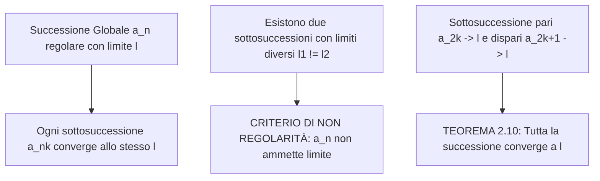

[[Home MOC|Home]] / [[Education & Learning]] / [[Lezione 14 - Limiti di Successioni e Proprieta Locali]]

# Lezione 14 - Limiti di Successioni e Proprietà Locali

## Sintesi Esecutiva
Questa quattordicesima lezione (Sapienza Università di Roma — a cura dei proff. G. Franzina e S. Salzo) approfondisce le proprietà asintotiche delle <mark style="background:rgba(255, 193, 69, 0.32)"><b>successioni numeriche</b></mark> e getta le basi strutturali per l'analisi locale delle funzioni reali. La trattazione dimostra che ogni successione convergente è necessariamente limitata, introduce il concetto formale di <mark style="background:rgba(181, 113, 255, 0.36)"><b>sottosuccessione estratta</b></mark> e ne stabilisce l'invarianza del limite, fornendo potenti criteri di non regolarità basati sulle oscillazioni (come la successione geometrica $q^n$). Infine, la lezione formalizza la nozione di <mark style="background:rgba(255, 193, 69, 0.32)"><b>proprietà locale</b></mark> in un intorno ed erige le dimostrazioni analitiche rigorose dell'<mark style="background:rgba(181, 113, 255, 0.36)"><b>algebra dei limiti</b></mark> per somma, prodotto e quoziente tramite la tecnica di partizione dell'errore $\varepsilon/2$.

---

## Successioni Convergenti e Limitatezza

Il legame tra regolarità asintotica e limitatezza globale costituisce una proprietà di separazione cardine dell'analisi reale.

### Carattere Locale del Limite di Successioni
Il comportamento asintotico di una successione per $n \to +\infty$ dipende unicamente dalla "coda" dei suoi termini, risultando del tutto insensibile alla modifica di un numero finito di valori iniziali.

> [!IMPORTANT] Proposizione 1.1 (Carattere Locale del Limite)
> Siano $(a_n)_{n \in \mathbb{N}}$ e $(b_n)_{n \in \mathbb{N}}$ due successioni di numeri reali e supponiamo che esista un indice soglia $\nu_0 \in \mathbb{N}$ tale che:
> $$\forall n \in \mathbb{N}, \quad n > \nu_0 \implies a_n = b_n$$
> Allora, per ogni $\ell \in \overline{\mathbb{R}}$, si ha:
> $$\lim_{n \to +\infty} a_n = \ell \iff \lim_{n \to +\infty} b_n = \ell$$

*Dimostrazione:*
Sia $\lim_{n \to +\infty} a_n = \ell$ e sia $V \in \mathcal{U}(\ell)$ un intorno arbitrario di $\ell$. Per definizione di limite, esiste $\nu_1 \in \mathbb{N}$ tale che $\forall n > \nu_1 \implies a_n \in V$.
Ponendo $\nu = \max\{\nu_0, \nu_1\}$, per ogni $n > \nu$ si ha simultaneamente $n > \nu_0$ (dunque $b_n = a_n$) e $n > \nu_1$ (dunque $a_n \in V$), da cui $b_n \in V$. Il viceversa segue simmetricamente scambiando i ruoli di $a_n$ e $b_n$. $\blacksquare$

---

### Convergenza e Limitatezza Globale
Una successione $(a_n)_{n \in \mathbb{N}}$ si dice **limitata** se l'insieme dei suoi valori $\{a_n : n \in \mathbb{N}\}$ è un sottoinsieme limitato di $\mathbb{R}$:
$$\exists m, M \in \mathbb{R} : \forall n \in \mathbb{N}, \quad m \le a_n \le M \iff \exists C > 0 : \forall n \in \mathbb{N}, \quad |a_n| \le C$$

> [!IMPORTANT] Proposizione 1.2 (Convergenza Implica Limitatezza)
> Ogni successione numerica reale convergente ad un limite finito $\ell \in \mathbb{R}$ è limitata:
> $$\lim_{n \to +\infty} a_n = \ell \in \mathbb{R} \implies (a_n)_{n \in \mathbb{N}} \text{ è limitata}$$

*Dimostrazione:*
Sia $\lim_{n \to +\infty} a_n = \ell \in \mathbb{R}$. Applicando la definizione metrica di convergenza con la scelta convenzionale $\varepsilon = 1$, esiste un indice $\nu \in \mathbb{N}$ tale che:
$$\forall n > \nu \implies |a_n - \ell| < 1$$
Per la disuguaglianza triangolare inversa, per ogni $n > \nu$:
$$|a_n| = |a_n - \ell + \ell| \le |a_n - \ell| + |\ell| < 1 + |\ell|$$
I termini della successione con indice $n > \nu$ sono quindi tutti uniformemente maggiorati da $1 + |\ell|$.
I termini rimanenti $a_0, a_1, \dots, a_\nu$ formano un insieme finito composto da $\nu + 1$ numeri reali. Poniamo:
$$C = \max\left\{|a_0|, |a_1|, \dots, |a_\nu|, \, 1 + |\ell|\right\} \in \mathbb{R}$$
Ne segue che:
- Se $n \le \nu$, allora $|a_n| \le \max\{|a_0|, \dots, |a_\nu|\} \le C$;
- Se $n > \nu$, allora $|a_n| < 1 + |\ell| \le C$.
In ogni caso, $\forall n \in \mathbb{N}$ si ha $|a_n| \le C$, il che dimostra la limitatezza globale della successione. $\blacksquare$

> [!WARNING] Limitatezza non implica Convergenza
> La limitatezza è una **condizione necessaria ma non sufficiente** per la convergenza. La successione $a_n = (-1)^n$ è limitata ($|a_n| = 1 \le 1$), ma non ammette limite (è oscillante e non regolare).

---

### Divergenza e Illimitatezza

> [!NOTE] Proposizione 1.3 (Divergenza e Illimitatezza)
> 1. Ogni successione divergente positivamente ($\lim_{n \to +\infty} a_n = +\infty$) non è limitata superiormente.
> 2. Ogni successione divergente negativamente ($\lim_{n \to +\infty} a_n = -\infty$) non è limitata inferiormente.

*Dimostrazione (Punto 1):*
Per provare l'illimitatezza superiore occorre mostrare che $\forall \beta \in \mathbb{R}, \exists n \in \mathbb{N} : a_n > \beta$.
Poiché $a_n \to +\infty$, per definizione di limite per ogni fissato $\beta \in \mathbb{R}$ esiste $\nu \in \mathbb{N}$ tale che $\forall n > \nu \implies a_n > \beta$. Esistono quindi addirittura infiniti indici $n$ per cui $a_n > \beta$, escludendo qualsiasi maggiorante. $\blacksquare$

---

## Sottosuccessioni (Successioni Estratte)

Una successione $(a_n)_{n \in \mathbb{N}}$ rappresenta un elenco infinito e ordinato di termini $(a_0, a_1, a_2, \dots)$. Una sottosuccessione seleziona una sequenza infinita di elementi preservandone l'ordine naturale di scorrimento.

### Definizione Assiomatica di Sottosuccessione
> [!IMPORTANT] Definizione 2.1 (Sottosuccessione o Successione Estratta)
> Data una successione $(a_n)_{n \in \mathbb{N}}$, si chiama **successione estratta** (o **sottosuccessione**) ogni successione del tipo:
> $$(a_{n_k})_{k \in \mathbb{N}}$$
> dove $(n_k)_{k \in \mathbb{N}}$ è una successione **strettamente crescente** di numeri naturali:
> $$n_0 < n_1 < n_2 < \dots < n_k < n_{k+1} < \dots$$
> In termini formali, una successione estratta non è altro che la composizione funzionale:
> $$a \circ n : \mathbb{N} \to \mathbb{R}, \quad k \mapsto a(n(k)) = a_{n_k}$$

Esempi canonici:
- **Sottosuccessione dei termini pari:** $n_k = 2k \implies (a_{2k})_{k \in \mathbb{N}} = (a_0, a_2, a_4, a_6, \dots)$.
- **Sottosuccessione dei termini dispari:** $n_k = 2k + 1 \implies (a_{2k+1})_{k \in \mathbb{N}} = (a_1, a_3, a_5, a_7, \dots)$.

---

### Il Lemma di Crescita dell'Indice

> [!IMPORTANT] Lemma 2.3 (Crescita dell'Indice)
> Sia $(n_k)_{k \in \mathbb{N}}$ una successione strettamente crescente di numeri naturali. Allora:
> $$\forall k \in \mathbb{N}, \quad n_k \ge k$$

*Dimostrazione per Induzione su $k$:*
- *Base ($k = 0$):* Poiché $n_0 \in \mathbb{N}$, si ha banalmente $n_0 \ge 0$.
- *Passo induttivo ($k \implies k + 1$):* Assumiamo l'ipotesi induttiva $n_k \ge k$.
  Essendo $(n_k)$ strettamente crescente in $\mathbb{N}$, si ha $n_{k+1} > n_k$.
  Per la discretezza dell'ordinamento di $\mathbb{N}$ (provata in [[Lezione 6 - Valore Assoluto e Numeri Naturali]]), $n_{k+1} \ge n_k + 1$.
  Sostituendo l'ipotesi induttiva:
  $$n_{k+1} \ge n_k + 1 \ge k + 1$$
Il principio di induzione garantisce che $n_k \ge k$ per ogni $k \in \mathbb{N}$. $\blacksquare$

---

### Teorema sui Limiti delle Sottosuccessioni

> [!IMPORTANT] Teorema 2.5 (Invarianza del Limite per Sottosuccessioni)
> Sia $(a_n)_{n \in \mathbb{N}}$ una successione di numeri reali e $(a_{n_k})_{k \in \mathbb{N}}$ una sua sottosuccessione arbitraria. Allora, per ogni $\ell \in \overline{\mathbb{R}}$:
> $$\lim_{n \to +\infty} a_n = \ell \implies \lim_{k \to +\infty} a_{n_k} = \ell$$
> *In parole:* se una successione ammette limite (è regolare), tutte le sue infinite sottosuccessioni estratte sono regolari e convergono/divergono al medesimo limite $\ell$.

*Dimostrazione:*
Sia $\lim_{n \to +\infty} a_n = \ell$ e sia $V \in \mathcal{U}(\ell)$ un intorno di $\ell$.
Esiste un indice $\nu \in \mathbb{N}$ tale che $\forall n > \nu \implies a_n \in V$.
Per il Lemma 2.3, per ogni $k > \nu$ si ha:
$$n_k \ge k > \nu \implies a_{n_k} \in V$$
Dunque $\lim_{k \to +\infty} a_{n_k} = \ell$. $\blacksquare$

---

### Criterio di Non Regolarità
Il Teorema 2.5 fornisce il più potente strumento pratico per escludere l'esistenza del limite:
$$\exists (a_{n_k}) \to \ell_1, \; \exists (a_{m_k}) \to \ell_2 \quad \text{con } \ell_1 \ne \ell_2 \implies \lim_{n \to +\infty} a_n \text{ non esiste}$$

*Esempio Fondamentale:*
Sia $a_n = (-1)^n$:
- Sottosuccessione pari: $a_{2k} = (-1)^{2k} = 1 \to 1$;
- Sottosuccessione dispari: $a_{2k+1} = (-1)^{2k+1} = -1 \to -1$.
Poiché $1 \ne -1$, la successione $((-1)^n)$ non è regolare.

---

### Studio Completo della Successione Geometrica $q^n$

> [!IMPORTANT] Proposizione 2.9 (Limite della Successione Geometrica)
> Sia $q \in \mathbb{R}$ e consideriamo la successione geometrica $a_n = q^n$. Allora:
> 1. Se $q \le -1$, la successione non è regolare (oscilla);
> 2. Se $q > -1$, la successione è regolare e risulta:
>    $$\lim_{n \to +\infty} q^n = \begin{cases} +\infty & \text{se } q > 1 \\ 1 & \text{se } q = 1 \\ 0 & \text{se } |q| < 1 \end{cases}$$

*Dimostrazione:*
1. **Caso $q = 1$:** $q^n = 1^n = 1$, costante, quindi $\lim q^n = 1$.
2. **Caso $q > 1$:** Poniamo $a = q - 1 > 0 \implies q = 1 + a$. Per la Disuguaglianza di Bernoulli (dimostrata in [[Lezione 7 - Insiemi Numerici N Z e Q]]):
   $$q^n = (1 + a)^n \ge 1 + na$$
   Fissato un arbitrario $\beta > 0$, per la proprietà archimedea scegliamo $\nu = \lfloor \frac{\beta - 1}{a} \rfloor + 1$. Per ogni $n > \nu$:
   $$q^n \ge 1 + na > 1 + a \cdot \frac{\beta - 1}{a} = \beta \implies \lim_{n \to +\infty} q^n = +\infty$$
3. **Caso $|q| < 1$:** Se $q = 0$, $0^n = 0 \to 0$. Se $0 < |q| < 1$, allora $\frac{1}{|q|} > 1$.
   Per il punto precedente, $\lim_{n \to +\infty} \left(\frac{1}{|q|}\right)^n = +\infty$. Applicando il teorema sul reciproco:
   $$\lim_{n \to +\infty} |q^n| = \lim_{n \to +\infty} \frac{1}{(1/|q|)^n} = 0 \iff \lim_{n \to +\infty} q^n = 0$$
4. **Caso $q = -1$:** $q^n = (-1)^n$, non regolare per quanto visto sopra.
5. **Caso $q < -1$:** Consideriamo le due sottosuccessioni dei termini pari e dispari:
   - Termini pari: $q^{2k} = (q^2)^k$. Poiché $q < -1$, si ha $q^2 > 1$. Dal punto (2), $\lim_{k \to +\infty} q^{2k} = +\infty$.
   - Termini dispari: $q^{2k+1} = q \cdot (q^2)^k$. Poiché $q < 0$ e $(q^2)^k \to +\infty$, si ha $\lim_{k \to +\infty} q^{2k+1} = -\infty$.
   Avendo due sottosuccessioni che divergono a limiti opposti ($+\infty$ e $-\infty$), la successione non ammette limite. $\blacksquare$

---

### Teorema di Ricostruzione dai Termini Pari e Dispari
L'inverso del Teorema 2.5 non vale per una singola sottosuccessione. Tuttavia, se partizioniamo l'intero insieme degli indici $\mathbb{N}$ nell'unione dei pari e dei dispari e verifichiamo la concordanza del limite, la regolarità globale è garantita.

> [!IMPORTANT] Teorema 2.10 (Convergenza da Pari e Dispari)
> Sia $(a_n)_{n \in \mathbb{N}}$ una successione reale. Se:
> $$\lim_{k \to +\infty} a_{2k} = \ell \quad \text{e} \quad \lim_{k \to +\infty} a_{2k+1} = \ell, \quad \text{con } \ell \in \overline{\mathbb{R}}$$
> allora l'intera successione converge a $\ell$:
> $$\lim_{n \to +\infty} a_n = \ell$$

*Dimostrazione:*
Sia $V \in \mathcal{U}(\ell)$ un intorno di $\ell$.
- Per la convergenza dei pari, $\exists \nu_1 \in \mathbb{N} : \forall k > \nu_1 \implies a_{2k} \in V$;
- Per la convergenza dei dispari, $\exists \nu_2 \in \mathbb{N} : \forall k > \nu_2 \implies a_{2k+1} \in V$.
Poniamo $\nu = \max\{2\nu_1, \, 2\nu_2 + 1\} \in \mathbb{N}$.
Sia ora $n \in \mathbb{N}$ con $n > \nu$:
- Se $n$ è pari, $n = 2k \implies 2k > \nu \ge 2\nu_1 \implies k > \nu_1 \implies a_n = a_{2k} \in V$.
- Se $n$ è dispari, $n = 2k + 1 \implies 2k + 1 > \nu \ge 2\nu_2 + 1 \implies k > \nu_2 \implies a_n = a_{2k+1} \in V$.
In entrambi i casi $a_n \in V$, provando la convergenza globale di $a_n$ a $\ell$. $\blacksquare$

---

## Proprietà Locali e Topologia di Intorni

La formalizzazione dei limiti di funzioni richiede di esprimere affermazioni che non devono necessariamente valere su tutto il dominio $A$, ma soltanto in prossimità del punto di accumulazione $x_0$.

### Definizione di Proprietà Locale
> [!IMPORTANT] Definizione 3.1 (Proprietà Vera in un Intorno)
> Siano $A \subseteq \mathbb{R}$, $P(x)$ un predicato definito su $A$ e $x_0 \in \overline{\mathbb{R}}$ un punto di accumulazione per $A$.
> Si dice che la proprietà $P(x)$ è **vera in un intorno di $x_0$** (o **vera definitivamente per $x \to x_0$**) se:
> $$\exists U \in \mathcal{U}(x_0) : \forall x \in U \cap A \setminus \{x_0\} \implies P(x) \text{ è vera}$$

Esempi immediati:
- $x^2 > 0$ è vera in un intorno di $0$ (infatti per ogni $x \in \mathbb{R} \setminus \{0\}$, $x^2 > 0$);
- $\sqrt{x} < 2$ è vera in un intorno di $1$;
- $x^2 > 1000$ è vera in un intorno di $+\infty$.

La definizione topologica unificata di limite si riformula in modo compatto:
$$\lim_{x \to x_0} f(x) = \ell \iff \forall V \in \mathcal{U}(\ell), \quad f(x) \in V \text{ in un intorno di } x_0$$

---

### Intersezione Finita di Proprietà Locali

> [!IMPORTANT] Proposizione 3.3 (Intersezione di Proprietà Locali)
> Se $P_1(x)$ è vera in un intorno di $x_0$ e $P_2(x)$ è vera in un intorno di $x_0$, allora la proposizione congiunta $P_1(x) \land P_2(x)$ è vera in un intorno di $x_0$.

*Dimostrazione:*
Per ipotesi esistono $U_1, U_2 \in \mathcal{U}(x_0)$ tali che:
- $\forall x \in U_1 \cap A_{x_0} \implies P_1(x)$ è vera;
- $\forall x \in U_2 \cap A_{x_0} \implies P_2(x)$ è vera.
Poniamo $U = U_1 \cap U_2$. Essendo intersezione di due intorni di $x_0$, $U$ è ancora un intorno di $x_0$.
Se $x \in U \cap A_{x_0}$, allora contemporaneamente $x \in U_1$ e $x \in U_2$, per cui sia $P_1(x)$ sia $P_2(x)$ sono vere.
Il principio si estende per induzione a qualsiasi numero finito di proprietà locali: $P_1(x) \land \dots \land P_k(x)$ è vera in un intorno di $x_0$. $\blacksquare$

---

### Limite del Valore Assoluto

> [!IMPORTANT] Proposizione 3.5 (Limite del Valore Assoluto)
> Sia $f: A \to \mathbb{R}$, $\ell \in \mathbb{R}$ e $x_0 \in \overline{\mathbb{R}}$ punto di accumulazione per $A$. Allora:
> $$\lim_{x \to x_0} f(x) = \ell \implies \lim_{x \to x_0} |f(x)| = |\ell|$$

*Dimostrazione:*
Dalla disuguaglianza triangolare inversa provata in [[Lezione 6 - Valore Assoluto e Numeri Naturali]], per ogni $x \in A$ vale:
$$||f(x)| - |\ell|| \le |f(x) - \ell|$$
Fissato un arbitrario $\varepsilon > 0$, per l'ipotesi di convergenza di $f$ esiste un intorno $U \in \mathcal{U}(x_0)$ tale che:
$$|f(x) - \ell| < \varepsilon, \quad \forall x \in U \cap A_{x_0}$$
A maggior ragione, concatenando le disuguaglianze:
$$||f(x)| - |\ell|| \le |f(x) - \ell| < \varepsilon, \quad \forall x \in U \cap A_{x_0}$$
il che dimostra che $\lim_{x \to x_0} |f(x)| = |\ell|$. $\blacksquare$

---

### Limitatezza Locale di Funzioni Convergenti

> [!IMPORTANT] Proposizione 3.6 (Limitatezza Locale)
> Se $f: A \to \mathbb{R}$ è convergente a un limite finito $\ell \in \mathbb{R}$ per $x \to x_0$, allora $f$ è limitata in un intorno di $x_0$. In particolare:
> $$|f(x)| \le 1 + |\ell| \quad \text{in un intorno di } x_0$$

*Dimostrazione:*
Fissiamo $\varepsilon = 1$. Per la definizione metrica di limite, esiste un intorno $U \in \mathcal{U}(x_0)$ tale che per ogni $x \in U \cap A_{x_0}$ si ha $|f(x) - \ell| < 1$.
Dalla disuguaglianza triangolare:
$$|f(x)| = |f(x) - \ell + \ell| \le |f(x) - \ell| + |\ell| < 1 + |\ell|$$
Dunque la funzione è localmente limitata dalla costante $M = 1 + |\ell|$. $\blacksquare$

---

## Algebra dei Limiti di Funzioni

L'algebra dei limiti stabilisce le regole operative per calcolare il limite della somma, del prodotto e del quoziente di due funzioni convergenti a partire dai rispettivi limiti finiti.

### La Strategia della Suddivisione di $\varepsilon$ ($\varepsilon/2$)
Per controllare la vicinanza di una somma algebrica $|A(x) + B(x)| < \varepsilon$, la disuguaglianza triangolare impone:
$$|A(x) + B(x)| \le |A(x)| + |B(x)|$$
La strategia universale consiste nel rendere ciascun addendo indipendentemente più piccolo di $\varepsilon/2$ in opportuni intorni $U_1$ e $U_2$, per poi considerare l'intersezione $U = U_1 \cap U_2$ garantita dalla Proposizione 3.3.

---

### Teorema Fondamentale sull'Algebra dei Limiti

> [!IMPORTANT] Teorema 3.8 (Algebra dei Limiti Finiti)
> Siano $f, g: A \to \mathbb{R}$ e sia $x_0 \in \overline{\mathbb{R}}$ punto di accumulazione per $A$. Supponiamo che:
> $$\lim_{x \to x_0} f(x) = \ell \in \mathbb{R} \quad \text{e} \quad \lim_{x \to x_0} g(x) = m \in \mathbb{R}$$
> Allora valgono le seguenti proprietà:
> 1. **Somma:** $\lim_{x \to x_0} (f + g)(x) = \ell + m$
> 2. **Prodotto:** $\lim_{x \to x_0} (f \cdot g)(x) = \ell \cdot m$
> 3. **Quoziente:** Se $m \ne 0$ e $g(x) \ne 0$ per ogni $x \in A$, allora:
>    $$\lim_{x \to x_0} \left(\frac{f}{g}\right)(x) = \frac{\ell}{m}$$

---

### Dimostrazioni Analitiche Rigorose

#### Dimostrazione 1 (Somma):
Fissiamo $\varepsilon > 0$. Dobbiamo dimostrare che $|(f+g)(x) - (\ell+m)| < \varepsilon$ in un intorno di $x_0$.
Per la disuguaglianza triangolare:
$$|(f+g)(x) - (\ell+m)| = |(f(x) - \ell) + (g(x) - m)| \le |f(x) - \ell| + |g(x) - m|$$
Poiché $f(x) \to \ell$ e $g(x) \to m$, in corrispondenza del valore $\varepsilon/2 > 0$:
- $\exists U_1 \in \mathcal{U}(x_0) : \forall x \in U_1 \cap A_{x_0} \implies |f(x) - \ell| < \frac{\varepsilon}{2}$;
- $\exists U_2 \in \mathcal{U}(x_0) : \forall x \in U_2 \cap A_{x_0} \implies |g(x) - m| < \frac{\varepsilon}{2}$.
Posto $U = U_1 \cap U_2$, per ogni $x \in U \cap A_{x_0}$ si ha:
$$|(f+g)(x) - (\ell+m)| \le |f(x) - \ell| + |g(x) - m| < \frac{\varepsilon}{2} + \frac{\varepsilon}{2} = \varepsilon$$
La tesi è dimostrata. $\blacksquare$

#### Dimostrazione 2 (Prodotto):
Fissiamo $\varepsilon > 0$. Vogliamo mostrare che $|f(x)g(x) - \ell m| < \varepsilon$ in un intorno di $x_0$.
Manipoliamo algebricamente aggiungendo e sottraendo il termine misto $f(x)m$:
$$|f(x)g(x) - \ell m| = |f(x)(g(x) - m) + (f(x) - \ell)m| \le |f(x)| \cdot |g(x) - m| + |m| \cdot |f(x) - \ell|$$
Per la Proposizione 3.6, $f$ è localmente limitata: esiste $U_0 \in \mathcal{U}(x_0)$ tale che $|f(x)| < 1 + |\ell|$. Dunque:
$$|f(x)g(x) - \ell m| \le (1 + |\ell|)|g(x) - m| + (1 + |m|)|f(x) - \ell|$$
Richiediamo che ciascuno dei due termini sia minore di $\varepsilon/2$:
- $(1 + |\ell|)|g(x) - m| < \frac{\varepsilon}{2} \iff |g(x) - m| < \frac{\varepsilon}{2(1 + |\ell|)}$;
- $(1 + |m|)|f(x) - \ell| < \frac{\varepsilon}{2} \iff |f(x) - \ell| < \frac{\varepsilon}{2(1 + |m|)}$.
Poiché $g \to m$ e $f \to \ell$, esistono $U_1, U_2 \in \mathcal{U}(x_0)$ in cui tali maggiorazioni sono soddisfatte.
Ponendo $U = U_0 \cap U_1 \cap U_2$, per ogni $x \in U \cap A_{x_0}$:
$$|f(x)g(x) - \ell m| < \frac{\varepsilon}{2} + \frac{\varepsilon}{2} = \varepsilon \quad \blacksquare$$

#### Dimostrazione 3 (Reciproco e Quoziente):
Dimostriamo preliminarmente che se $g(x) \to m \ne 0$, allora $\frac{1}{g(x)} \to \frac{1}{m}$.
Notiamo che:
$$\left|\frac{1}{g(x)} - \frac{1}{m}\right| = \left|\frac{m - g(x)}{g(x) \cdot m}\right| = \frac{|g(x) - m|}{|g(x)| \cdot |m|}$$
Poiché per la Proposizione 3.5 $|g(x)| \to |m| > 0$, nell'intorno $V = \left]\frac{|m|}{2}, \frac{3|m|}{2}\right[$ di $|m|$ si ha:
$$|g(x)| > \frac{|m|}{2} \implies \frac{1}{|g(x)|} < \frac{2}{|m|}$$
Sostituendo nella stima precedente:
$$\left|\frac{1}{g(x)} - \frac{1}{m}\right| \le \frac{2}{|m|^2} |g(x) - m|$$
Fissato $\varepsilon > 0$, basta scegliere un intorno in cui $|g(x) - m| < \frac{\varepsilon |m|^2}{2}$, ottenendo:
$$\left|\frac{1}{g(x)} - \frac{1}{m}\right| < \frac{2}{|m|^2} \cdot \frac{\varepsilon |m|^2}{2} = \varepsilon$$
Infine, per il quoziente generale basta scrivere $\frac{f}{g} = f \cdot \frac{1}{g}$ e applicare la regola del prodotto appena dimostrata:
$$\lim_{x \to x_0} \frac{f(x)}{g(x)} = \lim_{x \to x_0} f(x) \cdot \lim_{x \to x_0} \frac{1}{g(x)} = \ell \cdot \frac{1}{m} = \frac{\ell}{m} \quad \blacksquare$$
