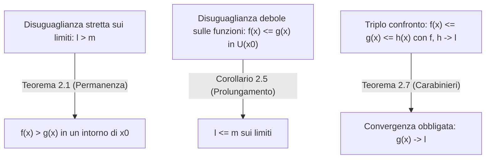

[[Home MOC|Home]] / [[Education & Learning]] / [[University]] / [[Lezione 15 - Proprieta dei Limiti]]

# Lezione 15 - Proprietà dei Limiti

## Sintesi Esecutiva
Questa quindicesima lezione (Sapienza Università di Roma — a cura dei proff. G. Franzina e S. Salzo, 16 Ottobre 2026) sviluppa in modo sistematico le conseguenze operative dell'algebra dei limiti e studia il legame profondo tra <mark style="background:rgba(255, 193, 69, 0.32)"><b>passaggio al limite e relazione d'ordine</b></mark>. Dopo aver dimostrato il calcolo per sostituzione diretta dei limiti di polinomi e funzioni razionali, la lezione introduce i teoremi cardine del confronto locale: il <mark style="background:rgba(255, 193, 69, 0.32)"><b>Teorema della permanenza delle disuguaglianze</b></mark> (e della permanenza del segno), il <mark style="background:rgba(181, 113, 255, 0.36)"><b>prolungamento delle disuguaglianze</b></mark> e il <mark style="background:rgba(255, 193, 69, 0.32)"><b>Teorema del confronto (o dei carabinieri)</b></mark>, grazie al quale viene dimostrato geometricamente il limite notevole $\lim_{x \to 0} \frac{\sin x}{x} = 1$. Infine, l'algebra dei limiti viene estesa alla retta reale ampliata $\overline{\mathbb{R}}$ per gestire somme, prodotti e reciproci in presenza di limiti infiniti, classificando rigorosamente tutte le <mark style="background:rgba(181, 113, 255, 0.36)"><b>forme indeterminate</b></mark> ($+\infty - \infty$, $0 \cdot \infty$, $\frac{\infty}{\infty}$, $\frac{0}{0}$) e il comportamento asintotico delle funzioni razionali per $x \to \pm\infty$.

---

## 1. Algebra dei Limiti: Polinomi e Funzioni Razionali

Nella [[Lezione 14 - Limiti di Successioni e Proprieta Locali]] abbiamo visto che l'operazione di limite rispetta somma, prodotto e (laddove il denominatore non si annulli) passaggio al reciproco e al quoziente. Applichiamo ora tali teoremi alle classi fondamentali di funzioni algebriche.

### Esempio 1.1: Monomi, Polinomi e Funzioni Razionali

#### (i) Limite di un Monomio
> [!IMPORTANT] Proposizione (Esempio 1.1.i — Limite di un Monomio)
> Siano $a \in \mathbb{R}$, $n \in \mathbb{N}$ e $x_0 \in \mathbb{R}$. Allora:
> $$\lim_{x \to x_0} a x^n = a x_0^n$$

*Dimostrazione (per induzione su $n \in \mathbb{N}$):*
- **Passo base ($n = 0$):** La tesi è vera perché la funzione $x \mapsto a x^0 = a$ è costante, e il limite di una costante coincide con la costante stessa: $\lim_{x \to x_0} a = a = a x_0^0$.
- **Passo induttivo ($n \implies n + 1$):** Supponiamo vera la tesi per $n$, ossia $\lim_{x \to x_0} a x^n = a x_0^n$. Scriviamo:
$$a x^{n+1} = (a x^n) \cdot x$$
Essendo $\lim_{x \to x_0} x = x_0$, applicando il Teorema sul limite del prodotto risulta:
$$\lim_{x \to x_0} a x^{n+1} = \left(\lim_{x \to x_0} a x^n\right)\left(\lim_{x \to x_0} x\right) = a x_0^n \cdot x_0 = a x_0^{n+1}$$
Per il principio di induzione la formula vale per ogni $n \in \mathbb{N}$. $\blacksquare$

---

#### (ii) Funzione Polinomiale
> [!IMPORTANT] Definizione e Limite di una Funzione Polinomiale (Esempio 1.1.ii)
> Si chiama **funzione polinomiale** una funzione del tipo:
> $$P: \mathbb{R} \to \mathbb{R}, \quad P(x) = a_n x^n + a_{n-1} x^{n-1} + \dots + a_1 x + a_0$$
> dove $a_k \in \mathbb{R}$ per $k = 0, 1, \dots, n$.
> Per ogni $x_0 \in \mathbb{R}$, risulta:
> $$\lim_{x \to x_0} P(x) = a_n x_0^n + a_{n-1} x_0^{n-1} + \dots + a_1 x_0 + a_0 = P(x_0)$$

*Dimostrazione:*
Poiché $P(x)$ è la somma finita di monomi del tipo $a_k x^k$ considerati al punto (i), applicando iterativamente il Teorema sulla somma dei limiti si ottiene immediatamente $\lim_{x \to x_0} P(x) = P(x_0)$. $\blacksquare$

---

#### (iii) Funzione Razionale
> [!IMPORTANT] Definizione e Limite di una Funzione Razionale (Esempio 1.1.iii)
> Siano $P(x)$ e $Q(x)$ due polinomi e siano $\{x_1, \dots, x_m\}$ gli zeri reali di $Q(x)$. Si definisce **funzione razionale**:
> $$f: A \to \mathbb{R}, \quad f(x) = \frac{P(x)}{Q(x)}, \quad \text{con } A = \mathbb{R} \setminus \{x_1, \dots, x_m\}$$
> Per ogni punto del dominio $x_0 \in A$, si ha:
> $$\lim_{x \to x_0} \frac{P(x)}{Q(x)} = \frac{P(x_0)}{Q(x_0)}$$

*Dimostrazione:*
Se $x_0 \in A = \mathbb{R} \setminus \{x_1, \dots, x_m\}$, dal punto (ii) segue che $\lim_{x \to x_0} P(x) = P(x_0)$ e $\lim_{x \to x_0} Q(x) = Q(x_0) \ne 0$ (poiché $x_0$ non è uno zero di $Q$). Pertanto, per il Teorema sul limite del rapporto, il limite coincide con il quoziente dei limiti $\frac{P(x_0)}{Q(x_0)}$. $\blacksquare$

---

## 2. Limiti e Ordinamento

Studiamo ora come le disuguaglianze tra funzioni si riflettano sui rispettivi limiti e viceversa.

### Teorema della Permanenza delle Disuguaglianze

> [!IMPORTANT] Teorema 2.1 (Della Permanenza delle Disuguaglianze)
> Sia $A \subset \mathbb{R}$ e sia $x_0 \in \overline{\mathbb{R}}$ un punto di accumulazione per $A$ in $\overline{\mathbb{R}}$. Siano $f: A \to \mathbb{R}$ e $g: A \to \mathbb{R}$ due funzioni e supponiamo che:
> $$\lim_{x \to x_0} f(x) = \ell \in \overline{\mathbb{R}} \quad \text{e} \quad \lim_{x \to x_0} g(x) = m \in \overline{\mathbb{R}}$$
> Allora:
> $$\ell > m \implies f(x) > g(x) \text{ in un intorno di } x_0$$

*Dimostrazione:*
Per ipotesi $\ell, m \in \overline{\mathbb{R}}$ con $\ell > m$. Per la proprietà di separazione (Hausdorff) di $\overline{\mathbb{R}}$, possiamo scegliere due intorni $V_1 \in \mathcal{U}(\ell)$ e $V_2 \in \mathcal{U}(m)$, rispettivamente di $\ell$ e $m$, tali che siano disgiunti e ordinati:
$$V_1 \cap V_2 = \emptyset \quad \text{e} \quad V_1 \ge V_2 \quad \text{(sono separati)}$$
In altri termini, vale la condizione:
$$\forall y_1 \in V_1, \, \forall y_2 \in V_2 : \quad y_1 > y_2 \tag{1}$$
Poiché per ipotesi $f(x) \to \ell$ e $g(x) \to m$ per $x \to x_0$, per definizione topologica di limite si deve avere:
$$f(x) \in V_1 \text{ in un intorno di } x_0 \quad \text{e} \quad g(x) \in V_2 \text{ in un intorno di } x_0$$
Per la proprietà di intersezione finita di proprietà locali (Proposizione 3.3 della Lezione 14), risulta che:
$$f(x) \in V_1 \quad \text{e} \quad g(x) \in V_2 \quad \text{simultaneamente in un intorno di } x_0$$
Di conseguenza, applicando la $(1)$ con $y_1 = f(x)$ e $y_2 = g(x)$, si ottiene:
$$f(x) > g(x) \text{ in un intorno di } x_0 \quad \blacksquare$$

> [!WARNING] Osservazione 2.2 (La disuguaglianza debole sui limiti non si conserva)
> Il Teorema 2.1 afferma che $\ell > m \implies f(x) > g(x)$ in un intorno di $x_0$.
> **Non** vale invece l'analoga implicazione con la disuguaglianza larga:
> $$\ell \ge m \centernot\implies f(x) \ge g(x) \text{ in un intorno di } x_0$$
> In particolare, può accadere che $\ell = m$ senza che sia necessariamente $f(x) \le g(x)$ oppure $g(x) \le f(x)$ in un intorno di $x_0$.
> - **Controesempio:** Si prendano $f(x) = x$, $g(x) = -x$ e $x_0 = 0$. Entrambe tendono a $\ell = m = 0$, ma in ogni intorno completo di $0$ si ha $f(x) > g(x)$ per $x > 0$ e $f(x) < g(x)$ per $x < 0$.

---

### Confronto con una Costante e Permanenza del Segno

> [!IMPORTANT] Corollario 2.3 (Confronto Locale con una Costante)
> Sia $A \subset \mathbb{R}$ e sia $x_0 \in \overline{\mathbb{R}}$ un punto di accumulazione per $A$ in $\overline{\mathbb{R}}$. Siano $f: A \to \mathbb{R}$ e $\lambda \in \mathbb{R}$ e supponiamo che $\lim_{x \to x_0} f(x) = \ell \in \overline{\mathbb{R}}$. Allora:
> $$\ell > \lambda \text{ (risp. } \ell < \lambda\text{)} \implies f(x) > \lambda \text{ (risp. } f(x) < \lambda\text{) in un intorno di } x_0$$

*Dimostrazione:*
Consegue immediatamente dal Teorema 2.1 scegliendo come seconda funzione la funzione costante $g(x) \equiv \lambda$, il cui limite per $x \to x_0$ è $m = \lambda$. $\blacksquare$

> [!IMPORTANT] Corollario 2.4 (Teorema della Permanenza del Segno)
> Sia $A \subset \mathbb{R}$ e $f: A \to \mathbb{R}$. Sia $x_0 \in \overline{\mathbb{R}}$ un punto di accumulazione per $A$. Supponiamo che $\lim_{x \to x_0} f(x) = \ell \in \overline{\mathbb{R}}$. Allora:
> $$\ell > 0 \text{ (risp. } \ell < 0\text{)} \implies f(x) > 0 \text{ (risp. } f(x) < 0\text{) in un intorno di } x_0$$

*Dimostrazione:*
Consegue direttamente dal Corollario 2.3 ponendo $\lambda = 0$. $\blacksquare$

---

### Teorema di Prolungamento delle Disuguaglianze

> [!IMPORTANT] Corollario 2.5 (Teorema di Prolungamento delle Disuguaglianze)
> Sia $A \subset \mathbb{R}$ e sia $x_0 \in \overline{\mathbb{R}}$ un punto di accumulazione per $A$ in $\overline{\mathbb{R}}$. Siano $f: A \to \mathbb{R}$ e $g: A \to \mathbb{R}$ due funzioni tali che $\lim_{x \to x_0} f(x) = \ell \in \overline{\mathbb{R}}$ e $\lim_{x \to x_0} g(x) = m \in \overline{\mathbb{R}}$. Allora:
> $$f(x) \le g(x) \text{ in un intorno di } x_0 \implies \ell \le m$$

*Dimostrazione:*
Supponiamo che $f(x) \le g(x)$ in un intorno di $x_0$ e procediamo **per assurdo** negando la tesi, ossia supponendo che sia $\ell > m$.
Per il Teorema 2.1 (della permanenza delle disuguaglianze), da $\ell > m$ seguirebbe:
$$f(x) > g(x) \text{ in un intorno di } x_0$$
Ma per ipotesi $f(x) \le g(x)$ in un intorno di $x_0$; prendendo l'intersezione dei due intorni si arriverebbe ad avere:
$$f(x) \le g(x) \quad \text{e} \quad f(x) > g(x) \quad \text{simultaneamente in un intorno di } x_0$$
Ciò produce una contraddizione, poiché nessun numero reale può essere simultaneamente minore o uguale e strettamente maggiore di un altro numero reale. Pertanto deve essere $\ell \le m$. $\blacksquare$

> [!WARNING] Osservazione 2.6 (La disuguaglianza stretta si attenua nel limite)
> Notiamo che nel passaggio al limite si prolunga la disuguaglianza debole "$\le$", ma **non** quella stretta "$<$":
> $$f(x) < g(x) \text{ in un intorno di } x_0 \centernot\implies \ell < m$$
> (Vale soltanto $f(x) < g(x) \implies \ell \le m$).
> - **Controesempio:** Per ogni $x \in ]-1, 1[ \setminus \{0\}$ vale la disuguaglianza stretta:
> $$x^2 < |x|$$
> ma passando al limite per $x \to 0$ i due limiti coincidono:
> $$\lim_{x \to 0} x^2 = 0 = \lim_{x \to 0} |x|$$

---

### Teorema del Confronto (o della Convergenza Obbligata o dei Carabinieri)

> [!IMPORTANT] Teorema 2.7 (Del Confronto / Della Convergenza Obbligata / Dei Carabinieri)
> Sia $A \subset \mathbb{R}$ e sia $x_0 \in \overline{\mathbb{R}}$ un punto di accumulazione per $A$ in $\overline{\mathbb{R}}$. Siano $f, g, h: A \to \mathbb{R}$ tre funzioni definite in $A$ a valori in $\mathbb{R}$ e supponiamo che:
> - **a)** $f(x) \le g(x) \le h(x)$ in un intorno di $x_0$;
> - **b)** $\lim_{x \to x_0} f(x) = \ell$ e $\lim_{x \to x_0} h(x) = \ell$, con $\ell \in \overline{\mathbb{R}}$.
>
> Allora anche la funzione intermedia ammette limite $\ell$:
> $$\lim_{x \to x_0} g(x) = \ell$$

*Dimostrazione:*
Sia $V \in \mathcal{U}(\ell)$ un intorno arbitrario di $\ell$. Dobbiamo provare che $g(x) \in V$ in un intorno di $x_0$.
Osserviamo preliminarmente che, essendo $V$ un intervallo di $\overline{\mathbb{R}}$ (convesso rispetto all'ordine), vale la proprietà:
$$y_1, y_2 \in V \quad \text{e} \quad y_1 \le y_2 \implies [y_1, y_2] \subset V \tag{2}$$
Dall'ipotesi **b)** segue che:
$$f(x) \in V \text{ in un intorno di } x_0 \quad \text{e} \quad h(x) \in V \text{ in un intorno di } x_0$$
Inoltre, per l'ipotesi **a)**, si ha $f(x) \le g(x) \le h(x)$ in un intorno di $x_0$.
Intersecando i tre intorni, le tre condizioni:
$$\begin{cases} f(x) \in V \\ h(x) \in V \\ f(x) \le g(x) \le h(x) \end{cases}$$
sono **simultaneamente vere** in un intorno di $x_0$.
Allora, poiché $g(x) \in [f(x), h(x)]$ con gli estremi $f(x), h(x) \in V$, ricordando la $(2)$ si conclude che $g(x) \in V$ in un intorno di $x_0$, ossia $\lim_{x \to x_0} g(x) = \ell$. $\blacksquare$

---

### Confronto per la Divergenza ("Basta un solo carabiniere")

> [!TIP] Osservazione 2.8 (Criterio del Confronto per Limiti Infiniti)
> Nel Teorema 2.7, quando il limite è infinito ($\ell = +\infty$ oppure $\ell = -\infty$), basta una sola funzione di confronto ("un solo carabiniere"):
> 1. **Divergenza a $+\infty$:** Se $f(x) \le g(x)$ in un intorno di $x_0$ e $\lim_{x \to x_0} f(x) = +\infty$, allora $\lim_{x \to x_0} g(x) = +\infty$.
>    *Verifica:* Sia $V = ]\beta, +\infty]$ un intorno di $+\infty$. Poiché $f(x) \to +\infty$, si ha $f(x) \in ]\beta, +\infty]$ in un intorno di $x_0$. Allora le due condizioni:
>    $$\begin{cases} f(x) \le g(x) \\ f(x) > \beta \end{cases}$$
>    valgono simultaneamente in un intorno di $x_0$, implicando $g(x) > \beta$, ossia $g(x) \in V$ in un intorno di $x_0$.
> 2. **Divergenza a $-\infty$:** Analogamente, se $g(x) \le h(x)$ in un intorno di $x_0$ e $\lim_{x \to x_0} h(x) = -\infty$, allora $\lim_{x \to x_0} g(x) = -\infty$.

---

### Corollario del Maggiorante Infinitesimo e Funzione Limitata per Infinitesima

> [!IMPORTANT] Corollario 2.9 (Maggiorazione in Valore Assoluto con Funzione Infinitesima)
> Sia $A \subset \mathbb{R}$ e sia $x_0 \in \overline{\mathbb{R}}$ un punto di accumulazione per $A$. Siano $f: A \to \mathbb{R}$ e $g: A \to \mathbb{R}$ due funzioni tali che:
> $$|f(x)| \le g(x) \text{ in un intorno di } x_0$$
> Allora:
> $$\lim_{x \to x_0} g(x) = 0 \implies \lim_{x \to x_0} f(x) = 0$$

*Dimostrazione:*
Supponiamo che $\lim_{x \to x_0} g(x) = 0$. La disuguaglianza $|f(x)| \le g(x)$ equivale a:
$$-g(x) \le f(x) \le g(x) \text{ in un intorno di } x_0$$
Poiché $\lim_{x \to x_0} (-g(x)) = -\lim_{x \to x_0} g(x) = 0$, entrambe le funzioni estreme tendono a $0$; per il Teorema 2.7 (dei carabinieri) segue $\lim_{x \to x_0} f(x) = 0$. $\blacksquare$

> [!IMPORTANT] Corollario 2.13 (Prodotto di una Funzione Infinitesima per una Funzione Limitata)
> Sia $A \subset \mathbb{R}$ e sia $x_0 \in \overline{\mathbb{R}}$ un punto di accumulazione per $A$. Siano $f: A \to \mathbb{R}$ e $g: A \to \mathbb{R}$ due funzioni tali che:
> $$\lim_{x \to x_0} f(x) = 0 \quad \text{e} \quad g(x) \text{ è limitata in un intorno di } x_0$$
> Allora:
> $$\lim_{x \to x_0} f(x)g(x) = 0$$

*Dimostrazione:*
Per l'ipotesi di limitatezza locale di $g$, esiste una costante $C > 0$ tale che:
$$|g(x)| \le C \text{ in un intorno di } x_0$$
Moltiplicando ambo i membri per $|f(x)| \ge 0$, si ottiene:
$$|f(x)g(x)| = |f(x)| \cdot |g(x)| \le C |f(x)| \text{ in un intorno di } x_0$$
Poiché per ipotesi $\lim_{x \to x_0} f(x) = 0$, si ha $\lim_{x \to x_0} C|f(x)| = C \cdot 0 = 0$. Applicando il Corollario 2.9 con maggiorante $C|f(x)|$, segue immediatamente $\lim_{x \to x_0} f(x)g(x) = 0$. $\blacksquare$

#### Esempio 2.14 (Oscillazione Smorzata)
Sapendo che $\lim_{x \to 0} x^2 = 0$, dal Corollario 2.13 segue immediatamente che:
$$\lim_{x \to 0} x^2 \sin\frac{1}{x} = 0$$
poiché la funzione $g(x) = \sin(1/x)$, pur non ammettendo limite per $x \to 0$, è limitata in $\mathbb{R} \setminus \{0\}$ ($|\sin(1/x)| \le 1$).

---

### Esempio 2.10: Limiti Trigonometrici Fondamentali e Limite Notevole $\frac{\sin x}{x}$

> [!IMPORTANT] Teorema / Esempio 2.10 (Limiti Trigonometrici Fondamentali)
> Valgono i seguenti limiti per $x \to 0$:
> $$\lim_{x \to 0} \sin x = 0, \qquad \lim_{x \to 0} \cos x = 1, \qquad \lim_{x \to 0} \frac{\sin x}{x} = 1 \tag{3}$$

*Dimostrazione completa:*

#### Passo 1: Disuguaglianza Geometrica sulla Circonferenza Goniometrica
Consideriamo la circonferenza trigonometrica di centro $O$ e raggio $OA = 1$. Per ogni angolo $x \in ]0, \pi/2[$, confrontiamo le aree di tre figure contenute l'una nell'altra ($\text{Triangolo } OAB \subset \text{Settore circolare } OAB \subset \text{Triangolo rettangolo } OAC$):
- Area del triangolo $OAB$: $\frac{1}{2} \cdot OA \cdot \sin x = \frac{\sin x}{2}$
- Area del settore circolare $OAB$: $\frac{1}{2} \cdot r^2 \cdot x = \frac{x}{2}$
- Area del triangolo $OAC$: $\frac{1}{2} \cdot OA \cdot \tan x = \frac{\tan x}{2}$

Moltiplicando per $2$ si ottiene la disuguaglianza geometrica fondamentale:
$$\forall x \in ]0, \pi/2[ : \quad \sin x < x < \tan x = \frac{\sin x}{\cos x} \tag{4}$$

#### Passo 2: Dimostrazione di $\lim_{x \to 0} \sin x = 0$
Dalla prima disuguaglianza di $(4)$, ricordando che $\sin x$ è una funzione dispari ($\sin(-x) = -\sin x$):
$$x \in ]-\pi/2, 0[ \implies -x \in ]0, \pi/2[ \implies \sin(-x) < -x \implies \underbrace{-\sin x}_{< 0} < \underbrace{-x}_{< 0} \implies |\sin x| < |x|$$
Unendo il caso $x \in ]0, \pi/2[$ (dove $\sin x > 0 \implies |\sin x| < |x|$), otteniamo:
$$\forall x \in ]-\pi/2, \pi/2[ \setminus \{0\} : \quad |\sin x| < |x| \tag{5}$$
Poiché $\lim_{x \to 0} |x| = 0$, dal Corollario 2.9 segue:
$$\lim_{x \to 0} \sin x = 0$$

#### Passo 3: Dimostrazione di $\lim_{x \to 0} \cos x = 1$
Ricordiamo la formula di bisezione/duplicazione del coseno $\cos 2\alpha = 1 - 2\sin^2\alpha$, che per $\alpha = \frac{x}{2}$ diventa:
$$\cos x = 1 - 2\sin^2\frac{x}{2}$$
Applicando la $(5)$ all'argomento $x/2$, per ogni $x \in ]-\pi, \pi[ \setminus \{0\}$ vale:
$$0 \le \sin^2\frac{x}{2} = \left|\sin\frac{x}{2}\right|^2 < \left|\frac{x}{2}\right|^2 = \frac{x^2}{4}$$
Poiché $\lim_{x \to 0} \frac{x^2}{4} = 0$, dal Corollario 2.9 segue $\lim_{x \to 0} \sin^2\left(\frac{x}{2}\right) = 0$. Per il Teorema sulle operazioni sui limiti:
$$\lim_{x \to 0} \cos x = \lim_{x \to 0} \left(1 - 2\sin^2\frac{x}{2}\right) = 1 - 2 \cdot 0 = 1$$

#### Passo 4: Dimostrazione del Limite Notevole $\lim_{x \to 0} \frac{\sin x}{x} = 1$
Il rapporto $\frac{\sin x}{x}$ per $x \to 0$ si presenta nella forma indeterminata $\frac{0}{0}$.
Per $x \in ]0, \pi/2[$ è $\sin x > 0$; dividendo tutti i membri della $(4)$ per $\sin x$ e passando ai reciproci si ha:
$$\forall x \in ]0, \pi/2[ : \quad 1 < \frac{x}{\sin x} < \frac{1}{\cos x} \implies \cos x < \frac{\sin x}{x} < 1$$
Ricordando che $\cos x$ è pari ($\cos(-x) = \cos x$) e $\sin x$ è dispari ($\sin(-x) = -\sin x$), per $x \in ]-\pi/2, 0[$ si ha $-x \in ]0, \pi/2[$ e quindi:
$$\cos(-x) < \frac{\sin(-x)}{-x} = \frac{-\sin x}{-x} < 1 \implies \cos x < \frac{\sin x}{x} < 1$$
In definitiva vale in tutto l'intorno bucato:
$$\forall x \in ]-\pi/2, \pi/2[ \setminus \{0\} : \quad \cos x < \frac{\sin x}{x} < 1$$
Poiché $\lim_{x \to 0} \cos x = 1$ e $\lim_{x \to 0} 1 = 1$, per il **Teorema 2.7 (dei carabinieri)** si conclude che:
$$\lim_{x \to 0} \frac{\sin x}{x} = 1 \quad \blacksquare$$

---

### Esercizio 2.11 ed Esempio 2.12: Retta e Potenze all'Infinito

> [!NOTE] Esercizio 2.11 (Limiti di Funzioni Lineari Affine all'Infinito)
> Mediante la definizione di limite si verifica direttamente che, per $a \ne 0$:
> $$\lim_{x \to +\infty} (ax + b) = \begin{cases} +\infty & \text{se } a > 0 \\ -\infty & \text{se } a < 0 \end{cases}, \qquad \lim_{x \to -\infty} (ax + b) = \begin{cases} -\infty & \text{se } a > 0 \\ +\infty & \text{se } a < 0 \end{cases}$$

> [!IMPORTANT] Esempio 2.12 (Limiti della Funzione Potenza $x^n$ per $x \to \pm\infty$)
> Sia $n \in \mathbb{N}$ con $n \ge 1$. Allora:
> $$\lim_{x \to +\infty} x^n = +\infty \qquad \text{e} \qquad \lim_{x \to -\infty} x^n = \begin{cases} +\infty & \text{se } n \text{ è pari} \\ -\infty & \text{se } n \text{ è dispari} \end{cases}$$

*Dimostrazione (tramite Disuguaglianza di Bernoulli e Osservazione 2.8):*
1. **Caso $x \to +\infty$:** Per ogni $x \in \mathbb{R}^+$ (quindi $x - 1 > -1$), applicando la disuguaglianza di Bernoulli:
$$x^n = (1 + (x - 1))^n \ge 1 + n(x - 1) \quad \text{in un intorno di } +\infty$$
Poiché $\lim_{x \to +\infty} [1 + n(x - 1)] = +\infty$ (per l'Esercizio 2.11 con $a = n > 0$), per l'Osservazione 2.8 (confronto per la divergenza) segue $\lim_{x \to +\infty} x^n = +\infty$.
2. **Caso $x \to -\infty$ con $n$ pari:** Per ogni $x \in \mathbb{R}^-$ si ha $-x > 0$, quindi $-x - 1 > -1$. Dalla disuguaglianza di Bernoulli:
$$x^n = (-x)^n \ge 1 + n(-x - 1) = 1 - n(x + 1) \quad \text{in un intorno di } -\infty$$
Poiché $\lim_{x \to -\infty} [1 - n(x + 1)] = +\infty$ (coefficiente di $x$ pari a $-n < 0$), dall'Osservazione 2.8 segue $\lim_{x \to -\infty} x^n = +\infty$.
3. **Caso $x \to -\infty$ con $n$ dispari:** Per ogni $x \in \mathbb{R}^-$ si ha $(-x)^n = -x^n$. Dalla disuguaglianza di Bernoulli:
$$-x^n = (-x)^n \ge 1 + n(-x - 1) = 1 - n(x + 1) \implies x^n \le -1 + n(x + 1) \quad \text{in un intorno di } -\infty$$
Poiché $\lim_{x \to -\infty} [-1 + n(x + 1)] = -\infty$ (coefficiente di $x$ pari a $n > 0$), dall'Osservazione 2.8 segue $\lim_{x \to -\infty} x^n = -\infty$. $\blacksquare$

---

## 2.1 Operazioni con i Limiti in $\overline{\mathbb{R}}$

Estendiamo ora l'algebra dei limiti al caso in cui una o entrambe le funzioni divergano a $\pm\infty$.

### Limitatezza Unilaterale Locale

> [!IMPORTANT] Proposizione 2.15 (Limitatezza Unilaterale Locale)
> Sia $A \subset \mathbb{R}$, $x_0 \in \overline{\mathbb{R}}$ punto di accumulazione per $A$ e $f: A \to \mathbb{R}$. Supponiamo che $\lim_{x \to x_0} f(x) = \ell \in \overline{\mathbb{R}}$. Allora valgono le seguenti affermazioni:
> - **(i)** Se $\ell > -\infty$, allora $f$ è **limitata inferiormente** in un intorno di $x_0$:
>   $$\exists \lambda \in \mathbb{R} \text{ tale che } \lambda \le f(x) \text{ in un intorno di } x_0$$
> - **(ii)** Se $\ell < +\infty$, allora $f$ è **limitata superiormente** in un intorno di $x_0$:
>   $$\exists \lambda \in \mathbb{R} \text{ tale che } f(x) \le \lambda \text{ in un intorno di } x_0$$

*Dimostrazione:*
Proviamo la **(i)** (la **(ii)** si prova in modo del tutto analogo). Supponiamo che $\ell > -\infty$. Allora possiamo scegliere un numero reale $\lambda \in \mathbb{R}$ tale che $\lambda < \ell$. Per il Corollario 2.3 (permanenza delle disuguaglianze), si ha:
$$\lambda < f(x) \quad \text{(e dunque } \lambda \le f(x)\text{) in un intorno di } x_0 \quad \blacksquare$$

---

### Somma di Limiti Infiniti

> [!IMPORTANT] Teorema 2.16 (Somma con un Limite Infinito)
> Sia $A \subset \mathbb{R}$ e sia $x_0 \in \overline{\mathbb{R}}$ punto di accumulazione per $A$. Siano $f, g: A \to \mathbb{R}$ e supponiamo che:
> $$\lim_{x \to x_0} f(x) = \ell \in \{-\infty, +\infty\}$$
> Valgono le seguenti proposizioni:
> - **(i)** Se $\ell = +\infty$ e $g$ è **limitata inferiormente** in un intorno di $x_0$, allora $\lim_{x \to x_0} (f + g)(x) = +\infty$.
> - **(ii)** Se $\ell = -\infty$ e $g$ è **limitata superiormente** in un intorno di $x_0$, allora $\lim_{x \to x_0} (f + g)(x) = -\infty$.
>
> *Schema sintetico:*
> $$\underbrace{f(x)}_{\to +\infty} + \underbrace{g(x)}_{\text{l.i.}} \to +\infty \qquad \text{e} \qquad \underbrace{f(x)}_{\to -\infty} + \underbrace{g(x)}_{\text{l.s.}} \to -\infty$$

*Esempio immediato:*
$$\lim_{x \to 0} \left(\frac{1}{x^2} + \sin\frac{1}{x}\right) = +\infty$$
perché $\frac{1}{x^2} \to +\infty$ e la seconda funzione $\sin(1/x)$, pur non avendo limite per $x \to 0$, è limitata inferiormente ($\sin(1/x) \ge -1$).

*Dimostrazione del Teorema 2.16 (punto i):*
Sia $\beta > 0$ arbitrario. Dobbiamo provare che $f(x) + g(x) > \beta$ in un intorno di $x_0$.
Per l'ipotesi di limitatezza inferiore di $g$, esiste $\lambda \in \mathbb{R}$ tale che:
$$g(x) \ge \lambda \text{ in un intorno di } x_0$$
Inoltre, poiché $\lim_{x \to x_0} f(x) = +\infty$, in corrispondenza della soglia reale $\beta - \lambda$ vale:
$$f(x) > \beta - \lambda \text{ in un intorno di } x_0$$
Intersecando i due intorni, le condizioni $g(x) \ge \lambda$ e $f(x) > \beta - \lambda$ valgono simultaneamente in un intorno di $x_0$; sommandole membro a membro si ottiene:
$$f(x) + g(x) > (\beta - \lambda) + \lambda = \beta \text{ in un intorno di } x_0 \quad \blacksquare$$

---

### Estensione dell'Addizione a $\overline{\mathbb{R}}$ e Forma Indeterminata $+\infty - \infty$

Combinando il Teorema 2.16 e la Proposizione 2.15 (**Osservazione 2.17**), se $\lim_{x \to x_0} f(x) = \ell \in \{-\infty, +\infty\}$ e $\lim_{x \to x_0} g(x) = m \in \overline{\mathbb{R}}$:
$$\begin{cases} \text{se } \ell = +\infty \text{ e } m > -\infty \implies \lim_{x \to x_0} (f(x) + g(x)) = +\infty \\ \text{se } \ell = -\infty \text{ e } m < +\infty \implies \lim_{x \to x_0} (f(x) + g(x)) = -\infty \end{cases}$$

Introducendo le convenzioni algebriche in $\overline{\mathbb{R}}$:
$$\forall m \in \mathbb{R} \cup \{+\infty\} : \quad (+\infty) + m = m + (+\infty) = +\infty$$
$$\forall m \in \mathbb{R} \cup \{-\infty\} : \quad (-\infty) + m = m + (-\infty) = -\infty$$
otteniamo il risultato generale sulla somma in $\overline{\mathbb{R}}$:

> [!IMPORTANT] Corollario 2.18 (Limite della Somma in $\overline{\mathbb{R}}$)
> Supponiamo che $\lim_{x \to x_0} f(x) = \ell \in \overline{\mathbb{R}}$ e $\lim_{x \to x_0} g(x) = m \in \overline{\mathbb{R}}$. Allora:
> $$\lim_{x \to x_0} (f(x) + g(x)) = \ell + m$$
> **con l'esclusione** dei casi in cui uno tra $\ell$ e $m$ sia $+\infty$ e l'altro sia $-\infty$.
> Le espressioni $(+\infty) + (-\infty)$ e $(-\infty) + (+\infty)$ sono dette **forme indeterminate** (il limite può essere finito, $+\infty$, $-\infty$ oppure non esistere).

---

### Prodotto e Reciproco con Limiti Infiniti

> [!IMPORTANT] Teorema 2.19 (Prodotto di Limiti Infiniti e Passaggio al Reciproco)
> Sia $A \subset \mathbb{R}$, $x_0 \in \overline{\mathbb{R}}$ punto di accumulazione per $A$, e siano $f, g: A \to \mathbb{R}$. Valgono le seguenti proprietà:
> - **(i) Prodotto:** Se $\lim_{x \to x_0} f(x) = +\infty$ (risp. $-\infty$) e $\lim_{x \to x_0} g(x) = m \in \overline{\mathbb{R}} \setminus \{0\}$, allora:
>   $$\lim_{x \to x_0} f(x)g(x) = \begin{cases} +\infty \text{ (risp. } -\infty\text{)} & \text{se } m > 0 \\ -\infty \text{ (risp. } +\infty\text{)} & \text{se } m < 0 \end{cases}$$
> - **(ii) Reciproco di un infinito:** Se $\lim_{x \to x_0} f(x) = \pm\infty$, allora:
>   $$\lim_{x \to x_0} \frac{1}{f(x)} = 0$$
> - **(iii) Reciproco di un infinitesimo di segno costante:** Se $\lim_{x \to x_0} f(x) = 0$ e $f(x) > 0$ (risp. $f(x) < 0$) in un intorno di $x_0$, allora:
>   $$\lim_{x \to x_0} \frac{1}{f(x)} = +\infty \quad \text{(risp. } -\infty\text{)}$$
>
> *Schemi sintetici:*
> $$\underbrace{f(x)}_{\to +\infty} \cdot \underbrace{g(x)}_{\to \pm} \to \pm\infty, \qquad \underbrace{f(x)}_{\to -\infty} \cdot \underbrace{g(x)}_{\to \pm} \to \mp\infty, \qquad \frac{1}{\underbrace{f(x)}_{\to \pm\infty}} \to 0, \qquad \frac{1}{\underbrace{f(x)}_{\to 0^\pm}} \to \pm\infty$$

*Dimostrazione:*
- **Dimostrazione di (i):** Consideriamo il caso $\lim_{x \to x_0} f(x) = +\infty$ e $m \in ]0, +\infty]$ (gli altri casi si provano allo stesso modo).
  Fissiamo $\beta > 0$ e scegliamo un reale $\lambda \in \mathbb{R}$ tale che $0 < \lambda < m$. Per il teorema della permanenza delle disuguaglianze (Corollario 2.3), si ha:
$$g(x) > \lambda > 0 \text{ in un intorno di } x_0$$
  D'altra parte, poiché $\lim_{x \to x_0} f(x) = +\infty$, in corrispondenza della soglia $\frac{\beta}{\lambda} > 0$ si ha:
$$f(x) > \frac{\beta}{\lambda} \text{ in un intorno di } x_0$$
  Nell'intersezione dei due intorni entrambe le disuguaglianze (tra quantità positive) valgono simultaneamente; moltiplicando membro a membro si ottiene:
$$f(x)g(x) > \frac{\beta}{\lambda} \cdot \lambda = \beta \text{ in un intorno di } x_0 \implies \lim_{x \to x_0} f(x)g(x) = +\infty$$

- **Dimostrazione di (ii):** Fissiamo $\varepsilon > 0$. Dobbiamo provare che:
$$\left|\frac{1}{f(x)}\right| < \varepsilon \text{ in un intorno di } x_0 \iff |f(x)| > \frac{1}{\varepsilon} \text{ in un intorno di } x_0$$
  - Se $\lim_{x \to x_0} f(x) = +\infty$, allora $f(x) > \frac{1}{\varepsilon} > 0 \implies |f(x)| > \frac{1}{\varepsilon}$ in un intorno di $x_0$.
  - Se $\lim_{x \to x_0} f(x) = -\infty$, allora $f(x) < -\frac{1}{\varepsilon} < 0 \implies |f(x)| = -f(x) > \frac{1}{\varepsilon}$ in un intorno di $x_0$.
  In ogni caso $|f(x)| > 1/\varepsilon$ in un intorno di $x_0$, da cui la tesi.

- **Dimostrazione di (iii):** Fissiamo $\beta > 0$ (nel caso $f(x) > 0$). Per l'ipotesi $\lim_{x \to x_0} f(x) = 0$, si ha $|f(x)| < \frac{1}{\beta}$ in un intorno di $x_0$, e per ipotesi $f(x) > 0$ in un intorno di $x_0$.
  Nell'intersezione dei due intorni valgono simultaneamente:
$$0 < f(x) < \frac{1}{\beta} \text{ in un intorno di } x_0 \implies \frac{1}{f(x)} > \beta \text{ in un intorno di } x_0$$
  il che dimostra che $\lim_{x \to x_0} \frac{1}{f(x)} = +\infty$. $\blacksquare$

---

### Convenzioni Algebriche in $\overline{\mathbb{R}}$ e Quadro Completo delle Forme Indeterminate

> [!IMPORTANT] Osservazione 2.20 (Algebra Estesa di $\overline{\mathbb{R}}$ e Forme Indeterminate)
> Come conseguenza del Teorema 2.19, estendiamo l'algebra di $\mathbb{R}$ a $\overline{\mathbb{R}}$ ponendo per convenzione:
> $$\forall m \in \overline{\mathbb{R}} \setminus \{0\} : \quad (\pm\infty) \cdot m = m \cdot (\pm\infty) = \begin{cases} \pm\infty & \text{se } m > 0 \\ \mp\infty & \text{se } m < 0 \end{cases}$$
> $$\forall m \in \mathbb{R} : \quad \frac{m}{\pm\infty} = 0 \qquad \text{e} \qquad \frac{1}{0^\pm} = \pm\infty$$
> dove la notazione $0^+$ (risp. $0^-$) indica che la funzione tende a $0$ restando strettamente positiva (risp. strettamente negativa) in un intorno di $x_0$.
> Con tali convenzioni:
> 1. Se $f(x) \to \ell \in \overline{\mathbb{R}}$ e $g(x) \to m \in \overline{\mathbb{R}}$ con $(\ell, m) \ne (\pm\infty, 0)$ e $(\ell, m) \ne (0, \pm\infty)$, allora:
>    $$\lim_{x \to x_0} f(x)g(x) = \ell m$$
> 2. Se $\ell$ e $m$ non sono entrambi infiniti né entrambi zero, allora:
>    $$\lim_{x \to x_0} \frac{f(x)}{g(x)} = \frac{\ell}{m}$$
>
> #### Elenco Completo delle Forme Indeterminate Algebriche
> | Operazione | Forma Indeterminata | Significato |
> | :--- | :---: | :--- |
> | **Somma algebrica** | $(+\infty) + (-\infty), \; (-\infty) + (+\infty)$ | Conflitto tra due infiniti di segno opposto |
> | **Prodotto** | $(\pm\infty) \cdot 0, \; 0 \cdot (\pm\infty)$ | Conflitto tra un infinito e un infinitesimo |
> | **Quoziente di infiniti** | $\dfrac{\pm\infty}{\pm\infty}$ | Rapporto tra due funzioni divergenti |
> | **Quoziente di infinitesimi** | $\dfrac{0}{0}$ | Rapporto tra due funzioni infinitesime |

---

## 3. Esempi di Operazioni sui Limiti in $\overline{\mathbb{R}}$ e Funzioni Razionali all'Infinito

### Esempio 2.1: I Quattro Esiti Possibili della Forma Indeterminata $+\infty - \infty$
Consideriamo per $x \to 0$ le seguenti quattro coppie di funzioni, per ciascuna delle quali risulta $\lim_{x \to 0} f(x) = +\infty$ e $\lim_{x \to 0} g(x) = -\infty$:

1. **Caso (a) — Il limite non esiste:**
$$f(x) = \frac{1}{x^2}, \quad g(x) = \frac{x - 1}{x^2} \implies \lim_{x \to 0} (f(x) + g(x)) = \lim_{x \to 0} \frac{1}{x} \quad \text{non esiste}$$
2. **Caso (b) — Il limite è finito:**
$$f(x) = \frac{1}{x^2}, \quad g(x) = \frac{2x^2 - 1}{x^2} \implies \lim_{x \to 0} (f(x) + g(x)) = \lim_{x \to 0} 2 = 2$$
3. **Caso (c) — Il limite è $+\infty$:**
$$f(x) = \frac{1}{x^4}, \quad g(x) = -\frac{1}{x^2} \implies \lim_{x \to 0} (f(x) + g(x)) = \lim_{x \to 0} \frac{1 - x^2}{x^4} = \lim_{x \to 0} (1 - x^2) \cdot \lim_{x \to 0} \frac{1}{x^4} = 1 \cdot (+\infty) = +\infty$$
4. **Caso (d) — Il limite è $-\infty$:**
$$f(x) = \frac{1}{x^2}, \quad g(x) = -\frac{1}{x^4} \implies \lim_{x \to 0} (f(x) + g(x)) = \lim_{x \to 0} \frac{x^2 - 1}{x^4} = \lim_{x \to 0} (x^2 - 1) \cdot \lim_{x \to 0} \frac{1}{x^4} = (-1) \cdot (+\infty) = -\infty$$

---

### Esempio 2.2: Tecniche di Risoluzione per $+\infty - \infty$ (Raccoglimento e Razionalizzazione)

#### (i) Raccoglimento del Termine di Grado Massimo
$$\lim_{x \to +\infty} (x^3 - 3x^2) = \lim_{x \to +\infty} x^3 \left(1 - \frac{3}{x}\right) = (+\infty) \cdot 1 = +\infty$$

#### (ii) Razionalizzazione di Differenze di Radicali
Proviamo che:
$$\lim_{x \to +\infty} \left(\sqrt{x + 1} - \sqrt{x}\right) = 0$$
Poiché $\lim_{x \to +\infty} \sqrt{x + 1} = +\infty$ e $\lim_{x \to +\infty} \sqrt{x} = +\infty$, il limite si presenta nella forma indeterminata $(+\infty) + (-\infty)$. Moltiplicando e dividendo per la somma $\sqrt{x + 1} + \sqrt{x}$ (razionalizzazione):
$$\sqrt{x + 1} - \sqrt{x} = \frac{(\sqrt{x + 1} - \sqrt{x})(\sqrt{x + 1} + \sqrt{x})}{\sqrt{x + 1} + \sqrt{x}} = \frac{(x + 1) - x}{\sqrt{x + 1} + \sqrt{x}} = \frac{1}{\sqrt{x + 1} + \sqrt{x}} \to \frac{1}{+\infty} = 0 \quad \text{per } x \to +\infty$$
dove nell'ultimo passaggio si è applicato il punto (ii) del Teorema 2.19.

---

### Limite di una Funzione Razionale per $x \to \pm\infty$

> [!IMPORTANT] Regola Generale per il Limite di Funzioni Razionali all'Infinito
> Consideriamo il rapporto di due polinomi di grado $n, m \in \mathbb{N}^*$ con coefficienti direttori $a_n \ne 0$ e $b_m \ne 0$:
> $$\lim_{x \to \pm\infty} \frac{P(x)}{Q(x)} = \lim_{x \to \pm\infty} \frac{a_n x^n + a_{n-1} x^{n-1} + \dots + a_1 x + a_0}{b_m x^m + b_{m-1} x^{m-1} + \dots + b_1 x + b_0}$$
> Raccogliendo $x^n$ al numeratore e $x^m$ al denominatore per ogni $x \in A \setminus \{0\}$:
> $$\frac{P(x)}{Q(x)} = \frac{x^n}{x^m} \cdot \frac{a_n + \frac{a_{n-1}}{x} + \dots + \frac{a_1}{x^{n-1}} + \frac{a_0}{x^n}}{b_m + \frac{b_{m-1}}{x} + \dots + \frac{b_1}{x^{m-1}} + \frac{b_0}{x^m}}$$
> Poiché per $x \to \pm\infty$ tutti i termini $\frac{a_{n-k}}{x^k} \to 0$ e $\frac{b_{m-k}}{x^k} \to 0$, la seconda frazione tende a $\frac{a_n}{b_m} \in \mathbb{R}^*$, mentre per il rapporto delle potenze massime:
> $$\frac{x^n}{x^m} = \begin{cases} x^{n-m} & \text{se } n > m \\ 1 & \text{se } n = m \\ \dfrac{1}{x^{m-n}} & \text{se } n < m \end{cases}$$
> In definitiva valgono le due formule chiuse:
> $$\lim_{x \to +\infty} \frac{P(x)}{Q(x)} = \begin{cases} \dfrac{a_n}{b_m} \cdot (+\infty) & \text{se } n > m \\[6pt] \dfrac{a_n}{b_m} & \text{se } n = m \\[6pt] 0 & \text{se } n < m \end{cases}$$
> $$\lim_{x \to -\infty} \frac{P(x)}{Q(x)} = \begin{cases} \dfrac{a_n}{b_m} \cdot (+\infty) & \text{se } n > m \text{ e } n - m \text{ è pari} \\[6pt] \dfrac{a_n}{b_m} \cdot (-\infty) & \text{se } n > m \text{ e } n - m \text{ è dispari} \\[6pt] \dfrac{a_n}{b_m} & \text{se } n = m \\[6pt] 0 & \text{se } n < m \end{cases}$$

#### Esempio 2.3 (Calcolo Esplicito di Limiti Razionali all'Infinito)
1. **Caso $n < m$ ($n = 3 < m = 4$):**
$$\lim_{x \to +\infty} \frac{3x^3 - 2x + 1}{-x^4 + 2x^2 + x} = \lim_{x \to +\infty} \frac{x^3}{x^4} \cdot \frac{3 - \frac{2}{x^2} + \frac{1}{x^3}}{-1 + \frac{2}{x^2} + \frac{1}{x^3}} = \lim_{x \to +\infty} \frac{1}{x} \cdot \frac{3 - \frac{2}{x^2} + \frac{1}{x^3}}{-1 + \frac{2}{x^2} + \frac{1}{x^3}} = 0 \cdot (-3) = 0$$
2. **Caso $n > m$ ($n = 4 > m = 3$, con $n - m = 1$ dispari per $x \to -\infty$):**
$$\lim_{x \to -\infty} \frac{-x^4 + 2x^2 + x}{3x^3 - 2x + 1} = \lim_{x \to -\infty} \frac{x^4}{x^3} \cdot \frac{-1 + \frac{2}{x^2} + \frac{1}{x^3}}{3 - \frac{2}{x^2} + \frac{1}{x^3}} = \lim_{x \to -\infty} x \cdot \frac{-1 + \frac{2}{x^2} + \frac{1}{x^3}}{3 - \frac{2}{x^2} + \frac{1}{x^3}} = (-\infty) \cdot \left(-\frac{1}{3}\right) = +\infty$$

---

## 4. Domande di Autovalutazione (con Soluzione Ragionata)

1. **Quale delle seguenti corrisponde alla definizione di $\lim_{x \to -2} f(x) = -4$?**
   - *Opzioni:*
     1. $\forall \delta > 0 \, \exists \varepsilon > 0 \text{ tale che } \forall x \in \mathbb{R} : 0 < |x + 2| < \delta \implies |f(x) + 4| < \varepsilon$
     2. $\mathbf{\forall \varepsilon > 0 \, \exists \delta > 0 \text{ tale che } \forall x \in \mathbb{R} : 0 < |x + 2| < \delta \implies |f(x) + 4| < \varepsilon}$ ✅
     3. $\forall \varepsilon > 0 \, \exists \delta > 0 \text{ tale che } \forall x \in \mathbb{R} : 0 < |x - 2| < \delta \implies |f(x) - 4| < \varepsilon$
     4. $\forall \varepsilon > 0 \, \exists \delta > 0 \text{ e } \exists x \in \mathbb{R} \text{ tale che } 0 < |x + 2| < \delta \implies |f(x) + 4| < \varepsilon$
   - *Spiegazione:* La distanza da $x_0 = -2$ è $|x - (-2)| = |x + 2|$ e la distanza dal limite $\ell = -4$ è $|f(x) - (-4)| = |f(x) + 4|$, con quantificatori $\forall \varepsilon > 0 \, \exists \delta > 0 \, \forall x$.

2. **Quale delle seguenti corrisponde alla definizione di $\lim_{x \to -\infty} f(x) = +\infty$?**
   - *Opzioni:*
     1. $\forall \beta > 0 \, \exists \alpha > 0 \text{ tale che } \forall x \in \mathbb{R} : x > \alpha \implies f(x) > \beta$
     2. $\forall \beta > 0 \, \exists \alpha > 0 \text{ tale che } \forall x \in \mathbb{R} : x < -\alpha \implies f(x) < -\beta$
     3. $\forall \alpha > 0 \, \exists \beta > 0 \text{ tale che } \forall x \in \mathbb{R} : x < -\alpha \implies f(x) > \beta$
     4. $\mathbf{\forall \beta > 0 \, \exists \alpha > 0 \text{ tale che } \forall x \in \mathbb{R} : x < -\alpha \implies f(x) > \beta}$ ✅
   - *Spiegazione:* Per $x \to -\infty$ gli intorni del dominio sono semirette sinistre $x < -\alpha$, mentre per $\ell = +\infty$ gli intorni dell'immagine sono semirette destre $f(x) > \beta$, per ogni $\beta > 0$.

3. **Se $\lim_{x \to 2} f(x) = 5$, quale delle seguenti è vera?**
   - *Opzioni:*
     1. $f(x) > 2$ nell'intervallo $]1, 3[$
     2. $\mathbf{f(x) > 4.99 \text{ in un intorno di } 2}$ ✅
     3. $f(x) = 5$ in un intorno di $2$
     4. nessuna delle precedenti
   - *Spiegazione:* Per il Corollario 2.3 (permanenza delle disuguaglianze), poiché $\ell = 5 > 4.99 = \lambda$, esiste un intorno di $x_0 = 2$ (non necessariamente coincidente con $]1, 3[$!) in cui $f(x) > 4.99$.
