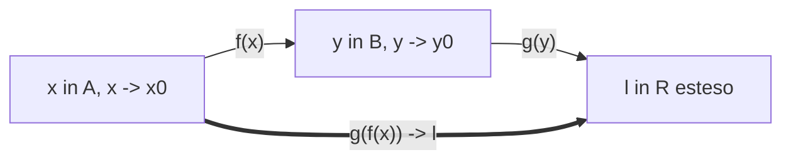

[[Home MOC|Home]] / [[Education & Learning]] / [[University]] / [[Lezione 17 - Limiti delle Funzioni Composte e Confronto Locale]]

# Lezione 17 - Limiti delle Funzioni Composte e Confronto Locale

## Sintesi Esecutiva
Questa diciassettesima lezione (Sapienza Università di Roma — a cura del prof. S. Salzo, 20 Ottobre 2026) affronta due pilastri operativi e concettuali dell'analisi matematica: il <mark style="background:rgba(255, 193, 69, 0.32)"><b>Teorema sul limite delle funzioni composte</b></mark> (regola di sostituzione o cambio di variabile nei limiti) e la teoria formale del <mark style="background:rgba(255, 193, 69, 0.32)"><b>confronto locale tra funzioni</b></mark>. Viene enunciato e rigorosamente dimostrato il teorema di composizione dei limiti, evidenziando il ruolo critico dell'ipotesi di non annullamento locale $f(x) \neq y_0$ attraverso un notevole controesempio basato sulla funzione parte intera. Successivamente, la lezione introduce la notazione di Landau per la <mark style="background:rgba(181, 113, 255, 0.36)"><b>trascurabilità locale ($f = o(g)$ o $f \ll g$)</b></mark>, l'equivalenza d'<mark style="background:rgba(181, 113, 255, 0.36)"><b>ordine ($f \asymp g$)</b></mark> e l'<mark style="background:rgba(255, 193, 69, 0.32)"><b>asintoticità ($f \sim g$)</b></mark>, provandone le proprietà algebriche (transitività, riflessività, simmetria) e la caratterizzazione tramite limiti di quozienti. La lezione si chiude con l'introduzione alla gerarchia di infiniti e infinitesimi, provando mediante la formula del binomio di Newton che l'esponenziale diverge più rapidamente di qualsiasi potenza lineare: $\lim_{n \to +\infty} \frac{e^n}{n} = +\infty$.

---

## 1. Limiti delle Funzioni Composte

Il calcolo dei limiti per sostituzione (cambio di variabile) è fondato sulla possibilità di comporre il limite della funzione interna con quello della funzione esterna.

### Il Teorema di Composizione

> [!IMPORTANT] Teorema 1.1 (Sul Limite delle Funzioni Composte)
> Siano $A$ e $B$ due sottoinsiemi non vuoti di $\mathbb{R}$ e siano:
> $$f: A \to \mathbb{R}, \quad g: B \to \mathbb{R} \quad \text{con } f(A) \subset B$$
> Siano $x_0 \in \overline{\mathbb{R}}$ punto di accumulazione per $A$ e $y_0 \in \overline{\mathbb{R}}$ punto di accumulazione per $B$. Supponiamo che:
> - **a)** $\lim_{x \to x_0} f(x) = y_0$ e $\lim_{y \to y_0} g(y) = \ell \in \overline{\mathbb{R}}$
> - **b)** $f(x) \neq y_0$ in un intorno sferico forato di $x_0$ ($\exists U_0 \in \mathcal{U}(x_0) : \forall x \in U_0 \cap A \setminus \{x_0\} \implies f(x) \neq y_0$)
>
> Allora:
> $$\lim_{x \to x_0} (g \circ f)(x) = \lim_{x \to x_0} g(f(x)) = \ell$$
> Inoltre, se $y_0 \in B$ e $\ell = g(y_0)$ (ovvero se $g$ è continua in $y_0$), la conclusione sussiste **anche se la condizione b) non è verificata**.

*Dimostrazione:*
Sia $W$ un intorno aperto di $\ell$ in $\overline{\mathbb{R}}$.
1. Poiché $\lim_{y \to y_0} g(y) = \ell$, dalla definizione topologica di limite esiste un intorno $V \in \mathcal{U}(y_0)$ tale che:
$$y \in V \cap B \setminus \{y_0\} \implies g(y) \in W \tag{1}$$
2. Poiché $\lim_{x \to x_0} f(x) = y_0$ ed essendo $V \in \mathcal{U}(y_0)$, per definizione di limite esiste un intorno $U_1 \in \mathcal{U}(x_0)$ tale che:
$$x \in U_1 \cap A \setminus \{x_0\} \implies f(x) \in V \tag{2}$$
3. Dall'ipotesi **b)**, esiste un intorno $U_2 \in \mathcal{U}(x_0)$ tale che:
$$x \in U_2 \cap A \setminus \{x_0\} \implies f(x) \neq y_0 \tag{3}$$
4. Poniamo $U = U_1 \cap U_2 \in \mathcal{U}(x_0)$. Nell'intorno $U$, le condizioni $(2)$ e $(3)$ valgono simultaneamente. Essendo per ipotesi $f(A) \subset B$, si ottiene che per ogni $x \in U \cap A \setminus \{x_0\}$:
$$f(x) \in V \cap B \setminus \{y_0\}$$
5. Applicando la relazione $(1)$ al punto $y = f(x)$, deduciamo che:
$$g(f(x)) \in W$$
Ciò prova che per ogni intorno $W$ di $\ell$ esiste un intorno $U$ di $x_0$ tale che $(g \circ f)(x) \in W$ per $x \in U \cap A \setminus \{x_0\}$, ovvero $\lim_{x \to x_0} g(f(x)) = \ell$. $\blacksquare$

> [!NOTE] Osservazione 1.2 (Regola Pratica di Sostituzione)
> Formalmente, per calcolare $\lim_{x \to x_0} g(f(x))$ si pone $y = f(x)$. Se $y \to y_0$ per $x \to x_0$ e sono verificate le ipotesi del Teorema 1.1, allora:
> $$\lim_{x \to x_0} g(f(x)) = \lim_{x \to x_0} g(y)\Big|_{y=f(x)} = \lim_{y \to y_0} g(y)$$

### Esempi Notabili di Applicazione
- **Esempio 1.3 (i):** Calcolare $\lim_{x \to +\infty} x^2 \sin\left(\frac{1}{x^2}\right)$.
  Ponendo $y = \frac{1}{x^2}$, per $x \to +\infty$ si ha $y \to 0$ e $y \neq 0$ per ogni $x \in \mathbb{R}^*$. Allora:
$$\lim_{x \to +\infty} \frac{\sin(1/x^2)}{1/x^2} = \lim_{y \to 0} \frac{\sin y}{y} = 1$$
- **Esempio 1.3 (ii):** Calcolare $\lim_{x \to 0^+} 2^{1/x}$.
  Ponendo $y = 1/x$, per $x \to 0^+$ si ha $y \to +\infty$. Dunque:
$$\lim_{x \to 0^+} 2^{1/x} = \lim_{y \to +\infty} 2^y = +\infty$$
- **Esempio 1.3 (iii):** Calcolare $\lim_{x \to 1} \left(\frac{x+1}{x-1}\right)^2$.
  Ponendo $y = \left|\frac{x+1}{x-1}\right|$, per $x \to 1$ si ha $y \to +\infty$. Dunque $\lim_{x \to 1} y^2 = +\infty$.

> [!WARNING] Osservazione 1.4 (Necessità dell'Ipotesi b e Controesempio)
> L'ipotesi $f(x) \neq y_0$ è indispensabile quando $g$ non è continua in $y_0$.
> Si considerino le funzioni:
> $$f(x) = \left\lfloor x + \frac{1}{2} \right\rfloor, \qquad g(y) = \begin{cases} 1 & \text{se } y = 0 \\ 0 & \text{se } y \neq 0 \end{cases}$$
> Risulta $\lim_{x \to 0} f(x) = 0 = y_0$ e $\lim_{y \to 0} g(y) = 0$.
> Tuttavia, per ogni $x \in \left[-\frac{1}{2}, \frac{1}{2}\right[$ si ha identicamente $x + 1/2 \in [0, 1[$, da cui $f(x) = 0$.
> Di conseguenza, in tutto l'intorno $\left]-\frac{1}{2}, \frac{1}{2}\right[$ di $0$:
> $$g(f(x)) = g(0) = 1 \implies \lim_{x \to 0} g(f(x)) = 1 \neq 0$$
> Il teorema fallisce poiché $f(x)$ collassa costantemente sul valore limite $y_0 = 0$.

---

## 2. Teoria del Confronto Locale tra Funzioni

### Definizioni di Ordine Locale (Simboli di Landau)

> [!IMPORTANT] Definizione 2.1 (Confronto Locale: o-piccolo, Stesso Ordine, Asintotico)
> Siano $f, g: A \to \mathbb{R}$ e sia $x_0 \in \overline{\mathbb{R}}$ punto di accumulazione per $A$.
> 1. **Trascurabilità ($o$-piccolo):** Si dice che $f$ è trascurabile rispetto a $g$ per $x \to x_0$ e si scrive:
>    $$f \ll g \quad \text{oppure} \quad f = o(g) \quad \text{per } x \to x_0$$
>    se esiste una funzione $\sigma: A \to \mathbb{R}$ tale che in un intorno $U \in \mathcal{U}(x_0)$:
>    $$f(x) = \sigma(x)g(x) \quad \text{e} \quad \lim_{x \to x_0} \sigma(x) = 0$$
> 2. **Stesso Ordine:** Si dice che $f$ è dello stesso ordine di $g$ per $x \to x_0$ e si scrive:
>    $$f \asymp g \quad \text{per } x \to x_0$$
>    se esiste una funzione $\sigma: A \to \mathbb{R}$ tale che in un intorno $U \in \mathcal{U}(x_0)$:
>    $$f(x) = \sigma(x)g(x) \quad \text{e} \quad \lim_{x \to x_0} \sigma(x) = \ell \in \mathbb{R}^* = \mathbb{R} \setminus \{0\}$$
> 3. **Asintoticità:** Si dice che $f$ è asintotica a $g$ per $x \to x_0$ e si scrive:
>    $$f \sim g \quad \text{per } x \to x_0$$
>    se esiste una funzione $\sigma: A \to \mathbb{R}$ tale che in un intorno $U \in \mathcal{U}(x_0)$:
>    $$f(x) = \sigma(x)g(x) \quad \text{e} \quad \lim_{x \to x_0} \sigma(x) = 1$$

### Proprietà Algebriche delle Relazioni Locali

> [!IMPORTANT] Proposizione 2.2 (Proprietà di $o$-piccolo, $\asymp$ e $\sim$)
> Siano $f, g, h: A \to \mathbb{R}$ e sia $x_0 \in \overline{\mathbb{R}}$ punto di accumulazione per $A$. Per $x \to x_0$:
> - **(i)** $f \ll f \implies f(x) = 0$ definitivamente in un intorno di $x_0$.
> - **(ii)** $f \ll g \land g \ll h \implies f \ll h$ *(transitività di $\ll$)*.
> - **(iii)** $\asymp$ è una **relazione di equivalenza** (riflessiva, simmetrica, transitiva).
> - **(iv)** $\sim$ è una **relazione di equivalenza** (riflessiva, simmetrica, transitiva).

*Dimostrazione:*
- **Dimostrazione di (i):** Supponiamo che $f(x) = \sigma(x)f(x)$ in un intorno $U$ con $\lim_{x \to x_0} \sigma(x) = 0$. Fissato $\varepsilon = 1/2$, esiste un intorno $V$ in cui $|\sigma(x)| < 1/2$. Nell'intersezione $U \cap V$ si ha:
$$|f(x)| = |\sigma(x)||f(x)| \le \frac{1}{2}|f(x)| \iff \frac{1}{2}|f(x)| \le 0$$
Essendo $|f(x)| \ge 0$, l'unica possibilità è $|f(x)| = 0$, da cui $f(x) = 0$ in un intorno di $x_0$.
- **Dimostrazione di Transitività (ii, iii, iv):** Se $f(x) = \sigma(x)g(x)$ con $\sigma(x) \to \ell$ e $g(x) = \gamma(x)h(x)$ con $\gamma(x) \to m$, allora:
$$f(x) = [\sigma(x)\gamma(x)]h(x)$$
con $\lim_{x \to x_0} [\sigma(x)\gamma(x)] = \ell m$.
Se $\ell = 0$ o $m = 0 \implies \ell m = 0$ (transitività di $\ll$).
Se $\ell \neq 0$ e $m \neq 0 \implies \ell m \neq 0$ (transitività di $\asymp$).
Se $\ell = 1$ e $m = 1 \implies \ell m = 1$ (transitività di $\sim$).
- **Dimostrazione di Riflessività (iii, iv):** Basta scegliere $\sigma(x) = 1$ per ogni $x \in A$.
- **Dimostrazione di Simmetria (iii, iv):** Sia $f(x) = \sigma(x)g(x)$ in un intorno $U_1$ con $\lim \sigma(x) = \ell \neq 0$. Per il Teorema della permanenza del segno, esiste un intorno $U_2$ in cui $\sigma(x) \neq 0$. Definiamo $\gamma(x) = 1/\sigma(x)$ per $\sigma(x) \neq 0$ e $0$ altrimenti. In $U_1 \cap U_2$ risulta $g(x) = \gamma(x)f(x)$ con $\lim \gamma(x) = 1/\ell \neq 0$. Se $\ell = 1$, allora $1/\ell = 1$. $\blacksquare$

### Caratterizzazione con il Limite del Rapporto

> [!IMPORTANT] Proposizione 2.4 (Caratterizzazione tramite Quoziente)
> Siano $f, g: A \to \mathbb{R}$ e supponiamo che $g(x) \neq 0$ per ogni $x \in A \setminus \{x_0\}$. Allora:
> - $f = o(g) \iff \lim_{x \to x_0} \frac{f(x)}{g(x)} = 0$
> - $f \asymp g \iff \lim_{x \to x_0} \frac{f(x)}{g(x)} = \ell \in \mathbb{R}^*$
> - $f \sim g \iff \lim_{x \to x_0} \frac{f(x)}{g(x)} = 1$
> - Inoltre, se $f(x) \neq 0$ definitivamente:
>   $$g = o(f) \iff \lim_{x \to x_0} \left|\frac{f(x)}{g(x)}\right| = +\infty$$

### Infinitesimi e Infiniti

> [!IMPORTANT] Definizioni 2.6 e 2.7 (Infinitesimi, Infiniti e Ordini Relativi)
> Sia $f: A \to \mathbb{R}$ e $x_0 \in \overline{\mathbb{R}}$ punto di accumulazione per $A$.
> - $f$ si dice **infinitesima** per $x \to x_0$ se $\lim_{x \to x_0} f(x) = 0$.
> - $f$ si dice un **infinito** per $x \to x_0$ se $\lim_{x \to x_0} |f(x)| = +\infty$.
>
> Siano $f, g$ due funzioni tali che $f \ll g$ per $x \to x_0$:
> - Se $f$ e $g$ sono entrambe **infinitesime**, $f$ si dice *infinitesimo di ordine superiore* rispetto a $g$ ($g$ è di ordine inferiore rispetto a $f$).
> - Se $f$ e $g$ sono entrambi **infiniti**, $f$ si dice *infinito di ordine inferiore* rispetto a $g$ ($g$ è un infinito di ordine superiore rispetto a $f$).

---

## 3. Gerarchia Esponenziale-Potenza: Primo Teorema Cardine

> [!IMPORTANT] Proposizione 3.1 (Divergenza Rapida di $e^n/n$)
> Vale il seguente limite fondamentale di successione:
> $$\lim_{n \to +\infty} \frac{e^n}{n} = +\infty$$

*Dimostrazione:*
Poiché $e > 2$, per ogni intero $n \ge 2$, applicando lo sviluppo della potenza del binomio di Newton a $2^n = (1 + 1)^n$:
$$e^n > 2^n = (1 + 1)^n = \sum_{k=0}^n \binom{n}{k} \ge \binom{n}{0} + \binom{n}{1} + \binom{n}{2} = 1 + n + \frac{n(n-1)}{2}$$
Sviluppando il binomio:
$$1 + n + \frac{n^2 - n}{2} = 1 + \frac{n}{2} + \frac{n^2}{2} > \frac{n^2}{2}$$
Inoltre per $n = 1$ si ha $e^1 = e > 1/2$. Di conseguenza, per ogni $n \in \mathbb{N}^*$:
$$e^n > \frac{n^2}{2} \implies \frac{e^n}{n} > \frac{n}{2}$$
Poiché $\lim_{n \to +\infty} \frac{n}{2} = +\infty$, per il Teorema del confronto (un solo carabiniere) segue direttamente che:
$$\lim_{n \to +\infty} \frac{e^n}{n} = +\infty \quad \blacksquare$$
