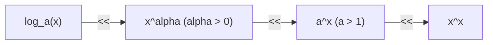

[[Home MOC|Home]] / [[Education & Learning]] / [[University]] / [[Lezione 18 - Gerarchie di Infiniti e Infinitesimi e Continuita I]]

# Lezione 18 - Gerarchie di Infiniti e Infinitesimi e Continuità (Parte I)

## Sintesi Esecutiva
Questa diciottesima lezione (Sapienza Università di Roma — a cura del prof. S. Salzo, 22 Ottobre 2026) introduce due argomenti cardinali dell'analisi: la <mark style="background:rgba(255, 193, 69, 0.32)"><b>gerarchia universale degli infiniti e degli infinitesimi</b></mark> e i fondamenti della <mark style="background:rgba(255, 193, 69, 0.32)"><b>teoria delle funzioni continue</b></mark>. Partendo dal limite $e^n/n \to +\infty$ stabilito nella lezione precedente, vengono estese e dimostrate con precisione le relazioni di confronto tra logaritmi, potenze con esponente reale $\alpha > 0$, esponenziali $a^x$ ($a > 1$) e la torre esponenziale $x^x$. Per le successioni viene introdotto e provato il <mark style="background:rgba(181, 113, 255, 0.36)"><b>Criterio del rapporto</b></mark>, grazie al quale si inseriscono nella catena gerarchica il fattoriale $n!$, la potenza ennesima $n^n$ e il fattoriale raddoppiato $(2n)!$. Nella seconda parte della lezione viene formalizzata la nozione di <mark style="background:rgba(255, 193, 69, 0.32)"><b>funzione continua</b></mark> sia in forma topologica (controimmagini di intorni) sia in formulazione metrica $\varepsilon$-$\delta$, provando che ogni funzione è banalmente continua nei punti isolati del suo dominio, mentre nei punti di accumulazione la continuità coincide col valore limite. Chiude la trattazione il <mark style="background:rgba(181, 113, 255, 0.36)"><b>Teorema di Cesàro</b></mark> per il calcolo di limiti con radici $n$-esime.

---

## 1. Gerarchia di Infiniti e Infinitesimi per Funzioni Reali

### Teorema della Gerarchia in $\mathbb{R}$

> [!IMPORTANT] Proposizione 1.1 (Gerarchia degli Infiniti ed Infinitesimi per Funzioni)
> Siano $a > 1$ e $\alpha > 0$. Valgono i seguenti limiti notevoli:
> - **(i)** $\lim_{x \to +\infty} \frac{a^x}{x^\alpha} = +\infty$
> - **(ii)** $\lim_{x \to -\infty} |x|^\alpha a^x = 0$
> - **(iii)** $\lim_{x \to +\infty} \frac{\log_a x}{x^\alpha} = 0$
> - **(iv)** $\lim_{x \to 0^+} x^\alpha \log_a x = 0$
> - **(v)** $\lim_{x \to +\infty} \frac{x^x}{a^x} = +\infty$

*Dimostrazione:*
- **Dimostrazione di (i):**
  1. *Caso base $a = e$ e $\alpha = 1$:* Per ogni $x > 0$ vale la disuguaglianza della parte intera $\lfloor x \rfloor \le x < \lfloor x \rfloor + 1$. Essendo la funzione esponenziale crescente:
$$e^{\lfloor x \rfloor} \le e^x \quad \text{e} \quad \frac{1}{\lfloor x \rfloor + 1} < \frac{1}{x} \implies \frac{e^{\lfloor x \rfloor}}{\lfloor x \rfloor + 1} \le \frac{e^x}{x}$$
  Ponendo $n = \lfloor x \rfloor \in \mathbb{N}$, per $x \to +\infty$ si ha $n \to +\infty$. Applicando il Teorema di composizione dei limiti e la Proposizione 3.1 della Lezione 17:
$$\lim_{x \to +\infty} \frac{e^{\lfloor x \rfloor}}{\lfloor x \rfloor + 1} = \lim_{n \to +\infty} \frac{e^n}{n+1} = \lim_{n \to +\infty} \left(\frac{e^n}{n} \cdot \frac{n}{n+1}\right) = (+\infty) \cdot 1 = +\infty$$
  Per il Teorema del confronto segue $\lim_{x \to +\infty} \frac{e^x}{x} = +\infty$.
  2. *Caso $a > 1$ e $\alpha = 1$:* Scriviamo $a^x = e^{x \ln a}$. Essendo $\ln a > 0$:
$$\frac{a^x}{x} = \frac{e^{x \ln a}}{x} = \ln a \cdot \frac{e^{x \ln a}}{x \ln a}$$
  Ponendo $y = x \ln a \to +\infty$, si ha $\lim_{x \to +\infty} \frac{a^x}{x} = \ln a \cdot \lim_{y \to +\infty} \frac{e^y}{y} = (\ln a) \cdot (+\infty) = +\infty$.
  3. *Caso generale $\alpha > 0$:* Scriviamo:
$$\frac{a^x}{x^\alpha} = \left(\frac{a^{x/\alpha}}{x}\right)^\alpha = \left(\frac{(a^{1/\alpha})^x}{x}\right)^\alpha$$
  Poiché $a > 1$ e $\alpha > 0$, risulta $a^{1/\alpha} > 1$. Dal punto precedente $\frac{(a^{1/\alpha})^x}{x} \to +\infty$, da cui per continuità della potenza $y^\alpha$ con $\alpha > 0$ segue che il limite è $+\infty$.
- **Dimostrazione di (ii):** Poniamo $y = -x$. Per $x \to -\infty$, si ha $y \to +\infty$, perciò:
$$\lim_{x \to -\infty} |x|^\alpha a^x = \lim_{y \to +\infty} y^\alpha a^{-y} = \lim_{y \to +\infty} \frac{y^\alpha}{a^y} = \lim_{y \to +\infty} \frac{1}{\frac{a^y}{y^\alpha}} = \frac{1}{+\infty} = 0$$
- **Dimostrazione di (iii):** Poniamo $y = \log_a x$, da cui $x = a^y$. Poiché $a > 1$, per $x \to +\infty$ si ha $y \to +\infty$. Allora:
$$\lim_{x \to +\infty} \frac{\log_a x}{x^\alpha} = \lim_{y \to +\infty} \frac{y}{(a^y)^\alpha} = \lim_{y \to +\infty} \frac{y}{(a^\alpha)^y} = 0$$
essendo $a^\alpha > 1$ e applicando il reciproco di (i) con esponente 1.
- **Dimostrazione di (iv):** Ponendo $y = 1/x \to +\infty$ per $x \to 0^+$, si ha:
$$\lim_{x \to 0^+} x^\alpha \log_a x = \lim_{y \to +\infty} \frac{\log_a(1/y)}{y^\alpha} = \lim_{y \to +\infty} \frac{-\log_a y}{y^\alpha} = 0$$
- **Dimostrazione di (v):** Scrivendo le basi in forma esponenziale:
$$\frac{x^x}{a^x} = \frac{e^{x \ln x}}{e^{x \ln a}} = e^{x(\ln x - \ln a)}$$
Poiché $\lim_{x \to +\infty} x(\ln x - \ln a) = (+\infty) \cdot (+\infty) = +\infty$, per continuità dell'esponenziale risulta $\lim_{x \to +\infty} e^{x(\ln x - \ln a)} = +\infty$. $\blacksquare$

> [!NOTE] Osservazione 1.2 (Catena di Infiniti per $x \to +\infty$)
> Dalla Proposizione 1.1 deriva la gerarchia canonica di trascurabilità locale per $x \to +\infty$:
> $$\log_a x \ll x^\alpha \ll a^x \ll x^x \qquad (a > 1, \, \alpha > 0)$$

---

## 2. Gerarchia per Successioni e Criterio del Rapporto

### Criterio del Rapporto per Successioni

> [!IMPORTANT] Proposizione 1.4 (Criterio del Rapporto per Successioni)
> Sia $(a_n)_{n \in \mathbb{N}}$ una successione reale a termini strettamente positivi ($a_n > 0$) e supponiamo che:
> $$\lim_{n \to +\infty} \frac{a_{n+1}}{a_n} = \ell \in [0, +\infty]$$
> Allora:
> $$\lim_{n \to +\infty} a_n = \begin{cases} +\infty & \text{se } \ell > 1 \\ 0 & \text{se } \ell < 1 \end{cases}$$
> *(Se $\ell = 1$ il criterio non fornisce informazioni).*

*Dimostrazione:*
1. **Caso $\ell < 1$:** Scegliamo un numero reale $q$ tale che $\ell < q < 1$. Per il Teorema della permanenza delle disuguaglianze applicato a $\frac{a_{n+1}}{a_n} \to \ell$, esiste un indice $\nu \in \mathbb{N}$ tale che per ogni $n > \nu$:
$$\frac{a_{n+1}}{a_n} < q \implies a_{n+1} < q a_n$$
Iterando tale disuguaglianza a ritroso per $n > \nu$:
$$a_n \le q a_{n-1} \le q^2 a_{n-2} \le \dots \le q^{n - \nu - 1} a_{\nu + 1} = \frac{a_{\nu + 1}}{q^{\nu + 1}} q^n$$
Poiché $0 < q < 1$, la successione geometrica $q^n \to 0$ per $n \to +\infty$. Essendo $a_n > 0$, per il Teorema dei carabinieri $a_n \to 0$.
2. **Caso $\ell > 1$:** Scegliamo $q$ tale che $1 < q < \ell$. Per la permanenza delle disuguaglianze, esiste un indice $\nu \in \mathbb{N}$ tale che per ogni $n > \nu$:
$$\frac{a_{n+1}}{a_n} > q \implies a_{n+1} > q a_n$$
Iterando: $a_n > \frac{a_{\nu+1}}{q^{\nu+1}} q^n$. Poiché $q > 1$, $q^n \to +\infty$, e per confronto diretto $a_n \to +\infty$. $\blacksquare$

### Inserimento di Fattoriali e Torri di Potenze

> [!IMPORTANT] Proposizione 1.5 (Limiti Notevoli di Fattoriali e Potenze)
> Valgono i seguenti limiti di divergenza per successioni:
> - **(i)** $\lim_{n \to +\infty} \frac{n!}{a^n} = +\infty \quad (\forall a > 1)$
> - **(ii)** $\lim_{n \to +\infty} \frac{n^n}{n!} = +\infty$
> - **(iii)** $\lim_{n \to +\infty} \frac{(2n)!}{n^n} = +\infty$

*Dimostrazione:*
- **Dimostrazione di (i):** Poniamo $b_n = \frac{n!}{a^n}$. Calcoliamo il rapporto:
$$\frac{b_{n+1}}{b_n} = \frac{(n+1)!}{a^{n+1}} \cdot \frac{a^n}{n!} = \frac{(n+1)n! \cdot a^n}{a \cdot a^n \cdot n!} = \frac{n+1}{a}$$
Poiché $\lim_{n \to +\infty} \frac{n+1}{a} = +\infty > 1$, per il Criterio del rapporto $b_n \to +\infty$.
- **Dimostrazione di (ii):** Poniamo $b_n = \frac{n^n}{n!}$. Allora:
$$\frac{b_{n+1}}{b_n} = \frac{(n+1)^{n+1}}{(n+1)!} \cdot \frac{n!}{n^n} = \frac{(n+1)(n+1)^n}{(n+1)n!} \cdot \frac{n!}{n^n} = \left(\frac{n+1}{n}\right)^n = \left(1 + \frac{1}{n}\right)^n$$
Poiché $\lim_{n \to +\infty} (1 + 1/n)^n = e \approx 2.718 > 1$, per il Criterio del rapporto $b_n \to +\infty$.
- **Dimostrazione di (iii):** Poniamo $b_n = \frac{(2n)!}{n^n}$. Allora:
$$\frac{b_{n+1}}{b_n} = \frac{(2n+2)!}{(n+1)^{n+1}} \cdot \frac{n^n}{(2n)!} = \frac{(2n+2)(2n+1)(2n)!}{(n+1)(n+1)^n} \cdot \frac{n^n}{(2n)!} = \frac{2(n+1)(2n+1)}{n+1} \cdot \left(\frac{n}{n+1}\right)^n = 2(2n+1) \cdot \frac{1}{\left(1 + \frac{1}{n}\right)^n}$$
Passando al limite:
$$\lim_{n \to +\infty} \frac{b_{n+1}}{b_n} = \lim_{n \to +\infty} \left[2(2n+1) \cdot \frac{1}{(1 + 1/n)^n}\right] = (+\infty) \cdot \frac{1}{e} = +\infty > 1$$
Dunque $b_n \to +\infty$. $\blacksquare$

> [!NOTE] Osservazione 1.6 (Gerarchia Completa per Successioni)
> Riassumendo, per $n \to +\infty$ vale la catena d'ordine:
> $$\log_a n \ll n^\alpha \ll a^n \ll n! \ll n^n \ll (2n)! \qquad (a > 1, \, \alpha > 0)$$

---

## 3. Teoria delle Funzioni Continue (Parte I)

### Definizione Topologica e Metrica

> [!IMPORTANT] Definizione 2.1 (Funzione Continua)
> Sia $f: A \subset \mathbb{R} \to \mathbb{R}$ e sia $x_0 \in A$.
> - Si dice che $f$ è **continua in $x_0$** se:
>   $$\forall V \in \mathcal{U}(f(x_0)), \quad \exists U \in \mathcal{U}(x_0) : \quad f(U \cap A) \subset V$$
> - Se $f$ è continua in ogni punto di un sottoinsieme $B \subset A$, si dice che $f$ è *continua in $B$*.
> - La funzione $f$ si dice semplicemente **continua** se è continua su tutto il suo dominio $A$.

> [!NOTE] Osservazione 2.2 (Formulazione Metrica $\varepsilon$-$\delta$)
> Fissando gli intorni euclidei $V = ]f(x_0) - \varepsilon, f(x_0) + \varepsilon[$ e $U = ]x_0 - \delta, x_0 + \delta[$:
> $$\forall \varepsilon > 0, \quad \exists \delta > 0 : \quad \forall x \in A, \, |x - x_0| < \delta \implies |f(x) - f(x_0)| < \varepsilon$$

### Continuità nei Punti Isolati e di Accumulazione

> [!IMPORTANT] Proposizione 2.3 (Caratterizzazione Topologica della Continuità)
> Sia $f: A \subset \mathbb{R} \to \mathbb{R}$ e sia $x_0 \in A$.
> - **(i)** Se $x_0$ è un **punto isolato** di $A$, allora $f$ è **sempre continua** in $x_0$.
> - **(ii)** Se $x_0$ è un **punto di accumulazione** per $A$, allora:
>   $$f \text{ è continua in } x_0 \iff \lim_{x \to x_0} f(x) = f(x_0)$$

*Dimostrazione:*
- **Dimostrazione di (i):** Se $x_0$ è isolato per $A$, per definizione esiste un intorno $U \in \mathcal{U}(x_0)$ tale che $U \cap A = \{x_0\}$. Ne segue che per ogni intorno $V \in \mathcal{U}(f(x_0))$:
$$f(U \cap A) = f(\{x_0\}) = \{f(x_0)\} \subset V$$
La definizione di continuità è quindi banalmente soddisfatta per ogni $V$.
- **Dimostrazione di (ii):** Se $x_0 \in A$ è punto di accumulazione per $A$, ogni intorno $V$ di $f(x_0)$ contiene già $f(x_0)$. Pertanto:
$$f(U \cap A) \subset V \iff f(U \cap A \setminus \{x_0\}) \subset V$$
che coincide per definizione con la convergenza del limite funzionale $\lim_{x \to x_0} f(x) = f(x_0)$. $\blacksquare$

---

## 4. Complementi: Il Teorema di Cesàro sulla Radice $n$-esima

> [!IMPORTANT] Teorema 3.1 (Di Cesàro per la Radice $n$-esima)
> Sia $(a_n)_{n \in \mathbb{N}}$ una successione reale a termini strettamente positivi ($a_n > 0$). Supponiamo che:
> $$\lim_{n \to +\infty} \frac{a_{n+1}}{a_n} = \ell \in [0, +\infty]$$
> Allora:
> $$\lim_{n \to +\infty} \sqrt[n]{a_n} = \ell$$

### Applicazioni Notevoli (Esempi 3.2)
- **(i)** Limite di $\lim_{n \to +\infty} \sqrt[n]{n^\alpha}$ ($\alpha > 0$):
  Ponendo $a_n = n^\alpha$, si ha $\frac{a_{n+1}}{a_n} = \left(1 + \frac{1}{n}\right)^\alpha \to 1 \implies \lim_{n \to +\infty} \sqrt[n]{n^\alpha} = 1$.
- **(ii)** Limite di $\lim_{n \to +\infty} \sqrt[n]{\binom{2n}{n}}$:
  Ponendo $a_n = \binom{2n}{n} = \frac{(2n)!}{(n!)^2}$, il rapporto è $\frac{a_{n+1}}{a_n} = \frac{(2n+2)(2n+1)}{(n+1)^2} \to 4 \implies \lim \sqrt[n]{\binom{2n}{n}} = 4$.
- **(iii)** Limite notevole della radice di Stirling $\lim_{n \to +\infty} \frac{n}{\sqrt[n]{n!}}$:
  Riscrivendo come $\lim \sqrt[n]{\frac{n^n}{n!}}$ e ponendo $a_n = \frac{n^n}{n!}$, si ha $\frac{a_{n+1}}{a_n} = \left(1 + \frac{1}{n}\right)^n \to e \implies \lim_{n \to +\infty} \frac{n}{\sqrt[n]{n!}} = e$.

> [!WARNING] Osservazione 3.3 (Il Viceversa non Sussiste)
> L'esistenza del limite della radice $n$-esima non implica l'esistenza del limite del rapporto.
> Controesempio: fissato $q > 0$ con $q \neq 1$, si consideri la successione oscillatoria:
> $$a_n = \begin{cases} q^n & \text{se } n \text{ è pari} \\ 2q^n & \text{se } n \text{ è dispari} \end{cases}$$
> Il rapporto $\frac{a_{n+1}}{a_n}$ vale $2q$ per $n$ pari e $\frac{1}{2}q$ per $n$ dispari (dunque non converge), mentre la radice $n$-esima $\sqrt[n]{a_n}$ tende univocamente a $q$ poiché $\sqrt[n]{2} \to 1$.
