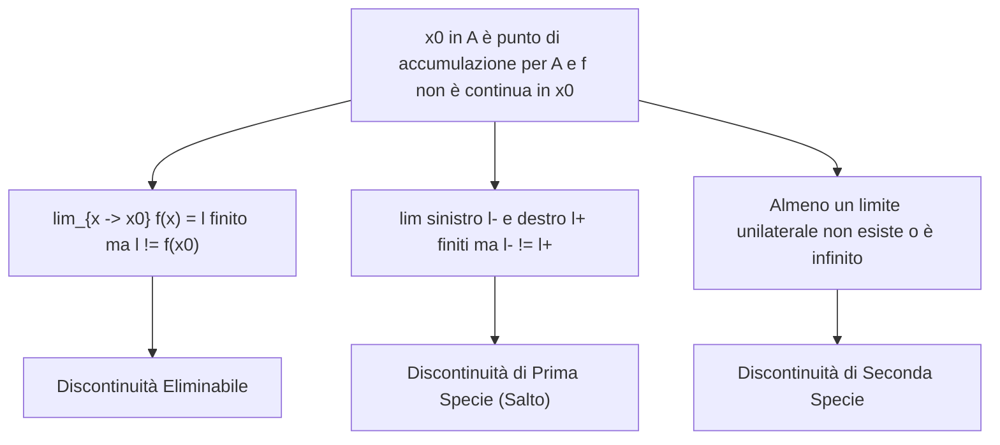

[[Home MOC|Home]] / [[Education & Learning]] / [[University]] / [[Lezione 19 - Funzioni Continue e Punti di Discontinuita]]

# Lezione 19 - Funzioni Continue e Punti di Discontinuità

## Sintesi Esecutiva
Questa diciannovesima lezione (Sapienza Università di Roma — a cura del prof. S. Salzo, 23 Ottobre 2026) sviluppa la struttura globale delle funzioni continue e approfondisce la tassonomia rigorosa delle loro singolarità. Viene analizzata l'<mark style="background:rgba(255, 193, 69, 0.32)"><b>algebra dello spazio $\mathcal{C}(A)$</b></mark>, dimostrando che l'insieme delle funzioni continue costituisce un'algebra reticolata stabile rispetto a combinazioni lineari, prodotti, rapporti, valore assoluto e operazioni di estremo $\max\{f, g\}$ e $\min\{f, g\}$. Si introduce la classe fondamentale delle <mark style="background:rgba(255, 193, 69, 0.32)"><b>funzioni Lipschitziane</b></mark>, provando che ogni mappa lipschitziana è uniformemente continua e applicando tale proprietà a seno e coseno mediante le formule di prostaferesi. Vengono poi enunciati e dimostrati il <mark style="background:rgba(181, 113, 255, 0.36)"><b>Teorema sulla continuità della funzione composta</b></mark> e il <mark style="background:rgba(181, 113, 255, 0.36)"><b>Teorema di prolungamento per continuità</b></mark>. La seconda parte della lezione introduce la classificazione sistematica dei <mark style="background:rgba(255, 193, 69, 0.32)"><b>punti di discontinuità</b></mark> (eliminabili, di prima specie o salto, e di seconda specie), esaminando casi storici e controesempi rilevanti: la parte intera, la funzione oscillatoria $\sin(1/x)$, l'esponenziale asimmetrico $e^{1/x}$ e la funzione ovunque discontinua di Dirichlet.

---

## 1. Algebra delle Funzioni Continue e Spazio $\mathcal{C}(A)$

### Operazioni Algebriche e Reticolari

> [!IMPORTANT] Teorema 1.2 (Algebra delle Funzioni Continue)
> Siano $A \subset \mathbb{R}$, $x_0 \in A$ e siano $f, g: A \to \mathbb{R}$ continue in $x_0$. Allora:
> - **(i)** $f + g$ è continua in $x_0$.
> - **(ii)** $f \cdot g$ è continua in $x_0$.
> - **(iii)** Se $g(x) \neq 0$ per ogni $x \in A$, allora $f/g$ è continua in $x_0$.
> - **(iv)** $|f|$ è continua in $x_0$.
> - **(v)** $f \vee g = \max\{f, g\}$ e $f \wedge g = \min\{f, g\}$ sono continue in $x_0$.
> - **(vi)** Se $x_0 \in B \subset A$, allora la restrizione $f|_B$ è continua in $x_0$.

Per dimostrare la proprietà reticolare (v), è indispensabile il seguente lemma di scomposizione:

> [!NOTE] Lemma 1.3 (Rappresentazione di Max e Min)
> Per ogni coppia di numeri reali $a, b \in \mathbb{R}$:
> $$\max\{a, b\} = \frac{a + b + |a - b|}{2}, \qquad \min\{a, b\} = \frac{a + b - |a - b|}{2}$$

*Dimostrazione del Lemma:*
- Se $a \le b$, allora $|a - b| = -(a - b) = b - a$. Sostituendo:
$$\frac{a + b + (b - a)}{2} = \frac{2b}{2} = b = \max\{a, b\}, \qquad \frac{a + b - (b - a)}{2} = \frac{2a}{2} = a = \min\{a, b\}$$
- Se $a \ge b$, allora $|a - b| = a - b$. Sostituendo:
$$\frac{a + b + (a - b)}{2} = \frac{2a}{2} = a = \max\{a, b\}, \qquad \frac{a + b - (a - b)}{2} = \frac{2b}{2} = b = \min\{a, b\} \quad \blacksquare$$

*Dimostrazione del Teorema 1.2:*
- Per i punti (i)–(iv) e (vi): se $x_0$ è punto isolato di $A$, qualsiasi funzione è continua in $x_0$. Se $x_0$ è punto di accumulazione, la continuità equivale al passaggio al limite $\lim_{x \to x_0} f(x) = f(x_0)$ e $\lim_{x \to x_0} g(x) = g(x_0)$; la tesi discende direttamente dai teoremi sulle operazioni algebriche dei limiti e dalla continuità del valore assoluto.
- Per il punto (v): applicando il Lemma 1.3 punto per punto:
$$(f \vee g)(x) = \frac{f(x) + g(x) + |f(x) - g(x)|}{2}, \qquad (f \wedge g)(x) = \frac{f(x) + g(x) - |f(x) - g(x)|}{2}$$
Poiché $f$ e $g$ sono continue, la loro differenza $f - g$ è continua, il valore assoluto $|f - g|$ è continuo, e la combinazione lineare è continua. Dunque $f \vee g$ e $f \wedge g$ sono continue in $x_0$. $\blacksquare$

> [!NOTE] Definizione 1.4 e Osservazione 1.5 (Struttura dello Spazio $\mathcal{C}(A)$)
> L'insieme delle funzioni continue su $A$:
> $$\mathcal{C}(A) = \{f: A \to \mathbb{R} \mid f \text{ è continua su } A\}$$
> possiede la struttura di **spazio vettoriale reale** (rispetto a somma e prodotto scalare), di **algebra reale** (rispetto al prodotto di funzioni) e di **algebra reticolata** (rispetto alle operazioni reticolari $\vee$ e $\wedge$).

---

## 2. Funzioni Lipschitziane

> [!IMPORTANT] Definizione 1.6 (Funzione Lipschitziana)
> Una funzione $f: A \subset \mathbb{R} \to \mathbb{R}$ si dice **Lipschitziana** se esiste una costante reale $L > 0$ tale che:
> $$\forall x, y \in A: \quad |f(x) - f(y)| \le L |x - y|$$
> La costante $L$ si chiama *costante di Lipschitz* di $f$.

> [!IMPORTANT] Proposizione 1.7 (La Lipschitzianità Implica la Continuità)
> Ogni funzione Lipschitziana $f: A \to \mathbb{R}$ è continua su $A$.

*Dimostrazione:*
Fissiamo $x_0 \in A$. Per ogni $\varepsilon > 0$, scegliamo $\delta = \frac{\varepsilon}{L} > 0$.
Allora, per ogni $x \in A$ tale che $|x - x_0| < \delta$, dalla condizione di Lipschitz segue:
$$|f(x) - f(x_0)| \le L |x - x_0| < L \cdot \frac{\varepsilon}{L} = \varepsilon$$
La definizione metrica $\varepsilon$-$\delta$ di continuità è soddisfatta in ogni punto $x_0 \in A$. $\blacksquare$

### Lipschitzianità di Seno, Coseno e Valore Assoluto

> [!NOTE] Esempi 1.8 (Seno, Coseno e Modulo sono 1-Lipschitziani)
> - **Seno e Coseno:** Dalle formule di prostaferesi:
>   $$\sin x - \sin y = 2 \cos\left(\frac{x+y}{2}\right) \sin\left(\frac{x-y}{2}\right)$$
>   Poiché $|\cos \theta| \le 1$ e $|\sin t| \le |t|$ per ogni $t \in \mathbb{R}$:
>   $$|\sin x - \sin y| = 2 \left|\cos\left(\frac{x+y}{2}\right)\right| \left|\sin\left(\frac{x-y}{2}\right)\right| \le 2 \cdot 1 \cdot \left|\frac{x-y}{2}\right| = |x - y|$$
>   In modo analogo $|\cos x - \cos y| \le |x - y|$. Pertanto $\sin$ e $\cos$ sono Lipschitziane con costante $L = 1$, dunque continue su $\mathbb{R}$.
> - **Valore Assoluto:** Dalla disuguaglianza triangolare inversa:
>   $$\big||x| - |y|\big| \le |x - y|$$
>   il valore assoluto è Lipschitziano con $L = 1$, quindi continuo su $\mathbb{R}$.

---

## 3. Composizione e Prolungamento per Continuità

### Continuità delle Funzioni Composte

> [!IMPORTANT] Teorema 1.9 (Continuità delle Funzioni Composte)
> Siano $A, B \subset \mathbb{R}$ non vuoti, $f: A \to B$ e $g: B \to \mathbb{R}$. Sia $x_0 \in A$.
> $$f \text{ continua in } x_0 \quad \land \quad g \text{ continua in } f(x_0) \implies g \circ f \text{ è continua in } x_0$$

*Dimostrazione:*
Sia $W \in \mathcal{U}(g(f(x_0)))$.
1. Essendo $g$ continua in $f(x_0)$, esiste un intorno $V \in \mathcal{U}(f(x_0))$ tale che $y \in V \cap B \implies g(y) \in W$.
2. Essendo $f$ continua in $x_0$, in corrispondenza dell'intorno $V$ esiste un intorno $U \in \mathcal{U}(x_0)$ tale che $x \in U \cap A \implies f(x) \in V$.
3. Poiché per ipotesi $f(A) \subset B$, per ogni $x \in U \cap A$ si ha $f(x) \in V \cap B$, da cui $g(f(x)) \in W$.
Ciò prova che $g \circ f$ è continua in $x_0$. $\blacksquare$

> [!NOTE] Osservazione 1.10 (Limite di Funzione Composta con Funzione Esterna Continua)
> Se $\lim_{x \to x_0} f(x) = y_0 \in B$ e la funzione esterna $g$ è continua in $y_0$, allora:
> $$\lim_{x \to x_0} g(f(x)) = g(y_0)$$
> In questo caso fondamentale, **non è richiesta** la condizione $f(x) \neq y_0$.

### Teorema del Prolungamento Continuo

> [!IMPORTANT] Teorema 1.11 (Di Prolungamento per Continuità)
> Sia $A \subset \mathbb{R}$ un insieme non vuoto e $f: A \to \mathbb{R}$ una funzione continua. Sia $B \subset \mathbb{R}$ tale che:
> - **(i)** $A \subset B \subset A \cup D_r(A)$ (dove $D_r(A)$ è l'insieme dei punti di accumulazione finiti di $A$);
> - **(ii)** Per ogni $x_0 \in B \setminus A$, esiste finito il limite $\lim_{x \to x_0} f(x) \in \mathbb{R}$.
>
> Allora esiste uno ed un solo prolungamento continuo $\overline{f}: B \to \mathbb{R}$ tale che $\overline{f}|_A = f$, definito esplicitamente da:
> $$\overline{f}(x) = \begin{cases} f(x) & \text{se } x \in A \\ \lim_{y \to x} f(y) & \text{se } x \in B \setminus A \end{cases}$$

---

## 4. Classificazione dei Punti di Discontinuità

> [!IMPORTANT] Definizione 2.1 (Tassonomia dei Punti di Discontinuità)
> Sia $f: A \to \mathbb{R}$ e sia $x_0 \in A$. Si dice che $x_0$ è un **punto di discontinuità** per $f$ se $f$ non è continua in $x_0$.
> Poiché nei punti isolati ogni funzione è continua, $x_0$ deve necessariamente essere un **punto di accumulazione** per $A$. Si distinguono tre specie:
> 1. **Discontinuità Eliminabile:**
>    Esiste finito il limite bilaterale $\lim_{x \to x_0} f(x) = \ell \in \mathbb{R}$, ma $\ell \neq f(x_0)$. La discontinuità si elimina ridefinendo il valore nel punto ponendo $f(x_0) := \ell$.
> 2. **Discontinuità di Prima Specie (o di Salto):**
>    $x_0$ è di accumulazione da destra e sinistra ed esistono finiti entrambi i limiti unilaterali:
>    $$\lim_{x \to x_0^-} f(x) = \ell^- \in \mathbb{R}, \qquad \lim_{x \to x_0^+} f(x) = \ell^+ \in \mathbb{R} \quad \text{con } \ell^- \neq \ell^+$$
>    La differenza $s = \ell^+ - \ell^-$ si chiama **salto** della funzione in $x_0$.
> 3. **Discontinuità di Seconda Specie:**
>    Si ha quando non si verificano i casi precedenti, ossia quando **almeno uno dei due limiti unilaterali** non esiste oppure è infinito ($\pm\infty$).

> [!WARNING] Osservazione 2.2 (Il Punto Deve Appartenere al Dominio)
> Per parlare rigorosamente di continuità o discontinuità di $f$ in $x_0$, il punto **deve appartenere al dominio $A$**.
> Ad esempio, $f(x) = 1/x$ definita su $\mathbb{R}^*$ **non è discontinua** in $x_0 = 0$: semplicemente $0 \notin \text{dom}(f)$ e non ha senso valutarvi la continuità.

### Casi Studio e Funzioni Patologiche (Esempi 2.3)
1. **Parte Intera $f(x) = \lfloor x \rfloor$:** Per ogni $k \in \mathbb{Z}$, si ha $\lim_{x \to k^-} \lfloor x \rfloor = k - 1$ e $\lim_{x \to k^+} \lfloor x \rfloor = k$. I punti di $\mathbb{Z}$ sono **discontinuità di prima specie** con salto costante $s = k - (k - 1) = 1$.
2. **Funzione Oscillatoria $\sin(1/x)$ con $f(0) = 0$:** Le successioni $x_k = \frac{1}{\pi/2 + 2k\pi} \to 0^+$ (in cui $\sin(1/x_k) = 1$) e $y_k = \frac{1}{-\pi/2 + 2k\pi} \to 0^+$ (in cui $\sin(1/y_k) = -1$) provano che **non esistono** né il limite destro né il limite sinistro. Il punto $x_0 = 0$ è una **discontinuità di seconda specie per oscillazione**.
3. **Funzione di Dirichlet:**
$$f(x) = \begin{cases} 1 & \text{se } x \in \mathbb{Q} \\ 0 & \text{se } x \in \mathbb{R} \setminus \mathbb{Q} \end{cases}$$
   Per la densità simultanea di razionali e irrazionali, in ogni intorno di qualunque $x_0 \in \mathbb{R}$ la funzione assume sia il valore 1 sia il valore 0. Dunque in **ogni punto reale** non esistono i limiti unilaterali: la funzione è **ovunque discontinua con discontinuità di seconda specie**.
4. **Esponenziale Inverso $f(x) = e^{1/x}$ per $x \neq 0$ con $f(0) = 0$:**
$$\lim_{x \to 0^+} e^{1/x} = +\infty, \qquad \lim_{x \to 0^-} e^{1/x} = 0 = f(0)$$
   Essendo il limite destro infinito, $x_0 = 0$ è una **discontinuità di seconda specie**.
