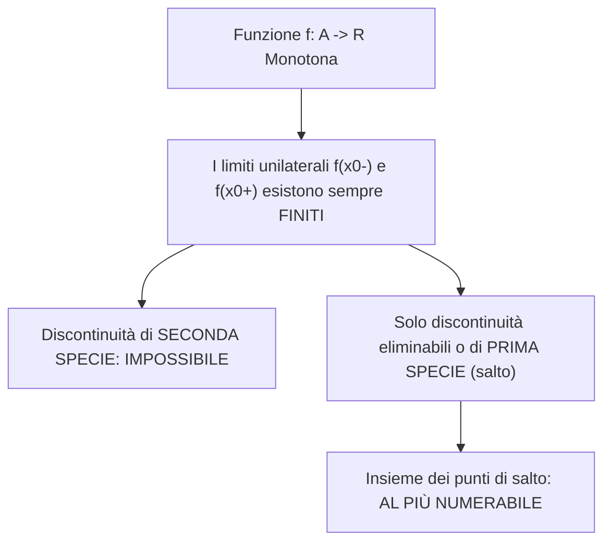

[[Home MOC|Home]] / [[Education & Learning]] / [[University]] / [[Lezione 20 - Continuita delle Funzioni Monotone e Limiti Notevoli]]

# Lezione 20 - Continuità delle Funzioni Monotone e Limiti Notevoli

## Sintesi Esecutiva
Questa ventesima lezione (Sapienza Università di Roma — a cura del prof. S. Salzo, 27 Ottobre 2026) completa lo studio della continuità per classi speciali di funzioni e costruisce il repertorio analitico fondamentale di tutti i <mark style="background:rgba(255, 193, 69, 0.32)"><b>limiti notevoli trascendenti</b></mark>. Nella prima parte viene esaminata la regolarità delle <mark style="background:rgba(255, 193, 69, 0.32)"><b>funzioni monotone</b></mark>: si dimostra che i limiti unilaterali esistono sempre finiti, impedendo tassativamente l'insorgenza di discontinuità di seconda specie, e si dimostra il fondamentale <mark style="background:rgba(181, 113, 255, 0.36)"><b>Teorema dell'immagine intervallo</b></mark> (se l'immagine di una funzione monotona è un intervallo, la funzione è necessariamente continua su tutto il dominio). Tale risultato stabilisce rigorosamente la continuità globale di esponenziali, logaritmi, potenze reali e funzioni iperboliche. Nella seconda parte della lezione, partendo dalla definizione di Nepero, vengono provati in sequenza tutti i limiti notevoli per $x \to \pm\infty$ e $x \to 0$ con relative dimostrazioni deduttive formali: le forme potenze-esponenziali che generano il numero $e$ e sue varianti, il limite del logaritmo, dell'esponenziale con base qualsiasi, della potenza binomia reale $(1+x)^\alpha - 1$, nonché i limiti trigonometrici per $1 - \cos x$ e $\tan x$. Infine, tali limiti vengono tradotti nel quadro operativo delle <mark style="background:rgba(255, 193, 69, 0.32)"><b>stime e sviluppi asintotici al primo ordine</b></mark> per $x \to 0$.

---

## 1. Continuità delle Funzioni Monotone

### Limiti Unilaterali e Tassonomia delle Singolarità

Sia $f: A \to \mathbb{R}$ una funzione monotona crescente e sia $x_0 \in A$.
Se $x_0$ è punto isolato di $A$, $f$ è automaticamente continua in $x_0$.
Se $x_0$ è punto di accumulazione per $A$, dal teorema sui limiti delle funzioni monotone discende che i limiti unilaterali esistono sempre finiti:
$$f(x_0^-) = \sup_{\substack{x \in A \\ x < x_0}} f(x), \qquad f(x_0^+) = \inf_{\substack{x \in A \\ x > x_0}} f(x)$$
Si presentano tre casistiche topologiche:
- **(i) $x_0$ accumulazione solo a sinistra:** $f(x_0^-) \le f(x_0)$; $f$ è continua in $x_0 \iff f(x_0^-) = f(x_0)$.
- **(ii) $x_0$ accumulazione solo a destra:** $f(x_0) \le f(x_0^+)$; $f$ è continua in $x_0 \iff f(x_0^+) = f(x_0)$.
- **(iii) $x_0$ accumulazione bilaterale:** $f(x_0^-) \le f(x_0) \le f(x_0^+)$; $f$ è continua in $x_0 \iff f(x_0^-) = f(x_0^+)$.

> [!IMPORTANT] Osservazione 1.1 e 1.2 (Regolarità delle Funzioni Monotone)
> - I punti di discontinuità di una funzione monotona possono essere **esclusivamente eliminabili o di prima specie (di salto)**. Non possono mai esistere discontinuità di seconda specie (né per divergenza né per oscillazione).
> - L'insieme dei punti di discontinuità di una qualsiasi funzione monotona è **al più numerabile** (finito o equipotente a $\mathbb{N}$).

### Teorema dell'Immagine Intervallo

> [!IMPORTANT] Teorema 1.4 (Continuità per Immagine Intervallo)
> Sia $f: A \to \mathbb{R}$ una funzione monotona. Se l'immagine $f(A)$ è un intervallo di $\mathbb{R}$, allora $f$ è continua su $A$.

*Dimostrazione:*
Ricordiamo la proprietà caratteristica degli intervalli di $\mathbb{R}$:
$$\forall y_1, y_2 \in I, \quad y_1 < y_2 \land y_1 < y < y_2 \implies y \in I$$
Supponiamo senza perdita di generalità che $f$ sia crescente e sia $x_0 \in A$.
Supponiamo per assurdo che $f$ non sia continua a sinistra in $x_0$, ovvero che $x_0$ sia di accumulazione a sinistra e che:
$$f(x_0^-) = \sup_{\substack{x \in A \\ x < x_0}} f(x) < f(x_0)$$
Dalla monotonia di $f$, per ogni $x \in A$ si ha:
$$x < x_0 \implies f(x) \le f(x_0^-) \quad \text{e} \quad x \ge x_0 \implies f(x) \ge f(x_0)$$
Scegliamo un punto $x_1 \in A$ con $x_1 < x_0$. Poniamo $y_1 = f(x_1)$ e $y_0 = f(x_0)$. Poiché $y_1 \le f(x_0^-) < f(x_0) = y_0$, sia $y_1$ sia $y_0$ appartengono a $f(A)$.
Tuttavia, per la proprietà di sopra, nessun elemento dell'intervallo aperto $]f(x_0^-), f(x_0)[$ può appartenere a $f(A)$, poiché nessun valore di $f(x)$ cade tra $f(x_0^-)$ e $f(x_0)$.
Ciò contraddice il fatto che $f(A)$ sia un intervallo.
Dunque deve essere $f(x_0^-) = f(x_0)$. In modo speculare si prova che $f(x_0^+) = f(x_0)$, provando che $f$ è continua in ogni punto $x_0 \in A$. $\blacksquare$

> [!NOTE] Esempio 1.5 (Continuità delle Funzioni Elementari Invertibili)
> Dal Teorema 1.4 discende immediatamente la continuità di tutte le funzioni elementari:
> - **Esponenziali e Logaritmi:** Per ogni $a > 0$, $\exp_a: \mathbb{R} \to ]0, +\infty[$ e $\log_a: ]0, +\infty[ \to \mathbb{R}$ sono strettamente monotone e le loro immagini sono intervalli. Dunque sono **continue sui rispettivi domini**.
> - **Potenze Reali:** Per ogni $\alpha \neq 0$, la funzione $x \mapsto x^\alpha$ ha come immagine un intervallo ed è strettamente monotona, quindi è **continua**.
> - **Funzioni Iperboliche:** $\sinh: \mathbb{R} \to \mathbb{R}$ e $\tanh: \mathbb{R} \to ]-1, 1[$ sono strettamente crescenti con immagine intervallo, dunque continue su $\mathbb{R}$. La funzione $\cosh: \mathbb{R} \to [1, +\infty[$ è continua poiché le sue restrizioni a $\mathbb{R}^+$ e $\mathbb{R}^-$ sono strettamente monotone con immagine intervallo $[1, +\infty[$.

---

## 2. Deduzione e Dimostrazione dei Limiti Notevoli

### Limite 1: Generazione del Numero di Nepero $e$

> [!IMPORTANT] Teorema (Limite Notevole 1)
> Vale il seguente limite fondamentale per $x \to \pm\infty$:
> $$\lim_{x \to \pm\infty} \left(1 + \frac{1}{x}\right)^x = e$$

*Dimostrazione:*
Il dominio è $]-\infty, -1[ \cup ]0, +\infty[$.
1. **Caso $x \to +\infty$:**
   Per ogni $x \ge 1$, dalla proprietà della parte intera $\lfloor x \rfloor \le x < \lfloor x \rfloor + 1$:
$$1 + \frac{1}{\lfloor x \rfloor + 1} < 1 + \frac{1}{x} \le 1 + \frac{1}{\lfloor x \rfloor}$$
   Per la monotonia dell'elevamento a potenza con base ed esponente positivi:
$$\left(1 + \frac{1}{\lfloor x \rfloor + 1}\right)^{\lfloor x \rfloor} < \left(1 + \frac{1}{x}\right)^x \le \left(1 + \frac{1}{\lfloor x \rfloor}\right)^{\lfloor x \rfloor + 1}$$
   Ponendo $n = \lfloor x \rfloor \in \mathbb{N}$ e calcolando i limiti delle successioni agli estremi per $n \to +\infty$:
$$\lim_{n \to +\infty} \left(1 + \frac{1}{n+1}\right)^n = \lim_{n \to +\infty} \left[\left(1 + \frac{1}{n+1}\right)^{n+1} \cdot \left(1 + \frac{1}{n+1}\right)^{-1}\right] = e \cdot 1 = e$$
$$\lim_{n \to +\infty} \left(1 + \frac{1}{n}\right)^{n+1} = \lim_{n \to +\infty} \left[\left(1 + \frac{1}{n}\right)^n \cdot \left(1 + \frac{1}{n}\right)\right] = e \cdot 1 = e$$
   Per il Teorema dei carabinieri, risulta $\lim_{x \to +\infty} \left(1 + \frac{1}{x}\right)^x = e$.
2. **Caso $x \to -\infty$:**
   Per $x < -1$, poniamo $x = -|x|$. Riscrivendo la frazione:
$$\left(1 + \frac{1}{x}\right)^x = \left(1 - \frac{1}{|x|}\right)^{-|x|} = \left(\frac{|x|-1}{|x|}\right)^{-|x|} = \left(\frac{|x|}{|x|-1}\right)^{|x|} = \left(1 + \frac{1}{|x|-1}\right)^{|x|-1} \cdot \left(1 + \frac{1}{|x|-1}\right)$$
   Ponendo $y = |x| - 1 \to +\infty$ per $x \to -\infty$, applicando il limite a $+\infty$:
$$\lim_{x \to -\infty} \left(1 + \frac{1}{x}\right)^x = \lim_{y \to +\infty} \left[\left(1 + \frac{1}{y}\right)^y \cdot \left(1 + \frac{1}{y}\right)\right] = e \cdot 1 = e \quad \blacksquare$$

---

### Limite 2: Potenza con Parametro ed Esponente Infinitesimo

> [!IMPORTANT] Teorema (Limite Notevole 2)
> Per ogni parametro $p \in \mathbb{R}$:
> $$\lim_{x \to \pm\infty} \left(1 + \frac{p}{x}\right)^x = e^p \qquad \text{e} \qquad \lim_{x \to 0} (1 + px)^{1/x} = e^p$$

*Dimostrazione:*
Se $p = 0$ i limiti sono banali ($1^x = 1 = e^0$).
Sia $p \neq 0$. Ponendo $y = x/p$, per $x \to \pm\infty$ si ha $y \to \pm\infty \cdot \text{sgn}(p) = \pm\infty$. Riscrivendo:
$$\lim_{x \to \pm\infty} \left(1 + \frac{p}{x}\right)^x = \lim_{x \to \pm\infty} \left[\left(1 + \frac{1}{x/p}\right)^{x/p}\right]^p = \lim_{y \to \pm\infty} \left[\left(1 + \frac{1}{y}\right)^y\right]^p = e^p$$
Per il secondo limite, ponendo $y = 1/x$, per $x \to 0^\pm$ si ha $y \to \pm\infty$:
$$\lim_{x \to 0} (1 + px)^{1/x} = \lim_{y \to \pm\infty} \left(1 + \frac{p}{y}\right)^y = e^p \quad \blacksquare$$

---

### Limite 3: Limite Notevole del Logaritmo

> [!IMPORTANT] Teorema (Limite Notevole 3)
> Sia $a > 0$ con $a \neq 1$. Allora:
> $$\lim_{x \to 0} \frac{\log_a(1 + x)}{x} = \log_a e = \frac{1}{\ln a}$$
> In particolare, per base naturale $a = e$:
> $$\lim_{x \to 0} \frac{\ln(1 + x)}{x} = 1$$

*Dimostrazione:*
Dalle proprietà algebriche dei logaritmi:
$$\frac{\log_a(1 + x)}{x} = \frac{1}{x} \cdot \log_a(1 + x) = \log_a\left[(1 + x)^{1/x}\right]$$
Poiché $\lim_{x \to 0} (1 + x)^{1/x} = e$ (dal Limite Notevole 2 con $p=1$) e la funzione $\log_a$ è continua su $\mathbb{R}^+$, applicando il Teorema di composizione dei limiti con funzione esterna continua:
$$\lim_{x \to 0} \frac{\log_a(1 + x)}{x} = \lim_{y \to e} \log_a y = \log_a e \quad \blacksquare$$

---

### Limite 4: Limite Notevole dell'Esponenziale

> [!IMPORTANT] Teorema (Limite Notevole 4)
> Sia $a > 0$. Allora:
> $$\lim_{x \to 0} \frac{a^x - 1}{x} = \ln a$$
> In particolare, per base naturale $a = e$:
> $$\lim_{x \to 0} \frac{e^x - 1}{x} = 1$$

*Dimostrazione:*
Se $a = 1$ il numeratore è identicamente nullo e $\ln 1 = 0$.
Sia $a \neq 1$. Effettuiamo la sostituzione $y = a^x - 1$.
Allora $a^x = 1 + y \iff x = \log_a(1 + y)$.
Poiché $a^x$ è continua, per $x \to 0$ si ha $y \to a^0 - 1 = 0$ (e $y \neq 0$ per $x \neq 0$).
Sostituendo:
$$\lim_{x \to 0} \frac{a^x - 1}{x} = \lim_{y \to 0} \frac{y}{\log_a(1 + y)} = \lim_{y \to 0} \frac{1}{\frac{\log_a(1 + y)}{y}} = \frac{1}{\log_a e} = \ln a \quad \blacksquare$$

---

### Limite 5: Limite Notevole della Potenza Reale

> [!IMPORTANT] Teorema (Limite Notevole 5)
> Per ogni esponente reale $\alpha \in \mathbb{R}$:
> $$\lim_{x \to 0} \frac{(1 + x)^\alpha - 1}{x} = \alpha$$

*Dimostrazione:*
Riscriviamo il numeratore sfruttando l'identità esponenziale $(1 + x)^\alpha = e^{\alpha \ln(1 + x)}$:
$$\frac{(1 + x)^\alpha - 1}{x} = \frac{e^{\alpha \ln(1 + x)} - 1}{\alpha \ln(1 + x)} \cdot \frac{\ln(1 + x)}{x} \cdot \alpha$$
Ponendo $y = \alpha \ln(1 + x)$, poiché per $x \to 0$ si ha $y \to 0$, applicando i Limiti 3 e 4:
$$\lim_{x \to 0} \frac{(1 + x)^\alpha - 1}{x} = \lim_{y \to 0} \frac{e^y - 1}{y} \cdot \lim_{x \to 0} \frac{\ln(1 + x)}{x} \cdot \alpha = 1 \cdot 1 \cdot \alpha = \alpha \quad \blacksquare$$

---

### Limite 6: Limiti Notevoli Goniometrici del Coseno e della Tangente

> [!IMPORTANT] Teorema (Limite Notevole 6)
> Valgono i seguenti limiti goniometrici:
> $$\lim_{x \to 0} \frac{1 - \cos x}{x^2} = \frac{1}{2} \qquad \text{e} \qquad \lim_{x \to 0} \frac{\tan x}{x} = 1$$

*Dimostrazione:*
1. **Per il coseno:** Moltiplicando numeratore e denominatore per $1 + \cos x$:
$$\frac{1 - \cos x}{x^2} = \frac{(1 - \cos x)(1 + \cos x)}{x^2 (1 + \cos x)} = \frac{1 - \cos^2 x}{x^2 (1 + \cos x)} = \frac{\sin^2 x}{x^2} \cdot \frac{1}{1 + \cos x} = \left(\frac{\sin x}{x}\right)^2 \cdot \frac{1}{1 + \cos x}$$
   Poiché $\lim_{x \to 0} \frac{\sin x}{x} = 1$ e per continuità del coseno $\lim_{x \to 0} \cos x = \cos 0 = 1$:
$$\lim_{x \to 0} \frac{1 - \cos x}{x^2} = (1)^2 \cdot \frac{1}{1 + 1} = \frac{1}{2}$$
2. **Per la tangente:** Scrivendo $\tan x = \frac{\sin x}{\cos x}$:
$$\lim_{x \to 0} \frac{\tan x}{x} = \lim_{x \to 0} \left(\frac{\sin x}{x} \cdot \frac{1}{\cos x}\right) = 1 \cdot \frac{1}{1} = 1 \quad \blacksquare$$

---

## 3. Quadro Sinottico delle Stime Asintotiche per $x \to 0$

I limiti notevoli dimostrati forniscono le approssimazioni locali polinomiali di grado 1 e 2 per $x \to 0$:

| Funzione Trascedente | Equivalenza Asintotica | Formula con $o$-piccolo |
| :--- | :--- | :--- |
| **Seno** | $\sin x \sim x$ | $\sin x = x + o(x)$ |
| **Tangente** | $\tan x \sim x$ | $\tan x = x + o(x)$ |
| **Coseno** | $1 - \cos x \sim \frac{1}{2} x^2$ | $\cos x = 1 - \frac{1}{2} x^2 + o(x^2)$ |
| **Logaritmo Naturale** | $\ln(1 + x) \sim x$ | $\ln(1 + x) = x + o(x)$ |
| **Esponenziale Naturale**| $e^x - 1 \sim x$ | $e^x = 1 + x + o(x)$ |
| **Esponenziale Generale**| $a^x - 1 \sim x \ln a$ | $a^x = 1 + x \ln a + o(x)$ |
| **Binomio Reale** | $(1 + x)^\alpha - 1 \sim \alpha x$ | $(1 + x)^\alpha = 1 + \alpha x + o(x)$ |

---

## 4. Approfondimenti ed Esercizi Teorici

### Esercizio 3.1: Numerabilità dei Salti di una Funzione Monotona
Sia $f: [a, b] \to \mathbb{R}$ una funzione crescente.
- Per ogni $x \in ]a, b[$, definiamo il salto $s(x) = f(x^+) - f(x^-) \ge 0$.
- L'insieme di tutti i punti di salto è $D = \{x \in ]a, b[ \mid s(x) > 0\}$.
- Per ogni $\varepsilon > 0$, l'insieme $D_\varepsilon = \{x \in ]a, b[ \mid s(x) > \varepsilon\}$ è necessariamente **finito**. Infatti, scegliendo $k$ punti distinti in $D_\varepsilon$, la somma dei loro salti soddisfa:
$$k \cdot \varepsilon < \sum_{i=1}^k s(x_i) \le f(b) - f(a) \implies k < \frac{f(b) - f(a)}{\varepsilon}$$
- Scegliendo una successione $\varepsilon_n = 1/n \to 0$, l'insieme $D$ si esprime come unione numerabile di insiemi finiti:
$$D = \bigcup_{n=1}^{+\infty} D_{1/n}$$
Poiché l'unione numerabile di insiemi finiti è **al più numerabile**, l'insieme dei punti di discontinuità di qualunque funzione monotona è al più numerabile.

### Esercizio 3.2: Funzione Continua Solo nell'Origine
Si consideri la variante della funzione di Dirichlet:
$$f(x) = \begin{cases} x & \text{se } x \in \mathbb{Q} \\ 0 & \text{se } x \in \mathbb{R} \setminus \mathbb{Q} \end{cases}$$
- Poiché $|f(x)| \le |x|$ per ogni $x \in \mathbb{R}$ e $\lim_{x \to 0} |x| = 0$, per il Teorema dei carabinieri $\lim_{x \to 0} f(x) = 0 = f(0)$, dunque $f$ è **continua in $x_0 = 0$**.
- Per ogni $x_0 \neq 0$, sfruttando la densità di $\mathbb{Q}$ e $\mathbb{R} \setminus \mathbb{Q}$, esistono successioni razionali convergenti a $x_0$ con limite $x_0 \neq 0$, e successioni irrazionali convergenti a $x_0$ con limite $0$. Dunque per ogni $x_0 \neq 0$ il limite non esiste: $f$ è **discontinua in tutti i punti $x \in \mathbb{R}^*$**.
