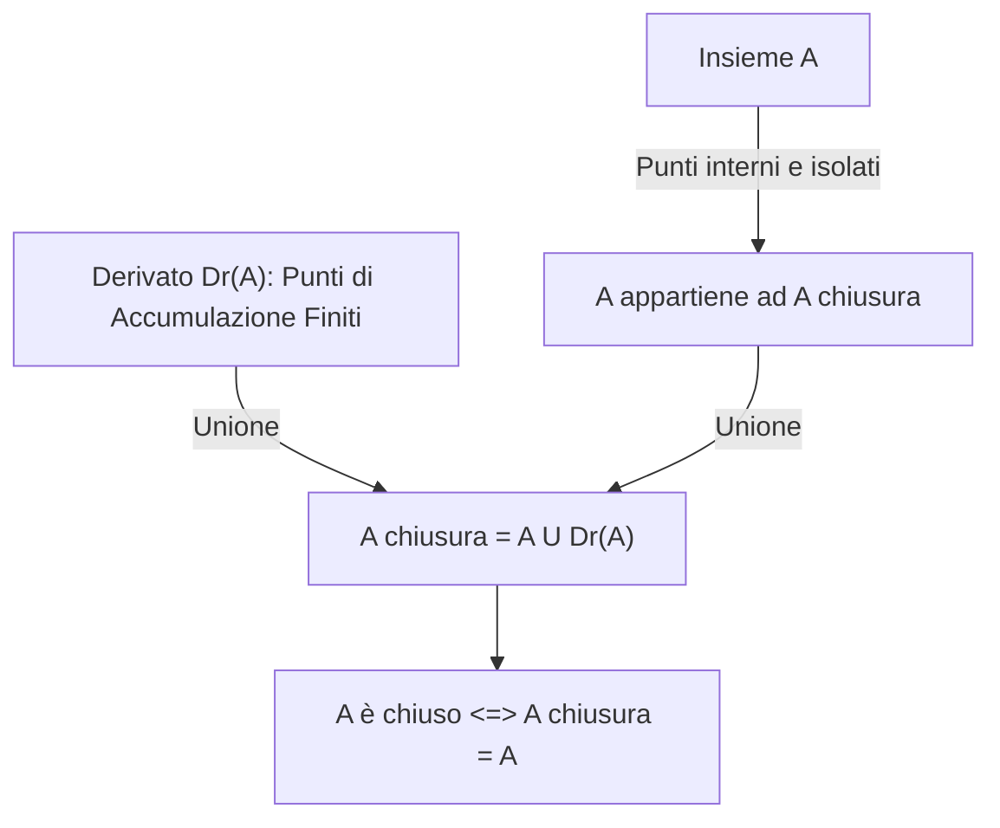
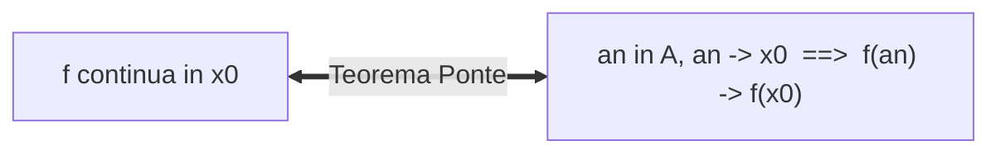

[[Home MOC|Home]] / [[Education & Learning]] / [[University]] / [[Lezione 21 - Teoremi di Bolzano e Proprieta Topologiche per Successioni]]

# Lezione 21 - Teoremi di Bolzano e Proprietà Topologiche per Successioni

## Sintesi Esecutiva
Questa ventunesima lezione (Sapienza Università di Roma — a cura del prof. S. Salzo, 28 Ottobre 2026) apre lo studio globale delle proprietà delle funzioni continue su insiemi reali strutturati. La trattazione introduce anzitutto gli strumenti topologici sequenziali fondamentali: la nozione di <mark style="background:rgba(255, 193, 69, 0.32)"><b>punto di aderenza</b></mark>, la <mark style="background:rgba(255, 193, 69, 0.32)"><b>chiusura $\overline{A}$</b></mark> di un insieme come unione con il derivato $D_r(A)$, e la definizione di <mark style="background:rgba(181, 113, 255, 0.36)"><b>insieme chiuso</b></mark>. Viene enunciato e provato il fondamentale <mark style="background:rgba(255, 193, 69, 0.32)"><b>Teorema Ponte (caratterizzazione dei limiti mediante successioni)</b></mark>, che stabilisce l'equivalenza esatta tra il comportamento analitico topologico di una funzione e i limiti delle successioni nei suoi punti di accumulazione, estendendolo alla caratterizzazione sequenziale della continuità e degli insiemi chiusi. Nel cuore della lezione viene presentato e rigorosamente dimostrato il pilastro dell'analisi reale: il <mark style="background:rgba(255, 193, 69, 0.32)"><b>Teorema degli zeri di Bolzano</b></mark>. La dimostrazione viene condotta in forma algoritmica e costruttiva mediante il <mark style="background:rgba(181, 113, 255, 0.36)"><b>metodo di bisezione</b></mark>, ricavando la stima a priori del numero di iterazioni necessarie per conseguire una precisione fissata $\varepsilon > 0$. Infine, la lezione fornisce la dimostrazione originale variazionale di Bolzano fondata sull'estremo superiore e sul teorema della permanenza del segno.

---

## 1. Chiusura di un Insieme e Insiemi Chiusi

### Punti di Aderenza e Chiusura Topologica

> [!IMPORTANT] Definizione 1.1 (Punto Aderente e Insieme Chiusura)
> Sia $A \subset \mathbb{R}$ e sia $x \in \mathbb{R}$. Il punto $x$ si dice **aderente** ad $A$ (o punto di aderenza per $A$) se:
> $$\forall U \in \mathcal{U}(x), \quad U \cap A \neq \emptyset$$
> cioè se ogni intorno di $x$ contiene almeno un punto di $A$.
> L'insieme di tutti i punti di aderenza di $A$ si indica con $\overline{A}$ e si chiama **aderenza** o **chiusura** di $A$:
> $$\overline{A} = \{x \in \mathbb{R} \mid \forall U \in \mathcal{U}(x), U \cap A \neq \emptyset\}$$

> [!NOTE] Osservazione 1.2 e 1.3 (Differenze con i Punti di Accumulazione)
> 1. Il punto aderente $x$ è **necessariamente finito** ($x \in \mathbb{R}$).
> 2. Nella definizione di accumulazione si richiede $U \cap (A \setminus \{x\}) \neq \emptyset$, mentre nell'aderenza basta $U \cap A \neq \emptyset$. Ne consegue:
>    - Se $x \in A$, allora banalmente $x \in U \cap A$ per ogni intorno $U$, per cui **ogni punto di $A$ è aderente ad $A$** ($A \subset \overline{A}$).
>    - Se $x \notin A$, allora $x$ è aderente ad $A \iff x$ è punto di accumulazione per $A$.
> 3. Vale l'identità fondamentale:
>    $$\overline{A} = A \cup D_r(A)$$
>    dove $D_r(A)$ denota l'insieme dei punti di accumulazione al finito di $A$.

### Insiemi Chiusi e Proprietà di Minimo

> [!IMPORTANT] Definizione 1.5 (Insieme Chiuso)
> Un insieme $A \subset \mathbb{R}$ si dice **chiuso** se coincide con la propria chiusura:
> $$A \text{ è chiuso} \iff \overline{A} = A \iff D_r(A) \subset A$$
> ovvero se $A$ contiene tutti i propri punti di accumulazione al finito.

> [!IMPORTANT] Proposizione 1.6 (Proprietà della Chiusura)
> Per ogni insieme $A \subset \mathbb{R}$, l'aderenza $\overline{A}$ è un insieme chiuso ed è il più piccolo insieme chiuso contenente $A$:
> $$\overline{\overline{A}} = \overline{A}$$

---

## 2. Proprietà Topologiche e Continuità per Successioni

### Il Teorema Ponte per i Limiti

> [!IMPORTANT] Teorema 2.1 (Caratterizzazione dei Limiti mediante Successioni — Teorema Ponte)
> Siano $f: A \to \mathbb{R}$, $\ell \in \overline{\mathbb{R}}$ e $x_0 \in \overline{\mathbb{R}}$ punto di accumulazione per $A$. Le seguenti proposizioni sono equivalenti:
> - **(i)** $\lim_{x \to x_0} f(x) = \ell$
> - **(ii)** Per ogni successione $(a_n)_{n \in \mathbb{N}}$ di punti di $A \setminus \{x_0\}$ tale che $a_n \to x_0$, risulta:
>   $$\lim_{n \to +\infty} f(a_n) = \ell$$

### Continuità per Successioni

> [!IMPORTANT] Teorema 2.2 (Caratterizzazione Sequenziale della Continuità)
> Siano $f: A \to \mathbb{R}$ e $x_0 \in A$. Le seguenti affermazioni sono equivalenti:
> - **(i)** $f$ è continua in $x_0$.
> - **(ii)** Per ogni successione $(a_n)_{n \in \mathbb{N}}$ di punti di $A$ tale che $a_n \to x_0$, si ha:
>   $$\lim_{n \to +\infty} f(a_n) = f(x_0)$$

### Caratterizzazione Sequenziale della Chiusura e dei Chiusi

> [!IMPORTANT] Proposizione 2.3 (Chiusura Sequenziale)
> Sia $A \subset \mathbb{R}$ e $x \in \mathbb{R}$. Allora:
> $$x \in \overline{A} \iff \exists (a_n)_{n \in \mathbb{N}} \in A^{\mathbb{N}} : \lim_{n \to +\infty} a_n = x$$

> [!IMPORTANT] Proposizione 2.4 (Chiusura Sequenziale di un Insieme)
> Sia $A \subset \mathbb{R}$. Sono equivalenti:
> - **(i)** $A$ è chiuso in $\mathbb{R}$.
> - **(ii)** Per ogni successione convergente $(a_n)_{n \in \mathbb{N}}$ di elementi di $A$, il limite appartiene ad $A$:
>   $$(a_n \in A \ \forall n \ \land \ a_n \to x) \implies x \in A$$

---

## 3. Teorema degli Zeri di Bolzano e Metodo di Bisezione

> [!IMPORTANT] Teorema 3.1 (Degli Zeri di Bolzano)
> Sia $I$ un intervallo di $\mathbb{R}$ e sia $f: I \to \mathbb{R}$ una funzione continua. Siano $a, b \in I$ con $a < b$ tali che la funzione assuma valori di segno discorde agli estremi:
> $$f(a) f(b) < 0$$
> Allora esiste almeno un punto $x_0 \in ]a, b[$ tale che:
> $$f(x_0) = 0$$

### Algoritmo di Bisezione e Stima dell'Errore

Il metodo di bisezione costruisce iterativamente una successione di intervalli inscatolati $[a_n, b_n]$ dimezzandone l'ampiezza ad ogni passo:
$$a_0 = a, \quad b_0 = b, \quad c_n = \frac{a_n + b_n}{2}$$
1. Se $f(c_n) = 0$, l'algoritmo termina con la radice esatta $x_0 = c_n$.
2. Altrimenti, si seleziona il sottointervallo $[a_{n+1}, b_{n+1}]$ ai cui estremi $f$ mantiene segni discordi.

Le successioni soddisfano le proprietà:
$$a \le a_n \le a_{n+1} \le b_{n+1} \le b_n \le b, \qquad b_n - a_n = \frac{b - a}{2^n}$$
Entrambe convergono all'unico punto di intersezione $x_0 = \sup_n a_n = \inf_n b_n$, in cui per continuità $f(x_0) = 0$.

> [!NOTE] Formula per la Precisione Assegnata
> Per garantire un errore assoluto inferiore a una tolleranza fissata $\varepsilon > 0$:
> $$|x_0 - c_n| \le \frac{b - a}{2^{n+1}} < \varepsilon \iff n > \log_2\left(\frac{b-a}{\varepsilon}\right) - 1$$
> Il numero minimo di biezioni è quindi dato da $n = \left\lfloor \log_2\left(\frac{b-a}{\varepsilon}\right) \right\rfloor + 1$.

---

## 4. Dimostrazione Variazionale Alternativa di Bolzano

> [!IMPORTANT] Teorema 4.1 (Zeri di Bolzano — Forma con Estremo Superiore)
> Sia $f: [a, b] \to \mathbb{R}$ continua con $f(a) < 0 < f(b)$. Posto:
> $$A = \{x \in [a, b] \mid f(x) < 0\}$$
> Risulta che $x_0 = \sup A \in ]a, b[$ è uno zero di $f$:
> $$f(x_0) = 0$$
> *Dimostrazione:* Per la permanenza del segno, sia $f(x_0) < 0$ sia $f(x_0) > 0$ generano contraddizioni rispetto alla definizione di $x_0 = \sup A$. Dunque deve essere tassativamente $f(x_0) = 0$.
