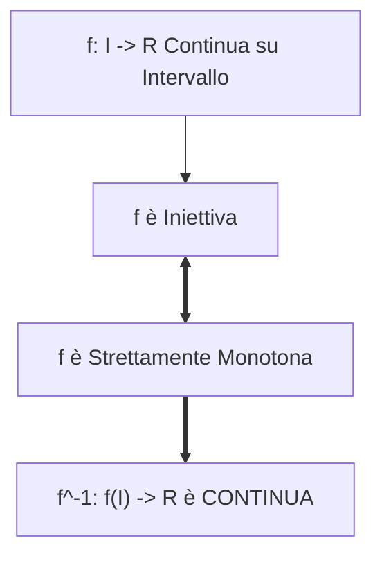

[[Home MOC|Home]] / [[Education & Learning]] / [[University]] / [[Lezione 22 - Valori Intermedi Punti Fissi e Teorema di Bolzano-Weierstrass]]

# Lezione 22 - Valori Intermedi, Punti Fissi e Teorema di Bolzano-Weierstrass

## Sintesi Esecutiva
Questa ventiduesima lezione (Sapienza Università di Roma — a cura del prof. S. Salzo, 29 Ottobre 2026) sviluppa le conseguenze fondamentali della continuità sulle geometrie connesse di $\mathbb{R}$. Nella prima parte viene enunciato e provato il <mark style="background:rgba(255, 193, 69, 0.32)"><b>Teorema dei valori intermedi di Bolzano</b></mark> nelle sue due forme canoniche: l'assunzione di ogni quota compresa tra due valori noti e la formulazione topologica secondo cui l'immagine continua di un qualsiasi intervallo reale è ancora un intervallo ($f(I)$ è un intervallo). Da ciò discende l'esistenza rigorosa e l'unicità della <mark style="background:rgba(181, 113, 255, 0.36)"><b>radice $n$-esima</b></mark> per ogni reale positivo. Nella seconda parte vengono esplorate le conseguenze topologiche e analitiche: il <mark style="background:rgba(255, 193, 69, 0.32)"><b>Teorema del punto fisso</b></mark> per mappe $g: [a, b] \to [a, b]$, il teorema che stabilisce l'equivalenza perfetta tra <mark style="background:rgba(255, 193, 69, 0.32)"><b>iniettività e stretta monotonia</b></mark> per funzioni continue su intervalli, e la conseguente <mark style="background:rgba(181, 113, 255, 0.36)"><b>continuità globale delle funzioni inverse</b></mark>. La lezione si conclude con uno dei cardini assoluti dell'analisi matematica: il <mark style="background:rgba(255, 193, 69, 0.32)"><b>Teorema di Bolzano-Weierstrass</b></mark>, dimostrato con straordinaria eleganza formale mediante la tecnica discreta degli <mark style="background:rgba(181, 113, 255, 0.36)"><b>indici di picco</b></mark>, provando che da ogni successione limitata è sempre possibile estrarre una sottosuccessione monotona convergente.

---

## 1. Il Teorema dei Valori Intermedi di Bolzano

### Enunciati e Conseguenze Topologiche

> [!IMPORTANT] Teorema 1.1 (Dei Valori Intermedi di Bolzano — 1° Forma)
> Sia $f: I \to \mathbb{R}$ una funzione continua definita in un intervallo $I$ di $\mathbb{R}$ (aperto, chiuso, limitato o illimitato). Siano $a, b \in I$ con $f(a) < f(b)$.
> Allora:
> $$[f(a), f(b)] \subset f(I)$$
> Inoltre, posti $m = \inf_I f$ e $M = \sup_I f$, risulta:
> $$]m, M[ \subset f(I)$$
> cioè per ogni quota $y \in ]m, M[$ esiste almeno un punto $x \in I$ tale che $f(x) = y$.

> [!IMPORTANT] Teorema 1.3 (Dei Valori Intermedi — 2° Forma Topologica)
> Sia $f: I \to \mathbb{R}$ una funzione continua definita in un intervallo $I \subset \mathbb{R}$. Allora l'immagine $f(I)$ è un intervallo di $\mathbb{R}$.

> [!NOTE] Corollario 1.4 (Esistenza ed Unicità della Radice $n$-esima)
> Siano $n \in \mathbb{N}^*$ e $y \in \mathbb{R}^+$. Esiste un unico numero reale $x \in \mathbb{R}^+$ tale che:
> $$x^n = y$$
> *Dimostrazione:* L'unicità deriva dalla stretta crescenza di $x \mapsto x^n$ su $\mathbb{R}^+$. L'esistenza segue dal Teorema dei valori intermedi applicato a $[0, b]$ con $b > \max(1, y)$, per cui $0^n \le y < b^n$.

---

## 2. Conseguenze: Punti Fissi, Monotonia e Funzioni Inverse

### Teorema del Punto Fisso su Intervalli Compatti

> [!IMPORTANT] Teorema 2.1 (Del Punto Fisso)
> Sia $g: [a, b] \to [a, b]$ una funzione continua. Allora esiste almeno un punto $x_0 \in [a, b]$ tale che:
> $$g(x_0) = x_0$$
> *Dimostrazione:* Si considera la funzione ausiliaria $f(x) = g(x) - x$. Poiché $a \le g(x) \le b$, si ha $f(a) = g(a) - a \ge 0$ e $f(b) = g(b) - b \le 0$. Se non si annulla agli estremi, assume segni opposti, e per il Teorema degli zeri esiste $x_0 \in ]a, b[$ con $f(x_0) = 0 \iff g(x_0) = x_0$.

### Equivalenza tra Iniettività e Stretta Monotonia

> [!IMPORTANT] Teorema 2.2 (Iniettività e Monotonia su Intervalli)
> Sia $I \subset \mathbb{R}$ un intervallo e sia $f: I \to \mathbb{R}$ una funzione continua. Allora:
> $$f \text{ è iniettiva} \iff f \text{ è strettamente monotona}$$

> [!IMPORTANT] Teorema 2.4 (Continuità delle Funzioni Inverse)
> Sia $f: I \to \mathbb{R}$ una funzione continua, iniettiva e definita in un intervallo di $\mathbb{R}$.
> Allora la funzione inversa:
> $$f^{-1}: f(I) \to \mathbb{R}$$
> è **continua** su tutto il suo dominio $f(I)$.

---

## 3. Il Teorema di Bolzano-Weierstrass

> [!IMPORTANT] Teorema 3.1 (Di Bolzano-Weierstrass)
> Da ogni successione reale limitata $(a_n)_{n \in \mathbb{N}}$ è possibile estrarre una sottosuccessione convergente:
> $$\exists (a_{n_k})_{k \in \mathbb{N}} \quad \text{tale che} \quad \lim_{k \to +\infty} a_{n_k} = \ell \in \mathbb{R}$$

### La Tecnica degli Indici di Picco

La dimostrazione si basa sulla classificazione combinatoria degli indici della successione:
Un indice $n \in \mathbb{N}$ si dice **indice di picco** se il termine $a_n$ domina tutti i termini successivi:
$$\forall m \ge n \implies a_n \ge a_m$$
Sia $P = \{n \in \mathbb{N} \mid n \text{ è indice di picco}\}$. Si presentano due possibilità mutuamente esclusive:
1. **$P$ è un insieme infinito:** Si estraggono in ordine crescente gli indici di picco $n_0 < n_1 < n_2 < \dots$. Per definizione di picco, $a_{n_k} \ge a_{n_{k+1}}$, ottenendo un'estratta **monotona decrescente**.
2. **$P$ è un insieme finito:** Esiste una soglia $\overline{n}$ oltre la quale non vi sono più picchi. Poiché nessun indice oltre $\overline{n}$ è di picco, per ogni termine esiste un termine successivo strettamente maggiore. Si costruisce così un'estratta **strettamente crescente**.

In entrambi i casi si estrae una sottosuccessione monotona. Poiché $(a_n)$ è limitata, l'estratta è limitata e monotona, dunque **convergente per il Teorema sui limiti delle successioni monotone**.
