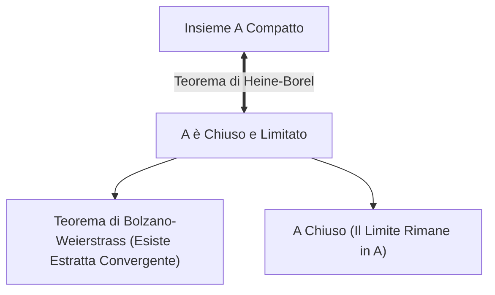

[[Home MOC|Home]] / [[Education & Learning]] / [[University]] / [[Lezione 23 - Insiemi Compatti Teorema di Weierstrass e Successioni per Ricorrenza]]

# Lezione 23 - Insiemi Compatti, Teorema di Weierstrass e Successioni per Ricorrenza

## Sintesi Esecutiva
Questa ventitreesima lezione (Sapienza Università di Roma — a cura del prof. S. Salzo, fine Ottobre 2026) introduce uno dei concetti cardine della topologia e dell'analisi funzionale classica: la <mark style="background:rgba(255, 193, 69, 0.32)"><b>compattezza sequenziale</b></mark> per sottoinsiemi di $\mathbb{R}$. La lezione dimostra in modo impeccabile il fondamentale <mark style="background:rgba(255, 193, 69, 0.32)"><b>Teorema di Heine-Borel</b></mark>, stabilendo che nella retta reale un insieme è compatto per successioni se e solo se è contemporaneamente chiuso e limitato. Su questo fondamento topologico viene enunciato e rigorosamente dimostrato il <mark style="background:rgba(255, 193, 69, 0.32)"><b>Teorema di Weierstrass sui massimi e minimi assoluti</b></mark> per funzioni continue definite su compatti, attraverso la tecnica canonica della <mark style="background:rgba(181, 113, 255, 0.36)"><b>successione massimizzante</b></mark>. La necessità strutturale di ciascuna delle tre ipotesi (limitatezza del dominio, chiusura del dominio, continuità della funzione) viene illustrata mediante puntuali controesempi analitici. La seconda parte della lezione esplora la teoria dinamica delle <mark style="background:rgba(255, 193, 69, 0.32)"><b>successioni definite per ricorrenza</b></mark> (iterazione di punto fisso o di Picard), dimostrando il teorema di convergenza ai punti fissi della funzione generatrice e applicandolo all'analisi formale del millenario <mark style="background:rgba(181, 113, 255, 0.36)"><b>Metodo di Erone per il calcolo della radice quadrata</b></mark>, con verifica deduttiva della stima per eccesso e della convergenza monotona a $\sqrt{b}$.

---

## 1. Insiemi Compatti e Teorema di Heine-Borel

### Definizione di Compattezza Sequenziale

> [!IMPORTANT] Definizione 1.1 (Insieme Compatto per Successioni)
> Un sottoinsieme $A \subset \mathbb{R}$ si dice **compatto** se da ogni successione $(a_n)_{n \in \mathbb{N}}$ a valori in $A$ ($a_n \in A$ per ogni $n$) è possibile estrarre una sottosuccessione $(a_{n_k})_{k \in \mathbb{N}}$ convergente a un elemento $x_0$ appartenente ad $A$:
> $$\forall (a_n) \in A^{\mathbb{N}}, \quad \exists (a_{n_k})_{k \in \mathbb{N}} \quad \text{tale che} \quad \lim_{k \to +\infty} a_{n_k} = x_0 \in A$$

### Il Teorema di Heine-Borel

> [!IMPORTANT] Teorema 1.2 (Di Heine-Borel in $\mathbb{R}$)
> Sia $A \subset \mathbb{R}$. Le seguenti affermazioni sono equivalenti:
> - **(i)** $A$ è compatto per successioni.
> - **(ii)** $A$ è chiuso e limitato.

*Dimostrazione:*
1. **$(i) \implies (ii)$:** Supponiamo che $A$ sia compatto.
   - **$A$ è limitato:** Se per assurdo $A$ non fosse limitato, per ogni $M > 0$ esisterebbe $a \in A$ con $|a| > M$. In particolare per ogni $n \in \mathbb{N}$ esisterebbe $a_n \in A$ tale che $|a_n| > n$. La successione $(a_n)$ diverge in modulo a $+\infty$, per cui ogni sua sottosuccessione diverge anch'essa in modulo a $+\infty$. Di conseguenza $(a_n)$ non ammette alcuna sottosuccessione convergente in $\mathbb{R}$, contraddicendo la compattezza di $A$.
   - **$A$ è chiuso:** Ricordiamo che $x \in \overline{A} \iff \exists (a_n) \in A^{\mathbb{N}}$ tale che $a_n \to x$. Poiché $A$ è compatto, da $(a_n)$ si può estrarre una sottosuccessione $(a_{n_k})$ convergente a un punto $x_0 \in A$. Per l'unicità del limite deve essere $x = x_0 \in A$. Ciò dimostra che $\overline{A} \subset A$, e quindi $\overline{A} = A$, provando che $A$ è chiuso.
2. **$(ii) \implies (i)$:** Supponiamo che $A$ sia chiuso e limitato. Sia $(a_n) \in A^{\mathbb{N}}$ una qualsiasi successione di elementi di $A$. Essendo $A$ limitato, la successione $(a_n)$ è limitata in $\mathbb{R}$. Per il Teorema di Bolzano-Weierstrass, da $(a_n)$ si può estrarre una sottosuccessione $(a_{n_k})$ convergente a un certo $x_0 \in \mathbb{R}$. Poiché $a_{n_k} \in A$ per ogni $k$, per la caratterizzazione sequenziale della chiusura si ha $x_0 \in \overline{A}$. Essendo $A$ chiuso per ipotesi ($\overline{A} = A$), risulta necessariamente $x_0 \in A$. Dunque $A$ è compatto. $\blacksquare$

> [!NOTE] Esempi Canonici di Insiemi Compatti
> 1. Ogni intervallo chiuso e limitato $A = [a, b]$ con $a < b$ è compatto.
> 2. L'insieme discreto con punto di accumulazione $A = \{0\} \cup \{1/n \mid n \in \mathbb{N}^*\}$ è compatto poiché è limitato e chiuso ($\overline{A} = A$).

---

## 2. Il Teorema di Weierstrass sui Massimi e Minimi

> [!IMPORTANT] Teorema 2.1 (Di Weierstrass)
> Sia $A \subset \mathbb{R}$ un insieme compatto (cioè chiuso e limitato) e sia $f: A \to \mathbb{R}$ una funzione continua.
> Allora $f$ ammette **massimo e minimo assoluti** su $A$:
> $$\exists x_{\min}, x_{\max} \in A \quad \text{tali che} \quad f(x_{\min}) = \min_{x \in A} f(x) \quad \text{e} \quad f(x_{\max}) = \max_{x \in A} f(x)$$

### Dimostrazione con Successione Massimizzante

Proviamo l'esistenza del massimo (la trattazione per il minimo è speculare applicando il risultato alla funzione continua $-f$).
Poniamo:
$$M = \sup_{x \in A} f(x) \in ]-\infty, +\infty]$$
1. Dalle proprietà caratteristiche dell'estremo superiore, possiamo costruire una successione numerica reale $(b_n)_{n \in \mathbb{N}}$ strettamente inferiore a $M$ e convergente a $M$:
$$b_n < M \quad \forall n, \qquad \lim_{n \to +\infty} b_n = M$$
   (ad esempio ponendo $b_n = M - \frac{1}{n+1}$ se $M < +\infty$, oppure $b_n = n$ se $M = +\infty$).
2. Per ogni $n$, poiché $b_n < M = \sup_{x \in A} f(x)$, per definizione di estremo superiore esiste un punto $a_n \in A$ tale che:
$$b_n < f(a_n) \le M$$
   Poiché $b_n \to M$, per il Teorema dei carabinieri la successione immagine converge al sup:
$$\lim_{n \to +\infty} f(a_n) = M$$
   La successione $(a_n)_{n \in \mathbb{N}} \in A^{\mathbb{N}}$ prende il nome di **successione massimizzante**.
3. Poiché l'insieme $A$ è compatto, da $(a_n)$ possiamo estrarre una sottosuccessione $(a_{n_k})_{k \in \mathbb{N}}$ convergente a un elemento $x_0 \in A$:
$$a_{n_k} \to x_0 \in A$$
4. Essendo $f$ continua in $x_0$, per il teorema ponte di continuità per successioni si ha:
$$\lim_{k \to +\infty} f(a_{n_k}) = f(x_0)$$
   D'altra parte, poiché $f(a_n) \to M$, anche ogni sua estratta converge a $M$: $\lim_{k \to +\infty} f(a_{n_k}) = M$.
   Per l'unicità del limite:
$$M = f(x_0)$$
   Poiché $x_0 \in A$, il valore $M$ appartiene all'immagine $f(A)$ ed è finito ($f(x_0) \in \mathbb{R}$).
   Concludiamo che $M = \max_{x \in A} f(x)$ e che $x_0$ è un punto di massimo per $f$. $\blacksquare$

### Necessità delle Ipotesi: Controesempi

Se anche una sola delle tre ipotesi del Teorema di Weierstrass viene a mancare, la tesi non è più garantita:
- **1. Insieme non limitato:** $f(x) = e^{-x}$ definita su $[0, +\infty[$. L'intervallo è chiuso e $f$ è continua, ma il dominio è illimitato. $\inf f = 0$, ma $f(x) > 0$ sempre: la funzione non ammette minimo assoluto.
- **2. Insieme non chiuso:** $f(x) = x^2$ su $]0, 1]$. Il dominio è limitato e la funzione è continua, ma l'intervallo non è chiuso in 0. $\inf f = 0$, ma $f(x) > 0$ per ogni $x \in ]0, 1]$: la funzione non ammette minimo assoluto.
- **3. Funzione non continua:** Sia $f: [0, 1] \to \mathbb{R}$ definita da:
$$f(x) = \begin{cases} 1 & \text{se } x = 0 \\ x^2 & \text{se } x \in ]0, 1] \end{cases}$$
  Il dominio $[0, 1]$ è compatto, ma $f$ è discontinua in $x = 0$. $\inf f = 0$, ma nessun punto del dominio assume valore 0: $f$ non ammette minimo.

---

## 3. Successioni per Ricorrenza e Metodo di Erone

### Iterazioni di Punto Fisso (Metodo di Picard)

Data una funzione continua $f: A \to A$ e un valore iniziale $x_0 \in A$, la relazione di ricorrenza:
$$\begin{cases} a_0 = x_0 \\ a_{n+1} = f(a_n) \quad \forall n \ge 0 \end{cases}$$
genera la successione dei termini $a_1 = f(x_0)$, $a_2 = f(f(x_0))$, ..., $a_n = f^{(n)}(x_0)$.

> [!IMPORTANT] Proposizione 3.1 (Convergenza a Punti Fissi)
> Sia $f: A \to A$ una funzione continua. Se la successione definita per ricorrenza $a_{n+1} = f(a_n)$ converge a un punto $\overline{x} \in A$:
> $$\lim_{n \to +\infty} a_n = \overline{x} \implies f(\overline{x}) = \overline{x}$$
> ovvero $\overline{x}$ è un **punto fisso** della funzione $f$.
> *Dimostrazione:* Per continuità $f(a_n) \to f(\overline{x})$. D'altra parte $a_{n+1} \to \overline{x}$. Poiché $a_{n+1} = f(a_n)$, per unicità del limite $\overline{x} = f(\overline{x})$. $\blacksquare$

### Il Metodo di Erone per la Radice Quadrata

Per calcolare $\sqrt{b}$ con $b > 0$, Erone di Alessandria (60 d.C.) ideò la procedura di rettangolarizzazione ricorsiva con media aritmetica tra base e altezza:
$$a_{n+1} = \frac{1}{2}\left(a_n + \frac{b}{a_n}\right) = f(a_n), \qquad f(x) = \frac{1}{2}\left(x + \frac{b}{x}\right)$$
1. **Punto fisso unico:** $f(x) = x \iff \frac{1}{2}(x + \frac{b}{x}) = x \iff x^2 = b \implies x = \sqrt{b}$ (per $x > 0$).
2. **Stima per eccesso sistematica:**
$$f(x) - \sqrt{b} = \frac{x^2 + b - 2x\sqrt{b}}{2x} = \frac{(x - \sqrt{b})^2}{2x} \ge 0 \implies a_n \ge \sqrt{b} \quad \forall n \ge 1$$
3. **Monotonia decrescente:**
$$a_{n+1} \le a_n \iff \frac{1}{2}\left(a_n + \frac{b}{a_n}\right) \le a_n \iff \frac{b}{a_n} \le a_n \iff b \le a_n^2 \iff \sqrt{b} \le a_n$$
   che è sempre verificata per il punto 2.
4. **Conclusione:** Essendo $(a_n)_{n \ge 1}$ decrescente e inferiormente limitata da $\sqrt{b}$, converge a un limite finito $\overline{x} \ge \sqrt{b} > 0$. Per la Proposizione 3.1, $\overline{x}$ deve essere un punto fisso di $f$, dunque:
$$\lim_{n \to +\infty} a_n = \sqrt{b}$$
