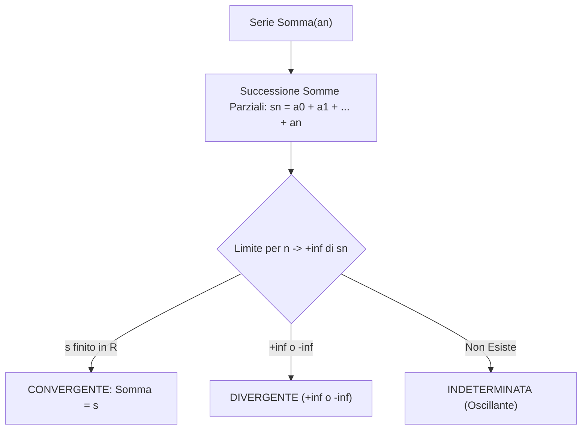

[[Home MOC|Home]] / [[Education & Learning]] / [[University]] / [[Lezione 24 - Serie Numeriche I Definizioni Proprieta e Serie Geometrica]]

# Lezione 24 - Serie Numeriche I: Definizioni, Proprietà e Serie Geometrica

## Sintesi Esecutiva
Questa ventiquattresima lezione (Sapienza Università di Roma — a cura del prof. S. Salzo, 3 Novembre 2026) inaugura lo studio sistematico delle <mark style="background:rgba(255, 193, 69, 0.32)"><b>serie numeriche</b></mark>, fornendo il rigore matematico necessario per sommare infiniti contributi reali. Partendo dalla formulazione filosofica del <mark style="background:rgba(181, 113, 255, 0.36)"><b>paradosso di Zenone</b></mark> (la corsa tra Achille e la tartaruga, risolta dalla convergenza della serie delle potenze di $1/2$), la lezione formalizza la serie come coppia ordinata formata dalla successione dei termini addendi e dalla successione delle <mark style="background:rgba(255, 193, 69, 0.32)"><b>somme parziali $(s_n)$</b></mark>. Viene introdotta la tassonomia esaustiva del carattere: <mark style="background:rgba(255, 193, 69, 0.32)"><b>convergente</b></mark>, <mark style="background:rgba(255, 193, 69, 0.32)"><b>divergente</b></mark> o <mark style="background:rgba(181, 113, 255, 0.36)"><b>indeterminata (oscillante)</b></mark>. Vengono quindi analizzati due modelli fondamentali risolubili per via algebrica diretta: la <mark style="background:rgba(255, 193, 69, 0.32)"><b>serie geometrica $\sum q^n$</b></mark>, con discussione completa del carattere al variare della ragione $q \in \mathbb{R}$, e le serie telescopiche, con particolare riferimento alla celebre <mark style="background:rgba(181, 113, 255, 0.36)"><b>serie di Mengoli</b></mark>. La lezione si chiude con la proprietà di linearità per le somme di serie e con la dimostrazione della <mark style="background:rgba(255, 193, 69, 0.32)"><b>condizione necessaria di convergenza ($a_n \to 0$)</b></mark>, evidenziandone la non sufficienza attraverso il controesempio della serie $\sum \frac{1}{\sqrt{n}}$ e della serie armonica.

---

## 1. Definizione Formale e Classificazione del Carattere

### La Serie come Limite di Somme Parziali

> [!IMPORTANT] Definizione 1.1 (Serie Numerica e Somma)
> Data una successione numerica reale $(a_n)_{n \in \mathbb{N}}$, si chiama **serie numerica** la coppia:
> $$\left((a_n)_{n \in \mathbb{N}}, (s_n)_{n \in \mathbb{N}}\right)$$
> dove $s_n$ è la successione delle somme parziali o ridotte $n$-esime:
> $$s_n = \sum_{k=0}^n a_k = a_0 + a_1 + \dots + a_n$$
> La serie si denota sinteticamente con $\sum_{n=0}^{+\infty} a_n$ o $\sum a_n$.
> Se esiste il limite per $n \to +\infty$ di $(s_n)$, tale limite si dice **somma della serie**:
> $$\sum_{n=0}^{+\infty} a_n = \lim_{n \to +\infty} s_n = \lim_{n \to +\infty} \sum_{k=0}^n a_k \in \overline{\mathbb{R}}$$

### Tassonomia del Carattere
- **Convergente:** $\lim_{n \to +\infty} s_n = s \in \mathbb{R}$ (esiste finito il valore della somma).
- **Divergente positivamente:** $\lim_{n \to +\infty} s_n = +\infty$.
- **Divergente negativamente:** $\lim_{n \to +\infty} s_n = -\infty$.
- **Indeterminata (o oscillante):** Il limite $\lim_{n \to +\infty} s_n$ non esiste in $\overline{\mathbb{R}}$ (es. serie di Grandi $\sum (-1)^n$).

---

## 2. Modelli Risolubili: Serie Geometrica e di Mengoli

### Studio Completo della Serie Geometrica

> [!IMPORTANT] Teorema 2.1 (Carattere della Serie Geometrica)
> Sia $q \in \mathbb{R}$. La serie geometrica $\sum_{n=0}^{+\infty} q^n$ ha somma parziale:
> $$s_n = \sum_{k=0}^n q^k = \begin{cases} \frac{1 - q^{n+1}}{1 - q} & \text{se } q \neq 1 \\ n + 1 & \text{se } q = 1 \end{cases}$$
> Al variare della ragione $q \in \mathbb{R}$, il carattere della serie è classificato da:
> $$\sum_{n=0}^{+\infty} q^n = \begin{cases} \frac{1}{1 - q} & \text{se } |q| < 1 \quad \text{(Convergente)} \\ +\infty & \text{se } q \ge 1 \quad \text{(Divergente positivamente)} \\ \text{non esiste} & \text{se } q \le -1 \quad \text{(Indeterminata / Oscillante)} \end{cases}$$

### Serie Telescopica di Mengoli

> [!NOTE] Esempio 2.2 (Serie di Mengoli)
> Consideriamo la serie $\sum_{n=1}^{+\infty} \frac{1}{n(n+1)}$.
> Scomponendo in fratti semplici:
> $$\frac{1}{n(n+1)} = \frac{1}{n} - \frac{1}{n+1}$$
> La somma parziale telescopica si semplifica a:
> $$s_n = \left(1 - \frac{1}{2}\right) + \left(\frac{1}{2} - \frac{1}{3}\right) + \dots + \left(\frac{1}{n} - \frac{1}{n+1}\right) = 1 - \frac{1}{n+1}$$
> Calcolando il limite:
> $$\sum_{n=1}^{+\infty} \frac{1}{n(n+1)} = \lim_{n \to +\infty} \left(1 - \frac{1}{n+1}\right) = 1 \quad \text{(Convergente)}$$

---

## 3. Proprietà di Linearità e Condizione Necessaria

### Linearità della Somma di Serie

> [!IMPORTANT] Proposizione 3.1 (Linearità)
> Siano $\sum a_n$ e $\sum b_n$ due serie numeriche convergenti con somme $A, B \in \mathbb{R}$. Allora:
> 1. $\sum_{n=0}^{+\infty} (a_n + b_n) = \sum_{n=0}^{+\infty} a_n + \sum_{n=0}^{+\infty} b_n = A + B$
> 2. Per ogni scalare $\lambda \in \mathbb{R}$, $\sum_{n=0}^{+\infty} (\lambda a_n) = \lambda \sum_{n=0}^{+\infty} a_n = \lambda A$.

### Condizione Necessaria per la Convergenza

> [!IMPORTANT] Teorema 3.2 (Condizione Necessaria di Convergenza)
> Sia $\sum_{n=0}^{+\infty} a_n$ una serie numerica. Allora:
> $$\sum_{n=0}^{+\infty} a_n \text{ è convergente} \implies \lim_{n \to +\infty} a_n = 0$$

*Dimostrazione:*
Sia $s_n = \sum_{k=0}^n a_k$. Per ogni $n \ge 1$ vale la decomposizione:
$$a_n = s_n - s_{n-1}$$
Essendo la serie convergente, esiste finito il limite $\lim_{n \to +\infty} s_n = s \in \mathbb{R}$. Di conseguenza anche la successione traslata soddisfa $\lim_{n \to +\infty} s_{n-1} = s$.
Per l'algebra dei limiti:
$$\lim_{n \to +\infty} a_n = \lim_{n \to +\infty} (s_n - s_{n-1}) = s - s = 0 \quad \blacksquare$$

> [!WARNING] La Condizione $a_n \to 0$ NON è Sufficiente
> Il fatto che il termine generale tenda a 0 **non assicura affatto** la convergenza della serie:
> - **Controesempio 1:** Per la serie $\sum_{n=1}^{+\infty} \frac{1}{\sqrt{n}}$, si ha $\frac{1}{\sqrt{n}} \to 0$. Tuttavia:
>   $$s_n = \sum_{k=1}^n \frac{1}{\sqrt{k}} \ge \sum_{k=1}^n \frac{1}{\sqrt{n}} = n \cdot \frac{1}{\sqrt{n}} = \sqrt{n} \to +\infty$$
>   dunque la serie diverge positivamente a $+\infty$.
> - **Controesempio 2:** La serie armonica $\sum_{n=1}^{+\infty} \frac{1}{n}$ ha termine $1/n \to 0$, ma diverge anch'essa a $+\infty$.
