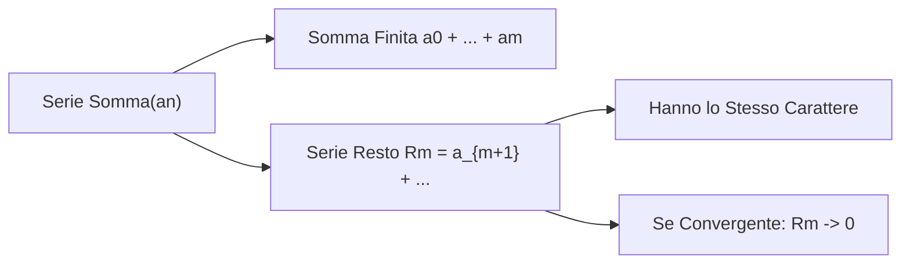

[[Home MOC|Home]] / [[Education & Learning]] / [[University]] / [[Lezione 25 - Serie Numeriche II Serie Resto e Criteri di Confronto]]

# Lezione 25 - Serie Numeriche II: Serie Resto e Criteri di Confronto

## Sintesi Esecutiva
Questa venticinquesima lezione (Sapienza Università di Roma — a cura del prof. S. Salzo, 4 Novembre 2026) approfondisce la struttura analitica delle serie numeriche ed esamina gli strumenti di convergenza per le serie a segno costante. La prima parte formalizza la nozione di <mark style="background:rgba(255, 193, 69, 0.32)"><b>serie resto di ordine $m$</b></mark> ($R_m = \sum_{n=m+1}^{+\infty} a_n$), dimostrando che essa possiede lo stesso carattere della serie genitrice e che, in caso di convergenza, il resto tende rigorosamente a zero ($R_m \to 0$). Da ciò discende la <mark style="background:rgba(181, 113, 255, 0.36)"><b>stabilità del carattere</b></mark> rispetto alla modifica di una quantità finita di termini, e la validità della <mark style="background:rgba(255, 193, 69, 0.32)"><b>proprietà associativa</b></mark> per tutte le serie regolari (con il monito del controesempio di Grandi per le serie oscillanti). La seconda parte della lezione pone al centro le <mark style="background:rgba(255, 193, 69, 0.32)"><b>serie a termini positivi ($a_n \ge 0$)</b></mark>: si dimostra il fondamentale teorema di regolarità, secondo cui tali serie non possono mai essere oscillanti bensì unicamente convergenti o divergenti a $+\infty$, per la crescenza monotona delle somme parziali. Viene provata la celebre divergenza della <mark style="background:rgba(181, 113, 255, 0.36)"><b>serie armonica</b></mark> mediante l'argomento medievale dei blocchi diadici di Oresme. Infine, la lezione stabilisce i due cardini operativi per l'indagine del carattere: il <mark style="background:rgba(255, 193, 69, 0.32)"><b>Criterio del confronto</b></mark> e il <mark style="background:rgba(255, 193, 69, 0.32)"><b>Criterio del confronto asintotico</b></mark> nelle tre casistiche del limite del rapporto $\ell \in ]0, +\infty[$, $\ell = 0$ e $\ell = +\infty$.

---

## 1. Serie Resto, Stabilità e Proprietà Associativa

### Definizione e Carattere della Serie Resto

> [!IMPORTANT] Proposizione 1.1 (Serie Resto di Ordine $m$)
> Sia $m \in \mathbb{N}$. Data la serie $\sum_{n=0}^{+\infty} a_n$, si definisce **serie resto** (o coda) di ordine $m$:
> $$R_m = \sum_{n=m+1}^{+\infty} a_n = a_{m+1} + a_{m+2} + \dots$$
> La serie originaria e la serie resto hanno **esattamente lo stesso carattere**. Se sono regolari, vale la decomposizione:
> $$\sum_{n=0}^{+\infty} a_n = \sum_{k=0}^m a_k + R_m$$
> Inoltre, se la serie è convergente, il resto tende a zero al crescere dell'indice di troncamento:
> $$\lim_{m \to +\infty} R_m = 0$$

> [!IMPORTANT] Proposizione 1.2 (Stabilità del Carattere)
> Il carattere di una serie numerica **non si altera** se si modifica, aggiunge o sopprime un numero finito di termini.

### Proprietà Associativa e Controesempio per Serie Oscillanti

> [!IMPORTANT] Teorema 1.3 (Proprietà Associativa per Serie Regolari)
> Sia $\sum a_n$ una serie regolare e sia $(n_k)_{k \in \mathbb{N}}$ una successione strettamente crescente con $n_0 = 0$.
> Definendo la serie a blocchi $\sum_{k=0}^{+\infty} b_k$ con $b_k = \sum_{i=n_k}^{n_{k+1}-1} a_i$, allora anche $\sum b_k$ è regolare e ha la medesima somma:
> $$\sum_{k=0}^{+\infty} b_k = \sum_{n=0}^{+\infty} a_n$$

> [!WARNING] Il Controesempio di Grandi
> Per serie oscillanti la proprietà associativa fallisce:
> $$\sum_{n=0}^{+\infty} (-1)^n = 1 - 1 + 1 - 1 + \dots \quad \text{(Indeterminata)}$$
> Raggruppando a coppie $(1-1) + (1-1) + \dots = 0 + 0 + \dots = 0$.
> Raggruppando lasciando il primo termine: $1 + (-1+1) + (-1+1) + \dots = 1 + 0 + 0 + \dots = 1$.
> Dunque associare parentesi è lecito **solo per serie regolari**.

---

## 2. Serie a Termini Positivi e Regolarità Intrinseca

### Il Teorema di Regolarità

> [!IMPORTANT] Definizione 2.1 (Serie a Termini Positivi)
> Una serie $\sum_{n=0}^{+\infty} a_n$ si dice **a termini positivi** se $a_n \ge 0$ per ogni $n \in \mathbb{N}$.

> [!IMPORTANT] Teorema 2.2 (Regolarità delle Serie a Termini Positivi)
> Ogni serie numerica a termini positivi $\sum a_n$ è **sempre regolare**:
> $$\sum_{n=0}^{+\infty} a_n \in [0, +\infty]$$
> Essa è unicamente **convergente** (se la somma è finita) oppure **divergente positivamente a $+\infty$**. Non può mai essere oscillante.

*Dimostrazione:*
Poiché $a_{n+1} \ge 0$, la successione delle somme parziali verifica:
$$s_{n+1} = s_n + a_{n+1} \ge s_n$$
dunque $(s_n)_{n \in \mathbb{N}}$ è monotona crescente. Dal Teorema sui limiti delle successioni monotone, ogni successione monotona ammette limite in $\overline{\mathbb{R}}$, coincidente con il suo estremo superiore:
$$\lim_{n \to +\infty} s_n = \sup_{n \in \mathbb{N}} s_n \in [0, +\infty] \quad \blacksquare$$

### Divergenza della Serie Armonica (Dimostrazione di Oresme)

> [!IMPORTANT] Teorema 2.3 (Divergenza della Serie Armonica)
> La serie armonica $\sum_{n=1}^{+\infty} \frac{1}{n}$ è **divergente positivamente a $+\infty$**.

*Dimostrazione (Nicole Oresme, ~1350):*
Raggruppiamo i termini in blocchi diadici di lunghezza $2^k$:
$$s_{2^k} = 1 + \frac{1}{2} + \underbrace{\left(\frac{1}{3} + \frac{1}{4}\right)}_{> 2 \cdot \frac{1}{4} = \frac{1}{2}} + \underbrace{\left(\frac{1}{5} + \dots + \frac{1}{8}\right)}_{> 4 \cdot \frac{1}{8} = \frac{1}{2}} + \dots + \underbrace{\left(\frac{1}{2^{k-1}+1} + \dots + \frac{1}{2^k}\right)}_{> 2^{k-1} \cdot \frac{1}{2^k} = \frac{1}{2}}$$
Ne consegue la minorazione per ogni $k \in \mathbb{N}^*$:
$$s_{2^k} > 1 + \frac{1}{2} + \frac{1}{2} + \dots + \frac{1}{2} = 1 + \frac{k}{2}$$
Poiché per $k \to +\infty$ si ha $1 + \frac{k}{2} \to +\infty$, la sottosuccessione $(s_{2^k})$ diverge. Essendo la serie a termini positivi e quindi regolare, l'intera successione diverge:
$$\sum_{n=1}^{+\infty} \frac{1}{n} = +\infty \quad \blacksquare$$

---

## 3. Criteri di Convergenza per Serie a Termini Positivi

### Il Criterio del Confronto

> [!IMPORTANT] Teorema 3.1 (Criterio del Confronto)
> Siano $\sum a_n$ e $\sum b_n$ due serie a termini positivi tali che definitivamente:
> $$a_n \le b_n \quad \forall n \ge \nu$$
> Allora:
> - **(i) $\sum b_n$ converge $\implies \sum a_n$ converge**
> - **(ii) $\sum a_n$ diverge $\implies \sum b_n$ diverge**

### Il Criterio del Confronto Asintotico

> [!IMPORTANT] Teorema 3.2 (Criterio del Confronto Asintotico)
> Siano $\sum a_n$ e $\sum b_n$ due serie a termini strettamente positivi ($a_n, b_n > 0$) e supponiamo che:
> $$\lim_{n \to +\infty} \frac{a_n}{b_n} = \ell \in [0, +\infty]$$
> Valgono le seguenti conclusioni:
> - **(i) Se $\ell \in ]0, +\infty[$:** Le due serie hanno **esattamente lo stesso carattere** ($\sum a_n$ converge $\iff \sum b_n$ converge).
> - **(ii) Se $\ell = 0$ ($a_n \ll b_n$):** $\sum b_n$ convergente $\implies \sum a_n$ convergente.
> - **(iii) Se $\ell = +\infty$ ($a_n \gg b_n$):** $\sum b_n$ divergente $\implies \sum a_n$ divergente.
