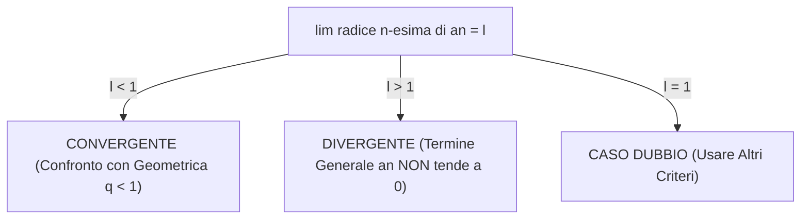

[[Home MOC|Home]] / [[Education & Learning]] / [[University]] / [[Lezione 26 - Serie Numeriche III Criteri della Radice e del Rapporto e Condensazione di Cauchy]]

# Lezione 26 - Serie Numeriche III: Criteri della Radice, del Rapporto, Condensazione di Cauchy e Prodotto di Eulero

## Sintesi Esecutiva
Questa ventiseiesima lezione (Sapienza Università di Roma — a cura del prof. S. Salzo, 5 Novembre 2026) presenta il nucleo avanzato dei criteri asintotici e operativi per lo studio delle serie a termini positivi. Nella prima parte vengono enunciati e rigorosamente provati il <mark style="background:rgba(255, 193, 69, 0.32)"><b>Criterio della radice di Cauchy</b></mark> e il <mark style="background:rgba(255, 193, 69, 0.32)"><b>Criterio del rapporto di d'Alembert</b></mark>, fondati sul confronto locale con opportune serie geometriche di ragione strettamente inferiore o superiore all'unità, illustrando il comportamento indeterminato nel caso limite $\ell = 1$. Nella seconda parte viene introdotta la fondamentale famiglia di confronto della <mark style="background:rgba(255, 193, 69, 0.32)"><b>serie armonica generalizzata $\sum \frac{1}{n^\alpha}$</b></mark>, provandone la convergenza per $\alpha > 1$ e la divergenza per $\alpha \le 1$ attraverso il potente <mark style="background:rgba(181, 113, 255, 0.36)"><b>Criterio di condensazione di Cauchy</b></mark>, generalizzazione moderna del metodo diadico di Oresme. La lezione fornisce quindi la guida metodologica strategica per lo studio del carattere delle serie. Infine, nella sezione teorica conclusiva, viene esplorata la teoria dei <mark style="background:rgba(255, 193, 69, 0.32)"><b>prodotti infiniti</b></mark>, culminando nella storica deduzione della <mark style="background:rgba(181, 113, 255, 0.36)"><b>formula del prodotto di Eulero (1737)</b></mark> per la funzione zeta di Riemann $\zeta(x) = \prod \frac{1}{1 - p_k^{-x}}$ e nella dimostrazione analitica della <mark style="background:rgba(255, 193, 69, 0.32)"><b>divergenza della serie dei reciproci dei numeri primi ($\sum \frac{1}{p_k} = +\infty$)</b></mark>.

---

## 1. Criteri della Radice e del Rapporto

### Il Criterio della Radice (Cauchy)

> [!IMPORTANT] Teorema 1.1 (Criterio della Radice)
> Sia $\sum a_n$ una serie numerica a termini positivi ($a_n \ge 0$) e supponiamo che:
> $$\lim_{n \to +\infty} \sqrt[n]{a_n} = \ell \in [0, +\infty]$$
> Allora:
> - **(i) Se $\ell < 1$:** La serie $\sum a_n$ è **convergente**.
> - **(ii) Se $\ell > 1$:** La serie $\sum a_n$ è **divergente positivamente a $+\infty$** (in quanto $a_n \not\to 0$).
> - **(iii) Se $\ell = 1$:** Il criterio è **inconcludente** (la serie può convergere o divergere).

### Il Criterio del Rapporto (d'Alembert)

> [!IMPORTANT] Teorema 1.2 (Criterio del Rapporto)
> Sia $\sum a_n$ una serie numerica a termini strettamente positivi ($a_n > 0$) e supponiamo che:
> $$\lim_{n \to +\infty} \frac{a_{n+1}}{a_n} = \ell \in [0, +\infty]$$
> Allora:
> - **(i) Se $\ell < 1$:** La serie $\sum a_n$ è **convergente**.
> - **(ii) Se $\ell > 1$:** La serie $\sum a_n$ è **divergente positivamente a $+\infty$**.
> - **(iii) Se $\ell = 1$:** Il criterio è **inconcludente**.

---

## 2. Serie Armonica Generalizzata e Criterio di Condensazione

### Criterio di Condensazione di Cauchy

> [!IMPORTANT] Teorema 2.1 (Di Condensazione di Cauchy)
> Sia $(a_n)_{n \in \mathbb{N}}$ una successione **monotona decrescente a termini positivi** ($a_n \ge a_{n+1} \ge 0$).
> Allora la serie originaria $\sum_{n=1}^{+\infty} a_n$ e la serie condensata $\sum_{n=0}^{+\infty} 2^n a_{2^n}$ hanno **esattamente lo stesso carattere**:
> $$\frac{1}{2} \sum_{n=0}^{+\infty} 2^n a_{2^n} \le \sum_{n=1}^{+\infty} a_n \le \sum_{n=0}^{+\infty} 2^n a_{2^n}$$

### Carattere della Serie Armonica Generalizzata

> [!IMPORTANT] Teorema 2.2 (Serie Armonica Generalizzata)
> Sia $\alpha \in \mathbb{R}$. La serie armonica generalizzata:
> $$\sum_{n=1}^{+\infty} \frac{1}{n^\alpha}$$
> ha il seguente comportamento:
> $$\sum_{n=1}^{+\infty} \frac{1}{n^\alpha} = \begin{cases} \text{Convergente} & \text{se } \alpha > 1 \\ \text{Divergente a } +\infty & \text{se } \alpha \le 1 \end{cases}$$

*Dimostrazione tramite Condensazione:*
Per $\alpha \le 0$ il termine $1/n^\alpha \not\to 0$, dunque diverge banalmente per violazione della condizione necessaria.
Per $\alpha > 0$, la successione $a_n = 1/n^\alpha$ è decrescente e positiva. Applichiamo la condensazione di Cauchy:
$$2^n a_{2^n} = 2^n \frac{1}{(2^n)^\alpha} = 2^n \cdot (2^{-\alpha})^n = (2^{1-\alpha})^n$$
La serie condensata è una serie geometrica di ragione $q = 2^{1-\alpha}$.
Essa converge se e solo se $q < 1 \iff 2^{1-\alpha} < 1 \iff 1 - \alpha < 0 \iff \alpha > 1$.
Per il Teorema di condensazione, la serie originaria $\sum 1/n^\alpha$ converge se e solo se $\alpha > 1$. $\blacksquare$

---

## 3. Prodotti Infiniti e Formula di Eulero

### Convergenza dei Prodotti Infiniti

> [!IMPORTANT] Teorema 3.1 (Prodotti Infiniti)
> Sia $(a_k)_{k \in \mathbb{N}^*}$ con $a_k > 0$. Il prodotto infinito $\prod_{k=1}^{+\infty} a_k = \lim_{n \to +\infty} \prod_{k=1}^n a_k$ converge a un valore finito non nullo se e solo se $\sum_{k=1}^{+\infty} \ln a_k$ converge.
> In particolare:
> 1. Condizione necessaria per la convergenza è $\lim_{k \to +\infty} a_k = 1$.
> 2. Se $a_k > 1$, il prodotto infinito $\prod_{k=1}^{+\infty} a_k$ e la serie $\sum_{k=1}^{+\infty} (a_k - 1)$ hanno lo stesso carattere.

### La Formula del Prodotto di Eulero (1737)

> [!IMPORTANT] Teorema 3.2 (Prodotto di Eulero per la Funzione Zeta)
> Sia $p_k$ la successione crescente di tutti i numeri primi ($p_1 = 2, p_2 = 3, p_3 = 5, \dots$).
> Per ogni $x > 1$, la somma della serie armonica generalizzata ammette l'identità fondamentale di Eulero:
> $$\zeta(x) = \sum_{n=1}^{+\infty} \frac{1}{n^x} = \prod_{k=1}^{+\infty} \frac{1}{1 - p_k^{-x}} = \prod_{k=1}^{+\infty} \left(\frac{1}{1 - \frac{1}{p_k^x}}\right)$$
> che stabilisce un ponte analitico indissolubile tra l'analisi reale e la distribuzione aritmetica dei numeri primi.

### Divergenza della Serie dei Reciproci dei Primi

> [!NOTE] Corollario 3.3 (Divergenza della Somma dei Primi)
> La serie dei reciproci dei numeri primi è **divergente a $+\infty$**:
> $$\sum_{k=1}^{+\infty} \frac{1}{p_k} = \frac{1}{2} + \frac{1}{3} + \frac{1}{5} + \frac{1}{7} + \frac{1}{11} + \dots = +\infty$$
> *Dimostrazione:* Prendendo il limite per $x \to 1^+$ nella formula di Eulero, poiché $\lim_{x \to 1^+} \zeta(x) = +\infty$, il prodotto infinito diverge. Per il Teorema 3.1, diverge la serie $\sum \left(\frac{1}{1 - p_k^{-1}} - 1\right) = \sum \frac{1}{p_k - 1} \sim \sum \frac{1}{p_k} = +\infty$.
