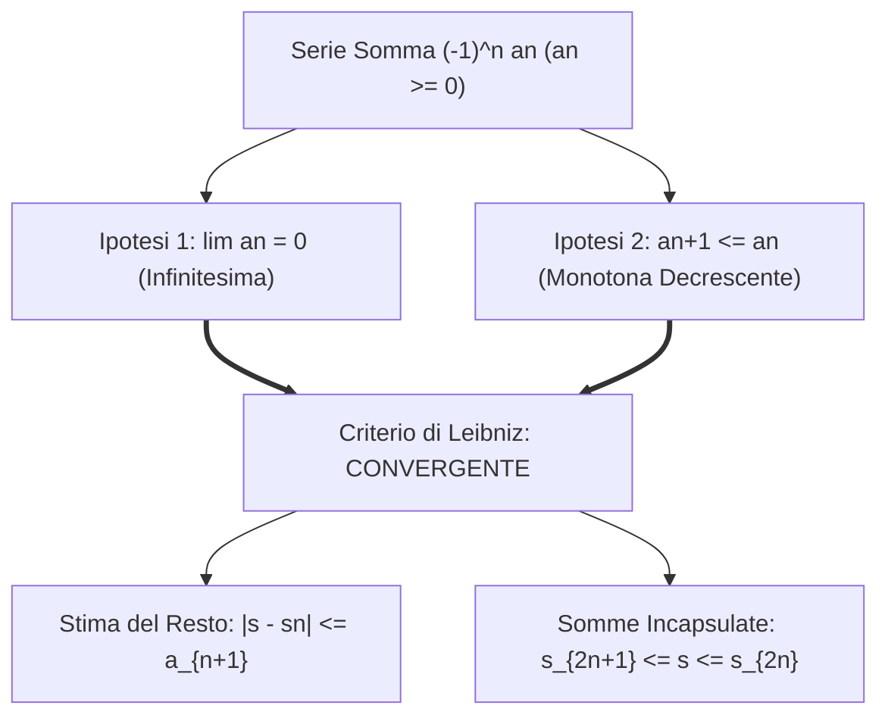

[[Home MOC|Home]] / [[Education & Learning]] / [[University]] / [[Lezione 27 - Serie Numeriche IV Criterio di Leibniz Convergenza Assoluta e Serie Esponenziale]]

# Lezione 27 - Serie Numeriche IV: Criterio di Leibniz, Convergenza Assoluta e Serie Esponenziale

## Sintesi Esecutiva
Questa ventisettesima lezione (Sapienza Università di Roma — a cura del prof. S. Salzo, 6 Novembre 2026) corona la trattazione analitica delle serie numeriche affrontando le configurazioni a segno variabile. Nella prima parte viene esaminata la classe delle <mark style="background:rgba(255, 193, 69, 0.32)"><b>serie a segno alterno $\sum (-1)^n a_n$</b></mark>: viene enunciato e provato il classico <mark style="background:rgba(255, 193, 69, 0.32)"><b>Criterio di Leibniz</b></mark>, dimostrando che la decrescenza infinitesima dei moduli garantisce la convergenza e fornisce la celebre <mark style="background:rgba(181, 113, 255, 0.36)"><b>stima a priori del resto di troncamento ($|R_n| \le a_{n+1}$)</b></mark>. Nella seconda parte si passa alle serie a segno qualunque introducendo il concetto cardine di <mark style="background:rgba(255, 193, 69, 0.32)"><b>convergenza assoluta ($\sum |a_n| < +\infty$)</b></mark>, provando che essa implica sempre la convergenza semplice mediante la scomposizione canonica nei contributi positivo e negativo ($a_n = a_n^+ - a_n^-$). Nella ricca sezione di approfondimento, la lezione ricava la stima ultrarapida di convergenza per il numero di Nepero $0 < e - s_n < \frac{1}{n \cdot n!}$ e dimostra per assurdo l'<mark style="background:rgba(181, 113, 255, 0.36)"><b>irrazionalità di $e$</b></mark>. Vengono quindi sviluppati i teoremi sul <mark style="background:rgba(255, 193, 69, 0.32)"><b>prodotto alla Cauchy</b></mark> di due serie (Teorema di Mertens), culminando nella costruzione assiomatico-deduttiva della <mark style="background:rgba(255, 193, 69, 0.32)"><b>funzione esponenziale $\exp(x) = \sum \frac{x^n}{n!}$</b></mark>, provandone la convergenza globale e la proprietà omomorfica fondamentale $\exp(x+y) = \exp(x)\exp(y)$.

---

## 1. Serie a Segno Alterno e Criterio di Leibniz

### Enunciato e Stima del Resto

> [!IMPORTANT] Definizione 1.1 (Serie a Segno Alterno)
> Sia $(a_n)_{n \in \mathbb{N}}$ una successione reale a termini positivi ($a_n \ge 0$). Una serie numerica del tipo:
> $$\sum_{n=0}^{+\infty} (-1)^n a_n = a_0 - a_1 + a_2 - a_3 + \dots$$
> si dice **serie a segno alterno**.

> [!IMPORTANT] Teorema 1.2 (Criterio di Leibniz)
> Sia $(a_n)_{n \in \mathbb{N}}$ una successione a termini positivi soddisfacente le due condizioni:
> - **(a)** $\lim_{n \to +\infty} a_n = 0$
> - **(b)** $a_{n+1} \le a_n$ per ogni $n \in \mathbb{N}$ (monotona decrescente)
>
> Allora la serie $\sum_{n=0}^{+\infty} (-1)^n a_n$ è **convergente** a una somma $s \in \mathbb{R}$.
> Inoltre le ridotte pari e dispari si incapsulano monotonicamente attorno alla somma:
> $$s_{2n+1} \le s_{2n+3} \le \dots \le s \le \dots \le s_{2n+2} \le s_{2n}$$
> e l'errore commesso arrestando la somma al termine $n$-esimo è maggiorato dal primo termine trascurato:
> $$|s - s_n| \le a_{n+1}$$

---

## 2. Convergenza Assoluta per Serie a Segno Qualunque

### Definizione e Teorema Fondamentale

> [!IMPORTANT] Definizione 2.1 (Convergenza Assoluta)
> Una serie numerica reale $\sum_{n=0}^{+\infty} a_n$ si dice **assolutamente convergente** se converge la serie dei suoi valori assoluti:
> $$\sum_{n=0}^{+\infty} |a_n| < +\infty$$

> [!IMPORTANT] Teorema 2.2 (La Convergenza Assoluta Implica la Convergenza Semplice)
> Se una serie numerica $\sum a_n$ è assolutamente convergente, allora è anche **semplicemente convergente**:
> $$\sum_{n=0}^{+\infty} |a_n| < +\infty \implies \sum_{n=0}^{+\infty} a_n \text{ converge in } \mathbb{R}$$
> Inoltre vale la disuguaglianza triangolare estesa alla somma:
> $$\left| \sum_{n=0}^{+\infty} a_n \right| \le \sum_{n=0}^{+\infty} |a_n|$$

### Decomposizione in Parte Positiva e Negativa

Ponendo per ogni $n \in \mathbb{N}$:
$$a_n^+ = \max(a_n, 0) \ge 0, \qquad a_n^- = \max(-a_n, 0) \ge 0$$
si ottengono le identità algebriche esatte:
$$a_n = a_n^+ - a_n^-, \qquad |a_n| = a_n^+ + a_n^-$$
La convergenza di $\sum |a_n|$ equivale alla convergenza simultanea delle due serie a termini positivi $\sum a_n^+$ e $\sum a_n^-$. Per linearità, la somma originaria è data da:
$$\sum_{n=0}^{+\infty} a_n = \sum_{n=0}^{+\infty} a_n^+ - \sum_{n=0}^{+\infty} a_n^-$$

---

## 3. Il Numero $e$, Prodotto di Cauchy ed Esponenziale Reale

### Stima di Troncamento e Irrazionalità di $e$

> [!IMPORTANT] Teorema 3.1 (Stima di Errore per il Numero di Nepero)
> Per ogni ordine di troncamento $n \in \mathbb{N}^*$, vale la stima bilaterale stretta:
> $$0 < e - \sum_{k=0}^n \frac{1}{k!} < \frac{1}{n \cdot n!}$$

> [!NOTE] Corollario 3.2 (Irrazionalità del Numero $e$)
> Il numero di Nepero $e$ è un **numero irrazionale** ($e \in \mathbb{R} \setminus \mathbb{Q}$).
> *Dimostrazione:* Se per assurdo $e = m/n$ con $m, n \in \mathbb{N}^*$, moltiplicando per $n!$ la disuguaglianza del Teorema 3.1 si otterrebbe:
> $$0 < m (n-1)! - \sum_{k=0}^n \frac{n!}{k!} < \frac{1}{n} \le 1$$
> L'espressione centrale è una combinazione di interi, dunque un intero positivo strettamente compreso tra $0$ e $1$, assurdo. $\blacksquare$

### Prodotto alla Cauchy e Teorema di Mertens

> [!IMPORTANT] Teorema 3.3 (Di Mertens sul Prodotto di Serie)
> Siano $\sum a_n$ e $\sum b_n$ due serie assolutamente convergenti. Definendo la serie convolutiva di Cauchy $\sum c_n$ con:
> $$c_n = \sum_{k=0}^n a_k b_{n-k} = a_0 b_n + a_1 b_{n-1} + \dots + a_n b_0$$
> Allora la serie $\sum c_n$ è assolutamente convergente e la sua somma coincide con il prodotto delle somme:
> $$\sum_{n=0}^{+\infty} c_n = \left(\sum_{n=0}^{+\infty} a_n\right) \left(\sum_{n=0}^{+\infty} b_n\right)$$

### Costruzione Rigorosa della Funzione Esponenziale

> [!IMPORTANT] Proposizione 3.4 (Definizione Analitica dell'Esponenziale)
> La serie di potenze:
> $$\exp(x) = \sum_{n=0}^{+\infty} \frac{x^n}{n!} = 1 + x + \frac{x^2}{2} + \frac{x^3}{6} + \dots$$
> converge assolutamente per ogni $x \in \mathbb{R}$ (dal criterio del rapporto $\frac{|x|^{n+1}}{(n+1)!} \frac{n!}{|x|^n} = \frac{|x|}{n+1} \to 0 < 1$).
> Essa verifica le proprietà fondative dell'analisi reale:
> 1. **Omomorfismo additivo:** $\exp(x + y) = \exp(x) \exp(y)$ per ogni $x, y \in \mathbb{R}$ (conseguenza diretta del prodotto alla Cauchy con la formula del binomio di Newton $\sum_{k=0}^n \frac{x^k}{k!} \frac{y^{n-k}}{(n-k)!} = \frac{(x+y)^n}{n!}$).
> 2. $\exp(x) > 0$ per ogni $x \in \mathbb{R}$ e $\exp(-x) = \frac{1}{\exp(x)}$.
> 3. $\exp(1) = e$.
> 4. $\exp$ è strettamente crescente su $\mathbb{R}$ con $\lim_{x \to +\infty} \exp(x) = +\infty$ e $\lim_{x \to -\infty} \exp(x) = 0$.
