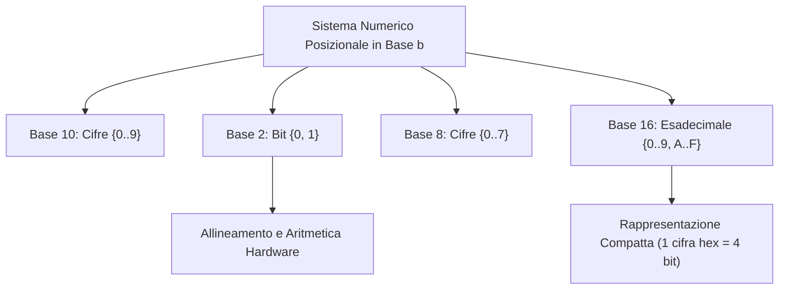
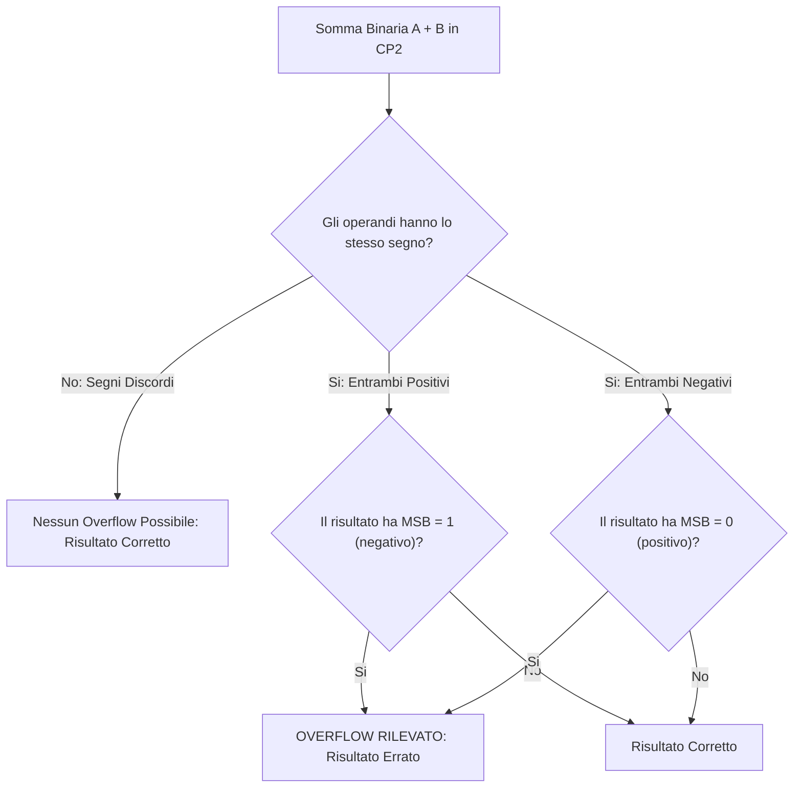

[[Home MOC|Home]] / [[Education & Learning]] / [[Sistemi di Numerazione Binaria e Interi con Segno]]

# Sistemi di Numerazione Binaria e Interi con Segno

## Sintesi Esecutiva
La rappresentazione discreta dei numeri costituisce l'architrave computazionale su cui poggia l'intera esecuzione delle istruzioni a livello macchina e nei compilatori. Questa lezione fondamentale (Sapienza Università di Roma, DIAG) formalizza i principi della <mark style="background:rgba(255, 193, 69, 0.32)"><b>notazione posizionale pesata</b></mark>, le conversioni algoritmiche tra le basi 2, 8, 10 e 16, e l'aritmetica binaria a precisione finita. Viene condotta un'analisi comparativa dei modelli di codifica degli interi con segno (modulo e segno, complemento a 1 ed eccesso), culminando nello studio del <mark style="background:rgba(181, 113, 255, 0.36)"><b>complemento a due (CP2)</b></mark>, delle regole di rilevamento dell'overflow algebrico e della gestione trasparente della precisione arbitraria adottata dal runtime di Python.

## Numeri, Numerali e Notazione Posizionale

### Distinzione Ontologica
Per comprendere la codifica informatica è necessario distinguere:
- **Numero:** concetto astratto che esprime una quantità o una grandezza matematica.
- **Numerale:** stringa finita di caratteri appartenente a un alfabeto simbolico che denota un numero all'interno di un dato sistema di numerazione.
Lo stesso numero può essere denotato da numerali differenti (es. $156_{10} = \text{CLVI}_{\text{romani}} = 10011100_2$).

### Sistemi Posizionali vs Non Posizionali
Nei sistemi non posizionali (es. il sistema romano), il valore associato a un simbolo è intrinseco o dipende parzialmente dai simboli adiacenti, rendendo l'esecuzione delle operazioni aritmetiche estremamente complessa.
Nei <mark style="background:rgba(255, 193, 69, 0.32)"><b>sistemi posizionali</b></mark>, ogni cifra contribuisce al valore totale in base alla sua posizione relativa, che ne determina il peso come potenza della base $b$:
$$N = \sum_{i=-k}^m a_i \cdot b^i$$
dove:
- $b \in \mathbb{N}_{\ge 2}$ è la **base** del sistema;
- $a_i \in \{0, 1, \dots, b-1\}$ sono le **cifre** (*coefficienti interi*);
- $i$ è la **posizione**, che definisce l'esponente della potenza della base.

### Basi di Primario Interesse in Informatica
- **Base 10 (Decimale):** alfabeto $\{0, \dots, 9\}$.
- **Base 2 (Binario):** alfabeto $\{0, 1\}$, le cui cifre sono chiamate **bit** (*binary digit*).
- **Base 8 (Ottale):** alfabeto $\{0, \dots, 7\}$, dove ciascuna cifra codifica gruppi di 3 bit ($2^3 = 8$).
- **Base 16 (Esadecimale):** alfabeto $\{0, \dots, 9, \text{A}, \text{B}, \text{C}, \text{D}, \text{E}, \text{F}\}$, dove $\text{A}=10, \dots, \text{F}=15$. Ciascuna cifra esadecimale codifica esattamente un **nibble** (4 bit, $2^4 = 16$).

### Ordini di Grandezza Binari
Un'utile regola pratica per le stime di calcolo poggia sulla vicinanza tra la decima potenza del 2 e la terza potenza del 10:
$$2^{10} = 1024 \approx 10^3 = 1000$$
Per stimare l'ordine di grandezza decimale di $2^k$, si divide l'esponente per 10 e si moltiplica per 3 ($x \approx \frac{k}{10} \times 3$):
$$2^{15} = 2^{10} \cdot 2^5 \approx 10^3 \cdot 32 = 3.2 \cdot 10^4$$

---

## Conversioni tra Basi e Aritmetica Binaria Pura

### Algoritmo delle Divisioni Successive (Decimale $\to$ Binario)
Per convertire un intero decimale $N$ in base $b$:
1. Si divide $N$ per $b$, annotando il quoziente intero $Q_1$ e il resto $R_0$.
2. Si divide $Q_1$ per $b$, ottenendo $Q_2$ e il resto $R_1$.
3. Si itera fino a ottenere un quoziente nullo ($Q_k = 0$).
4. Il numerale in base $b$ è formato dalla sequenza dei resti letti **in ordine inverso**, dal resto più recente (MSB) a quello iniziale (LSB): $R_{k-1} R_{k-2} \dots R_1 R_0$.

### Conversione Diretta Binario $\longleftrightarrow$ Esadecimale
Dato che $16 = 2^4$, la conversione tra binario ed esadecimale non richiede calcoli intermedi:
- **Binario $\to$ Esadecimale:** si raggruppano i bit in quartine da destra verso sinistra (aggiungendo eventuali zeri non significativi a sinistra) e si sostituisce ciascuna quartina con la corrispondente cifra hex.
  *Esempio:* $\underbrace{1111}_{\text{F}} \, \underbrace{1111}_{\text{F}} \, \underbrace{1010}_{\text{A}} \, \underbrace{0101}_{5} \implies \text{FFA5}_{16}$
- **Esadecimale $\to$ Binario:** ciascuna cifra hex viene espansa in 4 bit.

### Intervallo di Numeri Naturali su $n$ Bit
Con un registro di memoria costituito da $n$ bit, si possono generare $2^n$ configurazioni binarie distinte. Per numeri naturali non negativi in binario puro:
$$I_{\text{nat}} = [0, \, 2^n - 1]$$
- Per un byte ($n = 8$ bit): $[0, 255]$
- Per $n = 16$ bit: $[0, 65535]$
- Per $n = 32$ bit: $[0, 4\,294\,967\,295] \approx 4.29 \cdot 10^9$

---

## Codifica degli Interi con Segno

Per rappresentare sia numeri positivi che negativi all'interno di registri a $n$ bit, sono stati sviluppati differenti modelli convenzionali:

### 1. Modulo e Segno (MS)
- Il bit più significativo (MSB, $b_{n-1}$) funge da **bit di segno**: $0$ per positivo, $1$ per negativo.
- I restanti $n-1$ bit codificano il modulo del numero in binario puro.
- **Intervallo:** $[-(2^{n-1} - 1), \, +(2^{n-1} - 1)]$.
- **Criticità strutturali:**
  - Presenza di una doppia rappresentazione per lo zero: $+0 = (000\dots0)_{\text{MS}}$ e $-0 = (100\dots0)_{\text{MS}}$.
  - Circuiti di addizione e sottrazione separati e complessi: l'hardware deve prima confrontare i moduli e i segni prima di operare.

### 2. Complemento a Uno (CP1)
- I numeri positivi sono in binario puro col primo bit a 0. I negativi si ottengono invertendo tutti i bit (*bit-flip*).
- Anch'esso soffre del doppio zero e di complicazioni circuitali (richiede il cosiddetto *end-around carry*).

---

## Complemento a Due (CP2)

Il <mark style="background:rgba(255, 193, 69, 0.32)"><b>complemento a due (CP2)</b></mark> è lo standard universalmente impiegato in tutte le microarchitetture moderne (x86, ARM, RISC-V).

### Formulazione Posizionale Pesata
A differenza di quanto comunemente ritenuto, il CP2 è un sistema **strettamente posizionale**. L'unica particolarità risiede nel fatto che il bit più a sinistra (MSB, posizione $n-1$) possiede **peso negativo**:
$$\text{Pesi in CP2: } \quad -2^{n-1}, \quad 2^{n-2}, \quad \dots, \quad 2^1, \quad 2^0$$
Il valore numerico di una parola di $n$ bit $(b_{n-1} b_{n-2} \dots b_1 b_0)_{\text{CP2}}$ è dato da:
$$N = -b_{n-1} \cdot 2^{n-1} + \sum_{i=0}^{n-2} b_i \cdot 2^i$$

*Esempio con $n = 4$ bit:*
$$(1011)_{\text{CP2}} = 1 \cdot (-2^3) + 0 \cdot 2^2 + 1 \cdot 2^1 + 1 \cdot 2^0 = -8 + 0 + 2 + 1 = -5$$

### Proprietà Strutturali del CP2
- **Intervallo di rappresentabilità:**
$$I_{\text{CP2}} = [-2^{n-1}, \, 2^{n-1} - 1]$$
  Per $n = 8$ bit: $[-128, +127]$. Per $n = 16$ bit: $[-32768, +32767]$.
- **Unicità dello zero:** lo zero possiede una sola rappresentazione: $(0000\dots0)_{\text{CP2}}$.
- **Asimmetria:** il minimo valore negativo non ha un corrispondente opposto positivo rappresentabile sugli stessi $n$ bit (es. con 8 bit, $-128$ esiste ma $+128$ richiede almeno 9 bit).

### Algoritmi Operativi per la Negazione in CP2
Dato un numero $x$, per determinare il numerale in CP2 di $-x$:
1. **Regola analitica:** invertire tutti i bit di $x$ (NOT bit a bit) e sommare 1 al bit meno significativo:
$$-x = \overline{x} + 1$$
2. **Algoritmo di scansione da destra (veloce):** procedendo da destra verso sinistra (da LSB a MSB), ricopiare inalterati tutti i bit fino al primo `1` compreso; invertire quindi tutti i bit rimanenti a sinistra.
   *Esempio su 8 bit per $x = 74 = 01001010_2$:*
   Il primo `1` da destra è alla seconda cifra (`...10`). Ricopiando `10` e invertendo i restanti bit (`010010` $\to$ `101101`), si ottiene:
$$-74 = 10110110_{\text{CP2}}$$

### Estensione del Segno (Sign Extension)
Per rappresentare lo stesso numero in CP2 su un numero maggiore di bit ($m > n$), è sufficiente **replicare a sinistra il bit più significativo (MSB)**:
- Se il numero è positivo ($b_{n-1} = 0$), si aggiungono zeri a sinistra.
- Se il numero è negativo ($b_{n-1} = 1$), si aggiungono uni a sinistra.
*Esempio:* $-5$ su 4 bit è `1011`; esteso a 8 bit diventa `11111011`. Il valore algebrico rimane invariato.

---

## Rappresentazione in Eccesso (Notazione Polarizzata)

Nella rappresentazione in eccesso (o polarizzata con bias $K = 2^{n-1}$), il valore $N$ viene memorizzato sommando la costante $K$:
$$\text{Numerale}_{\text{EX}} = N + 2^{n-1}$$
Tale formato è largamente impiegato per codificare l'esponente nei numeri in virgola mobile (standard IEEE 754).

> [!TIP] Isomorfismo tra CP2 ed Eccesso
> Confrontando le tabelle di verità su $n$ bit:
> $$\text{Numerale in Eccesso } 2^{n-1} \equiv \text{Numerale in CP2 con il solo MSB invertito}$$
> Esempio su 4 bit: $0_{\text{dec}} = (0000)_{\text{CP2}} = (1000)_{\text{EX}}$.

---

## Aritmetica in CP2 e Rilevamento dell'Overflow

Il grandissimo vantaggio ingegneristico del CP2 risiede nell'unificazione circuitale delle operazioni:
- **Addizione e sottrazione** si eseguono con lo **stesso identico circuito sommatore**. La sottrazione $A - B$ viene calcolata come $A + (-B)$.
- **Riporto sul bit di segno (Carry-out / Trabocco esterno):** l'eventuale riporto generato oltre la $n$-esima posizione viene **ignorato** (*dropped*).

### Condizione di Overflow Algebrico
L'<mark style="background:rgba(255, 193, 69, 0.32)"><b>overflow</b></mark> (trabocco) si verifica quando il risultato teorico dell'operazione esce dall'intervallo rappresentabile $[-2^{n-1}, 2^{n-1}-1]$:
1. **Regola dei segni:** L'overflow può verificarsi **se e solo se** si sommano due numeri aventi lo stesso segno e il risultato assume il segno opposto:
   - $(+) + (+) = (-)$ $\implies$ Overflow positivo.
   - $(-)$ + $(-)$ = $(+)$ $\implies$ Overflow negativo.
2. Sommare numeri di segno discorde non produce mai overflow.

---

## Rappresentazione degli Interi in Python

Nei linguaggi orientati al sistema come C, C++ o Java, i tipi interi hanno ampiezza fissa definita dall'architettura (`int` a 32 bit, `long` a 64 bit). Quando un'operazione eccede tale capacità, si verifica un overflow silente con comportamento modulare.

### Precisione Arbitraria (Bignum) in Python
In Python, il tipo primitivo `int` implementa una <mark style="background:rgba(181, 113, 255, 0.36)"><b>precisione arbitraria</b></mark>:
- Gli interi non subiscono mai overflow numerico. La loro dimensione in memoria cresce dinamicamente in funzione del valore rappresentato, limitata unicamente dalla memoria RAM disponibile.
- **Implementazione interna CPython:** I numeri interi sono strutturati internamente come un array di "cifre" espresse in base $2^{30}$ (su sistemi a 64 bit) o $2^{15}$ (su sistemi a 32 bit).
- Quando si effettuano somme o moltiplicazioni di interi giganteschi (es. $2^{1000}$ o $100!$), il motore runtime spezza il calcolo tra i blocchi da 30 bit propagando automaticamente i riporti, garantendo la totale esattezza algebrica del risultato.
