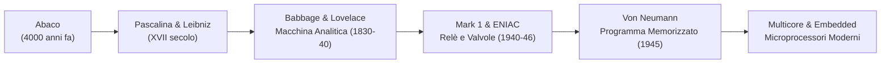
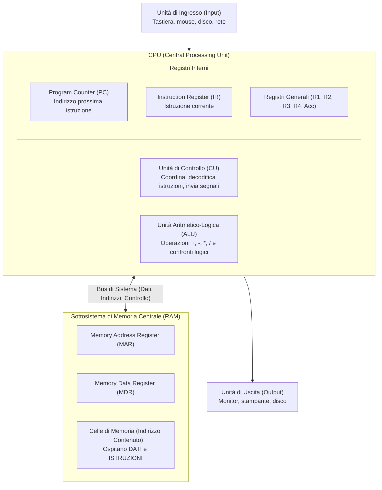
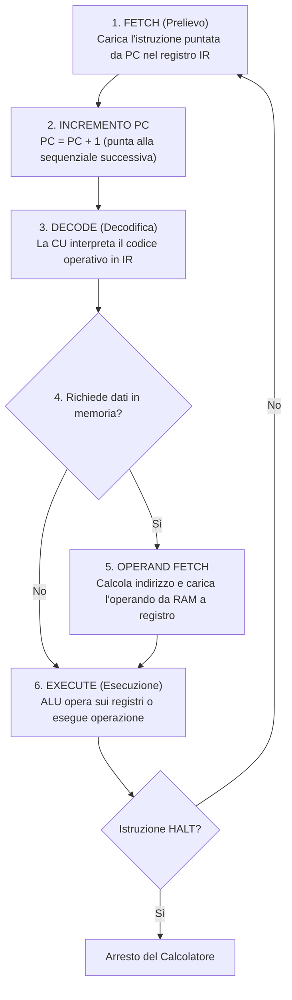
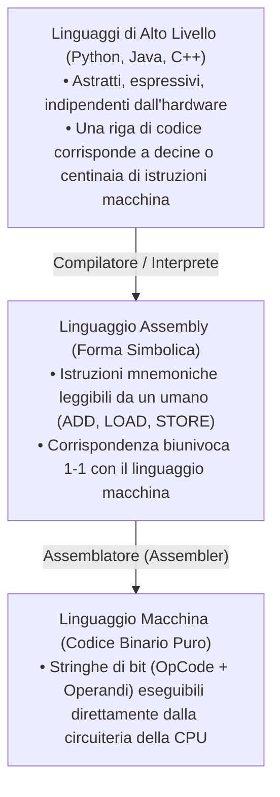
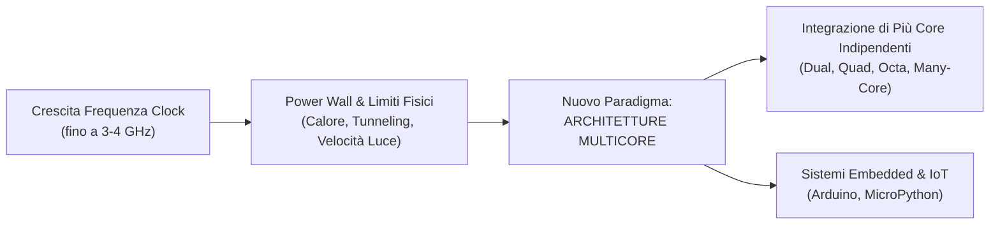

[[Home MOC|Home]] / [[Education & Learning]] / [[University]] / [[Lezione 0.3 - Architettura di Von Neumann e Storia dei Calcolatori]]

# Lezione 0.3 - Architettura di Von Neumann e Storia dei Calcolatori

## Sintesi Esecutiva
Mentre le dispense teoriche precedenti ([[Lezione 0.1 - Rappresentazione dei Caratteri e Dati Multimediali]] e [[Lezione 0.2 - Sistemi di Numerazione Binaria e Interi con Segno]]) hanno definito la codifica formale dell'informazione numerica e multimediale in sequenze binarie, questa terza dispensa didattica (Sapienza Università di Roma, DIAG — curata da A. Marchetti Spaccamela, D. Lembo, P. Liberatore, G. Santucci e M. Schaerf) affronta il motore fisico ed architetturale del calcolatore elettronico. Viene ripercorsa la parabola evolutiva del calcolo automatico, dai dispositivi meccanici del XVII secolo e dalla pionieristica visione della Macchina Analitica di Charles Babbage ed <mark style="background:rgba(255, 193, 69, 0.32)"><font color="#cc8800"><b>Ada Lovelace</b></font></mark> (la prima programmatrice della storia), fino ai calcolatori a valvole termoioniche degli anni '40 (ENIAC, Colossus). Il cuore teorico della trattazione sviscera l'<mark style="background:rgba(255, 193, 69, 0.32)"><font color="#cc8800"><b>architettura di von Neumann</b></font></mark> basata sul paradigma del **programma memorizzato** (*stored-program computer*), analizzando l'anatomia della CPU (Unità di Controllo, ALU e registri cardine come PC ed IR), il sottosistema di memoria centrale e registri di interfaccia (MAR, MDR), e la meccanica esecutiva del <mark style="background:rgba(181, 113, 255, 0.36)"><font color="#9a54c1"><b>ciclo Fetch-Decode-Execute</b></font></mark>. Vengono infine esaminati il divario tra linguaggio macchina e linguaggi di alto livello, la traiettoria esponenziale della **Legge di Moore**, i limiti fisici invalicabili della miniaturizzazione (effetti quantistici, velocità della luce, dissipazione termica) e la conseguente transizione verso le <mark style="background:rgba(181, 113, 255, 0.36)"><font color="#9a54c1"><b>architetture multicore</b></font></mark>, i sistemi embedded e MicroPython.

---

## 1. Dalle Macchine Meccaniche ai Primi Calcolatori Elettronici

La necessità di automatizzare il calcolo matematico precede di secoli l'avvento dell'elettronica.



### Precursori Meccanici
- **L'Abaco:** Il più antico strumento di calcolo manuale posizionale (circa 4000 anni fa).
- **Wilhelm Schickard (1623):** Primo progetto documentato di un orologio calcolatore meccanico basato su ruote dentate.
- **La "Pascalina" di Blaise Pascal (1642):** Calcolatrice meccanica ideata per addizioni e sottrazioni tramite un ingegnoso meccanismo di riporto automatico (*sautoir*).
- **Lo "Stepped Reckoner" di Gottfried Wilhelm von Leibniz (1671):** Introdusse il cilindro a scalini (*Leibniz wheel*), permettendo di eseguire meccanicamente anche moltiplicazioni e divisioni ripetute.

### Charles Babbage e la Nascita della Macchina Programmabile
Nel XIX secolo, il matematico inglese **Charles Babbage (1791–1871)** concepì due macchine rivoluzionarie:
1. **Difference Engine (Macchina Differenziale):** Dispositivo meccanico specializzato per tabulare polinomi mediante il metodo delle differenze finite.
2. **Analytical Engine (Macchina Analitica):** Il primo vero antenato concettuale del computer general-purpose. Per la prima volta vennero teorizzate le componenti essenziali dei calcolatori moderni:
   - **Store (Memoria):** Per conservare i numeri da elaborare (registri meccanici a ruote dentate).
   - **Mill (Mulino / Processore):** Unità di calcolo per eseguire le quattro operazioni aritmetiche.
   - **Input / Output:** Ispirato ai telai tessili di Joseph-Marie Jacquard, l'input era fornito tramite **schede perforate**.

> [!NOTE] Il Collegamento Storico con l'Italia
> Nel 1835 Camillo Benso di Cavour (ingegnere di formazione) incontrò Babbage a Londra. Nel 1840 Babbage fu invitato a Torino al Congresso degli scienziati italiani, donando i disegni della macchina all'Accademia delle Scienze. L'ingegnere e futuro Primo Ministro **Luigi Menabrea** pubblicò nel 1842 la prima descrizione scientifica in francese dell'architettura di Babbage.

### Ada Lovelace: La Prima Programmatrice della Storia
**Augusta Ada Byron, Contessa di Lovelace (1815–1852)**, tradusse in inglese l'articolo di Menabrea, arricchendolo con ampie e celebri *Note dell'autrice*.
- Nelle sue note, Ada formulò un algoritmo completo per calcolare la serie dei **numeri di Bernoulli** mediante la Macchina Analitica: questo elaborato è universalmente riconosciuto come il **primo programma per computer della storia**.
- Ada intuì che la macchina non era confinata al calcolo numerico puro: se le operazioni potevano essere astratte, la macchina avrebbe potuto comporre musica, manipolare grafica e trattare qualsiasi sistema simbolico. In suo onore, nel 1980 il Dipartimento della Difesa USA ha battezzato il linguaggio di programmazione **Ada**.

---

### Gli Anni '40 e l'Alba dell'Era Digitale
Durante la Seconda Guerra Mondiale, lo sforzo bellico e le esigenze balistiche e crittografiche impressero un'accelerazione decisiva:
- **Atanasoff-Berry Computer (ABC, 1939–1942):** Prototipo elettronico per risolvere sistemi di equazioni lineari (Iowa State University).
- **Konrad Zuse (Germania, 1938–1941):** Realizzò lo **Z3**, il primo calcolatore a relè binario pienamente funzionante e programmabile.
- **Colossus (Regno Unito, 1943–1944):** Macchina elettronica a valvole sviluppata a Bletchley Park sotto la direzione di Max Newman e il contributo di **Alan Turing**, progettata per decifrare i codici cifrati dell'Alto Comando tedesco (cifrario di Lorenz).
- **Harvard Mark 1 (Howard Aiken, 1944):** Mastodontico calcolatore elettromeccanico a relè lungo 16 metri (tempo di ciclo: circa 6 secondi).

> [!IMPORTANT] L'Origine del Termine "Bug"
> Il **9 settembre 1947**, durante il collaudo del Mark II ad Harvard sotto la supervisione della pioniera **Grace Hopper**, il sistema registrò un malfunzionamento anomalo. Gli operatori ispezionarono i banchi di relè e rimossero fisicamente una **falena** (*moth*) rimasta incastrata tra i contatti del Relè 70 nel Pannello F. L'insetto venne incollato con nastro adesivo sul diario di bordo (*logbook*) con la celebre nota: *"First actual case of bug being found"*. Da allora il termine "bug" indica un difetto software o hardware, e "debugging" la sua individuazione e rimozione.

- **ENIAC (Electronic Numerical Integrator and Computer, 1946):** Costruito presso la University of Pennsylvania da John Presper Eckert e John Mauchly. Fu il primo computer elettronico general-purpose ad alta velocità:
  - Velocità: $5.000$ operazioni al secondo ($5\text{ kHz}$).
  - Componenti: $18.000$ valvole termoioniche, $150\text{ kW}$ di consumo elettrico, peso di $27$ tonnellate, occupava uno spazio di $160\text{ m}^2$.
  - Limite operativo: non possedeva programma memorizzato; per cambiare programma occorreva riconfigurare manualmente cavi, spinotti e 6.000 interruttori su enormi quadri elettrici.

---

## 2. Il Modello e l'Architettura di Von Neumann

Nel 1945, il matematico ungherese-statunitense **John von Neumann** formalizzò nel documento *First Draft of a Report on the EDVAC* il modello concettuale su cui si basano, ancora oggi, la quasi totalità dei calcolatori moderni.

### Il Concetto di Programma Memorizzato (*Stored-Program*)
Nell'architettura di von Neumann scompare la separazione fisica tra calcolo e programmazione:
> **Principio del Programma Memorizzato:** Sia i **dati** da elaborare sia le **istruzioni** del programma risiedono all'interno del **medesimo spazio di memoria centrale**. Le istruzioni sono codificate come semplici sequenze numeriche binarie e vengono prelevate ed eseguite sequenzialmente una alla volta.

*(Nota: il modello alternativo denominato **Harvard/Berkeley** prevede invece spazi fisici di memoria e bus nettamente separati per le istruzioni e per i dati).*

### Componenti Fondamentali del Modello



1. **Unità di Controllo (CU - Control Unit):** È il "cervello" della CPU: preleva le istruzioni dalla memoria centrale, le decodifica e invia segnali di temporizzazione e controllo a tutte le altre componenti per orchestrarne l'esecuzione.
2. **Unità Aritmetico-Logica (ALU - Arithmetic and Logic Unit):** Esegue le computazioni matematiche elementari (addizioni, sottrazioni, moltiplicazioni) e le operazioni logico-relazionali (AND, OR, NOT, test di uguaglianza o disuguaglianza).
3. **Memoria Centrale (RAM):** Dispositivo ad accesso casuale contenente le locazioni di memoria dove risiedono i programmi in esecuzione e le relative strutture dati.
4. **Periferiche di Input / Output:** Consentono al calcolatore di acquisire dati dall'esterno (tastiera, sensori) e restituire i risultati elaborati all'utente o ad altri apparati (video, memorie di massa).
5. **Bus di Sistema:** Linee condivise di interconnessione elettrica suddivise funzionalmente in:
   - *Bus Dati:* per trasferire i dati tra CPU, memoria e periferiche.
   - *Bus Indirizzi:* per trasmettere l'indirizzo della locazione di memoria a cui accedere.
   - *Bus Controllo:* per sincronizzare le operazioni (segnali di Read/Write, clock, interrupt).

---

## 3. Il Sottosistema di Memoria Centrale

La memoria principale si presenta come una sequenza ordinata di **celle elementari** (locazioni).

### Distinzione Cardinale: Indirizzo vs Contenuto
- **Indirizzo di Memoria:** Un numero intero non negativo ($0, 1, 2, \dots, N-1$) che identifica univocamente la posizione fisica della cella nello spazio di memoria. L'indirizzo è invariabile.
- **Contenuto della Cella:** Il valore binario attualmente memorizzato all'interno della locazione. Il contenuto può essere sovrascritto e alterato durante l'esecuzione del programma.

### I Registri di Interfaccia con la Memoria
La CPU non accede direttamente al nucleo della memoria, ma interagisce attraverso due registri dedicati situati sul sottosistema di bus:
- <mark style="background:rgba(255, 193, 69, 0.32)"><font color="#cc8800"><b>MAR (Memory Address Register):</b></font></mark> Contiene l'indirizzo della cella di memoria che la CPU intende leggere o scrivere.
- <mark style="background:rgba(181, 113, 255, 0.36)"><font color="#9a54c1"><b>MDR (Memory Data Register):</b></font></mark> Contiene il dato estratto dalla memoria (in caso di lettura) oppure il dato da inviare per essere memorizzato nella cella indirizzata (in caso di scrittura).

### I Protocolli di Lettura e Scrittura

#### Operazione di Lettura (Read / Load)
Se la CPU deve leggere il contenuto della locazione con indirizzo `2`:
1. La CPU pone il valore `2` nel registro **MAR**.
2. La CPU invia sul bus di controllo il comando di **Lettura**.
3. Il controller di memoria preleva il valore contenuto nella cella 2 e lo deposita nel registro **MDR**.
4. La CPU trasferisce il dato da MDR verso i registri interni di lavoro.

#### Operazione di Scrittura (Write / Store)
Se la CPU deve scrivere il valore `32` nella cella di indirizzo `0`:
1. La CPU pone l'indirizzo `0` nel registro **MAR**.
2. La CPU pone il valore `32` nel registro **MDR**.
3. La CPU attiva sul bus di controllo il comando di **Scrittura**.
4. Il controller di memoria sovrascrive permanentemente la cella 0 con il contenuto di MDR (la memoria non restituisce valori alla CPU).

---

## 4. I Registri della CPU e il Ciclo Macchina Fetch-Decode-Execute

All'interno della CPU risiede un insieme ristretto di celle di memorizzazione ultra-rapide denominate **registri**.

### Registri Specializzati Fondamentali
- <mark style="background:rgba(255, 193, 69, 0.32)"><font color="#cc8800"><b>Program Counter (PC):</b></font></mark> Detto anche *Contatore di Programma*, memorizza l'**indirizzo in memoria della prossima istruzione** da eseguire. Viene incrementato automaticamente a ogni passo o aggiornato in caso di salti.
- <mark style="background:rgba(255, 193, 69, 0.32)"><font color="#cc8800"><b>Instruction Register (IR):</b></font></mark> Memorizza l'istruzione binaria corrente prelevata dalla memoria mentre viene decodificata ed eseguita dalla Control Unit.
- <mark style="background:rgba(181, 113, 255, 0.36)"><font color="#9a54c1"><b>Registri Dati Generali:</b></font></mark> Banchi di registri ad uso generico (denominati $R_1, R_2, R_3, R_4$ o *Accumulatori*) impiegati dall'ALU per contenere gli operandi e i risultati intermedi dei calcoli.

---

### La Sequenza Formale del Ciclo Fetch-Decode-Execute

L'esecuzione di ogni singola istruzione all'interno del calcolatore si scandisce rigidamente secondo un ciclo ripetitivo a micro-passi:



1. **Passo 1 - Fetch (Prelievo):** L'Unità di Controllo trasferisce il valore del `PC` nel `MAR`, ordina una lettura alla memoria centrale e carica la parola di istruzione depositata nel `MDR` all'interno del registro istruzione `IR`.
2. **Passo 2 - Aggiornamento del PC:** Il Program Counter viene incrementato per puntare alla locazione di memoria dell'istruzione successiva ($\text{PC} \leftarrow \text{PC} + 1$).
3. **Passo 3 - Decode (Decodifica):** La Control Unit decodifica il *Codice Operativo* dell'istruzione contenuta in `IR`, stabilendo quale circuito logico attivare e quali operandi siano richiesti.
4. **Passo 4 - Calcolo degli Indirizzi:** Se l'istruzione coinvolge operandi residenti in memoria RAM, ne determina l'indirizzo effettivo.
5. **Passo 5 - Prelievo degli Operandi:** Il dato viene letto dalla memoria centrale e trasferito in uno dei registri di lavoro della CPU.
6. **Passo 6 - Execute (Esecuzione):** L'operazione viene concretamente svolta (calcolo dell'ALU, trasferimento dati verso un dispositivo di output o scrittura in memoria).
7. **Passo 7 - Reiterazione:** Il ciclo ricomincia istantaneamente dal Passo 1, salvo che l'istruzione eseguita sia di arresto (`HALT`).

### Le Istruzioni di Controllo: Salti Condizionati ed Incondizionati
Di norma, l'esecuzione delle istruzioni è rigidamente lineare e sequenziale ($\text{locazione } 132 \to 133 \to 134$). Per implementare costrutti decisionali (`if-else`) e iterativi (`while`, `for`), la CPU dispone di **istruzioni di salto**:
- **Salto Incondizionato (`JUMP IND`):** Scrive direttamente il nuovo indirizzo `IND` nel `Program Counter` (`PC = IND`). Al ciclo successivo, la CPU eseguirà l'istruzione presente a quell'indirizzo, spezzando la sequenzialità.
- **Salto Condizionato (`JUMP_IF_ZERO IND`):** Modifica il `PC` al nuovo indirizzo solo se una determinata condizione logica è verificata (ad esempio, se il risultato dell'ultimo confronto dell'ALU è zero); se la condizione è falsa, il `PC` non viene alterato e si prosegue linearmente.

---

## 5. Livelli di Astrazione: Dal Linguaggio Macchina a Python

### La Gerarchia dei Linguaggi



### Studio Comparativo: Somma di Tre Numeri ($d = a + b + c$)

Si confronti l'astrazione e la concisione del codice Python di alto livello rispetto alla sequenza elementare di istruzioni richiesta dal linguaggio macchina/assembly:

#### Equivalente in Linguaggio Macchina / Assembly Didattico:
```assembly
READ  1000        ; Legge il primo numero da input e lo memorizza nella cella 1000
READ  1001        ; Legge il secondo numero da input e lo memorizza nella cella 1001
READ  1002        ; Legge il terzo numero da input e lo memorizza nella cella 1002
LOAD  R1, 1000    ; Carica il dato della cella 1000 nel registro R1
LOAD  R2, 1001    ; Carica il dato della cella 1001 nel registro R2
LOAD  R3, 1002    ; Carica il dato della cella 1002 nel registro R3
ADD   R4, R1, R2  ; R4 = R1 + R2  (somma i primi due)
ADD   R4, R3, R4  ; R4 = R4 + R3  (accumula il terzo)
STORE R4, 1003    ; Salva il totale accumulato in R4 nella cella di memoria 1003
WRITE 1003        ; Invia all'output il valore memorizzato nella cella 1003
HALT              ; Arresta l'esecuzione
```

#### Codice Python (Alto Livello):
```python
a = int(input())
b = int(input())
c = int(input())
d = a + b + c
print(d)
```
In Python il programmatore non si cura degli indirizzi di memoria fisici, dei registri di trasferimento o della gestione del ciclo di clock: l'interprete astrae l'hardware sottostante.

---

## 6. Confronto Calcolatore vs Mente Umana

| Parametro di Confronto | Neuroni Umani (Cervello) | Calcolatore Elettronico Moderno |
| :--- | :--- | :--- |
| **Tempo per Operazione Elementare** | $\sim 5\text{ millisecondi}$ ($200\text{ op/s}$) | $\sim 1\text{ nanosecondo}$ ($10^9\text{ op/s}$, miliardi di op/s) |
| **Capacità di Memoria Dati** | Difficile stima: $\sim 400\text{ milioni di bit}$ | $\ge 1\text{ Terabyte}$ ($8 \times 10^{12}\text{ bit}$) |
| **Punti di Forza** | Riconoscimento pattern, astrazione, creatività | Calcolo numerico esatto, velocità deterministica |
| **Limiti Strutturali** | Affaticamento, errori di calcolo, incertezza | Incapacità di contestualizzare, rigida dipendenza dal programma |

---

## 7. Legge di Moore e Limiti Fisici della Tecnologia al Silicio

### La Legge di Moore (Gordon Moore, 1965)
> **Enunciato:** Il numero di transistor integrabili su un singolo circuito integrato di silicio raddoppia circa ogni **18–24 mesi**.

La miniaturizzazione ha abilitato per 60 anni:
1. La possibilità di eseguire direttamente istruzioni macchina sempre più complesse.
2. L'integrazione di memorie cache ultra-rapide ($L_1, L_2, L_3$) sul die della CPU.
3. L'aumento esponenziale delle frequenze di clock: dai $5\text{ kHz}$ dell'ENIAC e dai $0.1\text{ MHz}$ dell'Intel 4004 (1971), fino ai $3-4\text{ GHz}$ dei computer attuali.

### Dal Computer Apollo (1969) al Notebook Moderno
- **Apollo Guidance Computer (1969):** Dimensioni $61 \times 32 \times 17\text{ cm}$, peso $32\text{ kg}$, RAM di appena $30.720\text{ bit}$ ($3.84\text{ KB}$).
- **Notebook Odierno:** Peso $< 1\text{ kg}$, frequenza $3-4\text{ GHz}$, RAM di vari gigabyte, memorie di massa a stato solido da Terabyte, consumo ridotto ad appena $30-50\text{ W}$.

### I Tre Limiti Fisici Invalicabili della Tecnologia Attuale

A partire dagli anni 2005–2015, l'evoluzione della potenza di calcolo su singolo core ha incontrato barriere termodinamiche e quantistiche insormontabili:

1. **La Scala Atomica dei Transistor:**
   - La dimensione del canale di gate nei transistor commerciali è scesa sotto i $7\text{ nm}$ e $3\text{ nm}$.
   - Poiché una molecola di silicio misura circa $0.2\text{ nm}$ e un atomo circa $0.1\text{ nm}$, il gate è spesso poche decine di atomi: a queste scale subentrano fenomeni di **tunneling quantistico** (perdite di corrente e bit flip incontrollabili) e un aumento vertiginoso dei difetti di fabbricazione.
2. **La Velocità della Luce ($c = 300.000\text{ km/s}$):**
   - La luce nel vuoto percorre circa $30\text{ cm}$ in $1\text{ nanosecondo}$ (ancora meno nel rame o nel silicio).
   - In un ciclo di clock a $3\text{ GHz}$ ($0.33\text{ ns}$), il segnale elettromagnetico percorre al massimo $10\text{ cm}$.
   - Su un chip di $1-3\text{ cm}$ di lato, per operare oltre i $30-40\text{ GHz}$ il tempo necessario al segnale per attraversare il chip supererebbe la durata del ciclo di clock stesso!
3. **La Barriera Termica (Power Wall / Dissipazione del Calore):**
   - La potenza termica dissipata per unità di superficie cresce proporzionalmente alla frequenza di clock e al quadrato della tensione ($P \propto f \cdot V^2$).
   - A frequenze superiori a $4\text{ GHz}$, la densità di calore ha raggiunto livelli paragonabili a piastre elettriche incandescenti e reattori nucleari, rendendo impossibile il raffreddamento convenzionale (progetti come il *Pentium 4 Tejas* dovettero essere cancellati per eccesso di calore).



---

## 8. La Rivoluzione Multicore, Sistemi Embedded e MicroPython

### La Soluzione Multicore: Dividere il Lavoro
Non potendo più aumentare la velocità del singolo orologio, l'industria dei semiconduttori ha mutato radicalmente strategia: **inserire molteplici CPU complete (dette core) all'interno del medesimo chip di silicio**.
- **Processori Multicore Commerciali:** Dai primi Intel Core 2 Duo e AMD Athlon X2 fino ai processori odierni con 8, 16, 32 o 64 core (es. Tilera TILE64, architetture STMicroelectronics P2012 con 64 core su cluster).
- **Nuova Sfida del Software:** Per sfruttare tali processori, i programmatori devono progettare algoritmi paralleli e multithreading, suddividendo il carico di lavoro tra i vari core.

### Sistemi Embedded e Internet of Things (IoT)
Oggi la stragrande maggioranza dei calcolatori non assume la forma di personal computer o server, bensì di **sistemi embedded** invisibili integrati negli oggetti quotidiani:
- Centraline di bordo e sistemi ADAS per automobili.
- Elettrodomestici intelligenti, domotica e sensori ambientali.

### La Piattaforma Didattica Arduino
Nata a Ivrea (il cui nome deriva da un bar storico in cui si incontravano i progettisti), **Arduino** è una scheda elettronica a basso costo dotata di microcontrollore e circuiti di I/O (analogici e digitali):
- Consente la prototipazione rapida di dispositivi hardware, sensori di luce/temperatura e controllori di motori.
- Modello interamente open-source (hardware e software liberi).

### Supporto a MicroPython
Recentemente, molti microcontrollori e schede di prototipazione embedded (come ESP32 e Raspberry Pi Pico) supportano **MicroPython**, una reimplementazione compatta e ottimizzata dell'interprete Python 3 pensata per girare direttamente sul "metallo" nudo:

```python
from machine import Pin
import time

# Configurazione del pin per il LED (uscita) e per il pulsante (ingresso)
led = Pin(2, Pin.OUT)
pulsante = Pin(0, Pin.IN, Pin.PULL_UP)

while True:
    if pulsante.value() == 0:  # Pulsante premuto (livello logico basso)
        led.on()               # Accende il LED
    else:
        led.off()              # Spegne il LED
    time.sleep(0.1)            # Pausa antirimbalzo per evitare letture spurie
```
