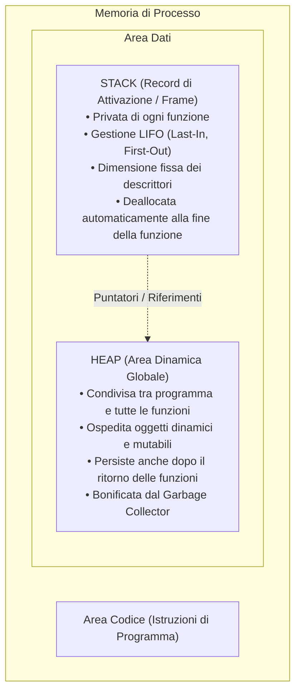
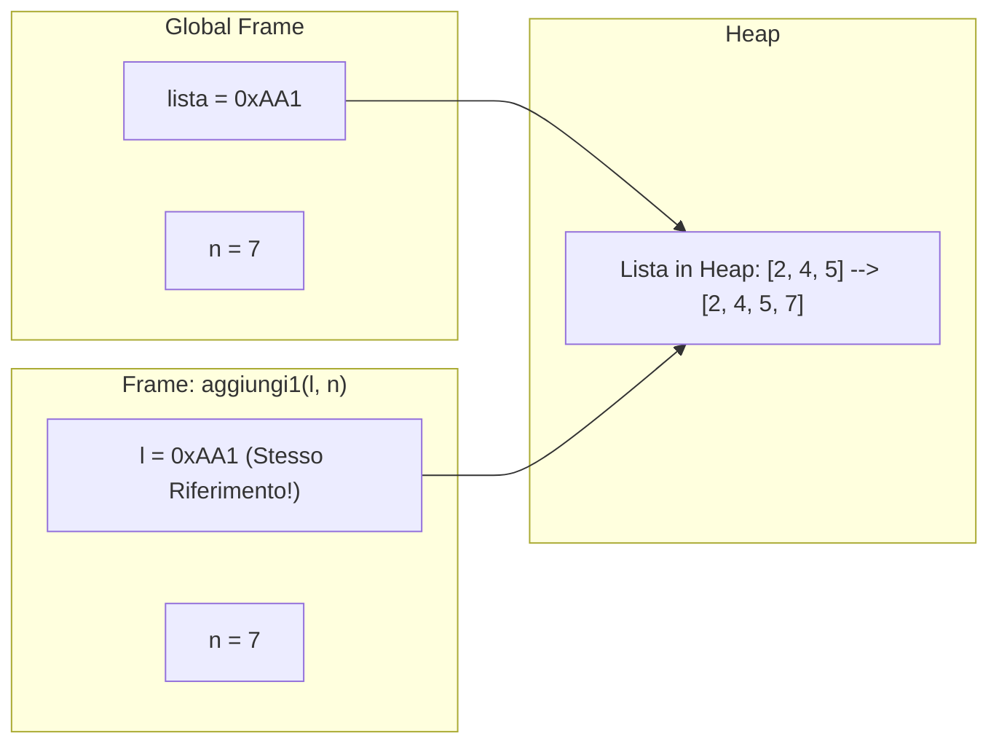

[[Home MOC|Home]] / [[Education & Learning]] / [[University]] / [[Lezione 10 - Modello di Memoria Stack Heap e Oggetti Mutabili]]

# Lezione 10 - Modello di Memoria Stack Heap e Oggetti Mutabili

## Sintesi Esecutiva
La padronanza della distinzione ontologica tra dati *immutabili* (numeri, booleani, stringhe) e dati *mutabili* (liste, dizionari) presuppone una chiara comprensione dell'architettura con cui l'interprete e il sistema operativo organizzano la memoria centrale. Questa decima lezione didattica (Sapienza Università di Roma, DIAG — a cura dei proff. D. Lembo, G. Santucci e M. Schaerf) formalizza il modello di memoria a due livelli: lo <mark style="background:rgba(255, 193, 69, 0.32)"><font color="#cc8800"><b>Stack (record di attivazione / frame locali privati)</b></font></mark> e l'<mark style="background:rgba(255, 193, 69, 0.32)"><font color="#cc8800"><b>Heap (memoria dinamica globale e condivisa)</b></font></mark>. Viene sviscerato il meccanismo del passaggio dei parametri in Python (*Call by Object Reference* o *Call by Sharing*), dimostrando perché le mutazioni in-place sulle liste alterino permanentemente i dati del programma chiamante (effetti collaterali), mentre le riassegnazioni di variabili immutabili rimangano confinate nel frame locale. La trattazione analizza in dettaglio le insidiose <mark style="background:rgba(181, 113, 255, 0.36)"><font color="#9a54c1"><b>trappole di iterazione</b></font></mark> (cancellazioni all'interno di cicli `for` che provocano il salto di elementi contigui), confronta la complessità e l'identità di memoria tra costrutti analoghi (`append` vs `+`, `sort` in-place vs `sorted`), e conclude con la risoluzione esaustiva di 6 esercizi di manipolazione strutturata collaudati tramite `tester_fun`.

---

## Architettura della Memoria Centrale: Stack ed Heap

La memoria centrale allocata per l'esecuzione di un programma Python è logicamente suddivisa in sezioni distinte:



### 1. Area Stack (Stack Frames)
- **Struttura LIFO:** Ogni invocazione di funzione alloca in cima allo Stack un nuovo record di attivazione (*frame* locale). Quando la funzione termina restituendo il controllo, il suo frame viene distrutto all'istante.
- **Global Frame:** È il frame speciale allocato per il programma principale, presente e persistente per l'intero ciclo di vita dell'applicazione.
- **Contenuto:** Contiene i descrittori delle variabili locali, i parametri formali e gli indirizzi di ritorno.

### 2. Area Heap (Memoria Dinamica)
- **Spazio Comune:** È l'area globale in cui risiedono fisicamente gli oggetti computazionali (in particolare le sequenze mutabili come le liste, i dizionari e le istanze di classe).
- **Gestione dei Riferimenti:** Più variabili residenti in frame diversi possono puntare contemporaneamente al medesimo oggetto nell'Heap.
- **Garbage Collector:** Quando un oggetto nell'Heap non è più referenziato da alcuna variabile attiva in alcuno stack frame, l'interprete Python ne ricicla automaticamente la memoria.

---

## Tipi Immutabili vs Mutabili nel Passaggio dei Parametri

In Python il passaggio degli argomenti alle funzioni segue rigorosamente la semantica del **Passaggio per Riferimento ad Oggetto** (*Call by Object Reference*): la funzione riceve una **copia del riferimento (puntatore)** all'oggetto, mai una copia del valore fisico. L'effetto finale dipende dalla mutabilità del tipo:



### 1. Tipi Immutabili (`int`, `float`, `str`, `bool`, `tuple`)
Poiché l'oggetto nell'Heap non può essere alterato internamente, qualsiasi operazione di "modifica" (es. `n = n + 1`) costringe Python a creare un **nuovo oggetto** nell'Heap e ad aggiornare la variabile locale del frame affinché punti a quest'ultimo. La variabile nel frame del chiamante rimane immutata.

### 2. Tipi Mutabili (`list`, `dict`, `set`)
La variabile locale riceve l'indirizzo di memoria dell'oggetto condiviso. L'applicazione di metodi mutazionali (`l.append()`, `l.insert()`, `l[i] = ...`, `l.pop()`) opera direttamente sull'oggetto nell'Heap, **propagando istantaneamente la modifica al programma chiamante**.

#### Confronto Fondamentale: `aggiungi1` vs `aggiungi2`
```python
# Modifica in-place (Effetto Collaterale Permanente)
def aggiungi1(l, n):
    l.append(n)  # Opera sull'oggetto heap condiviso con il chiamante!

# Clonazione difensiva (Nessun Effetto Collaterale)
def aggiungi2(l, n):
    l2 = l.copy()  # Alloca una nuova lista autonoma nell'heap
    l2.append(n)
    return l2

lista = [2, 4, 5]
aggiungi1(lista, 7)
print("Dopo aggiungi1:", lista)  # [2, 4, 5, 7] -> Modificata in-place!

lista2 = aggiungi2(lista, 99)
print("Originale dopo aggiungi2:", lista)   # [2, 4, 5, 7] -> Intatta!
print("Nuova lista restituita:", lista2)     # [2, 4, 5, 7, 99]
```

---

## Cicli e Modifica del Numero di Elementi: Le Trappole di Iterazione

> [!CAUTION] La Trappola della Rimozione durante il Ciclo `for`
> Modificare la dimensione di una lista (con `.remove()` o `.pop()`) all'interno di un ciclo `for` che itera sulla lista stessa è un **grave errore algoritmico**.

### Perché il Codice Errato Salta gli Elementi
Consideriamo il seguente codice errato per rimuovere tutte le occorrenze di `'giorno'` da una lista:

```python
def rimuoviTuttiErr(l, el):
    for elem in l:
        if elem == el:
            l.remove(elem)

k = ['nel', 'mezzo', 'giorno', 'giorno', 'cammino']
rimuoviTuttiErr(k, 'giorno')
print(k)  # Stampa ['nel', 'mezzo', 'giorno', 'cammino']! La seconda occorrenza NON è rimossa!
```

**Spiegazione Meccanica:**
1. L'iteratore del `for` tiene traccia dell'indice corrente (inizialmente 0, poi 1, poi 2...).
2. All'indice 2, individua il primo `'giorno'` e chiama `l.remove('giorno')`.
3. La rimozione sposta istantaneamente tutti gli elementi a destra di una posizione verso sinistra: il secondo `'giorno'` scivola dall'indice 3 all'indice 2!
4. All'iterazione successiva, il `for` incrementa il proprio contatore interno passando all'indice 3 (dove ora si trova `'cammino'`), **saltando a piè pari il secondo `'giorno'`**.

### Le Tre Soluzioni Canoniche Corrette

#### 1. Ciclo `while` con Ricerca di Presenza (`in`)
```python
def rimuoviTutti(l, el):
    rimosso = el in l
    while el in l:
        l.remove(el)  # Riesegue la ricerca dall'inizio finché esistono occorrenze
    return rimosso
```

#### 2. Iterazione su una Copia Superficiale (*Shallow Copy*)
Iterando su una copia congelata della lista (`l[:]`), l'indice del `for` scorre la copia immutata, mentre le rimozioni avvengono sulla lista originale:
```python
def rimuoviTutti_copia(l, el):
    for elem in l[:]:
        if elem == el:
            l.remove(elem)
```

#### 3. Svuotamento Totale della Lista (Pulizia Lista)
```python
# Approccio con while e pop
while len(l) > 0:
    l.pop()

# Approccio nativo Python
l.clear()
```

---

## Confronto Approfondito tra Metodi ed Operatori

### 1. `l.append(x)` vs `l = l + [x]`

| Proprietà | `l.append(x)` | `l = l + [x]` |
| :--- | :--- | :--- |
| **Azione in Memoria** | Modifica distruttiva in-place nell'Heap | Crea una **nuova lista** riallocando tutti gli elementi |
| **Complessità Temporale**| $O(1)$ ammortizzato | $O(n)$ (deve copiare tutti gli $n$ elementi) |
| **Identificativo (`id(l)`)**| Invariato (`id(l)` rimane lo stesso) | **Nuovo indirizzo** (`id` cambia) |
| **Effetto dentro Funzioni**| Visibile all'esterno nel chiamante | **Rompimento del legame**: la modifica rimane locale! |

```python
# Dimostrazione di disaccoppiamento del riferimento:
def raddoppiaUltimo(ls):
    if len(ls) > 0:
        ls = ls + [ls[-1]]  # ls ora punta a un NUOVO oggetto locale!

l = [2, 4, 5]
raddoppiaUltimo(l)
print(l)  # [2, 4, 5] -> Non è modificata perché l'operatore + ha generato un nuovo oggetto!
```

### 2. Ordinamento: `l.sort()` vs `sorted(l)`
- **`l.sort()`:** Ordina la lista direttamente in-place modificando la struttura interna nell'Heap. **Restituisce `None`**! (Scrivere `l = l.sort()` distrugge la lista assegnandovi `None`).
- **`sorted(l)`:** Funzione integrata che non tocca l'oggetto originale; alloca e **restituisce una nuova lista** contenente gli elementi ordinati.

### 3. Inserimento ed Estensione: `insert()`, `extend()`, Slicing
- `l.insert(i, x)`: Inserisce $x$ all'indice $i$ traslando verso destra tutti gli elementi successivi (costo $O(n)$).
- `l.extend(altro)`: Estende in-place la lista con tutti gli elementi dell'iterabile `altro` (equivalente a ripetuti `append`).
- Slicing in coda: `l[len(l):] = [x]` equivale semanticamente ad `append(x)`.

### 4. Insidia dell'Inizializzazione di Liste Annidate (Matrici)
```python
# ERRORE GRAVE: Replica del medesimo riferimento per ogni riga!
matrice_errata = [[0] * 3] * 3
matrice_errata[0][0] = 99
print(matrice_errata)  # [[99, 0, 0], [99, 0, 0], [99, 0, 0]] -> Tutte le righe sono la stessa lista!

# APPROCCIO CORRETTO: Creazione di righe indipendenti mediante comprehension
matrice_corretta = [[0 for _ in range(3)] for _ in range(3)]
matrice_corretta[0][0] = 99
print(matrice_corretta)  # [[99, 0, 0], [0, 0, 0], [0, 0, 0]]
```

---

## Risoluzione Dettagliata dei 6 Esercizi Algoritmici con `tester_fun`

### Esercizio 1: Lunghezza Massima in Lista di Stringhe (`stringaMax`)
**Testo:** Scrivere una funzione Python che riceve in input una lista di stringhe e restituisce la lunghezza della stringa più lunga.

```python
from tester import tester_fun

def stringaMax(l):
    if len(l) == 0:
        return 0
    max_len = 0
    for s in l:
        if len(s) > max_len:
            max_len = len(s)
    return max_len

tester_fun(stringaMax, [['casa', 'pippo', 'paperopoli']], 10)
tester_fun(stringaMax, [['ciao', 'a', '', 'io']], 4)
tester_fun(stringaMax, [['mario', 'maria', 'mario']], 5)
tester_fun(stringaMax, [['a', 'b', 'c']], 1)
tester_fun(stringaMax, [['abracadabra']], 11)
```

---

### Esercizio 2: Posizione dell'Ultimo Intero Positivo (`ultimoPos`)
**Testo:** Scrivere una funzione Python che riceve una lista di interi e restituisce la posizione dell'ultimo elemento positivo ($\ge 0$). Se nessun elemento è positivo, restituisce $-1$.

```python
from tester import tester_fun

def ultimoPos(l):
    # Scansione all'indietro per individuare tempestivamente l'ultimo elemento valido
    for i in range(len(l) - 1, -1, -1):
        if l[i] >= 0:
            return i
    return -1

tester_fun(ultimoPos, [[5, 6, 9, 0, -2]], 3)
tester_fun(ultimoPos, [[-5, -6, -9, -2]], -1)
tester_fun(ultimoPos, [[-10, 6, 9, 0, 2]], 4)
tester_fun(ultimoPos, [[-5, 3]], 1)
tester_fun(ultimoPos, [[5, -6, 9, 0, 2, -12, 13]], 6)
```

---

### Esercizio 3: Inserimento Ordinato per Lunghezza (`inserisciStringa`)
**Testo:** Scrivere una funzione Python che, ricevendo in ingresso una lista `l` ed una stringa `s`, inserisce la stringa `s` in `l` in-place in modo da mantenere le stringhe ordinate per lunghezza.

```python
from tester import tester_fun

def inserisciStringa(l, s):
    len_s = len(s)
    inserito = False
    
    for i in range(len(l)):
        if len_s <= len(l[i]):
            l.insert(i, s)
            inserito = True
            break
            
    if not inserito:
        l.append(s)
        
    return l

tester_fun(inserisciStringa, [['nel', 'mezzo', 'cammino'], 'casa'], ['nel', 'casa', 'mezzo', 'cammino'])
tester_fun(inserisciStringa, [['nel', 'casa', 'mezzo', 'cammino'], 'casa'], ['nel', 'casa', 'casa', 'mezzo', 'cammino'])
tester_fun(inserisciStringa, [['nel', 'casa', 'casa', 'mezzo', 'cammino'], 'vita'], ['nel', 'casa', 'casa', 'vita', 'mezzo', 'cammino'])
tester_fun(inserisciStringa, [['nel', 'casa', 'casa', 'mezzo', 'cammino'], 'nostra'], ['nel', 'casa', 'casa', 'mezzo', 'nostra', 'cammino'])
tester_fun(inserisciStringa, [['nel', 'casa', 'mezzo', 'nostra', 'cammino'], 'mi'], ['mi', 'nel', 'casa', 'mezzo', 'nostra', 'cammino'])
```

---

### Esercizio 4: Somma di Soli Interi in Lista Eterogenea (`somma`)
**Testo:** Scrivere una funzione che riceve una lista $l$ di elementi disomogenei e calcola la somma di tutti e soli gli elementi interi.

> [!NOTE] Attenzione al Tipo Booleano in Python
> In Python `bool` è una sottoclasse di `int` (`isinstance(True, int)` è `True`). Per sommare rigorosamente solo i numeri interi ed escludere i booleani, occorre usare il controllo di identità di tipo `type(elem) == int`.

```python
from tester import tester_fun

def somma(l):
    totale = 0
    for elem in l:
        if type(elem) == int:
            totale += elem
    return totale

tester_fun(somma, [[3, 5, 6.1, -1, 'casa', 11]], 18)
tester_fun(somma, [[3, 'ciao', 6.1, -1, 'casa', 11]], 13)
tester_fun(somma, [[3, 'ciao', 'roma', -1, 'casa', 11]], 13)
tester_fun(somma, [[3, -1, 11]], 13)
tester_fun(somma, [[5, 'ciao', -1, 'casa', 13]], 17)
```

---

### Esercizio 5: Eliminazione in-place per Lunghezza (`eliminaStringhe`)
**Testo:** Scrivere una funzione che riceve una lista di stringhe $l$ ed un intero $i$, ed elimina da $l$ in-place tutte le stringhe aventi lunghezza strettamente maggiore di $i$.

```python
from tester import tester_fun

def eliminaStringhe(l, i):
    idx = 0
    # Gestione controllata dell'indice per non saltare elementi contigui dopo la cancellazione
    while idx < len(l):
        if len(l[idx]) > i:
            l.pop(idx)
        else:
            idx += 1
    return l

tester_fun(eliminaStringhe, [["mamma", "sì", "ciao", "pippo"], 2], ["sì"])
tester_fun(eliminaStringhe, [["mamma", "sì", "ciao", "pippo"], 4], ["sì", "ciao"])
tester_fun(eliminaStringhe, [["mamma", "sì", "ciao", "pippo"], 5], ["mamma", "sì", "ciao", "pippo"])
tester_fun(eliminaStringhe, [["mamma", "sì", "ciao", "pippo"], 0], [])
tester_fun(eliminaStringhe, [["assolo", "io"], 4], ["io"])
```

---

### Esercizio 6: Fusione Ordinata di Due Liste di Stringhe (`merge`)
**Testo:** Scrivere una funzione che riceve in input due liste di stringhe $l_1$ ed $l_2$ ordinate per lunghezza e crea una **nuova lista** dalla loro fusione (*merge*) preservando l'ordinamento per lunghezza. Nel caso di stringhe della stessa lunghezza, dare priorità alle stringhe della lista $l_2$.

```python
from tester import tester_fun

def merge(l1, l2):
    ris = []
    i = 0
    j = 0
    n1 = len(l1)
    n2 = len(l2)
    
    # Scorrimento congiunto a due puntatori
    while i < n1 and j < n2:
        # Se la lunghezza in l2 è minore o UGUALE a quella in l1, prevale l2
        if len(l2[j]) <= len(l1[i]):
            ris.append(l2[j])
            j += 1
        else:
            ris.append(l1[i])
            i += 1
            
    # Accoda gli eventuali elementi rimanenti
    while i < n1:
        ris.append(l1[i])
        i += 1
        
    while j < n2:
        ris.append(l2[j])
        j += 1
        
    return ris

tester_fun(merge, [['a', 'b', 'abc', 'abbcc'], ['', 'aa', 'bb', 'cccc', 'ccccccc']], ['', 'a', 'b', 'aa', 'bb', 'abc', 'cccc', 'abbcc', 'ccccccc'])
tester_fun(merge, [['aa', 'bb'], ['cccc', 'ccccccc']], ['aa', 'bb', 'cccc', 'ccccccc'])
tester_fun(merge, [["sì", "ciao", "mamma", "pippo"], ["io", "assolo"]], ["io", "sì", "ciao", "mamma", "pippo", "assolo"])
tester_fun(merge, [['', 'a', 'c'], ['dd']], ['', 'a', 'c', 'dd'])
tester_fun(merge, [['alfa', 'omega'], ['beta', 'gamma']], ['beta', 'alfa', 'gamma', 'omega'])
```
