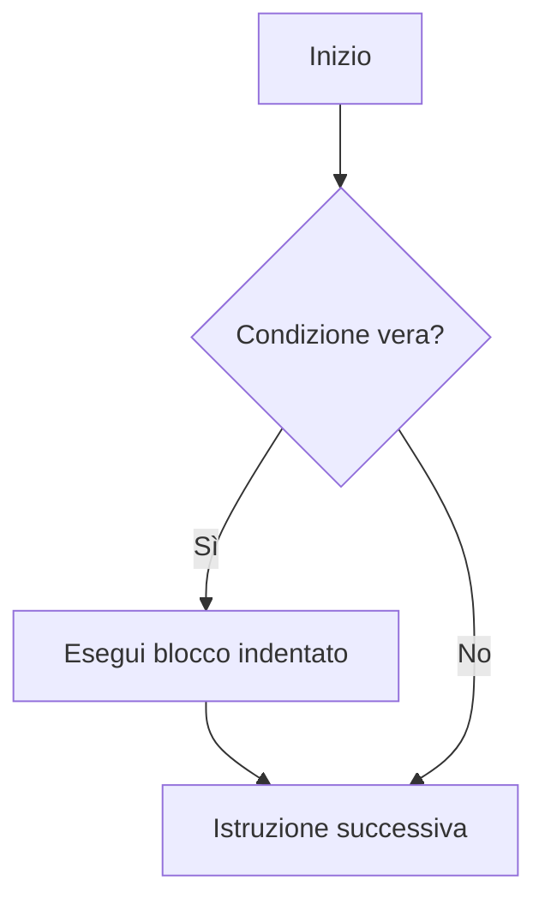

[[Home MOC|Home]] / [[Education & Learning]] / [[Lezione 5 - Condizioni e Istruzione If]]

# Lezione 5 - Condizioni e Istruzione If

## Sintesi Esecutiva
L'introduzione della diramazione condizionale conferisce ai programmi la facoltà di prendere decisioni dinamiche ed eseguire flussi alternativi in risposta a specifiche condizioni logiche. Questa quinta lezione didattica (Sapienza Università di Roma, DIAG — a cura dei proff. D. Lembo, A. Poggi, G. Santucci e M. Schaerf) formalizza il tipo primitivo `bool` e l'algebra booleana in Python, analizzando gli operatori logici `and`, `or`, `not`, le regole di De Morgan e il cortocircuito computazionale. La trattazione sviluppa la sintassi e l'indentazione semantica dei costrutti <mark style="background:rgba(255, 193, 69, 0.32)"><font color="#cc8800"><b>if, else ed elif</b></font></mark>, approfondisce i metodi di introspezione booleana sulle stringhe, mette in guardia dai rischi legati all'imprecisione del confronto diretto tra <mark style="background:rgba(181, 113, 255, 0.36)"><font color="#9a54c1"><b>numeri reali float</b></font></mark>, e formalizza pattern algoritmici per il controllo dell'input e la selezione testuale.

## Tipo Booleano ed Espressioni Relazionali

In Python il tipo di dato `bool` (ispirato al matematico George Boole) ammette esclusivamente due valori di verità, rappresentati dalle costanti predefinite:
$$\text{Costanti Booleane: } \quad \texttt{True}, \quad \texttt{False}$$
*(scritte rigorosamente con l'iniziale maiuscola).*

### Operatori Relazionali di Confronto
Gli operatori di confronto valutano relazioni tra espressioni numeriche o testuali e restituiscono un valore booleano:

| Operatore | Significato | Esempio | Risultato |
|---|---|---|---|
| `==` | Uguaglianza semantica | `5 == 5` | `True` |
| `!=` | Disuguaglianza | `5 != 3` | `True` |
| `<` | Minore stretto | `10 < 2` | `False` |
| `<=` | Minore o uguale | `4 <= 4` | `True` |
| `>` | Maggiore stretto | `7 > 1` | `True` |
| `>=` | Maggiore o uguale | `3 >= 8` | `False` |

```python
# Assegnazione di espressioni booleane a variabili
b = 5 < 3
print(b)  # Stampa False

c = len("scuola") == len("sala")
print(c)  # Stampa False (6 == 4 è False)
```

### Confronto Lessicografico tra Stringhe
Il confronto d'ordine tra stringhe in Python si basa sull'**ordinamento lessicografico** dei singoli code point Unicode (analizzati in [[Lezione 0 - Rappresentazione dei Caratteri e Dati Multimediali]]):
- I caratteri vengono confrontati uno ad uno da sinistra a destra.
- Poiché le lettere maiuscole precedono nell'ordinamento ASCII/Unicode quelle minuscole (es. `'Z'` ha codice 90, mentre `'a'` ha codice 97), qualsiasi lettera maiuscola risulta minore di qualunque lettera minuscola:
  ```python
  print("Zebra" < "ape")    # True (ord('Z') < ord('a'))
  print("casa" == "casale")  # False
  print("casa" < "casale")   # True (prefisso proprio)
  ```

---

## Algebra Booleana e Operatori Logici

Espressioni condizionali articolate si compongono mediante i tre operatori booleani fondamentali: `not`, `and` e `or`.

### Tabelle di Verità e Semantica
1. **Negazione (`not`):** operatore unario che inverte il valore di verità.
   `not True` $\to$ `False`, `not False` $\to$ `True`.
2. **Congiunzione (`and`):** vero se e solo se entrambi gli operandi sono veri.
   `True and True` $\to$ `True`; qualsiasi operando `False` rende l'espressione `False`.
3. **Disgiunzione (`or`):** falso se e solo se entrambi gli operandi sono falsi.
   `False or False` $\to$ `False`; è sufficiente un operando `True` per ottenere `True`.

### Equivalenze con la Negazione e Leggi di De Morgan
Nello sviluppo e nella semplificazione dei predicati logici, valgono le equivalenze:

| Espressione | Equivalente Logico |
|---|---|
| `not (x == y)` | `x != y` |
| `not (x != y)` | `x == y` |
| `not (x < y)` | `x >= y` |
| `not (x <= y)` | `x > y` |
| `not (x > y)` | `x <= y` |
| `not (x >= y)` | `x < y` |

> [!IMPORTANT] Leggi di De Morgan
> Consentono di negare congiunzioni e disgiunzioni logiche scambiando l'operatore:
> $$\texttt{not (A and B)} \iff \texttt{not A or not B}$$
> $$\texttt{not (A or B)} \iff \texttt{not A and not B}$$

### Gerarchia di Precedenza degli Operatori
Quando un'istruzione combina operatori eterogenei senza parentesi, Python applica il seguente ordine di precedenza:
1. **Parentesi tonde `()`:** precedenza assoluta.
2. **Operatori aritmetici:** potenza (`**`), moltiplicativi (`*`, `/`, `//`, `%`), additivi (`+`, `-`).
3. **Operatori di confronto relazionale:** `<`, `<=`, `>`, `>=`, `==`, `!=`, `in`.
4. **Operatore logico unario `not`**
5. **Operatore logico `and`**
6. **Operatore logico `or`**

```python
# Esempio di valutazione gerarchica:
# 5 < 3 and 2 + 1 == 3 or not False
# Passo 1 (aritmetica): 5 < 3 and 3 == 3 or not False
# Passo 2 (confronti): False and True or not False
# Passo 3 (not): False and True or True
# Passo 4 (and): False or True
# Passo 5 (or): True
```

### Valutazione in Cortocircuito (Short-Circuit Evaluation)
Python ottimizza l'esecuzione dei connettivi logici interrompendo la valutazione non appena il risultato finale è univocamente determinato:
- In `A and B`: se `A` è `False`, l'espressione non può essere vera; `B` **non viene minimamente valutata**.
- In `A or B`: se `A` è `True`, l'espressione è sicuramente vera; `B` **non viene minimamente valutata**.

Questo comportamento previene errori a runtime (*guard pattern*):
```python
# Se len(s) == 0, la seconda parte causerebbe IndexError, ma non viene eseguita!
if len(s) > 0 and s[0] == 'A':
    print("Inizia per A")
```

---

## Metodi e Funzioni Booleane per Stringhe

Python mette a disposizione predicati incorporati specifici per l'analisi del testo (in continuità con [[Lezione 3 - Stringhe Metodi e Slicing]]):

1. **Operatore di appartenenza `in`:**
   Verifica se una sottostringa è contenuta in una sequenza testuale:
   `'pel' in 'spellare'` restituisce `True`; `'pa' in 'spellare'` restituisce `False`.
2. **`s.isalpha()`:**
   Restituisce `True` se la stringa non è vuota ed è composta **esclusivamente da caratteri alfabetici** (senza spazi, cifre o punteggiatura).
3. **`s.isdecimal()`:**
   Restituisce `True` se la stringa non è vuota ed è composta **esclusivamente da cifre numeriche** (`'0'`-`'9'`).
4. **`s.islower()` / `s.isupper()`:**
   Verificano che tutti i caratteri alfabetici siano rispettivamente minuscoli o maiuscoli.
5. **`s.startswith(prefisso)` / `s.endswith(suffisso)`:**
   Controllano l'occorrenza di una sottostringa all'inizio o al termine della stringa.

---

## Costrutti Condizionali: If, Else ed Elif

### 1. Istruzione `if` Semplice
Esegue un blocco subordinato se e solo se la guardia logica è vera:

```python
if condizione:
    istruzione_1
    istruzione_2
istruzione_successiva
```
- La clausola termina con i due punti (`:`).
- Il corpo dell'istruzione deve essere rigorosamente indentato di 4 spazi.



### 2. Struttura Alternativa Completa: `if ... else`
Gestisce la ramificazione mutualmente esclusiva tra due percorsi:

```python
if condizione:
    blocco_vero
else:
    blocco_falso
```

### 3. Diramazione a Più Vie: `if ... elif ... else`
Quando si devono valutare molteplici alternative mutualmente esclusive, la sequenza `elif` (*else if*) evita l'annidamento profondo non leggibile:

```python
voto = 28
if voto >= 28:
    giudizio = "Ottimo"
elif voto >= 24:
    giudizio = "Buono"
elif voto >= 18:
    giudizio = "Sufficiente"
else:
    giudizio = "Insufficiente"
```
Python valuta le condizioni nell'ordine dall'alto verso il basso. Non appena una condizione risulta `True`, il relativo blocco viene eseguito e l'intera catena condizionale viene abbandonata.

---

## Criticità Numeriche: Confronto tra Reali (Float)

> [!WARNING] Anti-Pattern: Uguaglianza Diretta tra Float
> A causa della rappresentazione a precisione finita secondo lo standard IEEE 754, la maggior parte dei numeri frazionari non ammette una rappresentazione binaria esatta, inducendo errori di troncamento:
> ```python
> >>> 0.1 + 0.2 == 0.3
> False
> >>> 0.1 + 0.2
> 0.30000000000000004
> ```
> Confrontare due numeri reali con l'operatore di uguaglianza diretta `==` è un grave errore metodologico.

### Confronto con Tolleranza Epsilon
Il confronto corretto tra float richiede di verificare se la loro distanza assoluta risulta inferiore a una soglia di tolleranza infinitesima $\varepsilon$ prefissata:

```python
epsilon = 1e-9
a = 0.1 + 0.2
b = 0.3

if abs(a - b) < epsilon:
    print("I numeri sono numericamente coincidenti")
```
In alternativa, a partire da Python 3.5 si impiega la funzione standard `math.isclose(a, b, rel_tol=1e-9)`.

---

## Pattern Algoritmici ed Esercizi Risolti

### Esercizio 1: Selezione di Sottostringa tra Due Occorrenze
Leggere una stringa $s$ e un carattere $c$. Se $c$ compare almeno due volte, stampare la porzione compresa tra la prima e la seconda occorrenza (incluse); altrimenti stampare messaggio d'errore:

```python
s = input("Stringa: ")
c = input("Carattere: ")

if s.count(c) >= 2:
    idx1 = s.find(c)
    idx2 = s.find(c, idx1 + 1)
    sottostringa = s[idx1 : idx2 + 1]
    print("Sottostringa estratta:", sottostringa)
else:
    print(f"Il carattere '{c}' compare meno di due volte nella stringa.")
```

### Esercizio 2: Controllo Input di un Numero Frazionario con Segno
Verificare che una stringa in input rappresenti un valore decimale valido con segno opzionale (es. `"+12.5"`, `"-0.75"`, `"42.1"`):

```python
num_str = input("Inserisci numero decimale: ")

# Rimozione del segno opzionale iniziale
s = num_str
if len(s) > 0 and (s[0] == '+' or s[0] == '-'):
    s = s[1:]

parti = s.split('.')

# Condizione di validità: esattamente una virgola e parti composte solo da cifre
if len(parti) == 2 and parti[0].isdecimal() and parti[1].isdecimal():
    valore = float(num_str)
    print("Numero valido convertito:", valore)
else:
    print("Formato numerico frazionario non valido.")
```

### Esercizio 3: Test di Palindromia Tramite Slicing
Verificare se una stringa è palindroma (inversa identica all'originale):

```python
testo = input("Inserisci parola: ")
is_palindroma = (testo == testo[::-1])
print("Palindroma:", is_palindroma)
```

### Esercizio 4: Gioco dell'Indovinello con Feedback Condizionale
Indovinare un numero segreto generato casualmente tra 1 ed $N$ in 3 tentativi:

```python
import random

n = int(input("Inserisci il limite superiore N: "))
segreto = random.randint(1, n)
indovinato = False

for tentativo in range(1, 4):
    scelta = int(input(f"Tentativo {tentativo}/3 - Inserisci numero: "))
    if scelta == segreto:
        print(f"Complimenti! Hai indovinato in {tentativo} tentativi!")
        indovinato = True
        break
    elif scelta < segreto:
        print("Troppo basso!")
    else:
        print("Troppo alto!")

if not indovinato:
    print(f"Tentativi esauriti! Il numero segreto era: {segreto}")
```
