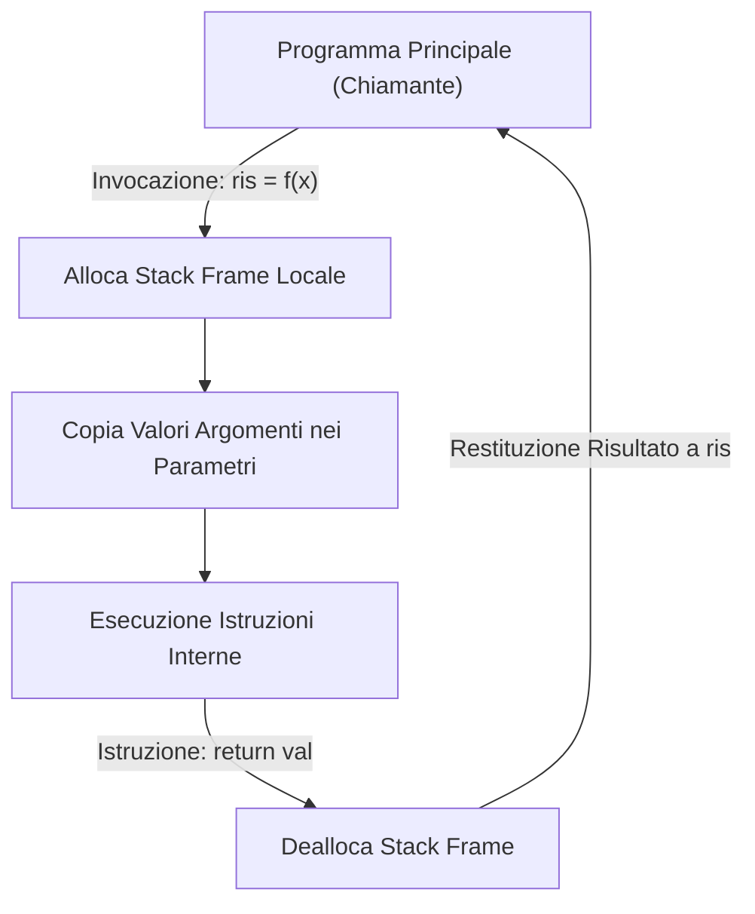
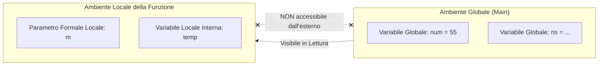

[[Home MOC|Home]] / [[Education & Learning]] / [[Lezione 6 - Funzioni Parametri Scope ed Esercizi Algoritmici]]

# Lezione 6 - Funzioni Parametri Scope ed Esercizi Algoritmici

## Sintesi Esecutiva
La scomposizione di un algoritmo complesso in sotto-problemi indipendenti e riutilizzabili rappresenta il fondamento dell'ingegneria del software e dell'astrazione procedurale. Questa sesta lezione didattica (Sapienza Università di Roma, DIAG — a cura dei proff. D. Lembo, A. Poggi, G. Santucci e M. Schaerf) formalizza la creazione e gestione di funzioni definite dall'utente mediante la clausola `def`. Viene sviscerata la distinzione tra definizione ed esecuzione, l'anatomia del passaggio dei parametri e il ruolo dell'istruzione `return`, evidenziando la netta separazione concettuale tra la restituzione di un valore computabile e la produzione di output a terminale (il tipo speciale `None`). La trattazione approfondisce la teoria della <mark style="background:rgba(255, 193, 69, 0.32)"><font color="#cc8800"><b>visibilità delle variabili (scope locale vs globale)</b></font></mark>, l'uso e i rischi della direttiva `global`, e la prevenzione degli <mark style="background:rgba(181, 113, 255, 0.36)"><font color="#9a54c1"><b>effetti collaterali indesiderati</b></font></mark>. Vengono infine introdotte la modularizzazione su file esterni, la sintassi dei <mark style="background:rgba(255, 193, 69, 0.32)"><font color="#cc8800"><b>parametri opzionali con valori di default</b></font></mark>, la metodologia di testing guidato tramite `tester_fun`, e la risoluzione rigorosa di complessi pattern algoritmici di manipolazione numerica e testuale.

---

## Anatomia di una Funzione: Definizione vs Invocazione

Nei capitoli precedenti (da [[Lezione 1 - Introduzione a Python ed Espressioni Numeriche]] a [[Lezione 5 - Condizioni e Istruzione If]]) sono state impiegate numerose funzioni integrate (*built-in*) fornite da Python, quali `len()`, `print()`, `input()`, `ord()`, `chr()`. Attraverso l'istruzione `def`, il programmatore può estendere il vocabolario del linguaggio creando le proprie funzioni personalizzate.

### Sintassi Fondamentale
```python
def nome_funzione(parametro_1, parametro_2, ...):
    """Docstring opzionale esplicativa."""
    blocco_istruzioni_indentato
    return risultato
```

> [!IMPORTANT] Definizione vs Esecuzione
> - **Definizione (`def`):** L'interprete compila il blocco di istruzioni e associa l'identificatore a un oggetto funzione memorizzato nel namespace corrente. **Nessuna delle istruzioni interne viene eseguita** in questa fase.
> - **Invocazione / Chiamata (`nome(...)`):** L'interprete sospende il flusso del programma chiamante, alloca un nuovo *record di attivazione* (stack frame locale), associa i valori degli argomenti effettivi ai parametri formali ed esegue sequenzialmente il corpo della funzione.



### Il Modello Matematico e l'Istruzione `return`
Analogamente a una funzione matematica $f: X \to Y$ (es. $f(x) = \sin(x)$), una funzione ideale in informatica riceve dei dati in ingresso mediante i suoi parametri, elabora la trasformazione e restituisce un unico risultato computato al chiamante tramite la parola chiave `return`.

```python
# Versione esplicita con variabile temporanea
def raddoppia(n):
    k = 2 * n
    return k

# Versione contratta ed idiomatica
def raddoppia_compatto(n):
    return 2 * n

ris = raddoppia(7)  # ris riceve il valore 14
```

### Funzioni Booleane Predicative: Esempio `isPari`
Una funzione che restituisce un valore booleano (`True` o `False`) prende il nome di **predicato**.

```python
# Versione con diramazione condizionale if-else
def isPari(n):
    if n % 2 == 0:
        return True
    else:
        return False

# Versione idiomatica: restituzione diretta dell'espressione booleana
def isPari_ottimale(n):
    return n % 2 == 0
```
Poiché l'operatore relazionale `==` produce nativamente un valore di tipo `bool`, è ridondante utilizzare un costrutto `if-else` per restituire le costanti letterali `True` e `False`.

---

## Funzioni Senza Valore di Ritorno ed Effetti Collaterali

### Funzioni "senza return": Il Valore `None`
In Python ogni funzione restituisce *sempre* un valore. Qualora il flusso di esecuzione raggiunga il termine del blocco indentato senza incontrare un `return`, oppure incontri un'istruzione `return` isolata senza argomenti, la funzione restituisce automaticamente il valore speciale singleton:
$$\texttt{None} \quad (\text{di tipo } \texttt{NoneType})$$

```python
def stampa_il_doppio(n):
    print(2 * n)
    # Ritorno implicito di None

v = 5
risultato = stampa_il_doppio(v)  # Stampa 10 a terminale
print("Valore assegnato a risultato:", risultato)  # Stampa None
```

> [!CAUTION] Confusione tra `print()` e `return`
> È uno degli errori più frequenti nei principianti:
> - `print()` è una funzione orientata all'output su standard output (terminale per l'utente umano). Essa **non restituisce nulla** al programma chiamante (`print('x')` restituisce `None`).
> - `return` è l'istruzione del linguaggio che passa il dato computato alla porzione di programma che ha effettuato l'invocazione, permettendo al valore di essere assegnato a variabili, inserito in espressioni o passato ad altre funzioni.

```python
x = print("prova")
print(x)  # Visualizza None, poiché print non restituisce dati riutilizzabili!
```

---

## Visibilità delle Variabili e Gestione dello Scope

Lo studio della visibilità (*scope*) governa la risoluzione dei nomi tra il programma principale e le funzioni richiamate.



### Variabili Locali vs Variabili Globali
1. **Variabili Locali:** Tutte le variabili create all'interno del corpo di una funzione (compresi i suoi parametri formali) appartengono al **namespace locale**. Esse nascono nel momento in cui la funzione viene invocata e vengono distrutte (deallocate dalla memoria) non appena l'esecuzione della funzione termina. Il programma principale **non ha alcun accesso** alle variabili locali.
2. **Variabili Globali:** Le variabili istanziate nel corpo principale del modulo appartengono al **namespace globale**. Una funzione può *leggere* il valore delle variabili globali.

```python
def aggiunginum(m):
    print("Valore del parametro locale m:", m)
    print("Valore della variabile globale num:", num)  # Lettura globale legittima
    m = m + num  # m è locale e viene modificata localmente
    return m

num = 55  # Variabile globale
ris = aggiunginum(5)
print("risultato:", ris)  # Stampa 60

# print(m) -> NameError: name 'm' is not defined (m non esiste fuori dalla funzione)
```

### Modifica delle Variabili Globali e la Direttiva `global`
In Python, se all'interno di una funzione compare un'istruzione di assegnazione (`variabile = valore`), l'interprete compila automaticamente quella variabile come **locale**. Ciò impedisce sovrascritture accidentali delle variabili del programma principale (fenomeno del *shadowing*).

Se si desidera intenzionalmente modificare una variabile globale all'interno del corpo di una funzione, è obbligatorio dichiararla preventivamente tramite la direttiva `global`:

```python
# Comportamento predefinito: creazione di variabile locale
def prova_locale():
    k = 9  # Crea una variabile LOCALE k, lasciando intatta la k globale
    print("Dentro prova_locale, k vale:", k)

k = 5
prova_locale()
print("Nel main, k vale ancora:", k)  # Stampa 5

# Modifica forzata della variabile globale
def prova_globale():
    global k
    k = 9  # Modifica direttamente la k del namespace globale
    print("Dentro prova_globale, k vale:", k)

k = 5
prova_globale()
print("Nel main, k modificata vale:", k)  # Stampa 9
```

> [!WARNING] Evitare l'Uso di `global` (Antipattern)
> L'uso della keyword `global` è fortemente sconsigliato nei paradigmi di programmazione moderna per tre motivi critici:
> 1. **Accoppiamento Stretto:** La funzione dipende dall'esistenza di una specifica variabile esterna con un nome rigido; se il programma chiamante usa un nome diverso, la funzione fallisce.
> 2. **Imprevedibilità:** Modificare lo stato globale rende il programma suscettibile a bug oscuri e interferenze difficili da isolare (azione spettrale a distanza).
> 3. **Impossibilità di Concorrenza:** Funzioni con stato globale condiviso non sono *thread-safe* né facilmente parallelizzabili.

---

## Effetti Collaterali e le Tre Buone Regole di Progettazione

Un'esecuzione si dice presentare un <mark style="background:rgba(181, 113, 255, 0.36)"><font color="#9a54c1"><b>effetto collaterale (side effect)</b></font></mark> quando modifica lo stato osservabile del sistema al di fuori del valore restituito:
- Modifica di variabili globali.
- Modifica di oggetti mutabili passati come argomenti (es. liste).
- Operazioni di Input/Output (scrittura su file, emissione di testo con `print()`, invio di pacchetti di rete).

Sebbene gli effetti collaterali siano indispensabili per interagire con l'ambiente esterno, la loro presenza all'interno delle funzioni di calcolo puro riduce drasticamente la **riusabilità** del codice. Si pensi a quanto risulterebbe disastrosa una funzione matematica `sin(x)` che ad ogni calcolo stampasse del testo o modificasse la variabile `x`!

### Le Tre Regole Auree dei Docenti
1. **Input Autoconsistente:** I dati necessari alla computazione devono essere forniti alla funzione **esclusivamente tramite i suoi parametri formali**. Evitare l'accesso diretto a variabili globali.
2. **Output Esclusivo via Return:** Il risultato deve essere restituito al chiamante unicamente con `return`. Non impiegare `print()` per comunicare il risultato dell'elaborazione.
3. **Minimizzazione dei Side Effects:** Ridurre al minimo indispensabile qualsiasi mutazione di stato che esuli dal puro calcolo.

### Confronto: Codice Fragile vs Codice Modulare e Riusabile

```python
# VERSIONE SCORRETTA E FRAGILE (Accoppiata alla variabile globale 'g')
def modifica_g_pessima(n):
    global g
    print("Valore globale corrente:", g)  # Effetto collaterale I/O
    g = n                                 # Effetto collaterale mutazione globale
    return g + n

# VERSIONE CORRETTA, PURA E RIUTILIZZABILE
def modifica_ottimale(valore_base, incremento):
    # Riceve tutto dall'input, non tocca variabili globali, restituisce il calcolo
    return valore_base + incremento
```

---

## Modularità del Codice: Importazione da File Esterni

All'aumentare delle dimensioni del codice, le funzioni vengono estratte dal file principale e raccolte all'interno di librerie dedicate denominati **moduli** (file con estensione `.py`).

Per poter essere importato, il file contenente la libreria (es. `mieFunzioni.py`) deve risiedere nella cartella di lavoro corrente o in una directory inclusa nel percorso di ricerca di Python (`sys.path`).

```python
# File: mieFunzioni.py
def isPari(n):
    return n % 2 == 0

def fattoriale(n):
    acc = 1
    for i in range(1, n + 1):
        acc *= i
    return acc
```

Nel programma principale, le definizioni possono essere incorporate secondo due sintassi complementari:

```python
# Sintassi selettiva (importa il simbolo nel namespace corrente)
from mieFunzioni import isPari, fattoriale

print(isPari(12))        # True
print(fattoriale(5))     # 120

# Sintassi qualificata (preserva il namespace del modulo)
import mieFunzioni

print(mieFunzioni.isPari(7))  # False
```

---

## Parametri Opzionali e Valori di Default

In Python è possibile associare ai parametri formali un <mark style="background:rgba(255, 193, 69, 0.32)"><font color="#cc8800"><b>valore di default</b></font></mark>. I parametri dotati di valore di default diventano **parametri opzionali**: se il chiamante omette l'argomento corrispondente nell'invocazione, viene applicato automaticamente il default designato.

```python
def incrementa(n, incremento=1):
    return n + incremento

print(incrementa(10))     # 11 (incremento assume il default 1)
print(incrementa(10, 5))  # 15 (incremento viene sovrascritto con 5)
```

### Regole Sintattiche sui Parametri di Default
1. **Vincolo di Posizionamento in Coda:** Tutti i parametri opzionali devono obbligatoriamente comparire **dopo** tutti i parametri obbligatori (non opzionali). La firma `def f(a=1, b):` genera un errore di compilazione immediato (`SyntaxError: non-default argument follows default argument`).
2. **Assegnazione Posizionale vs Keyword Arguments:** In presenza di molteplici parametri opzionali, gli argomenti passati posizionalmente saturano i parametri da sinistra verso destra. Qualora si desideri specificare un parametro opzionale saltando quelli intermedi, è obbligatorio richiamarlo esplicitamente per nome (*keyword argument*):

```python
def incrementa2(n, passo=1, lunghezza=1):
    return n + passo * lunghezza

x = 6
# Chiamata con tutti i default
print(incrementa2(x))                # 6 + 1*1 = 7

# Chiamata specificando solo il primo opzionale (passo)
print(incrementa2(x, 3))             # 6 + 3*1 = 9

# Chiamata specificando selettivamente 'lunghezza' tramite keyword
print(incrementa2(x, lunghezza=5))   # 6 + 1*5 = 11

# Chiamata completa con tutti i parametri
print(incrementa2(x, 3, 2))          # 6 + 3*2 = 12
```

Un esempio illustre di questa sintassi è offerto dalla funzione integrata `print(*objects, sep=' ', end='\n')`, in cui `sep` ed `end` sono argomenti keyword opzionali.

---

## Metodologia di Testing con `tester_fun`

Lo sviluppo professionale del software adotta un approccio **Test-Driven**: formalizzare i casi di test e i relativi risultati attesi *prima* o contestualmente alla scrittura del corpo della funzione. In questo modo si verifica oggettivamente che il comportamento dell'algoritmo soddisfi tutte le specifiche contrattuali, specialmente sui casi limite (*corner cases*).

La suite didattica mette a disposizione l'harness `tester_fun`:
```python
tester_fun(funzione_da_testare, lista_argomenti_input, risultato_atteso)
```
- Restituisce `1` (o incrementa il contatore) se l'output calcolato coincide strettamente con il valore atteso; restituisce `0` e segnala l'errore in caso di difformità.

```python
from tester import tester_fun

def raddoppia(n):
    return 2 * n

tester_fun(raddoppia, [2], 4)   # Test superato
tester_fun(raddoppia, [4], 8)   # Test superato
```

---

## Pattern Algoritmici ed Esercizi Risolti

Di seguito vengono analizzati e risolti i pattern algoritmici proposti nel notebook didattico, corredati di disamina della complessità e gestione dei casi limite.

### Pattern 1: Costruzione Incrementale con Accumulatore
Definire una funzione `rimuovoNonAlpha(s)` che riceve una stringa `s` e genera una nuova stringa contenente esclusivamente i caratteri alfabetici, scartando cifre, simboli e spazi.

```python
def rimuovoNonAlpha(s):
    ris = ''
    for c in s:
        if c.isalpha():
            ris += c
    return ris

# Esempio:
# rimuovoNonAlpha('casa1interno5!') -> 'casainterno'
```

---

### Pattern 2: Implementazione Robusta di `conta()` (Replica di `str.count`)
Scrivere una funzione `conta(s, c, start=0, end=None)` che simuli fedelmente il comportamento del metodo nativo `str.count()`, gestendo:
1. Slicing opzionale su intervallo delimitato da `start` ed `end`.
2. Il caso limite in cui il pattern cercato è la stringa vuota `c == ''`, che per convenzione standard delle stringhe restituisce `len(s[start:end]) + 1`.
3. Ricerca sequenziale su pattern lunghi (`len(c) > 1`) garantendo l'assenza di sovrapposizioni non consentite mediante calcolo dell'avanzamento.

```python
def conta(s, c, start=0, end=None):
    s1 = s[start:end]
    if c == '':
        return len(s1) + 1  # Convenzione nativa Python per il pattern vuoto
    
    len_c = len(c)
    len_s1 = len(s1)
    num = 0
    i = 0
    while i <= len_s1 - len_c:
        if s1[i:i + len_c] == c:
            num += 1
            i += len_c  # Salto in avanti per non contare sovrapposizioni
        else:
            i += 1
    return num
```

---

### Risoluzione Completa dei 6 Esercizi Didattici

#### Esercizio 1: Calcolo del Fattoriale
> **Specifica:** Scrivere una funzione `fattoriale(n)` che calcoli $n! = \prod_{i=1}^n i$, con il caso base $0! = 1$.

```python
def fattoriale(n):
    risultato = 1
    for i in range(1, n + 1):
        risultato *= i
    return risultato

# Verifiche:
# fattoriale(0)  -> 1
# fattoriale(4)  -> 24
# fattoriale(5)  -> 120
# fattoriale(10) -> 3628800
```

#### Esercizio 2: Massimo Divisore Proprio
> **Specifica:** Scrivere `maxdivisore(n)` che restituisce il più grande divisore intero di $n$ strettamente minore di $n$. Se $n$ è un numero primo, la funzione deve restituire $1$.

```python
def maxdivisore(n):
    # Il più grande divisore proprio non può mai eccedere la metà intera di n
    for d in range(n // 2, 0, -1):
        if n % d == 0:
            return d
    return 1

# Verifiche:
# maxdivisore(24)  -> 12
# maxdivisore(9)   -> 3
# maxdivisore(175) -> 35
# maxdivisore(131) -> 1 (131 è primo)
```

#### Esercizio 3: Carattere Più Frequente
> **Specifica:** Scrivere `maxfreq(s)` che restituisce il carattere che compare con frequenza massima nella stringa `s`. In caso di parità, restituisce il primo carattere incontrato nella stringa. Se la stringa è vuota, restituisce `""`.

```python
def maxfreq(s):
    if len(s) == 0:
        return ''
    
    carattere_max = ''
    max_occorrenze = -1
    
    for c in s:
        # Conteggio delle occorrenze del carattere corrente
        conteggio = s.count(c)
        # Usiamo il confronto strettamente maggiore '>' per preservare il primo incontrato
        if conteggio > max_occorrenze:
            max_occorrenze = conteggio
            carattere_max = c
            
    return carattere_max

# Verifiche:
# maxfreq('palla')                    -> 'a' (frequenza 2, prima di 'l')
# maxfreq('casa bianca di piero...') -> ' '
# maxfreq('')                         -> ''
```

#### Esercizio 4: Unione Sequenziale Senza Ripetizioni
> **Specifica:** Scrivere `collegaNoRipetizioni(s1, s2)` che unisce i caratteri di `s1` seguiti da quelli di `s2`, eliminando i duplicati e mantenendo l'ordine cronologico di apparizione.

```python
def collegaNoRipetizioni(s1, s2):
    unione = s1 + s2
    risultato = ''
    for c in unione:
        if c not in risultato:
            risultato += c
    return risultato

# Verifiche:
# collegaNoRipetizioni('casa', 'dolce casa') -> 'casdole '
# collegaNoRipetizioni('aaaaaab', 'bbbbba')   -> 'ab'
# collegaNoRipetizioni('', '')                -> ''
```

#### Esercizio 5: Lunghezza della Parola Più Lunga
> **Specifica:** Scrivere `maxlung(s)` che prende una stringa composta da caratteri alfabetici e spazi bianchi, e restituisce la lunghezza della parola più lunga (senza usare `split()`, impiegando un pattern di scansione o `find()`).

```python
def maxlung(s):
    max_len = 0
    lunghezza_corrente = 0
    
    for c in s:
        if c != ' ':
            lunghezza_corrente += 1
            if lunghezza_corrente > max_len:
                max_len = lunghezza_corrente
        else:
            lunghezza_corrente = 0
            
    return max_len

# Verifiche:
# maxlung('casa dolce casa') -> 5
# maxlung('pallina dentro un cassetto bianco estremamente pieno') -> 12
# maxlung('') -> 0
```

#### Esercizio 6: Metodo Replace Personalizzato
> **Specifica:** Scrivere `sostituisci(s, c1, c2, count=None)` che emuli la logica di `str.replace()`, sostituendo le prime `count` occorrenze della sottostringa `c1` con `c2` (se `count` è `None`, sostituisce tutte le occorrenze).

```python
def sostituisci(s, c1, c2, count=None):
    if c1 == '':
        return s
    
    risultato = ''
    i = 0
    lunghezza_c1 = len(c1)
    lunghezza_s = len(s)
    sostituzioni_effettuate = 0
    
    while i < lunghezza_s:
        # Verifica se da i parte la sottostringa c1 e se abbiamo ancora budget di sostituzioni
        if s[i:i + lunghezza_c1] == c1 and (count is None or sostituzioni_effettuate < count):
            risultato += c2
            i += lunghezza_c1
            sostituzioni_effettuate += 1
        else:
            risultato += s[i]
            i += 1
            
    return risultato

# Verifiche:
# sostituisci('palla', 'a', 'e')           -> 'pelle'
# sostituisci('pallina', 'a', 'o', 1)       -> 'pollina'
# sostituisci('pallina', 'al', 'er', 1)     -> 'perlina'
# sostituisci('palla casa pallone', 'll', 'l', 1) -> 'pala casa pallone'
```
