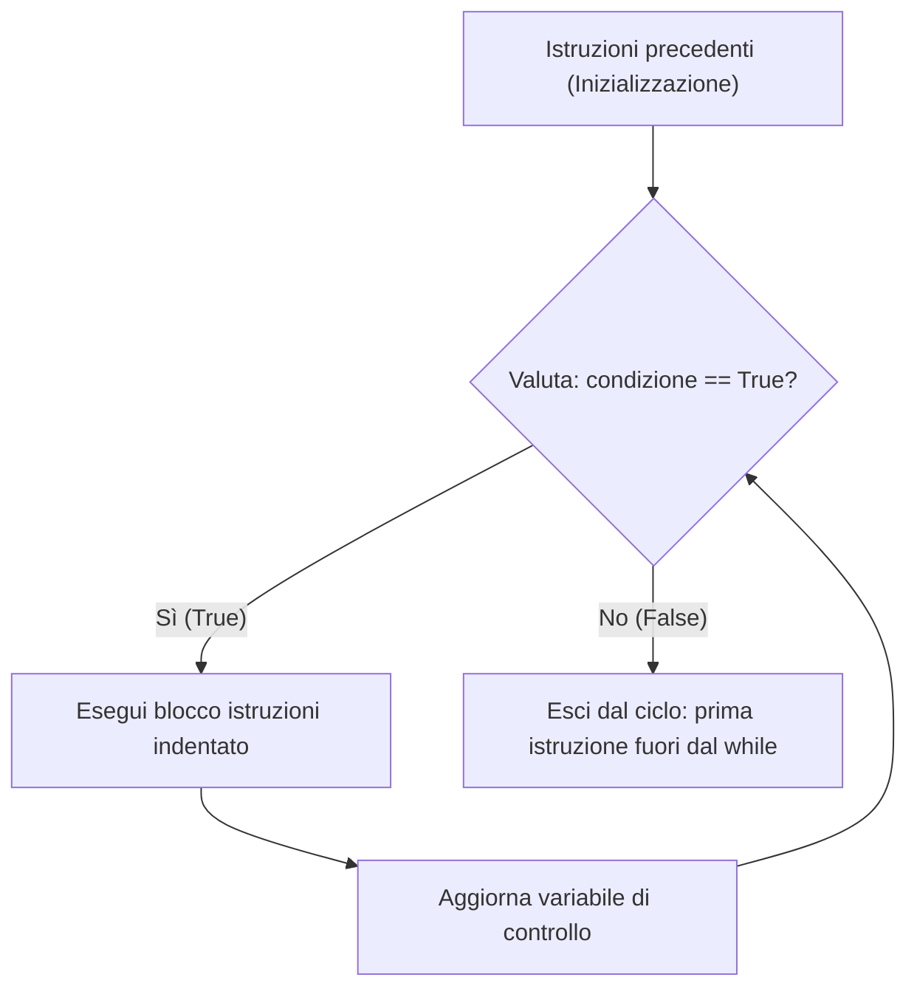
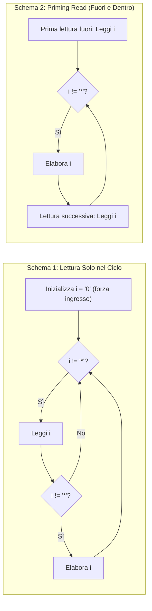

[[Home MOC|Home]] / [[Education & Learning]] / [[University]] / [[Lezione 7 - Ciclo While Iterazioni Indefinite e Sentinella]]

# Lezione 7 - Ciclo While Iterazioni Indefinite e Sentinella

## Sintesi Esecutiva
Mentre il costrutto `for` (analizzato in [[Lezione 4 - Ciclo For Sequenze e Variabili Accumulatore]]) governa l'iterazione deterministica su sequenze di lunghezza nota a priori, numerosi problemi computazionali richiedono di ripetere un blocco di istruzioni un numero di volte non predicibile all'ingresso del ciclo. Questa settima lezione didattica (Sapienza Università di Roma, DIAG — a cura dei proff. D. Lembo, A. Poggi, G. Santucci e M. Schaerf) formalizza l'istruzione <mark style="background:rgba(255, 193, 69, 0.32)"><font color="#cc8800"><b>while</b></font></mark> per la gestione delle <mark style="background:rgba(255, 193, 69, 0.32)"><font color="#cc8800"><b>iterazioni indefinite</b></font></mark>. Vengono esaminati la semantica operazionale del ciclo, il ruolo della <mark style="background:rgba(181, 113, 255, 0.36)"><font color="#9a54c1"><b>variabile di controllo</b></font></mark>, la validazione interattiva dell'input, e i tre schemi architetturali del <mark style="background:rgba(255, 193, 69, 0.32)"><font color="#cc8800"><b>ciclo controllato da sentinella</b></font></mark> (lettura interna con inizializzazione forzante, *priming read* fuori e dentro il ciclo, e controllo tramite flag booleano). La trattazione confronta infine cicli definiti e indefiniti dimostrando l'equivalenza espressiva tra `for` e `while`, illustra la composizione di <mark style="background:rgba(181, 113, 255, 0.36)"><font color="#9a54c1"><b>cicli annidati</b></font></mark> (`while-for` e `for-while` per simulazioni Monte Carlo) e risolve integralmente i 7 esercizi algoritmici proposti, inclusa la codifica e decodifica in binario puro (`int2bin` e `bin2int`).

---

## Il Paradigma dell'Iterazione Indefinita e l'Istruzione `while`

In molteplici scenari applicativi, un insieme di istruzioni deve essere ripetuto finché perdura una determinata condizione logica, senza conoscere in anticipo il numero esatto di ripetizioni necessarie. Si pensi alla lettura e somma di numeri interi inseriti da tastiera finché l'utente non digita il valore `0`: un simile comportamento non è esprimibile in modo naturale mediante un ciclo `for` su un `range()` prefissato.

### Sintassi e Semantica Operazionale
In Python l'istruzione `while` presenta la seguente struttura sintattica:

```python
while condizione:
    istruzione_1
    istruzione_2
    # ...
    istruzione_n
istruzione_successiva_fuori_dal_ciclo
```

La clausola si legge dichiarativamente: *"Finché la `condizione` risulta vera (`True`), continua ad eseguire il blocco di istruzioni indentato"*.

L'esecuzione procede secondo un ciclo a controllo in testa (*pre-test loop*):
1. **Valutazione della guardia:** Si valuta l'espressione booleana `condizione` (il cui risultato appartiene a `{True, False}`, cfr. [[Lezione 5 - Condizioni e Istruzione If]]).
2. **Ramo Vero (`True`):** Se la condizione è verificata, viene eseguito sequenzialmente l'intero corpo indentato del ciclo; al termine del blocco, il flusso di controllo **torna al punto 1** per rivalutare la condizione.
3. **Ramo Falso (`False`):** Non appena la valutazione della condizione produce `False`, il ciclo termina istantaneamente e l'esecuzione prosegue con la prima istruzione posizionata fuori dal blocco `while` (allo stesso livello di indentazione della keyword `while`).



> [!IMPORTANT] Proprietà Fondamentali del Controllo in Testa
> - **Zero Esecuzioni Possibili:** Poiché la condizione viene verificata *prima* ancora di entrare nel corpo del ciclo, se la condizione è `False` già alla prima valutazione, il blocco interno non viene eseguito **nemmeno una volta** ($0$ iterazioni).
> - **Rischio di Ciclo Infinito (*Infinite Loop*):** Se la condizione è inizialmente `True` e nessuna istruzione all'interno del corpo modifica le variabili coinvolte nella guardia in modo da renderla prima o poi `False`, il programma rimane intrappolato in una ripetizione infinita.

---

## Anatomia del Ciclo `while`: I Tre Elementi Costitutivi

Analizziamo il primo esempio canonico: leggere e sommare numeri interi da tastiera fino a quando non viene inserito il valore `0`.

```python
somma = 0
n = int(input('Inserisci un numero intero (0 per terminare): '))

while n != 0:
    somma = somma + n
    n = int(input('Inserisci un numero intero (0 per terminare): '))

print(somma)
```

Da questo schema emergono i **tre elementi strutturali** che governano la progettazione di un ciclo `while`:

1. **Inizializzazione fuori dal ciclo (Pre-condizione):** Prima della riga `while`, tutte le variabili accumulate e quelle interrogate nella guardia devono essere debitamente inizializzate (`somma = 0` e la prima lettura `n = int(input(...))`). Se `n` non fosse definita prima del `while`, la valutazione di `n != 0` solleverebbe un `NameError`.
2. **Specifica della condizione e Variabile di Controllo:** L'espressione booleana `n != 0` determina la permanenza nel ciclo. La variabile `n`, il cui valore decide l'esito del test di continuazione, prende il nome di <mark style="background:rgba(181, 113, 255, 0.36)"><font color="#9a54c1"><b>variabile di controllo del ciclo</b></font></mark>.
3. **Corpo del ciclo e Passo di Aggiornamento:** Include sia l'elaborazione utile (`somma = somma + n`), sia l'istruzione che modifica la variabile di controllo (`n = int(input(...))`) preparando il test per l'iterazione successiva.

---

## Esempi Applicativi: Generazione Casuale e Validazione dell'Input

### 1. Generazione di Stringa Casuale Terminante per `'o'`
**Problema:** Scrivere un programma che generi e stampi su una sola riga una stringa casuale composta da sole lettere alfabetiche minuscole (`'a'`–`'z'`) che termini con il carattere `'o'` e non contenga altre `'o'` al suo interno.

```python
import random

c = 333  # Qualunque intero iniziale diverso da ord('o') == 111

while chr(c) != "o":
    c = random.randint(ord("a"), ord("z"))
    print(chr(c), end='')
```

- **Analisi:** La variabile di controllo è `c` (codice Unicode del carattere estratto). L'inizializzazione `c = 333` (o qualunque valore tale che `chr(c) != 'o'`) serve a garantire che la guardia `chr(c) != "o"` sia `True` al primo controllo, forzando l'ingresso nel ciclo.
- Ad ogni iterazione, `random.randint(ord("a"), ord("z"))` estrae un intero uniforme nell'intervallo $[97, 122]$; il parametro opzionale `end=''` di `print()` sopprime l'andata a capo, concatenando visivamente i caratteri sulla stessa riga finché non viene sorteggiata la `'o'` finale (che viene stampata prima che il test successivo faccia uscire dal ciclo).

### 2. Ciclo di Controllo per la Validazione dell'Input in un Intervallo
**Problema:** Chiedere ripetutamente all'utente di inserire un intero compreso tra $1$ e $10$ inclusi, rifiutando i valori fuori intervallo e terminando solo quando viene fornito un valore valido.

```python
corretto = False

while not corretto:
    s = input("Inserisci un intero tra 1 e 10: ")
    n = int(s)
    if n >= 1 and n <= 10:
        print("Il valore inserito è corretto:")
        corretto = True
    else:
        print("Il valore inserito NON è corretto:")

print(n)
```

- **Pattern del Flag Booleano:** La variabile di controllo `corretto` è un booleano inizializzato a `False`. La guardia `while not corretto:` risulta `True` finché l'input è invalido; non appena l'utente inserisce $n \in [1, 10]$, il ramo `if` commuta `corretto = True`, causando l'uscita pulita al controllo successivo.

---

## Il Ciclo `while` Controllato da Sentinella

Un <mark style="background:rgba(255, 193, 69, 0.32)"><font color="#cc8800"><b>ciclo controllato da sentinella</b></font></mark> è un pattern iterativo in cui l'esecuzione dipende dai valori forniti sequenzialmente in input dall'utente e s'interrompe quando viene acquisito un valore convenzionale, detto **valore sentinella** (es. `0`, `-1`, `'*'`, o la stringa vuota `''`).

> [!NOTE] Natura del Valore Sentinella
> Il valore sentinella **non fa parte dei dati del problema** e non deve mai essere elaborato come dato valido: il suo unico scopo semantico è segnalare al programma il raggiungimento della fine della sequenza di input.

Per processare una sequenza di $n \ge 0$ elementi terminata da una sentinella occorre coordinare tre operazioni:
1. **Leggere** un elemento da input;
2. **Valutare** la condizione di permanenza (confronto con la sentinella);
3. **Elaborare** l'elemento letto.

A seconda di come vengono ordinate queste tre operazioni, si ottengono **tre schemi architetturali** distinti.



### Schema 1: Lettura Solo Dentro il Ciclo (con Valore Fittizio Iniziale)
In questo approccio l'istruzione `input()` compare una sola volta, all'inizio del corpo del `while`.

```python
# Gestione sequenza di n >= 0 interi con LETTURA SOLO DENTRO IL CICLO
i = "0"  # Inizializzazione fittizia diversa da "*" per forzare la prima iterazione

while i != "*":  # "*" è il valore sentinella
    print('sono dentro il ciclo...')
    i = input("inserisci un intero (* per terminare): ")
    if i != '*':
        print("Hai inserito:", int(i))
```

- **Regole Critiche dello Schema 1:**
  1. **(a) Inizializzazione forzante:** La variabile di controllo `i` deve essere inizializzata prima del ciclo a un valore arbitrario purché diverso dalla sentinella (`i = "0"`), così da garantire l'ingresso nella prima iterazione.
  2. **(b) Guardia interna anti-sentinella:** Poiché la lettura avviene *dopo* il test del `while`, quando l'utente digita `'*'` ci si trova già dentro il corpo del ciclo. È quindi **obbligatorio** proteggere l'elaborazione con `if i != '*':` (altrimenti `int('*')` causerebbe un `ValueError`!).
- **Conteggio delle Esecuzioni (per $n$ dati validi):**
  - Il corpo del ciclo viene eseguito **$n + 1$ volte** ($n$ volte per i dati validi più $1$ volta finale in cui viene letta e scartata la sentinella).
  - La condizione del `while` (`i != "*"`) viene verificata **$n + 2$ volte** (una volta in più rispetto alle $n+1$ iterazioni del corpo, corrispondente al test finale che fallisce e determina l'uscita).

### Schema 2: Lettura Prima e Dentro il Ciclo (*Priming Read*)
Questo schema anticipa la prima lettura *fuori* dal ciclo (*lettura d'innesco* o *priming read*), posizionando la lettura successiva come **ultima istruzione** del corpo del `while`.

```python
# Gestione sequenza di n >= 0 interi con LETTURA FUORI E DENTRO IL CICLO
i = input("inserisci un intero (* per terminare): ")

while i != "*":
    print('sono dentro il ciclo...')
    print("Hai inserito:", int(i))
    i = input("inserisci un intero (* per terminare): ")
```

- **Vantaggi Strutturali dello Schema 2:**
  1. Non richiede alcuna inizializzazione fittizia o artificiale della variabile di controllo.
  2. Elimina completamente l'`if` annidato dentro il ciclo: quando si entra nel corpo del `while`, si ha già la certezza matematica che `i != "*"`, quindi si può procedere direttamente con `int(i)` e poi leggere il valore successivo in coda.
- **Conteggio delle Esecuzioni (per $n$ dati validi):**
  - Il corpo del ciclo viene eseguito esattamente **$n$ volte** (se il primo input è subito `'*'`, il corpo viene eseguito $0$ volte).
  - Le operazioni di lettura `input()` eseguite sono complessivamente **$n + 1$** ($1$ fuori + $n$ dentro).
  - La condizione del `while` viene valutata **$n + 1$ volte** ($n$ con esito `True` + $1$ finale con esito `False`).

### Schema 3: Lettura Solo nel Ciclo con Variabile di Controllo Booleana
Variante dello Schema 1 che sostituisce l'inizializzazione fittizia della stringa con una variabile booleana esplicita `finito`:

```python
# Gestione sequenza di n >= 0 interi con LETTURA SOLO DENTRO IL CICLO e flag booleano
finito = False

while not finito:
    i = input("inserisci un intero (* per terminare): ")
    if i == "*":
        finito = True
    else:
        print("Hai inserito:", int(i))
```

### Tabella Comparativa dei Tre Schemi con Sentinella (su $n$ elementi validi)

| Caratteristica | Schema 1 (Lettura interna) | Schema 2 (*Priming Read*) | Schema 3 (Flag Booleano) |
|---|---|---|---|
| **Letture `input()` nel codice** | 1 (dentro il ciclo) | 2 (1 fuori + 1 in fondo al ciclo) | 1 (dentro il ciclo) |
| **Inizializzazione pre-ciclo** | Valore fittizio (`i = "0"`) | Prima lettura reale (`input()`) | Flag `finito = False` |
| **Controllo `if` interno** | Obbligatorio (`if i != '*'`) | Non necessario (assente) | Obbligatorio (`if-else`) |
| **Iterazioni del corpo del `while`** | $n + 1$ | $n$ | $n + 1$ |
| **Valutazioni della guardia `while`** | $n + 2$ | $n + 1$ | $n + 2$ |
| **Letture `input()` effettuate a runtime** | $n + 1$ | $n + 1$ | $n + 1$ |

---

## Cicli Definiti vs Cicli Indefiniti e Confronto con il `for`

Dal punto di vista teorico, i costrutti iterativi si classificano in due famiglie:

1. <mark style="background:rgba(255, 193, 69, 0.32)"><font color="#cc8800"><b>Cicli Indefiniti:</b></font></mark> Il numero di iterazioni che verranno eseguite **non è prevedibile** analizzando lo stato delle variabili all'ingresso del ciclo (es. lettura fino a sentinella, estrazione casuale fino a un evento, ricerca di convergenza). Il costrutto naturale per i cicli indefiniti è il `while`.
2. <mark style="background:rgba(181, 113, 255, 0.36)"><font color="#9a54c1"><b>Cicli Definiti:</b></font></mark> Il numero di iterazioni è **perfettamente determinabile a priori** sulla base del valore delle variabili all'inizio del ciclo (es. iterare $n$ volte, scorrere i caratteri di una stringa o i primi $127$ codici ASCII). I cicli definiti si scrivono in modo più conciso e sicuro con il `for`, ma possono essere sempre codificati anche con il `while`.

> [!TIP] Gerarchia di Generalità: `while` vs `for`
> Il ciclo `while` è **più versatile e generale** del ciclo `for`: ogni ciclo `for` può essere sempre tradotto meccanicamente in un ciclo `while` equivalente, mentre un ciclo `while` indefinito non può essere espresso direttamente con un `for` su un intervallo statico.

### Quattro Esempi di Cicli Definiti: Confronto Diretto `while` vs `for`

#### 1. Stampare $n$ volte la parola `'CIAO'`
```python
# Soluzione con ciclo while
n = int(input("inserisci il numero di volte che vuoi stampare la parola 'CIAO': "))
i = 1
while i <= n:
    print(i, 'CIAO')
    i += 1

# Soluzione con ciclo for
n = int(input("inserisci il numero di volte che vuoi stampare la parola 'CIAO': "))
for i in range(n):
    print('CIAO')
```

#### 2. Stampare i primi 127 caratteri ASCII
```python
# Soluzione con ciclo while (da 1 a 127)
i = 1
while i <= 127:
    print(i, chr(i))
    i += 1

# Soluzione con ciclo for (da 0 a 127)
for i in range(128):
    print(i, chr(i))
```

#### 3. Stampare i quadrati dei primi $n$ numeri interi
```python
# Soluzione con ciclo while
n = int(input("inserisci il numero di interi di cui vuoi i quadrati: "))
i = 1
while i <= n:
    print(i, i ** 2)
    i += 1

# Soluzione con ciclo for
n = int(input("inserisci il numero di interi di cui vuoi i quadrati: "))
for i in range(n + 1):
    print(i, i ** 2)
```

#### 4. Conto alla rovescia da $n \ge 0$ fino a $0$ incluso
```python
# Soluzione con ciclo while
n = int(input("Inserire un numero intero non negativo: "))
while n >= 0:
    print(n)
    n = n - 1

# Soluzione con ciclo for (passo negativo -1 e stop a -1 escluso)
n = int(input("Inserire un numero intero non negativo: "))
for i in range(n, -1, -1):
    print(i)
```

---

## Regole Generali di Trasformazione da `for` a `while`

Qualsiasi ciclo `for` in Python può essere riscritto canonicamente come ciclo `while` esplicitando il contatore d'indice e il suo incremento:

### Caso A: Iterazione su Intervallo Numerico `range(n)`
Il costrutto `for`:
```python
for i in range(n):
    istruzioni
```
si trasforma in:
```python
i = 0
while i < n:
    istruzioni
    i = i + 1
```

### Caso B: Iterazione Diretta sugli Elementi di una Sequenza
Il costrutto `for`:
```python
for e in sequenzaElementi:
    istruzioni_che_usano_e
```
si trasforma mediante indicizzazione posizionale `sequenzaElementi[i]`:
```python
i = 0
while i < len(sequenzaElementi):
    e = sequenzaElementi[i]
    istruzioni_che_usano_e
    i = i + 1
```

---

## Pattern Avanzati: Ripetizione di Programmi e Cicli Annidati

### 1. Ripetizione Interattiva di una Funzione (Menu Loop)
Il ciclo `while` con flag booleano permette di invocare ripetutamente una funzione (cfr. [[Lezione 6 - Funzioni Parametri Scope ed Esercizi Algoritmici]]) su diversi input senza dover riavviare l'intero script:

```python
def fattoriale(n):
    ris = 1
    for i in range(2, n + 1):
        ris = ris * i
    return ris

finito = False
while not finito:
    # Lettura dell'input e invocazione della funzione
    n = int(input("inserisci un intero positivo: "))
    print("il fattoriale di", n, "è", fattoriale(n))
    
    # Richiesta di continuazione o arresto
    s1 = input("----Finisco (si/no)? ")
    if s1.lower() == "si":
        finito = True
```
L'uso di `s1.lower() == "si"` rende il controllo *case-insensitive* (accettando `"SI"`, `"Si"`, `"si"`).

### 2. Ciclo `while` che Contiene un Ciclo `for` (Ciclo Annidato)
**Problema:** Leggere una sequenza di stringhe terminata dalla stringa vuota `''` e determinare il numero massimo di vocali presenti in una singola stringa della sequenza.

#### Soluzione Modulare (con funzione ausiliaria `conta_vocali`)
Scomponiamo il problema delegando il conteggio delle vocali di una singola stringa a una funzione con ciclo `for`, mentre il ciclo `while` esterno gestisce la sequenza indefinita con *priming read*:

```python
def conta_vocali(s):
    conta = 0
    for c in s:
        if c in 'aeiou':
            conta = conta + 1
    return conta

max_vocali = 0  # Inizializzato a 0 prima di leggere qualsiasi stringa
s = input('Inserisci la prima stringa (stringa vuota per terminare): ')

while s != '':
    conta = conta_vocali(s)
    if conta > max_vocali:
        max_vocali = conta
    s = input('Inserisci un\'altra stringa (stringa vuota per terminare): ')

print(max_vocali)
```

#### Soluzione Monolitica (senza funzioni, con `for` annidato nel `while`)
Incorporando il ciclo `for` direttamente nel corpo del `while`, è fondamentale **azzerare l'accumulatore interno** `conta = 0` all'inizio di ogni iterazione del `while` prima di scandire la nuova stringa `s`:

```python
max_vocali = 0
s = input('Inserisci la prima stringa (stringa vuota per terminare): ')

while s != '':
    conta = 0  # Reset fondamentale per ogni nuova stringa s!
    for c in s:
        if c in 'aeiou':
            conta = conta + 1
    if conta > max_vocali:
        max_vocali = conta
    s = input('Inserisci un\'altra stringa (stringa vuota per terminare): ')

print(max_vocali)
```

### 3. Ciclo `for` che Contiene un Ciclo `while` (Simulazione Monte Carlo)
**Problema:** Stimare empiricamente la lunghezza media attesa delle stringhe casuali di lettere minuscole (`'a'`–`'z'`) che terminano alla prima comparsa del carattere `'o'`.

- **Ciclo esterno (`for` — definito):** Ripete l'esperimento aleatorio un numero prefissato e molto grande di volte ($n = 100\,000$).
- **Ciclo interno (`while` — indefinito):** Genera una singola stringa casuale finché non esce `'o'`.

```python
import random

totale = 0
c = 333  # Qualunque intero diverso da ord('o')
n = 100000

for i in range(n):
    s = ''
    while chr(c) != "o":
        c = random.randint(ord("a"), ord("z"))
        s += chr(c)
    c = 333  # Reset vitale della variabile di controllo per l'iterazione successiva del for!
    totale += len(s)

print(totale / n)  # Stampa un valore prossimo a 26.0
```

> [!WARNING] Reset della Variabile di Controllo nei Cicli Annidati
> Nell'esempio sopra, al termine del `while` interno la variabile `c` vale necessariamente `ord('o')`. Se non si eseguisse l'istruzione `c = 333` prima dell'iterazione successiva del `for`, in tutte le $99\,999$ iterazioni seguenti la guardia `chr(c) != "o"` risulterebbe immediatamente `False` e il `while` interno non verrebbe mai più eseguito!
> Dal punto di vista probabilistico, poiché ad ogni estrazione la probabilità di ottenere `'o'` su 26 lettere equiprobabili è $p = \frac{1}{26}$, il numero di tentativi segue una distribuzione geometrica di valore atteso:
$$E[L] = \frac{1}{p} = 26$$

---

## Risoluzione Completa dei 7 Esercizi Didattici

### Esercizio 1: Lunghezza di una Sequenza di Stringhe
> **Specifica:** Scrivere un programma che legge una sequenza di stringhe inserite da input (una alla volta), ne stampa la lunghezza e termina all'inserimento di una stringa vuota (solo invio). Fornire due soluzioni: una con prima lettura fuori dal ciclo e una con lettura solo nel ciclo.

#### Soluzione 1A: Con prima lettura fuori dal ciclo (*Priming Read*)
```python
s = input("Inserisci una stringa (invio a vuoto per terminare): ")

while s != "":
    print("Lunghezza della stringa:", len(s))
    s = input("Inserisci una stringa (invio a vuoto per terminare): ")
```

#### Soluzione 1B: Con lettura solo dentro il ciclo
```python
s = " "  # Inizializzazione non vuota per forzare il primo ingresso nel ciclo

while s != "":
    s = input("Inserisci una stringa (invio a vuoto per terminare): ")
    if s != "":
        print("Lunghezza della stringa:", len(s))
```

---

### Esercizio 2: Pari o Dispari su Sequenza Terminata da `'*'`
> **Specifica:** Scrivere un programma che legge da input una sequenza di interi positivi terminata da `'*'` e per ognuno stampa a schermo se è pari o dispari.

```python
s = input("Inserisci un intero positivo (* per terminare): ")

while s != "*":
    n = int(s)
    if n % 2 == 0:
        print(n, "è pari")
    else:
        print(n, "è dispari")
    s = input("Inserisci un intero positivo (* per terminare): ")
```

---

### Esercizio 3: Rimozione della Prima Occorrenza di un Carattere
> **Specifica:** Scrivere un programma che legge da tastiera una stringa `s` ed un carattere `c` e stampa a schermo una nuova stringa uguale ad `s` ma senza la prima occorrenza del carattere `c` (es. `'casa'`, `'a'` $\to$ `'csa'`). Se il carattere `c` non compare in `s`, il programma stampa la stringa `s`. Fornire 2 soluzioni: una che usa il ciclo `while` e una che non usa né il `while` né il metodo `replace()`.

#### Soluzione 3A: Con ciclo `while` (ricerca dell'indice della prima occorrenza)
Scorriamo la stringa con un indice `i` finché non raggiungiamo la fine della stringa oppure troviamo il carattere `c`:

```python
s = input("Inserisci una stringa s: ")
c = input("Inserisci un carattere c: ")

i = 0
trovato = False
nuova_s = ""

while i < len(s):
    if s[i] == c and not trovato:
        trovato = True  # Salta solo la prima occorrenza di c
    else:
        nuova_s += s[i]
    i += 1

print(nuova_s)
```
*(In alternativa col `while`, si può incrementare `i` con `while i < len(s) and s[i] != c: i += 1` e poi concatenare `s[:i] + s[i+1:]`).*

#### Soluzione 3B: Senza `while` e senza `replace()` (usando `find()` e Slicing, oppure `for`)
```python
# Metodo 1: Con find() e slicing
s = input("Inserisci una stringa s: ")
c = input("Inserisci un carattere c: ")

pos = s.find(c)
if pos != -1:
    nuova_s = s[:pos] + s[pos + 1:]
else:
    nuova_s = s

print(nuova_s)

# Metodo 2: Con ciclo for e flag booleano
s = input("Inserisci una stringa s: ")
c = input("Inserisci un carattere c: ")

nuova_s = ""
rimosso = False
for car in s:
    if car == c and not rimosso:
        rimosso = True
    else:
        nuova_s += car

print(nuova_s)
```

---

### Esercizio 4: Filtro Caratteri con Codice UNICODE Primo
> **Specifica:** Scrivere un programma che legge da tastiera una sequenza di stringhe (terminata quando si inserisce la stringa vuota) e per ogni stringa `s` stampa la stringa composta dai soli caratteri di `s` il cui codice UNICODE è un numero primo. Si consiglia di scrivere 2 funzioni: `is_primo(n)` che restituisce `True` se `n` è primo (`False` altrimenti), e una funzione che prende in input una stringa `s` e restituisce la stringa filtrata.

```python
def is_primo(n):
    if n < 2:
        return False
    d = 2
    while d * d <= n:
        if n % d == 0:
            return False
        d += 1
    return True


def filtra_unicode_primi(s):
    ris = ""
    for c in s:
        if is_primo(ord(c)):
            ris += c
    return ris


# Programma principale con ciclo while controllato da sentinella ''
s = input("Inserisci una stringa (stringa vuota per terminare): ")
while s != "":
    print("Caratteri con codice UNICODE primo:", filtra_unicode_primi(s))
    s = input("Inserisci una stringa (stringa vuota per terminare): ")
```
- **Nota algoritmica:** Nella funzione `is_primo(n)` il ciclo `while d * d <= n:` (equivalente a $d \le \sqrt{n}$) testa i divisori in tempo $O(\sqrt{n})$, ma anche un semplice ciclo `for d in range(2, n // 2 + 1):` soddisfa pienamente la specifica didattica. Ad esempio, `'a'` ha `ord('a') == 97` (che è primo), mentre `'b'` ha `ord('b') == 98` (pari, non primo).

---

### Esercizio 5: Conversione da Intero a Binario Puro (`int2bin`)
> **Specifica:** Scrivere e testare una funzione `int2bin(n)` che riceve in ingresso un numero intero `n` ($\ge 0$) e restituisce una stringa con la sua codifica in binario puro (usare il metodo delle divisioni successive per 2).

Come studiato in [[Lezione 0.2 - Sistemi di Numerazione Binaria e Interi con Segno]], l'algoritmo delle divisioni successive per 2 estrae ad ogni passo il bit meno significativo tramite il resto `n % 2` e riduce il numero tramite il quoziente intero `n // 2`, finché il quoziente non si annulla. Poiché i resti vengono generati dal bit meno significativo ($LSB$) al più significativo ($MSB$), ogni nuovo bit va **anteposto** a sinistra della stringa accumulata (`bit + codifica`).

```python
def int2bin(n):
    if n == 0:
        return "0"
    
    binario = ""
    while n > 0:
        resto = n % 2
        binario = str(resto) + binario  # Prepend del bit a sinistra
        n = n // 2
    return binario

# Test di verifica:
print(int2bin(0))   # "0"
print(int2bin(1))   # "1"
print(int2bin(6))   # "110"
print(int2bin(13))  # "1101"
print(int2bin(255)) # "11111111"
```

---

### Esercizio 6: Conversione da Binario Puro a Intero (`bin2int`)
> **Specifica:** Scrivere e testare una funzione `bin2int(s)` che riceve in ingresso una stringa `s` contenente una sequenza di `'0'` e `'1'` e restituisce un intero calcolato interpretando la stringa in binario puro.

Secondo la legge posizionale in base 2, una stringa binaria $s = b_{k-1}b_{k-2}\dots b_1 b_0$ di lunghezza $k = \text{len}(s)$ rappresenta il valore:
$$N = \sum_{j=0}^{k-1} b_j \cdot 2^j$$

Possiamo implementarla sia tramite somma esplicita delle potenze di 2, sia tramite lo schema di Horner (`totale = totale * 2 + int(bit)`):

```python
def bin2int(s):
    valore = 0
    esponente = len(s) - 1
    i = 0
    while i < len(s):
        bit = int(s[i])
        valore += bit * (2 ** esponente)
        esponente -= 1
        i += 1
    return valore

# Versione alternativa compatta (Schema di Horner con ciclo for):
def bin2int_horner(s):
    valore = 0
    for c in s:
        valore = valore * 2 + int(c)
    return valore

# Test di verifica:
print(bin2int("0"))        # 0
print(bin2int("110"))      # 6
print(bin2int("1101"))     # 13
print(bin2int("11111111")) # 255
```

---

### Esercizio 7: Test di Coerenza su 10.000 Interi Casuali
> **Specifica:** Testare la coerenza di `int2bin` e `bin2int` con $10\,000$ interi casuali, verificando l'identità d'inversione $\text{bin2int}(\text{int2bin}(n)) = n$.

```python
import random

errori = 0
i = 0
while i < 10000:
    n = random.randint(0, 1000000)
    codifica = int2bin(n)
    decodifica = bin2int(codifica)
    if decodifica != n:
        print("Errore di coerenza per n =", n, "->", codifica, "->", decodifica)
        errori += 1
    i += 1

if errori == 0:
    print("Test superato con successo su tutti i 10.000 interi casuali!")
else:
    print("Test fallito con", errori, "errori.")
```
