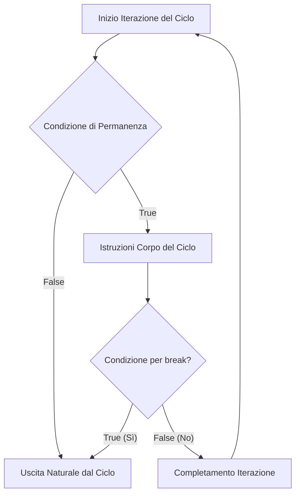
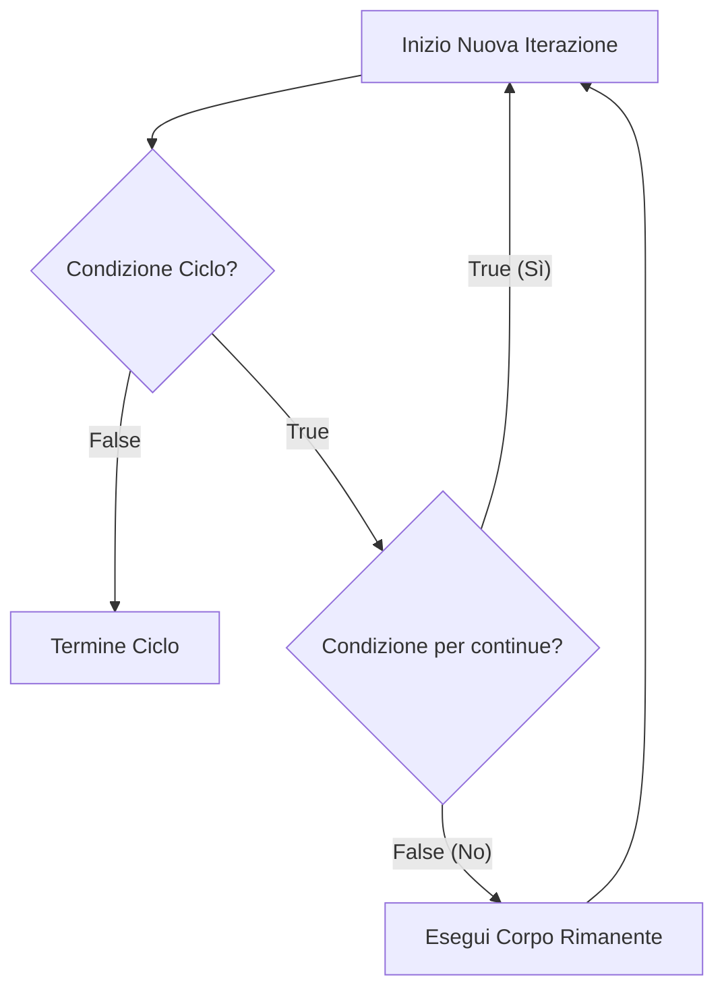

[[Home MOC|Home]] / [[Education & Learning]] / [[University]] / [[Lezione 8.1 - Istruzioni Break e Continue nei Cicli]]

# Lezione 8.1 - Istruzioni Break e Continue nei Cicli

## Sintesi Esecutiva
Mentre i costrutti standard di iterazione terminano in modo predeterminato (nel ciclo `while` quando la condizione di guardia diviene `False`, nel ciclo `for` quando la sequenza sorgente è interamente consumata), in molteplici contesti computazionali sorge la necessità di modulare o troncare tempestivamente l'esecuzione del blocco iterativo. Questa unità didattica (Sapienza Università di Roma, DIAG — a cura dei proff. D. Lembo, A. Poggi, G. Santucci e M. Schaerf) formalizza le istruzioni di controllo del flusso <mark style="background:rgba(255, 193, 69, 0.32)"><font color="#cc8800"><b>break</b></font></mark> e <mark style="background:rgba(255, 193, 69, 0.32)"><font color="#cc8800"><b>continue</b></font></mark>. Viene chiarito come tali istruzioni non aumentino il potere espressivo formale del linguaggio (qualsiasi ciclo con `break` o `continue` è sempre riconvertibile secondo i canoni della programmazione strutturata pura mediante flag booleani), ma introducano <mark style="background:rgba(181, 113, 255, 0.36)"><font color="#9a54c1"><b>rilevanti ottimizzazioni prestazionali</b></font></mark> (riduzione dei passi da $O(n)$ a $O(1)$ nel caso favorevole, come nella ricerca di divisori per la primalità). La trattazione esamina inoltre l'applicazione congiunta in algoritmi di validazione complessi (convertitore di numerazione posizionale da base 2–16 a base 10), formula un espresso invito alla cautela metodologica per scongiurare codice destrutturato, e risolve integralmente gli esercizi pratici.

---

## L'Istruzione `break`

### Semantica Operazionale
L'istruzione `break` può essere impiegata **esclusivamente all'interno di un'istruzione iterativa** (`while` o `for`). Allorché l'interprete Python valuta un'istruzione `break`:
1. Interrompe immediatamente e incondizionatamente il ciclo più interno in cui è racchiusa.
2. Salta tutte le eventuali istruzioni successive nel corpo del ciclo che non sono state ancora eseguite.
3. Trasferisce il controllo del flusso alla prima istruzione posta immediatamente all'esterno del blocco iterativo.

Di norma, il `break` è collocato all'interno di un'istruzione condizionale (`if`), al fine di interrompere l'iterazione al verificarsi di un evento sentinella o al raggiungimento di un obiettivo di ricerca.



### Esempio Didattico: Verifica della Primalità di un Intero
Dato un numero naturale $n > 1$, si vuole determinare se esso sia primo verificando l'assenza di divisori nell'intervallo $[2, \lfloor n/2 \rfloor]$. Non appena si individua un divisore $i$ tale che $n \pmod i == 0$, è superfluo proseguire:

```python
n = int(input("Inserire un numero naturale maggiore di 1: "))

i = 2 
limite = n // 2  # Massimo intero da considerare per un divisore

while i <= limite:
    if n % i == 0:
        print('numero non primo')
        break
    i += 1 

if i > limite: 
    print('numero primo')
```

### Equivalenza Strutturata (Riscrittura Senza `break`)
Il `break` non aggiunge potere espressivo. Qualsiasi ciclo facente uso di `break` può essere riscritto in forma strutturata mediante una <mark style="background:rgba(181, 113, 255, 0.36)"><font color="#9a54c1"><b>variabile booleana di stato (flag)</b></font></mark> combinata nella condizione di guardia tramite l'operatore logico `and`:

```python
n = int(input("Inserire un numero naturale maggiore di 1: "))
primo = True
i = 2 
limite = n // 2

while i <= limite and primo:
    if n % i == 0:
        primo = False
    i += 1 

if primo:
    print('numero primo')
else:
    print('numero non primo')
```

> [!NOTE] Confronto tra le Due Tecniche
> - **Con `break`:** Il flusso si interrompe all'istante all'interno del corpo. La verifica successiva (`if i > limite:`) poggia sul valore assunto dalla variabile contatore all'uscita.
> - **Senza `break` (strutturata):** Il ciclo completa l'iterazione corrente fino all'incremento `i += 1`, ma l'iterazione successiva viene inibita dalla clausola `and primo` nella testa del `while`.

---

## L'Istruzione `continue`

### Semantica Operazionale
Anche l'istruzione `continue` può essere utilizzata **esclusivamente all'interno di un ciclo**. A differenza di `break`:
- **Non interrompe il ciclo**, bensì tronca esclusivamente **l'iterazione corrente**.
- Salta tutte le istruzioni rimanenti nell'iterazione attiva e sposta il controllo direttamente alla testa del ciclo per rivalutare la condizione di guardia (nel `while`) o per prelevare l'elemento successivo della sequenza (nel `for`).



### Esempi Didattici
#### 1. Salto di un Singolo Valore Speciale
Stampare tutti i numeri da 9 a 0 escludendo il valore 5:

```python
var = 10
while var > 0:              
    var = var - 1
    if var == 5:
        continue
    print("valore variabile corrente:", var)
print("fine!")
```

#### 2. Filtraggio dei Multipli di 3 tra 1 e 51
```python
var = 0
while var < 51:              
    var = var + 1
    if var % 3 != 0:
        continue
    print("valore variabile corrente:", var)
print("fine!")
```

### Riscrittura Strutturata Senza `continue`
L'istruzione `continue` è sempre eliminabile negando la condizione del test condizionale:

```python
var = 0
while var < 51:              
    var = var + 1
    if var % 3 == 0:
        print("valore variabile corrente:", var)
print("fine!")
```

---

## Uso di `break` e `continue` nel Ciclo `for`

Nei cicli controllati da contatore o sequenza (`for elem in sequenza:`), `break` e `continue` mantengono la medesima semantica.

### Verifica di Primalità con `for` e `break`
```python
n = int(input('Inserire un numero naturale maggiore di 1: '))

primo = True  
for i in range(2, (n // 2) + 1):
    if n % i == 0:
        primo = False
        break

if primo:
    print('numero primo')
else:
    print('numero non primo')
```

### Impatto sull'Efficienza Algoritmica: Ricerca di Primi fino a $k = 1000$
Il confronto tra la scansione esaustiva priva di uscite anticipate e la versione ottimizzata illustra chiaramente l'utilità del `break`.

#### Versione Non Ottimizzata (Senza `break`)
```python
k = 1000
divisioni = 0   
primi = 0   
for n in range(2, k + 1):  
    primo = True
    limite = n // 2                   
    for i in range(2, limite + 1):                  
        divisioni += 1
        if n % i == 0:
            primo = False  # Il ciclo prosegue inutilmente fino a limite!
    if primo:
        print(n, end=' ')
        primi += 1

print('\ndivisioni =', divisioni)   # Esegue 249001 divisioni!
print('numeri primi =', primi)
```

#### Versione Ottimizzata (Con `break` e Passo Dispari)
```python
k = 1000
divisioni = 0   
primi = 1  # Il 2 è l'unico numero primo pari
print(2, '', end='')

for n in range(3, k + 1, 2):  # Scansione dei soli dispari
    primo = True
    limite = n // 2    
    for i in range(2, limite + 1):                  
        divisioni += 1
        if n % i == 0:
            primo = False
            break  # Interruzione immediata alla scoperta del primo divisore
    if primo:
        print(n, '', end='')
        primi += 1

print('\ndivisioni =', divisioni)   # Solo 4789 divisioni!
print('numeri primi =', primi)
```

> [!IMPORTANT] Guadagno di Complessità Pratica
> L'inserimento del `break` riduce il numero di divisioni computate da **249.001** a sole **4.789**, con una riduzione delle operazioni superiore al **98%**.

---

## Caso di Studio Complesso: Conversione di Base da 2–16 a 10 con Validazione dell'Input

L'esempio seguente sintetizza l'uso congiunto di un ciclo indefinito `while` esterno, di salti di validazione tramite `continue` e di un ciclo definito `for` interno con uscita per errore mediante `break`.

```python
finito = False
while not finito:   
    # 1. Validazione della base
    base = input("inserisci la base (2..16): ")
    if not (base.isdecimal() and (2 <= int(base) <= 16)):
        print('inserito un input errato per la base')
        continue
    base = int(base)

    # 2. Lettura e validazione del numerale
    s = input("numerale in base " + str(base) + ": ")
    valore = 0
    potenza = len(s) - 1
    errore = False

    for c in s:
        if not (c.isdecimal() or c in "ABCDEF"):
            print('inserito un numerale errato per le basi')
            errore = True
            break
        if c in "ABCDEF":
            c_val = ord(c) - ord("A") + 10
        else:
            c_val = int(c)
        if not (0 <= c_val < base):
            print('inserito un numerale errato per la base')
            errore = True
            break
        valore = valore + c_val * (base ** potenza)
        potenza = potenza - 1

    if not errore:
        print(s, "in base", base, "vale", valore, "in base 10")

    # 3. Richiesta di reiterazione
    s1 = input("----Finisco (si/no)? ")
    finito = s1.lower() == "si"
```

### Aspetti Algoritmici Salienti:
1. **Validazione con `continue`:** Se la base fornita non è valida, l'iterazione del `while` viene interrotta sul nascere, richiedendo nuovamente l'input senza eseguire il codice a valle.
2. **Conversione delle Cifre Esadecimali:** Tramite aritmetica Unicode: $\text{ord}(c) - \text{ord}('A') + 10$ mappa `'A'` in 10, `'B'` in 11, fino a `'F'` in 15.
3. **Calcolo della Notazione Posizionale:** Ogni cifra $c_i$ contribuisce con $c_i \cdot b^{\text{potenza}}$, dove $\text{potenza}$ decresce da $\text{len}(s) - 1$ fino a $0$.
4. **Interruzione con `break`:** Se un carattere non appartiene all'alfabeto ammesso o supera la base ($c_{\text{val}} \ge \text{base}$), il ciclo `for` termina immediatamente ponendo `errore = True`.

---

## Invito alla Cautela e Principi di Ingegneria del Software

> [!CAUTION] Cautela nell'uso di `break` e `continue`
> L'abuso indiscriminato di istruzioni di salto (`break`, `continue`) all'interno di cicli annidati introduce punti di uscita multipli non dichiarati nella guardia dell'iterazione. Questo stile compromette la leggibilità, complica la formulazione degli invarianti di ciclo e può degenerare in codice poco strutturato (*spaghetti code*).
> **Linee guida consigliate:**
> - Ricorrere a `break` prioritariamente nei pattern di **ricerca lineare** con successo immediato (*early exit*).
> - Evitare `break` o `continue` multipli annidati all'interno dello stesso ciclo quando una condizione composta nella testa del `while` rende il codice auto-esplicativo.

---

## Risoluzione Dettagliata degli Esercizi Algoritmici

### Esercizio 1: Primo Carattere con Codice Unicode Multiplo di $n$
**Testo:** Scrivere un programma (usando `break` per efficienza) che legge in input una stringa $s$ ed un intero $n$ e stampa il primo carattere di $s$ il cui codice Unicode sia un multiplo di $n$.

```python
s = input("Inserisci una stringa: ")
n = int(input("Inserisci un intero positivo n: "))

trovato = False
for c in s:
    if ord(c) % n == 0:
        print(f"Primo carattere trovato: '{c}' (Unicode: {ord(c)})")
        trovato = True
        break

if not trovato:
    print("Nessun carattere con codice Unicode multiplo di", n)
```

### Esercizio 2: Massimo Comun Divisore con Ricerca Decrescente
**Testo:** Scrivere un programma (usando `break`) che legge in input due interi positivi, calcola il loro Massimo Comun Divisore (MCD) e lo stampa a schermo.

```python
a = int(input("Inserisci il primo intero positivo: "))
b = int(input("Inserisci il secondo intero positivo: "))

# Ricerca all'indietro a partire dal minimo dei due numeri fino a 1
mcd = 1
for d in range(min(a, b), 0, -1):
    if a % d == 0 and b % d == 0:
        mcd = d
        break  # Il primo divisore comune incontrato procedendo a ritroso è il massimo

print("Il Massimo Comun Divisore è:", mcd)
```

### Esercizio 3: Verifica Presenza di Lettere Doppie Consecutive
**Testo:** Scrivere un programma (usando `break` ed il ciclo `for`) che legge in input una stringa e verifica se ci sia una "doppia", ovvero due lettere alfabetiche uguali consecutive. In caso positivo stampa `'SI'`, in caso negativo `'NO'`.

```python
s = input("Inserisci una stringa: ")

ha_doppia = False
for i in range(len(s) - 1):
    # Verifica che il carattere sia alfabetico e identico a quello successivo
    if s[i].isalpha() and s[i] == s[i + 1]:
        ha_doppia = True
        break

if ha_doppia:
    print("SI")
else:
    print("NO")
```
