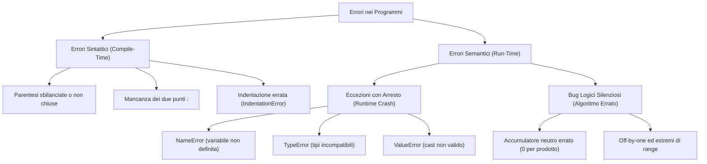

[[Home MOC|Home]] / [[Education & Learning]] / [[University]] / [[Lezione 8.2 - Tipologie ed Individuazione degli Errori]]

# Lezione 8.2 - Tipologie ed Individuazione degli Errori

## Sintesi Esecutiva
Durante lo sviluppo di un algoritmo computazionale, l'insorgenza di anomalie ed errori rappresenta una costante ineludibile del ciclo di vita del software. Questa lezione didattica (Sapienza Università di Roma, DIAG — a cura dei proff. D. Lembo, A. Poggi, G. Santucci e M. Schaerf) stabilisce una tassonomia formale degli errori distinguendo nettamente tra <mark style="background:rgba(255, 193, 69, 0.32)"><font color="#cc8800"><b>errori sintattici (compile-time)</b></font></mark> ed <mark style="background:rgba(255, 193, 69, 0.32)"><font color="#cc8800"><b>errori semantici (run-time)</b></font></mark>. Vengono fornite le chiavi interpretative per decifrare i messaggi diagnostici dell'interprete e degli ambienti di sviluppo (Jupyter, Spyder, IDLE), affrontando le casistiche di arresto per eccezione (`NameError`, `TypeError`, `ValueError`, `ZeroDivisionError`) e i più insidiosi <mark style="background:rgba(181, 113, 255, 0.36)"><font color="#9a54c1"><b>bug logico-algoritmici silenziosi</b></font></mark> (che non causano crash ma corrodono la correttezza del risultato, come l'errata scelta dell'elemento neutro negli accumulatori). La trattazione si conclude con un'analisi metodologica del flusso di debugging e la risoluzione rigorosa di 6 esercizi algoritmici validati mediante la suite di test unificato `tester_fun`.

---

## Tassonomia Generale degli Errori di Programmazione

Nei linguaggi interpretati come Python, gli errori si collocano in due macro-categorie temporali e funzionali:



---

## Errori di Sintassi (Compile-Time)

Gli errori sintattici scaturiscono dalla violazione delle regole grammaticali formali del linguaggio Python. 

### Caratteristiche Fondamentali
1. **Rilevazione a Tempo di Parsing:** Vengono intercettati dall'interprete prima ancora di mandare in esecuzione la prima riga del programma.
2. **Arresto Immediato:** L'interprete segnala il primo errore riscontrato ed interrompe l'elaborazione. Nessuna istruzione (nemmeno un `print` iniziale precedente) viene eseguita.
3. **Punto di Segnalazione vs Punto dell'Errore:** L'errore effettivo si trova **sul punto indicato o nelle righe immediatamente precedenti** (mai dopo).

### Casistiche Tipiche ed Esempi

#### 1. Parentesi Sbilanciate o Mancanti
```python
# Codice Errato:
s = int(input("Inserisci un intero")
print("hai inserito l'intero", s)
```
- **Comportamento dell'interprete:** In Jupyter o in Python standard, il messaggio riporta `SyntaxError: invalid syntax` posizionato sulla seconda riga (`print`). Poiché l'istruzione alla riga 1 non è chiusa dalla parentesi tonda, l'interprete considera la riga successiva come continuazione dell'espressione, fallendo al token `print`.
- **Risoluzione:** Verificare sempre la riga immediatamente antecedente al cursore di errore quando si riscontra un `SyntaxError` inspiegabile.

#### 2. Mancanza dei Due Punti `:` nei Blocchi Strutturati
```python
# Codice Errato:
n = int(input("Inserisci un intero"))
if n > 0
    print("positivo")
```
- **Diagnosi:** In Python le clausole di testa delle istruzioni composte (`if`, `elif`, `else`, `while`, `for`, `def`, `class`) devono terminare tassativamente con i due punti `:`.
- **Correzione:** `if n > 0:`

#### 3. Indentazione Non Coerente (`IndentationError`)
Python impiega l'indentazione come delimitatore sintattico di blocco. La mescolanza di spazi e tabulazioni o un rientro incoerente solleva istantaneamente un `IndentationError` o un `TabError`.

---

## Errori Semantici (Run-Time)

A differenza degli errori di sintassi, negli errori semantici il codice è formalmente valido secondo la grammatica del linguaggio, ma viola la logica operativa durante l'esecuzione.

### Categoria A: Errori che Provocano l'Arresto del Programma (Eccezioni)
Il programma si avvia correttamente, ma non appena l'interprete tenta di valutare un'espressione illegittima o applicare una funzione a valori non ammissibili, viene sollevata un'eccezione non gestita che interrompe l'esecuzione stampando il **Traceback**.

> [!IMPORTANT] Rilevazione Condizionale delle Eccezioni
> Un errore semantico risiede latente nel codice e viene rivelato **solamente se il flusso di controllo attraversa la riga incriminata**:

```python
n = int(input("Inserisci un intero: "))
if n > 0:
    print("intero positivo")
    print("radice quadrata di n =", n ** 0.5)
    print(k)          # NameError: se n <= 0, questo errore non si manifesterà mai!
    n + "casa"        # TypeError: int + str non consentito
    x = int("55a")    # ValueError: '55a' non è una base 10 valida
else:
    print("radice immaginaria")
```

#### Le Eccezioni più Frequenti:
- <mark style="background:rgba(255, 193, 69, 0.32)"><font color="#cc8800"><b>NameError</b></font></mark>: Accesso a una variabile mai definita o errore di battitura del nome (es. `M` anziché `m`, poiché Python è rigorosamente *case-sensitive*).
- <mark style="background:rgba(255, 193, 69, 0.32)"><font color="#cc8800"><b>TypeError</b></font></mark>: Applicazione di un operatore tra tipi tra loro incompatibili (es. sommare un intero ad una stringa: `3 + 'a'`).
- <mark style="background:rgba(255, 193, 69, 0.32)"><font color="#cc8800"><b>ValueError</b></font></mark>: Ricezione di un argomento con tipo corretto ma valore inammissibile (es. `int('45.6')` o `int('abc')`).
- <mark style="background:rgba(255, 193, 69, 0.32)"><font color="#cc8800"><b>ZeroDivisionError</b></font></mark>: Divisione o modulo per zero ($n / 0$ o $n \% 0$).

---

### Categoria B: Errori Logico-Algoritmici Silenziosi
Sono gli errori più pericolosi: il programma non si arresta, non genera messaggi di errore, ma produce un **risultato errato** a causa di una falla nel ragionamento algoritmico del programmatore.

#### Caso di Studio: Calcolo del Prodotto Cumulativo
Si consideri il programma didattico per calcolare il prodotto di una sequenza di interi immessi da tastiera terminata dal simbolo `'*'`:

```python
# Versione con insidia logica:
s = input("Inserisci un intero (* per terminare): ")
m = 0  # <--- ERRORE LOGICO FONDAMENTALE!

while s != "*":
    if s.isdecimal() or (s[0] in "+-" and s[1:].isdecimal()):
        val = int(s)
        m = m * val  # Qualsiasi valore moltiplicato per 0 rimane 0!
    s = input("Inserisci un intero (* per terminare): ")

print("totale =", m)  # Stamperà sempre 0, a prescindere dai numeri inseriti!
```

> [!CAUTION] L'Elemento Neutro degli Accumulatori
> - Per la **somma** ($\sum$), l'elemento neutro è $0$: $\text{somma} = 0$.
> - Per il **prodotto** ($\prod$), l'elemento neutro è $1$: $\text{prodotto} = 1$. L'inizializzazione a $0$ azzera permanentemente l'accumulatore.

---

## Metodologia di Debugging Sistematico

1. **Leggere attentamente il Traceback:** Individuare la riga esatta dell'errore (l'ultima riga del blocco `Traceback (most recent call last):`) e il tipo specifico di eccezione.
2. **Ispezionare i Dati di Ingresso:** Verificare lo stato delle variabili al momento del fallimento inserendo istruzioni `print()` di controllo prima del punto critico.
3. **Formulare un'Ipotesi:** Spiegare perché l'interprete ha ricevuto valori incompatibili con le precondizioni del costrutto.
4. **Apportare una Sola Modifica alla Volta:** Ricollaudare il programma ad ogni variazione per evitare l'introduzione di errori secondari.

---

## Risoluzione Dettagliata degli Esercizi con `tester_fun`

### Esercizio 1: Conteggio Stringhe con Carattere in Versione Minuscola e Maiuscola
**Testo:** Scrivere un programma che legge un carattere alfabetico $c$ ed una sequenza di stringhe immesse una alla volta da tastiera terminando all'inserimento di una stringa vuota (solo invio). Il programma deve stampare a schermo il numero di stringhe che contengono al loro interno il carattere $c$ sia in versione minuscola che maiuscola.

```python
c = input("Inserisci un carattere alfabetico: ")
c_low = c.lower()
c_up = c.upper()

conteggio = 0
s = input("Inserisci una stringa (invio per terminare): ")

while s != "":
    if c_low in s and c_up in s:
        conteggio += 1
    s = input("Inserisci una stringa (invio per terminare): ")

print("Numero di stringhe che contengono sia la minuscola che la maiuscola:", conteggio)
```

---

### Esercizio 2: Massimo Divisore Proprio (`maxdivisore`)
**Testo:** Scrivere una funzione che prende in input un intero positivo $n$ e restituisce il suo massimo divisore diverso da $n$. Se il numero è primo, restituisce $1$.

```python
from tester import tester_fun

def maxdivisore(n):
    # La ricerca procede all'indietro a partire da n // 2 fino a 1
    for d in range(n // 2, 0, -1):
        if n % d == 0:
            return d
    return 1

tester_fun(maxdivisore, [24], 12)
tester_fun(maxdivisore, [9], 3)
tester_fun(maxdivisore, [175], 35)
tester_fun(maxdivisore, [231], 77)
tester_fun(maxdivisore, [131], 1)
```

---

### Esercizio 3: Carattere Più Frequente (`maxfreq`)
**Testo:** Scrivere una funzione che prende in input una stringa e restituisce il carattere più frequente. In caso di parità, restituisce il primo incontrato; se la stringa è vuota, restituisce `""`.

```python
from tester import tester_fun

def maxfreq(s):
    if len(s) == 0:
        return ""
    
    max_char = s[0]
    max_conteggio = 0
    
    for c in s:
        cnt = s.count(c)
        if cnt > max_conteggio:
            max_conteggio = cnt
            max_char = c
            
    return max_char

tester_fun(maxfreq, ['palla'], 'a')
tester_fun(maxfreq, ['pallone'], 'l')
tester_fun(maxfreq, ['casa bianca di piero e sergio'], ' ')
tester_fun(maxfreq, ['palla casa pallone'], 'a')
tester_fun(maxfreq, [''], '')
```

---

### Esercizio 4: Concatenazione Senza Ripetizioni (`collegaNoRipetizioni`)
**Testo:** Scrivere una funzione che prende in input due stringhe $s_1$ ed $s_2$ e restituisce una nuova stringa composta dai caratteri di $s_1$ seguiti da quelli di $s_2$, ma **senza alcuna ripetizione**, preservando l'ordine di prima occorrenza.

```python
from tester import tester_fun

def collegaNoRipetizioni(s1, s2):
    ris = ""
    # Scansione sequenziale di s1 + s2 con filtro di appartenenza
    for c in s1 + s2:
        if c not in ris:
            ris += c
    return ris

tester_fun(collegaNoRipetizioni, ['casa', 'dolce casa'], 'casdole ')
tester_fun(collegaNoRipetizioni, ['pallina dentro', 'un cassetto bianco'], 'palin detroucsb')
tester_fun(collegaNoRipetizioni, ['pallina dentro un cassetto bianco estremamente pieno', ''], 'palin detroucsbm')
tester_fun(collegaNoRipetizioni, ['aaaaaaaaaaaaaaaaaaaaaaaaaaaaaab', 'bbbbbbbbbbbbbbbbbbbbbbbba'], 'ab')
tester_fun(collegaNoRipetizioni, ['', ''], '')
```

---

### Esercizio 5: Lunghezza della Parola Più Lunga (`maxlung`)
**Testo:** Scrivere una funzione che prende in input una stringa $s$ (composta solo da caratteri alfabetici e spazi) e restituisce la lunghezza della parola più lunga. Si assuma che le parole siano separate da spazi. Risolvere preferenzialmente mediante scansione delle posizioni o con il metodo `find()`.

```python
from tester import tester_fun

def maxlung(s):
    if len(s) == 0:
        return 0
    
    max_len = 0
    parola_corrente = 0
    
    for c in s:
        if c != ' ':
            parola_corrente += 1
            if parola_corrente > max_len:
                max_len = parola_corrente
        else:
            parola_corrente = 0
            
    return max_len

tester_fun(maxlung, ['casa dolce casa'], 5)
tester_fun(maxlung, ['pallina dentro un cassetto bianco'], 8)
tester_fun(maxlung, ['pallina dentro un cassetto bianco estremamente pieno'], 12)
tester_fun(maxlung, [''], 0)
tester_fun(maxlung, ['pallina dentro un cassetto bianco estremamente'], 12)
```

---

### Esercizio 6: Emulazione del Metodo Replace (`sostituisci`)
**Testo:** Scrivere una funzione `sostituisci(s, c1, c2, count=None)` che emuli fedelmente il comportamento del metodo nativo `replace` delle stringhe, sostituendo le occorrenze della sottostringa $c_1$ con $c_2$, fino a un massimo di `count` volte (se specificato).

```python
from tester import tester_fun

def sostituisci(s, c1, c2, count=None):
    if c1 == "":
        return s
    
    ris = ""
    i = 0
    len_c1 = len(c1)
    sostituzioni_fatte = 0
    
    while i < len(s):
        # Verifica se dal punto i inizia la sottostringa c1 e se rimangono sostituzioni
        if s[i:i + len_c1] == c1 and (count is None or sostituzioni_fatte < count):
            ris += c2
            i += len_c1
            sostituzioni_fatte += 1
        else:
            ris += s[i]
            i += 1
            
    return ris

tester_fun(sostituisci, ['palla', 'a', 'e'], 'pelle')
tester_fun(sostituisci, ['pallina', 'a', 'o'], 'pollino')
tester_fun(sostituisci, ['pallina', 'a', 'o', 1], 'pollina')
tester_fun(sostituisci, ['pallina', 'al', 'er', 1], 'perlina')
tester_fun(sostituisci, ['palla casa pallone', 'll', 'l', 1], 'pala casa pallone')
```
