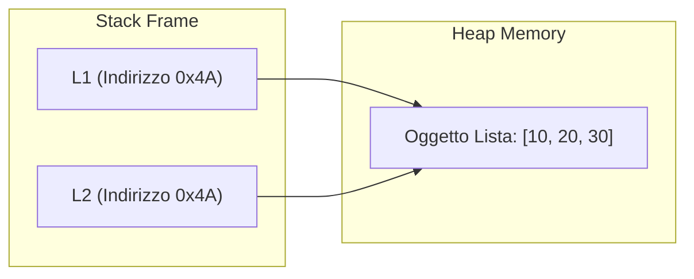

[[Home MOC|Home]] / [[Education & Learning]] / [[University]] / [[Lezione 9 - Liste Sequenze Mutabili e Operazioni]]

# Lezione 9 - Liste Sequenze Mutabili e Operazioni

## Sintesi Esecutiva
Mentre le stringhe (esaminate in [[Lezione 3 - Stringhe Metodi e Slicing]]) costituiscono collezioni ordinate ma rigidamente immutabili ed omogenee di caratteri testuali, la modellazione di scenari computazionali complessi richiede strutture dati dinamiche capaci di evolvere durante l'esecuzione del programma. Questa nona lezione didattica (Sapienza Università di Roma, DIAG — a cura dei proff. D. Lembo, A. Poggi, G. Santucci e M. Schaerf) formalizza la struttura dati fondamentale delle <mark style="background:rgba(255, 193, 69, 0.32)"><font color="#cc8800"><b>liste in Python</b></font></mark>. Vengono approfondite le quattro proprietà cardinali delle liste: l'ordinamento sequenziale per indice, la <mark style="background:rgba(255, 193, 69, 0.32)"><font color="#cc8800"><b>mutabilità in-place</b></font></mark>, l'eterogeneità degli elementi ospitati e la loro ordinabilità intrinseca. La trattazione sviluppa la teoria del modello a riferimenti di memoria, sviscerando il fenomeno dell'<mark style="background:rgba(181, 113, 255, 0.36)"><font color="#9a54c1"><b>aliasing</b></font></mark> e la differenza sostanziale tra semplice condivisione di puntatori, <mark style="background:rgba(181, 113, 255, 0.36)"><font color="#9a54c1"><b>copia superficiale (shallow copy)</b></font></mark> e copia profonda (deep copy). Vengono infine catalogati i metodi nativi di manipolazione e risolti 4 problemi algoritmici collaudati tramite `tester_fun`.

---

## Anatomia delle Liste: Proprietà e Creazione

Una lista in Python è una sequenza posizionale finita e mutabile di elementi.

### Le 4 Caratteristiche Cardine
1. **Ordinamento e Accesso Posizionale:** Ogni elemento occupa una posizione (*indice*) univoca determinata a partire da $0$ fino a $n-1$ (indicizzazione positiva) oppure da $-1$ a $-n$ (indicizzazione negativa da destra verso sinistra).
2. **Mutabilità:** Gli elementi possono essere modificati, aggiunti, rimpiazzati o cancellati direttamente in memoria senza dover riallocare l'intera sequenza.
3. **Eterogeneità:** Una lista può contenere dati di qualsiasi tipo primitivo o strutturato (`int`, `float`, `str`, `bool`, altre liste o oggetti misti).
4. **Ordinabilità:** Se gli elementi interni sono reciprocamente confrontabili (ad esempio tutti numeri o tutte stringhe), la lista può essere ordinata in senso crescente o decrescente.

### Creazione e Valutazione Dinamica
Le liste sono racchiuse tra parentesi quadre `[...]` con elementi separati da virgole:

```python
# Lista omogenea di interi
L1 = [2, 4, 6, 7]

# Lista omogenea di stringhe
L2 = ['casa', 'palla', 'strada']

# Lista eterogenea (tipi disomogenei)
L3 = ['casa', -7.5, 'a', 33]

# Valutazione di espressioni al momento della creazione
x = 2
y = -5
L4 = [x, y ** 2 + 1, x == 3]  # Risulta: [2, 26, False]
```

### Iterazione su Liste
L'attraversamento degli elementi può essere condotto secondo due paradigmi:

```python
# 1. Iterazione diretta per elementi (Value-based loop)
for elem in L3:
    print(elem)

# 2. Iterazione per indici (Index-based loop)
for i in range(len(L3)):
    print(i, L3[i])
```

---

## Operatori sulle Liste

| Operatore / Sintassi | Descrizione Semantica | Complessità Temporale |
| :--- | :--- | :--- |
| `L1 == L2` | Confronto di uguaglianza strutturale profonda | $O(n)$ |
| `L1 != L2` | Disuguaglianza strutturale | $O(n)$ |
| `elem in L` | Verifica di appartenenza (restituisce `True` o `False`) | $O(n)$ |
| `elem not in L`| Verifica di non appartenenza | $O(n)$ |
| `L1 + L2` | Concatenazione: genera una **nuova lista** con tutti gli elementi | $O(n_1 + n_2)$ |
| `L * k` | Replica: crea una nuova lista replicando gli elementi $k$ volte | $O(k \cdot n)$ |
| `L[i]` | Indicizzazione posizionale (lettura o scrittura) | $O(1)$ |
| `L[i:j]` | Slicing: crea una nuova sottolista dall'indice $i$ a $j-1$ | $O(j - i)$ |

### Semantica di Uguaglianza (`==`)
Due liste $L_1$ ed $L_2$ sono considerate uguali se e solo se:
$$\text{len}(L_1) == \text{len}(L_2) \quad \land \quad \forall i \in [0, \text{len}(L_1)-1]: L_1[i] == L_2[i]$$

```python
LL1 = [1, 2, 'pippo']
LL2 = [1, 1 + 1, 'pippo']  # True: le espressioni producono valori identici
LL3 = [1.0, 2, 'pippo']    # True: 1 == 1.0 produce True in Python
LL4 = ['1', 2, 'pippo']    # False: il tipo str '1' è diverso da int 1
```

---

## Mutabilità in-place vs Immutabilità

Nelle stringhe ogni operazione che sembra modificarne il contenuto restituisce in realtà una *nuova* stringa, poiché le stringhe sono oggetti immutabili. Nelle liste, l'operatore di indicizzazione a sinistra dell'assegnazione permette la modifica distruttiva sul posto:

```python
lista = ['a', 'b', 'c', 'd']
lista[1] = 'B_MODIFICATO'
print(lista)  # ['a', 'B_MODIFICATO', 'c', 'd']
```

---

## Variabili, Modello a Riferimenti ed Aliasing

> [!CAUTION] Il Pericolo dell'Aliasing (Condivisione di Riferimento)
> In Python una variabile che memorizza una lista non contiene fisicamente la sequenza degli elementi, bensì **un riferimento (puntatore) all'area di memoria** allocata nell'Heap.
> L'operazione `L2 = L1` **NON clona la lista**: copia unicamente il riferimento! Entrambe le variabili puntano al medesimo oggetto.



```python
L1 = [1, 2, 3]
L2 = L1  # Aliasing! Condivisione dello stesso oggetto
L2[0] = 999
print(L1)  # Stampa [999, 2, 3]! Anche L1 risulta modificata!
print(id(L1) == id(L2))  # True
```

### Copia Superficiale (*Shallow Copy*)
Per creare una replica indipendente al primo livello, occorre richiedere esplicitamente una copia:
1. Metodo `.copy()`: `L2 = L1.copy()`
2. Slicing completo: `L2 = L1[:]`
3. Costruttore: `L2 = list(L1)`

```python
L1 = [1, 2, 3]
L2 = L1.copy()
L2[0] = 999
print(L1)  # [1, 2, 3] (Intatta!)
print(L2)  # [999, 2, 3]
print(id(L1) == id(L2))  # False
```

---

## Catalogo Completo dei Metodi per le Liste

| Metodo | Firma | Descrizione e Comportamento | Valore di Ritorno |
| :--- | :--- | :--- | :--- |
| `append` | `L.append(x)` | Accoda l'elemento $x$ alla fine della lista | `None` |
| `insert` | `L.insert(i, x)` | Inserisce $x$ all'indice $i$, traslando a destra gli elementi successivi | `None` |
| `extend` | `L.extend(iter)` | Concatena in-place tutti gli elementi dell'iterabile `iter` | `None` |
| `pop` | `L.pop([i])` | Rimuove ed estrae l'elemento all'indice $i$ (default: l'ultimo elemento) | Elemento estratto |
| `remove` | `L.remove(x)` | Cancella la **prima occorrenza** del valore $x$ (solleva `ValueError` se assente) | `None` |
| `index` | `L.index(x)` | Restituisce la posizione della prima occorrenza di $x$ | Intero (indice) |
| `count` | `L.count(x)` | Conta quante volte il valore $x$ compare nella lista | Intero |
| `sort` | `L.sort()` | Ordina la lista in-place (algoritmo Timsort) | `None` |
| `reverse`| `L.reverse()` | Inverte l'ordine degli elementi in-place | `None` |

### Esempio di Utilizzo Metodi:
```python
l = [10, 20, 30]
l.append(40)       # [10, 20, 30, 40]
l.insert(1, 15)    # [10, 15, 20, 30, 40]
estratto = l.pop() # estratto = 40, l = [10, 15, 20, 30]
l.remove(15)       # [10, 20, 30]
l.reverse()        # [30, 20, 10]
l.sort()           # [10, 20, 30]
```

> [!NOTE] Ordinamento di Caratteri in una Stringa con `list()` e `.sort()`
> Poiché le stringhe non possiedono un metodo `.sort()`, la strategia canonica consiste nel convertirle temporaneamente in liste di caratteri, ordinarle ed infine ricomporle:

```python
def ordinaStringa(s):
    l = list(s)     # Converte la stringa in lista di singoli caratteri
    l.sort()        # Ordina la lista in ordine alfabetico (codici Unicode)
    ris = ''
    for char in l:
        ris += char
    return ris

print(ordinaStringa('mamma'))  # 'ammm'
```

---

## Risoluzione Dettagliata degli Esercizi con `tester_fun`

### Esercizio 1: Elemento Più Frequente in una Lista (`maxfrequenza`)
**Testo:** Scrivere una funzione che prende in ingresso una lista non vuota $l$ e restituisce l'elemento più frequente. Se più elementi compaiono lo stesso numero di volte, restituire quello che compare più all'inizio della lista.

```python
from tester import tester_fun

def maxfrequenza(l):
    ris = l[0]
    maxfreq = l.count(l[0])
    
    for el in l:
        # Se la frequenza dell'elemento corrente supera strettamente il massimo precedente
        if l.count(el) > maxfreq:
            ris = el
            maxfreq = l.count(el)
            
    return ris

tester_fun(maxfrequenza, [[1, 2, 3, 4, 2, 3, 2]], 2)
tester_fun(maxfrequenza, [[1, 2, 3, 4, 2, 3, 2, 'alfa', 1, 1]], 1)
tester_fun(maxfrequenza, [[1, 2, 3, 4, 2, 3, 'alfa', 'a', 'a', 1, 'a']], 'a')
tester_fun(maxfrequenza, [['a', 1]], 'a')
tester_fun(maxfrequenza, [[1]], 1)
```

---

### Esercizio 2: Filtro Sottostringa ed Ordinamento Alfabetico (`listaContiene`)
**Testo:** Scrivere una funzione che riceve in ingresso una lista $l$ di stringhe ed una stringa $s$ e restituisce la lista composta da tutti gli elementi di $l$ che contengono $s$, ordinata alfabeticamente.

```python
from tester import tester_fun

def listaContiene(l, s):
    ris = []
    for el in l:
        if s in el:
            ris.append(el)
    ris.sort()
    return ris

tester_fun(listaContiene, [['casa', 'sala', 'pasta', 'prosciutto'], 'sa'], ['casa', 'sala'])
tester_fun(listaContiene, [['casa', 'sala', 'pasta', 'prosciutto'], 'a'], ['casa', 'pasta', 'sala'])
tester_fun(listaContiene, [['casa', 'saluti', 'sala', 'pasta', 'prosciutto'], 'sa'], ['casa', 'sala', 'saluti'])
tester_fun(listaContiene, [['casa', 'sala', 'pasta', 'prosciutto'], 'se'], [])
tester_fun(listaContiene, [['salto', 'casa', 'sala', 'pasta', 'prosciutto'], 'sa'], ['casa', 'sala', 'salto'])
```

---

### Esercizio 3: Selezione Posizionale con Indici Ammissibili (`listaSelezioni`)
**Testo:** Scrivere una funzione che riceve una lista $ls$ di stringhe ed una lista $ln$ di numeri e restituisce una nuova lista contenente le stringhe di $ls$ alle posizioni indicate in $ln$, nell'ordine di $ln$. Gli indici non validi (esterni all'intervallo $[-\text{len}(ls), \text{len}(ls)-1]$) vanno scartati.

```python
from tester import tester_fun

def listaSelezioni(ls, ln):
    ris = []
    n = len(ls)
    for idx in ln:
        # Controllo di validità sia per indici positivi che negativi ammessi da Python
        if -n <= idx < n:
            ris.append(ls[idx])
    return ris

tester_fun(listaSelezioni, [['casa', 'sala', 'pasta', 'prosciutto'], [2, 3, 0]], ['pasta', 'prosciutto', 'casa'])
tester_fun(listaSelezioni, [['casa', 'sala', 'pasta', 'prosciutto'], [2, 7, -1]], ['pasta', 'prosciutto'])
tester_fun(listaSelezioni, [['casa', 'saluti', 'sala', 'pasta', 'prosciutto'], [2, -3, 0, 6]], ['sala', 'sala', 'casa'])
tester_fun(listaSelezioni, [['casa', 'sala', 'pasta', 'prosciutto'], [0, -5, -4, 0]], ['casa', 'casa', 'casa'])
tester_fun(listaSelezioni, [['salto', 'casa', 'sala', 'pasta', 'prosciutto'], [-1, 3, 3, -7]], ['prosciutto', 'pasta', 'pasta'])
```

---

### Esercizio 4: Confronto dei Caratteri Iniziali (`contaIniziali`)
**Testo:** Scrivere una funzione che riceve due liste di stringhe $l_1$ ed $l_2$ e restituisce il numero di volte in cui le stringhe nella stessa posizione hanno il medesimo carattere iniziale (ignorando le stringhe vuote).

```python
from tester import tester_fun

def contaIniziali(l1, l2):
    ris = 0
    # Limita l'esame alla lunghezza della lista più corta
    lunghezza_minima = min(len(l1), len(l2))
    
    for i in range(lunghezza_minima):
        s1 = l1[i]
        s2 = l2[i]
        if s1 != '' and s2 != '' and s1[0] == s2[0]:
            ris += 1
            
    return ris

tester_fun(contaIniziali, [['casa', 'sala', 'pasta', 'prosciutto'], ['sala', 'pasta', 'prosciutto', 'casa', 'saluti']], 1)
tester_fun(contaIniziali, [['casa', 'sala', 'pasta', 'prosciutto'], ['pasta', 'palla', 'prosciutto']], 1)
tester_fun(contaIniziali, [['casa', 'saluti', 'sala', 'pasta', 'prosciutto'], ['casa', 'sala', 'pasta', 'prosciutto']], 3)
tester_fun(contaIniziali, [['sala', 'pasta', 'prosciutto'], ['casa', 'casa', 'casa']], 0)
tester_fun(contaIniziali, [['salto', 'casa', 'sala', 'pasta', 'prosciutto'], ['casa', '', 'sala', 'pasta', 'prosciutto']], 3)
```
